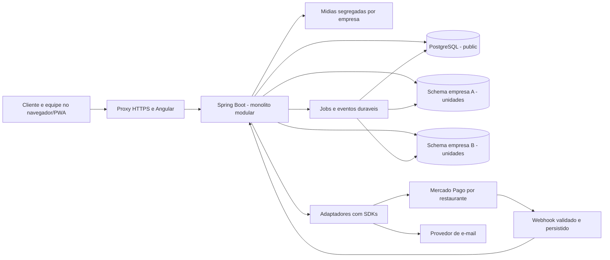

# Arquitetura

> **Escopo:** desenho do monólito, módulos, camadas e reutilização dos projetos de referência.
> **Situação:** especificação para implementação. Decisões confirmadas e premissas propostas seguem o [registro central](00_PROJECT_VISION.md); não representam funcionalidades já disponíveis.

[Índice da documentação](README.md)

## Desenho proposto



Um backend atende todas as empresas. Separação de módulos é organização de código, não processos independentes. API, jobs e eventos podem começar no mesmo processo, com persistência no PostgreSQL. Redis, RabbitMQ, Kafka e microserviços não são dependências iniciais.

## Organização de código

Estrutura futura proposta; estas pastas ainda não representam código existente:

```text
restaurant-manager/
  README.md
  AGENTS.md
  docs/
    README.md
    00_PROJECT_VISION.md ... 26_TEST_STRATEGY.md
    REFERENCES.md
    adr/
  backend/
    src/main/java/<pacote-base>/
      plataforma/
      tenancy/
      identidade/
      acessos/
      catalogo/
      mesas/
      pedidos/
      cozinha/
      entrega/
      pagamentos/
      notificacoes/
      auditoria/
      shared/
    src/main/resources/db/migration/
      public/
      tenant/
    src/test/
  frontend/
    src/app/
      core/
      shared/
      features/
  scripts/
```

Cada módulo usa controllers, services, repositories, DTOs, entidades e mappers quando necessários. Não criar classes vazias só para preencher camadas. `shared` contém apenas elementos transversais demonstrados, não regras de pedido misturadas a helpers genéricos. Leituras complexas podem ter consultas/projeções específicas, sem impor a nomenclatura ou heranças do Django.

Controller trata transporte e validação estrutural. Service recebe um contexto autenticado, autoriza a ação sobre o recurso, aplica a regra e delimita a transação. Repository consulta/persiste. Mapper converte dados sem consultas ocultas. Adaptadores encapsulam provedores. Operações entre módulos usam serviços explícitos; não consultar livremente tabelas internas de outro módulo para contornar invariantes.

## Reutilização das referências

| Origem | Aproveitar | Adaptar ao novo domínio |
| --- | --- | --- |
| Loja-virtual | Camadas Java/Spring, DTOs, exceções próprias, migrations, contratos da API, gateways, idempotência e reconciliação | Pedidos de comida, atendimento na mesa, multiempresa, refresh/revogação e permissões dinâmicas |
| Schools | Schema por empresa, contexto de tenant, perfis fixos configuráveis, proteção do administrador e auditoria | Implementação Java, unidades por funcionário e ações financeiras/operacionais além de CRUD |

Reutilização significa aproveitar princípios e padrões compreensíveis. Não copiar credenciais, dados, código obsoleto ou regras de frete de mercadorias/escola. Este projeto terá seus próprios bancos, migrações e testes. Não incorporar o antigo ReservasRestaurantes.

## Documentos relacionados

- [Regras de engenharia](03_ENGINEERING_RULES.md)
- [Isolamento por empresa](06_MULTI_TENANT.md)
- [Integrações](21_INTEGRATIONS.md)
- [Ambientes e operação](22_PRODUCTION_RUNBOOK.md)
