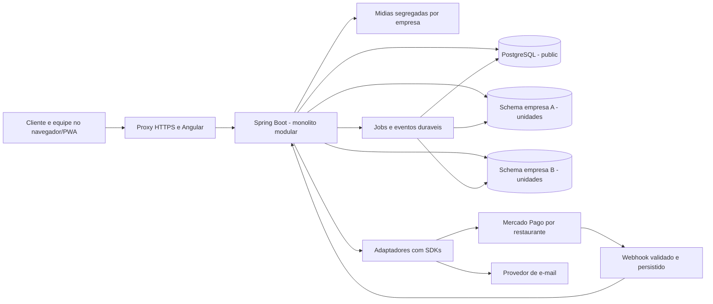

# Arquitetura

> **Escopo:** desenho do monólito, módulos, camadas e reutilização dos projetos de referência.
> **Situação:** especificação para implementação. Decisões confirmadas e premissas propostas seguem o [registro central](00_PROJECT_VISION.md); não representam funcionalidades já disponíveis.

[Índice da documentação](README.md)

## Desenho proposto



Um backend atende todas as empresas. Separação de módulos é organização de código, não processos independentes. API, jobs e eventos podem começar no mesmo processo, com persistência no PostgreSQL. Redis, RabbitMQ, Kafka e microserviços não são dependências iniciais.

## Organização de código

Estrutura da implementação local, incluindo os domínios da Sprint 4 local:

```text
restaurant-manager/
  README.md
  AGENTS.md
  docs/
    README.md
    00_PROJECT_VISION.md ... 26_TEST_STRATEGY.md
    REFERENCES.md
    adr/
  backend/
    src/main/java/br/com/restaurantmanager/
      plataforma/
      tenancy/
      identidade/
      unidades/
      catalogo/
        controllers/
        services/
        models/
        repositories/
        dtos/
      carrinho/
      midia/
      pedidos/
      mesas/
      cozinha/
      financeiro/
      delivery/
      pagamentos/
      comunicacoes/
      relatorios/
      eventos/
      shared/
    src/main/resources/db/migration/
      public/
      tenant/
    src/test/
  frontend/
    src/app/
      identidade/
      acessos/
      unidades/
      plataforma/
      catalogo/
      carrinho/
      pwa/
      pedidos/
      mesas/
      cozinha/
      financeiro/
      delivery/
      pagamentos/
      relatorios/
      eventos/
  scripts/
```

A política de acessos do backend permanece em `identidade`; o frontend possui
seu próprio domínio `acessos`. Preservar essa organização. O desenho inicial de
`core/shared/features` não exige mover componentes existentes.

Na Sprint 2, horários e canais ampliam `unidades`; `catalogo` concentra
cadastro, ofertas e favoritos; `carrinho` calcula a composição por meio do
serviço público do catálogo; `midia` publica imagens normalizadas. No frontend,
`pwa` controla instalação, conexão e atualização do shell. A persistência de
mídia segue o [ADR 0002](adr/0002-midia-publica-transacional.md). Na Sprint 3 local, `pedidos` possui snapshots, unidades de produção e transições;
`cozinha` oferece o KDS sem duplicar essa persistência; `mesas` possui atendimentos,
participantes e estado da comanda; `financeiro` possui cobranças/ajustes/saldos;
`eventos` publica fatos persistidos. Serviços de caso de uso coordenam serviços de
agregado, que não injetam os orquestradores. Na Sprint 4, `delivery` possui regiões, endereços pessoais e ocorrências;
`financeiro` possui ledger de recebimentos e reservas/devoluções; `pagamentos`
isola OAuth, checkout, inbox e adaptador do provedor; `comunicacoes` possui outbox
e captura; `relatorios` contém projeção somente de leitura dos fatos financeiros.
Mutações entre domínios passam por serviços. Projeções de relatório/fila podem
ler tabelas de outros domínios sem alterar suas invariantes. Componentes, serviços e tipos Angular ficam
próximos no domínio correspondente, conforme os [padrões de código](10_CODING_STANDARDS.md#legibilidade-e-organização-angular).

Cada módulo separa suas camadas em pacotes `controllers`, `services`,
`models`, `repositories` e `dtos`, como ilustrado em catálogo. Criar somente
as camadas que possuem implementação: carrinho, por exemplo, ainda não possui
repositório. Configurações, filtros, jobs, comandos e infraestrutura permanecem
no módulo responsável, em pacotes próprios. Mappers existem quando necessários;
não criar classes vazias só para preencher camadas. `shared` contém apenas
elementos transversais demonstrados, não regras de pedido misturadas a helpers
genéricos. Leituras complexas podem ter consultas/projeções específicas, sem
impor a nomenclatura ou heranças do Django. Os detalhes de imports, DTOs e
encapsulamento ficam nos [padrões Java](10_CODING_STANDARDS.md#legibilidade-e-organização-java).

Controller trata transporte e validação estrutural. Service recebe um contexto autenticado, autoriza a ação sobre o recurso, aplica a regra e delimita a transação. Repository consulta/persiste. Mapper converte dados sem consultas ocultas. Adaptadores encapsulam provedores. Operações entre módulos usam serviços explícitos; não consultar livremente tabelas internas de outro módulo para contornar invariantes.

## Reutilização das referências

| Origem | Aproveitar | Adaptar ao novo domínio |
| --- | --- | --- |
| Loja-virtual | Camadas Java/Spring, DTOs, exceções próprias, migrations, contratos da API, gateways, idempotência e reconciliação | Pedidos de comida, atendimento na mesa, multiempresa, refresh/revogação e permissões dinâmicas |
| Schools | Schema por empresa, contexto de tenant, perfis fixos configuráveis, proteção do administrador e auditoria | Implementação Java, unidades por funcionário e ações financeiras/operacionais além de CRUD |

Reutilização significa aproveitar princípios e padrões compreensíveis. Não copiar credenciais, dados, código obsoleto ou regras de frete de mercadorias/escola. Este projeto terá seus próprios bancos, migrações e testes. Não incorporar o antigo ReservasRestaurantes.

## Documentos relacionados

- [Regras de engenharia](03_ENGINEERING_RULES.md)
- [Isolamento por empresa](06_MULTI_TENANT.md)
- [Integrações](21_INTEGRATIONS.md)
- [Ambientes e operação](22_PRODUCTION_RUNBOOK.md)
