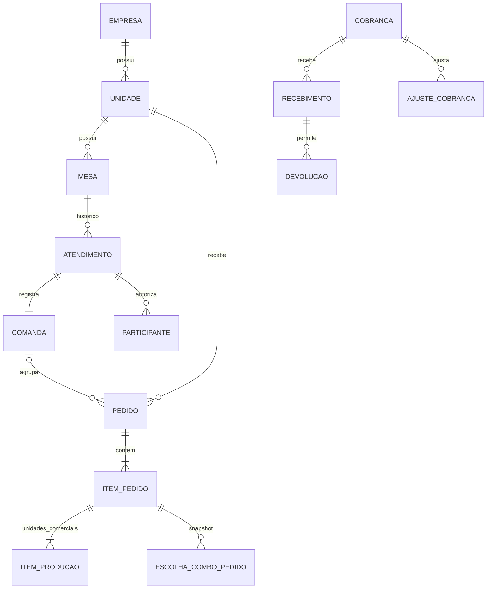

# Banco de dados

> **Escopo:** modelo conceitual, relações, integridade, persistência e disciplina de migrações.
> **Situação:** especificação para implementação. Decisões confirmadas e premissas propostas seguem o [registro central](00_PROJECT_VISION.md); não representam funcionalidades já disponíveis.

[Índice da documentação](README.md)

Modelo conceitual proposto. Tipos SQL, índices e nomes finais serão refinados por sprint; não é uma migration executável.

## Contexto da plataforma (`public`)

| Entidade | Responsabilidade / restrições |
| --- | --- |
| EmpresaTenant | ID imutável, nome do schema interno único, estado, versão provisionada e referência comercial |
| DominioTenant | Domínio normalizado e único, vínculo à empresa e situação de validação |
| UsuarioPlataforma / SessaoPlataforma | Acesso exclusivo à administração SaaS, separado de usuários empresariais |
| Provisionamento | Etapas, idempotência, falhas sanitizadas e retomada |
| AssinaturaSaaS | Situação comercial; não recebe vendas dos restaurantes |
| RotaIntegracao | Mapeamento mínimo de conta/recurso do provedor para tenant; sem expor credenciais ou histórico de consumo |
| AuditoriaPlataforma | Ações sobre provisionamento, domínio e estado da empresa |

## Contexto de cada empresa

| Grupo | Entidades principais | Invariantes |
| --- | --- | --- |
| Organização | Unidade, ConfiguracaoUnidade, HorarioFuncionamento | Configuração versionada; fuso, canais, prazos e região explícitos |
| Identidade | Usuario, Credencial, PerfilFixo, UsuarioUnidade, Sessao, TokenUsoUnico | E-mail normalizado único no tenant; tokens de recuperação/refresh protegidos e revogáveis |
| Acessos | PermissaoPerfil, VersaoPolitica | Ações conhecidas; Administrador protegido; sem sobrescrever configurações via seed |
| Clientes | Cliente, Endereco, Favorito | Pertencem ao cliente/tenant; snapshot do endereço no pedido |
| Catálogo | Categoria, Produto, Midia, ProdutoUnidade, GrupoAdicional, OpcaoAdicional, Combo, GrupoEscolhaCombo, OpcaoCombo | Limites por unidade comercial, opções/adicionais permitidos, preço base/acréscimos não negativos, disponibilidade por unidade |
| Salão | Mesa, Atendimento, ParticipanteMesa, Comanda, SolicitacaoAtendimento | Um atendimento ativo por mesa; participante vinculado à sessão; consumo histórico preservado |
| Pedidos | Pedido, ItemPedido, EscolhaComboPedido, AdicionalPedido, HistoricoPedido, SolicitacaoCancelamento | Canal/unidade/coerência de mesa, autoria, snapshot completo de escolhas/preços, quantidade original, primeiro preparo imutável, prazos e versão |
| Produção | ItemProducao, EventoProducao | Um item por unidade comercial da linha, inclusive combo completo; quantidade de registros coerente com a original, estados e cancelamentos rastreáveis |
| Entrega | RegiaoEntrega, Entrega, OcorrenciaEntrega | Faixas sem ambiguidade ou prioridade explícita; taxa e endereço históricos |
| Financeiro | Cobranca, AjusteCobranca, AlocacaoAjuste, Recebimento, TentativaPagamento, Devolucao | Cobrança de pedido externo ou comanda, sem duplicar rodadas; ajustes comerciais alocados a unidades/taxa e cancelamento limitado ao remanescente; valores e vínculos imutáveis após confirmação |
| Integrações | ContaPagamento, EventoProvedor, TentativaExterna | Credenciais cifradas no servidor, referência externa única no contexto correto, deduplicação |
| Comunicação | Notificacao, EventoSaida, TentativaEnvio | Destinatário autorizado, correlação e retry durável |
| Operação | Idempotencia, TrabalhoAgendado, Auditoria | Contexto explícito, unicidade, lease e registro de resultado |

Relações centrais:

`EMPRESA` no diagrama representa a fronteira de tenancy; não propõe joins livres entre schemas. Cobrança pertence **ou** a pedido de delivery/retirada **ou** à comanda. Rodadas de mesa não geram dívida financeira duplicada. Essa exclusividade precisa de constraint e teste.

Escolhas de combo são snapshots vinculados à configuração da linha; não são novas cobranças nem unidades de cancelamento. Linhas com configurações diferentes não compartilham snapshot mutável. A produção de uma linha com quantidade 3 permite três unidades rastreáveis; cancelar uma mantém a quantidade original e o histórico das outras. As regras de preço, preparo e agregação estão em [Regras de negócio](20_BUSINESS_RULES.md#quantidades-e-preparo).

## Regras de persistência

- IDs opacos/UUIDs são propostos, mas não substituem autorização. Consultar ID alheio não deve revelar existência ou dados.
- Valores monetários em decimal com moeda e regra de arredondamento explícitas; quantidade não negativa, limites de campo e FKs verificadas no banco.
- Versionar agregados editáveis. Índices devem atender fila por unidade/estado/prazo, comanda aberta, referências externas e busca paginada.
- Restringir unicidade de evento/tentativa por provedor, conta e identificador relevante; eventos sem ID estável exigem estratégia documentada.
- Guardar histórico de transições e ajustes com ator, instante, motivo e correlação. Ocultar ou desativar cadastro não remove histórico financeiro.
- Armazenar hash de segredo de recuperação/sessão quando não for necessário recuperar seu valor; tokens de provedor que precisam ser reutilizados exigem cifragem e chave externa ao banco.
- Separar dados fictícios de dados reais. Retenção, anonimização e exclusão serão definidas com responsáveis antes do piloto, preservando os registros necessários conforme o processo aplicável.

## Persistência da Sprint 2

V13 acrescenta funcionamento/horários da unidade. V14 acrescenta categorias,
produtos, ofertas, favoritos, revisão e auditoria do catálogo. Adicionais e
grupos/opções são configuração JSONB do agregado Produto: limites estruturais
no banco, validação de referências e dinheiro no serviço sob lock de escrita,
sem exclusão física de componentes. Preço da oferta é `numeric(8,2)`.

V15 publica mídia imutável em `bytea`, com tamanho/hash, cota e auditoria na
mesma transação. V16 liga produto e mídia por FK no próprio schema. A escolha
e seus limites estão no [ADR 0002](adr/0002-midia-publica-transacional.md).
Cotação usa snapshot PostgreSQL consistente e devolve composição/valores;
persistência do pedido pertence ao incremento abaixo.

## Persistência da Sprint 3

V17 acrescenta mesas, atendimentos, comandas, participantes, sessões próprias e
solicitações. Índice parcial impede dois atendimentos ativos na mesma mesa;
comanda é única por atendimento. V21 preserva ator e nome originais da intenção
de criação da mesa, inclusive após editar o cadastro.

V18 acrescenta pedidos, snapshots JSONB, unidades comerciais de produção,
histórico, comandos idempotentes, solicitações de cancelamento, parâmetros de
aceite e cobrança/parcelas/ajustes. Histórico, comandos e ajustes não admitem
UPDATE pela role de runtime. A cobrança de mesa pertence à comanda; rodadas
somam parcelas sem criar outra dívida. Recebimentos e devoluções permanecem
contratos para a Sprint 4; valores anteriores nos testes são fixtures explícitas.

V19 acrescenta streams e eventos operacionais persistidos. Cada stream usa um
contador transacional bloqueado até o commit, evitando avançar o cursor sobre
uma transação ainda invisível. Streams distinguem operação por unidade,
cliente, participante e comanda; o evento compartilhado da comanda não expõe o
identificador da rodada alheia.

V20 acrescenta trabalhos de prazo com lease, tentativas, próximo processamento
e falha sanitizada. O agendamento acompanha a criação do pedido na mesma
transação. Vencimentos e alertas são reavaliados sob lock do pedido; eventos,
histórico e ajustes confirmam juntos. Regras de retomada ficam em
[Integrações](21_INTEGRATIONS.md).

## Dados, testes e migrações

- Use PostgreSQL real nos testes que comprovam schema, constraints, locks e concorrência. Mocks não demonstram isolamento ou homologação financeira.
- Use bancos exclusivos de desenvolvimento e testes, com trava contra execução destrutiva em outro banco. Não reinicie nem altere bancos de outros projetos.
- Migrações versionadas, separadas para `public` e tenants. Não reescreva migração já aplicada em ambiente compartilhado; acrescente a correção e documente recuperação.
- Provisionamento só ativa a empresa após concluir schema, migrações, configuração e administrador. Falhas devem ser retomáveis e visíveis.
- Não apague pedidos, recebimentos, devoluções ou auditoria para corrigir histórico; registre cancelamentos/ajustes rastreáveis. Política de retenção precisa respeitar as dependências definidas no projeto.

## Documentos relacionados

- [Tenancy e provisionamento](06_MULTI_TENANT.md)
- [Invariantes financeiras](20_BUSINESS_RULES.md)
- [Transações e concorrência](03_ENGINEERING_RULES.md#transacoes-e-recuperacao)
- [Backup e restauração](22_PRODUCTION_RUNBOOK.md#backups-e-continuidade)
