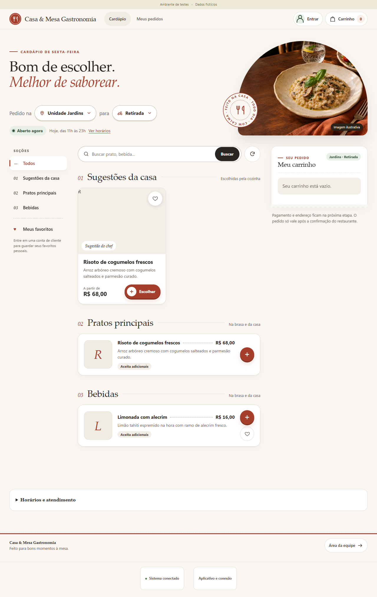
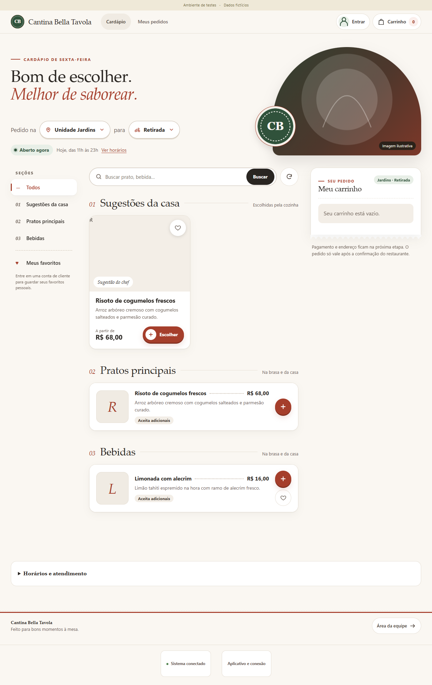
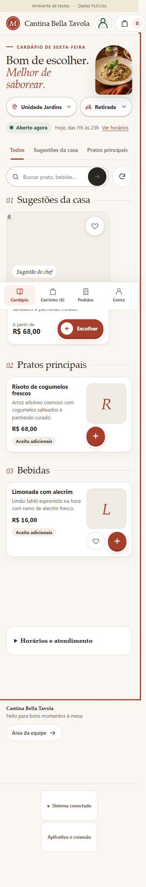
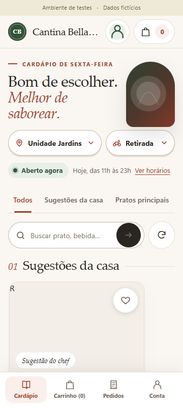

# Relatório Visual — Vitrine `/cardapio`, Comanda e Identidade Multi-Tenant

- **Data:** 2026-11-14
- **Área:** Cliente (`/cardapio`, `/carrinho`, shell `ClienteLayoutComponent`)
- **Escopo:** Estritamente camada visual (`.html`, `.css` e uso visual do `MarcaService` em template; nenhuma alteração em backend, serviços, rotas, modelos ou contratos de API).
- **Documentos consultados:** [Interface/PWA](../../09_UI_GUIDELINES.md), [Padrões de código](../../10_CODING_STANDARDS.md), [Definition of Done](../../12_DEFINITION_OF_DONE.md), [ADR 0003 — Spartan UI](../../adr/0003-spartan-navegacao-por-area.md).

---

## 1. Como era antes

Antes desta consolidação e limpeza final multi-tenant:

1. **Identidade fixa no cabeçalho e hero:**
   - Em `frontend/src/app/rotas/cliente-layout.css`, `.brand-mark app-icone` estava oculto (`display: none;`) e `.brand-mark::after` injetava `content: 'M';` fixo em CSS por cima de qualquer imagem `` ou do ícone neutro de garfo e faca (`<app-icone nome="marca" />`).
   - Em `frontend/src/app/catalogo/vitrine.component.html`, o selo circular decorativo (`.stamp`) renderizava `<text ...>M</text>` estático, e `.arch` em `vitrine.css` apontava exclusivamente para `/assets/bistro-banner.jpg` sem variável CSS para `bannerUrl` dinâmico do restaurante ativo.
2. **Estouro horizontal com nomes longos em celular e tablet:**
   - Em `360×800` e `768×1024`, `.restaurant-brand` com `flex: none` e sem truncamento de texto empurrava os controles da direita (`.header-actions`) além da largura da janela (`scrollWidth = 430` em `360px` com nome de tenant extenso; `scrollWidth = 839` em `768px`), além de alvos de navegação em `44px` no cabeçalho/rodapé.
3. **Alinhamento histórico da vitrine e comanda:**
   - A experiência de vitrine em `/cardapio` já havia recebido a estética de papelaria editorial linho/carvão/terracota/sálvia (com guias pontilhadas entre prato e preço, configurador de produto em `<dialog>` e talão lateral de comanda), restando a padronização multi-tenant completa para atender múltiplos estabelecimentos (pizzarias, hamburguerias, bistrôs e casas gastronômicas).

---

## 2. Representação visual — Antes × Depois

Capturas sanitizadas do build AOT real (`frontend/dist/restaurant-manager/browser`) em Microsoft Edge com dados fictícios (zero dados pessoais):

### 2.1. Identidade padrão sem logo configurado (Desktop `1280×900`)

| Antes (`'M'` estático cobrindo o cabeçalho e o selo hero) | Depois (emblema neutro universal de garfo e faca) |
| --- | --- |
|  |  |

### 2.2. Restaurante com marca própria (`logoUrl` + `bannerUrl` — Desktop `1280×900`)

| Antes (marca dinâmica ignorada, `'M'` mantido) | Depois (`logoUrl` no cabeçalho e selo + `--rm-hero-banner`) |
| --- | --- |
|  |  |

### 2.3. Responsividade em celular (`360×800`)

| Antes (estouro horizontal no cabeçalho + `'M'` fixo) | Depois (truncamento seguro, `scrollWidth === 360px` e barra fixa inferior) |
| --- | --- |
|  |  |

---

## 3. O que foi alterado

| Aspecto | Antes | Depois |
| --- | --- | --- |
| Selo da marca no cabeçalho (`cliente-layout.css`) | `.brand-mark::after { content: 'M'; }` cobrindo o selo e `<app-icone nome="marca">` oculto com `display: none` | Remoção completa de `::after { content: 'M' }` e `display: none`; `.brand-mark` com `overflow: hidden` exibe `` em `object-fit: cover` quando há `marca.logoUrl()`, ou `<app-icone nome="marca">` centralizado no fallback |
| Responsividade do cabeçalho multi-tenant (`cliente-layout.css`) | `.restaurant-brand { flex: none }` causava overflow horizontal em `360px` e `768px` com nomes longos | `.restaurant-brand` com `min-width: 0; flex: 0 1 auto`, truncamento com reticências em `.restaurant-brand > span:last-child`, `.header-actions { flex: none }`, ajustes em `max-width: 900px` e `max-width: 680px` e `min-height: 48px` nos links e ícones |
| Banner do hero (`vitrine.component.html`, `vitrine.css`) | Imagem única fixa `url('/assets/bistro-banner.jpg')` | `[style.--rm-hero-banner]="marca.bannerCss()"` em `.mast-photo .arch` com `background: var(--rm-hero-banner, url('/assets/bistro-banner.jpg')) 70% 50% / cover no-repeat` |
| Selo circular do hero (`vitrine.component.html`, `vitrine.css`) | SVG fixo com letra `<text ...>M</text>` no centro | `@if (marca.logoUrl() && !marca.erroLogo())` renderiza `.stamp.stamp--logo img` circular com fallback em `(error)="marca.marcarErroLogo()"`; `@else` renderiza o selo SVG *"FEITO NA CASA · TODO DIA · COM CALMA ·"* com o emblema neutro de garfo e faca centralizado (`#a53e2b`) |

### Arquivos modificados nesta entrega

- [cliente-layout.css](../../../frontend/src/app/rotas/cliente-layout.css)
- [vitrine.component.html](../../../frontend/src/app/catalogo/vitrine.component.html)
- [vitrine.css](../../../frontend/src/app/catalogo/vitrine.css)

*(Arquivos estruturais correlatos em `/cardapio` — `vitrine.component.ts`, `cliente-layout.component.ts`, `marca.service.ts`, `configurador-produto.component.ts`, `carrinho.component.ts`, `catalogo.css`, `carrinho.css` — não tiveram sua lógica alterada nesta entrega.)*

---

## 4. Por quê

1. **Produto SaaS White-Label (Zero marca fixa):** A plataforma atende múltiplos restaurantes; manter `'M'` estático em CSS/SVG contradizia a personalização por tenant via `MarcaService`. Agora qualquer casa sem logo configurado exibe o emblema neutro universal de garfo e faca + nome dinâmico (`'Seu restaurante'` como fallback), e estabelecimentos com identidade própria exibem seu logotipo e banner sem sobreposição.
2. **Resiliência visual de mídia externa:** O handler `(error)="marca.marcarErroLogo()"` nos `` do cabeçalho e do selo hero garante retorno imediato ao ícone/selo editorial em caso de URL indisponível (`404` ou falha de rede), sem ícones quebrados.
3. **Ergonomia sem overflow (`360px`, `768px`, `1280px`):** O encolhimento seguro da marca com reticências impede que razões sociais ou nomes fantasia longos quebrem a barra superior no celular e no tablet, mantendo os controles clicáveis em altura mínima `>= 48px`.
4. **Preservação estrutural:** Nenhuma rota, modelo, serviço, chamada HTTP ou assinatura TypeScript foi alterada; todas as ações do configurador, seleção de unidade/canal, favoritos, busca, paginação e comanda lateral permanecem íntegras.

---

## 5. Pendências e Requisitos para o Backend

O frontend (`MarcaService` em `frontend/src/app/rotas/marca.service.ts`) e os templates visuais já consomem e sanitizam a identidade dinâmica do restaurante. Para que cada estabelecimento configure e exiba sua própria marca ponta a ponta, o backend precisa disponibilizar:

1. **Endpoint público de identidade do restaurante — `GET /api/v1/restaurante`:**
   - **Resposta esperada (`200 OK`, JSON):**
     ```json
     {
       "nome": "Cantina Forno & Brasa",
       "logoUrl": "https://cdn.exemplo.com/tenants/.../logo.webp",
       "bannerUrl": "https://cdn.exemplo.com/tenants/.../banner.webp",
       "slogan": "Feito no forno à lenha, todo dia."
     }
     ```
   - **Campos opcionais / tolerantes:** `logoUrl`, `bannerUrl` e `slogan` podem ser `null`/omitidos (o frontend aplica fallback neutro e `/assets/bistro-banner.jpg`).
   - **Regras de segurança esperadas:** `logoUrl` e `bannerUrl` devem ser caminhos relativos seguros (`/api/v1/...` ou `/assets/...`, nunca `//...`) ou URLs `https://` válidas sem aspas, parênteses, barras invertidas ou quebras de linha (`<= 500` caracteres); `slogan` limitado a 120 caracteres; resolução estrita pelo host/subdomínio/contexto de tenant sem aceitar parâmetro arbitrário do chamador que permita spoofing.
2. **Gestão e upload seguro de identidade visual por restaurante (área de gestão / administrador):**
   - Endpoint autenticado (autorizado ao perfil `ADMINISTRADOR` do tenant ativo e validado por `empresaId`) para atualizar `nome`, `slogan` e enviar/substituir imagens de `logo` e `banner`.
   - Validação de MIME real (magic bytes: PNG, JPEG, WebP), limite de tamanho, remoção de metadados EXIF, geração de nomes opacos sem path traversal e armazenamento isolado por tenant.

---

## 6. Validações executadas

Execução realizada após a última edição de código em ambiente Windows com Node `v24.12.0` (Visual Studio Toolchain) e Microsoft Edge:

- `npm --prefix frontend run format:check` → **Aprovado** (exit code `0`; `All matched files use Prettier code style!`).
- `npm --prefix frontend run typecheck` (`tsc --noEmit -p tsconfig.app.json && tsc -p tsconfig.e2e.json`) → **Aprovado** (exit code `0`).
- `node frontend/node_modules/@angular/compiler-cli/bundles/src/bin/ngc.js -p frontend/tsconfig.app.json --noEmit` → **Aprovado** (exit code `0`, compilação AOT `strictTemplates` sem erros).
- `npm --prefix frontend run test:logic` (`node ../scripts/test-frontend.cjs`) → **Aprovado** (exit code `0`, todas as sondas de lógica aprovadas em ambiente simulado).
- `node scripts/check_contrast.cjs --self-test` → **Aprovado** (exit code `0`, `14 verificações de matemática, limites, destino e reutilização de sessão aprovadas; nenhuma navegação executada.`).
- **Auditoria AOT real (`frontend/dist/restaurant-manager/browser`) em Microsoft Edge (`360×800`, `768×1024`, `1280×900`, transporte mockado):**
  - `/cardapio` fallback e `/cardapio` multi-tenant com `logoUrl`/`bannerUrl`: ícones SVG reais renderizados, emblema neutro ou logotipo próprio aplicado sem `'M'`, zero erros (`errors: []`) e `scrollWidth === clientWidth` nas 3 larguras (`360`, `768`, `1280`).
  - `/cardapio` ao vivo via `ng serve` + mock `8089`: fallback automático em erro de imagem confirmado (`marcarErroLogo()`).
- `npm --prefix frontend run build` (direto no host) → **Bloqueado pela versão do Node local (`exit code 3`)**: Angular CLI `22.2.5` exige `>= v22.22.3`, `v24.15.0` ou `v26.0.0`, e a máquina possui `v24.12.0`.
- Build Angular de produção (`ng.js build`) + `scripts/build-pwa.cjs` com shim em memória de `process.versions.node = '26.0.0'` → **Aprovado** (`exit code 0`: chunk inicial `304.57 kB` bruto / `85.08 kB` transferido; `PWA: 36 arquivos públicos; versão 6284fcd0e46ec1b78afa; APIs excluídas.`).
- `python scripts/check-repository.py` → **Aprovado** (exit code `0`, conferindo links locais das imagens em `imagens/` e padrões de segredo).
