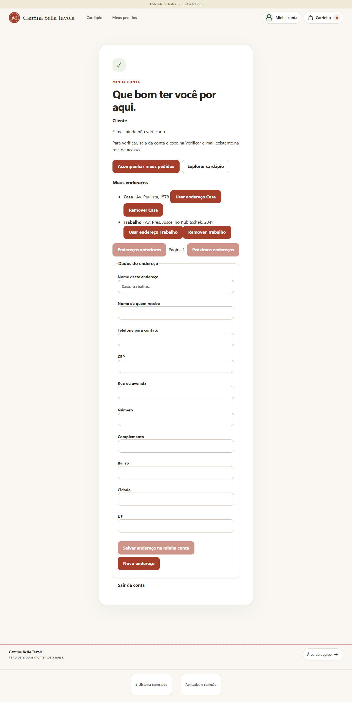
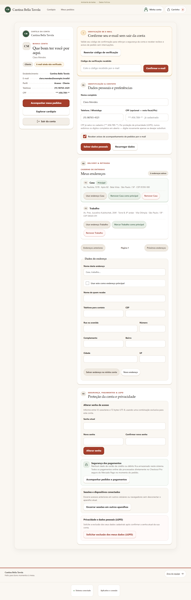
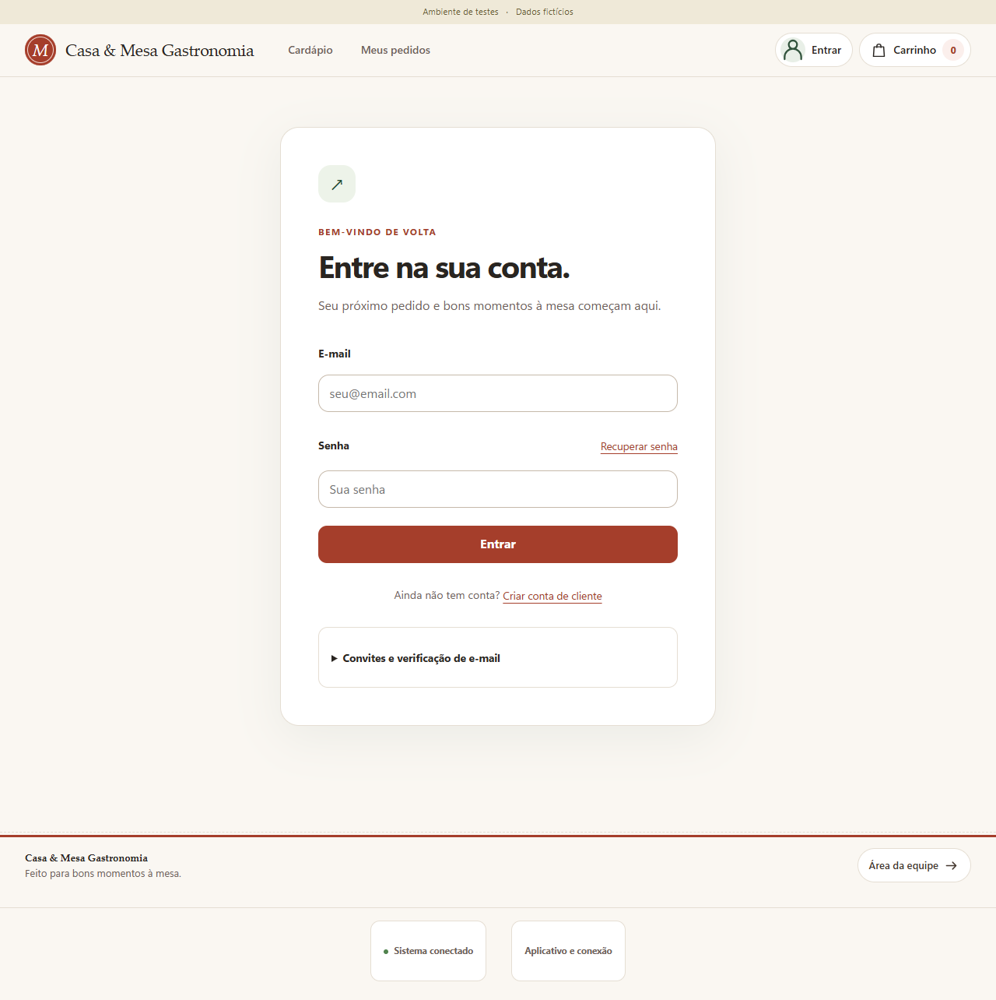
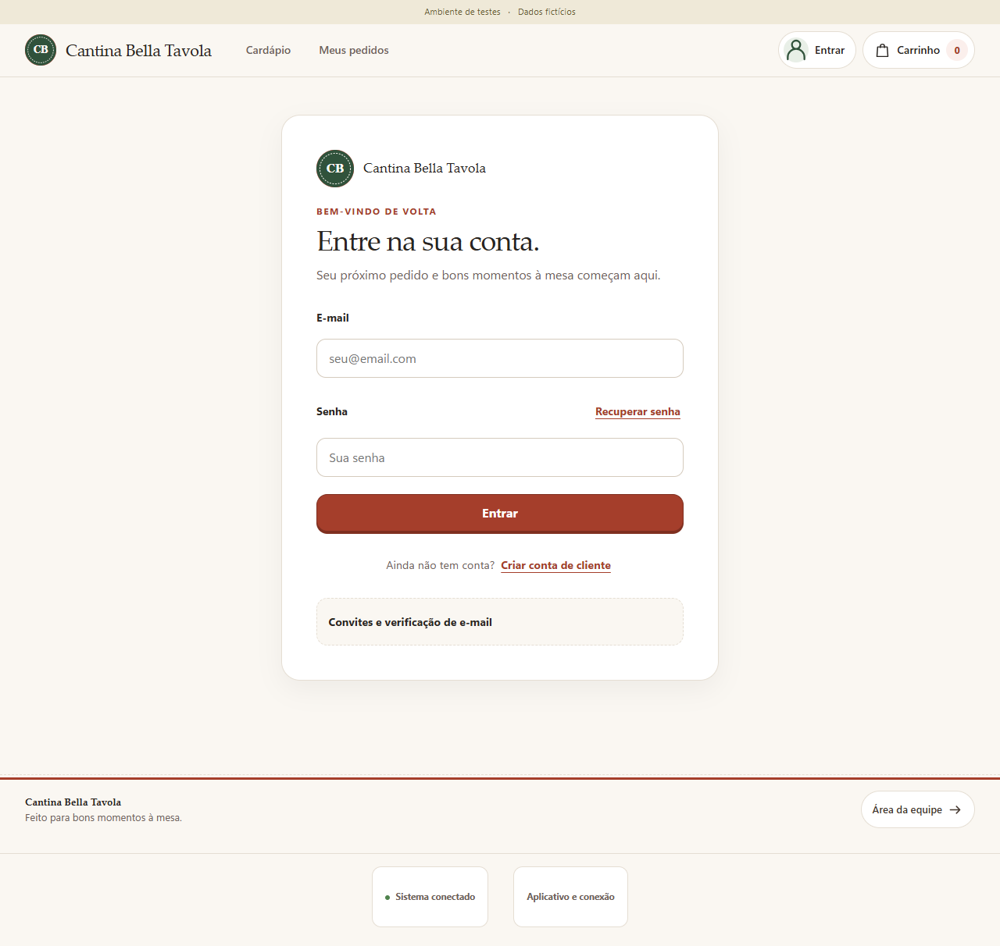
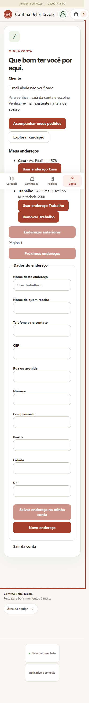
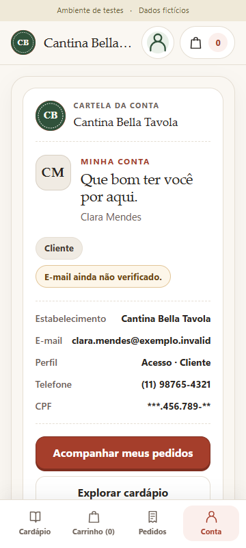
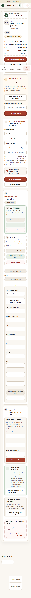
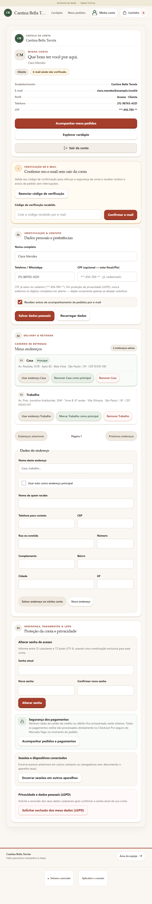

# Relatório Visual — `/conta`: Dossiê Multi-Tenant, Endereços e Segurança v3

- **Data:** 2026-11-14
- **Área:** Identidade (`/conta`, `/entrar`, `/gestao/entrar`) e Endereços (`app-enderecos`)
- **Escopo:** Estritamente camada visual (`template:`/`styles:` inline em `IdentidadeComponent`, `enderecos.component.html` e `styles:` inline em `EnderecosComponent`; nenhuma alteração em backend, serviços, guardas, rotas, assinaturas TypeScript ou importações).
- **Documentos consultados:** [Interface/PWA](../../09_UI_GUIDELINES.md), [Padrões de código](../../10_CODING_STANDARDS.md), [Definition of Done](../../12_DEFINITION_OF_DONE.md), [ADR 0003 — Spartan UI](../../adr/0003-spartan-navegacao-por-area.md).

---

## 1. Como era antes

1. **Paleta verde legada e ausência de hierarquia na área logada (`/conta`):**
   - `frontend/src/app/identidade/identidade.component.ts` utilizava um único cartão estreito (`35rem`), superfícies verdes legadas (`#edf3e9`, `#254d36`, `#285139`, `#dce2d9`, `#6b746c`, `#fcfcfa`), sombra verde (`#163d2810`) e formulários empilhados em bloco corrido sem separação visual entre resumo da conta, verificação de e-mail, dados pessoais, endereços, segurança e LGPD.
   - `input { width: 100%; min-height: 50px }` esticava checkboxes (`receberEmailsPedido` e `principalEndereco`) para 100% da largura.
   - Controles `.text-action` e `
` tinham `min-height: 44px` (abaixo do alvo mínimo `48px`), e botões desabilitados herdavam `opacity: 0.55` global.
   - Não havia exibição da marca multi-tenant (`MarcaService`), ficha cadastral com guias pontilhadas, explicação de segurança de pagamentos via Checkout Pro nem separação visual de perigo para exclusão LGPD.
2. **Lista e formulário de endereços sem ergonomia tátil (`app-enderecos`):**
   - `enderecos.component.html` e `enderecos.component.ts` renderizavam uma `<ul>` crua com marcadores `•` e botões em sequência linear sem diferenciação entre uso, marcação de principal e remoção, além de inputs empilhados sem grade fluida adaptada tanto para a coluna larga de `/conta` quanto para contextos compactos em `/pedidos` e `360px`.

---

## 2. Representação visual — Antes × Depois

Capturas sanitizadas do build AOT real (`frontend/dist/restaurant-manager/browser`) em Microsoft Edge com dados fictícios (zero dados pessoais):

### 2.1. Área logada `/conta` (Desktop `1280×900`)

| Antes (cartão estreito `35rem`, `'M'` fixo, `<ul>` cru de endereços, sem perfil/CPF/senha/LGPD) | Depois (dossiê em 2 colunas, `MarcaService`, verificação inline, CPF mascarado, talões `01/02`, Checkout Pro e LGPD) |
| --- | --- |
|  |  |

### 2.2. Tela de acesso `/entrar` (Desktop `1280×900`)

| Antes (`'M'` fixo e seta genérica `↗`) | Depois (marca dinâmica `MarcaService` com logotipo ou emblema neutro) |
| --- | --- |
|  |  |

### 2.3. Responsividade de `/conta` em celular (`360×800`) e tablet (`768×1024`)

| Antes · Celular `360px` (estouro horizontal à direita e lista crua) | Depois · Celular `360px` acima da dobra (barra inferior ancorada, zero estouro) | Depois · Celular `360px` completo (fluxo completo) | Depois · Tablet `768×1024` (empilhamento limpo) |
| --- | --- | --- | --- |
|  |  |  |  |

---

## 3. O que foi alterado

| Bloco / Arquivo | Antes | Depois |
| --- | --- | --- |
| Cartão deslogado e subformulários (`identidade.component.ts`) | Cartão com tokens verdes legados (`#285139`, `#edf3e9`), símbolo `↗`, alvos `.text-action`/`summary` em `44px` | Cartão editorial (`min(100%, 35rem)`) na paleta oficial (`#faf7f2`, `#ffffff`, `#292521`, `#a53e2b`, `#30523b`), cabeçalho dinâmico `MarcaService` (`logoUrl` com fallback `<app-icone nome="marca" />` e `marca.nome()`), 100% dos IDs e textos exigidos preservados, alvos `>= 48px`, alertas globais preservados |
| Dossiê logado em 2 colunas (`identidade.component.ts`) | Fluxo linear único em `35rem` | `.auth-card.auth-card--conta` até `min(100%, 68rem)` com grade assimétrica (`365px minmax(0, 1fr)` em `>= 1024px`), empilhamento fluido em `768px` e `360px` |
| Passaporte / Cartela esquerda (`identidade.component.ts`) | Apenas `h1`, `
` e status em texto simples | Marca dinâmica (`MarcaService`), iniciais do titular (`iniciaisConta(pessoa)`), `#conta-titulo`, badge único exato `{{ nomePerfil(pessoa.perfil) }}`, pílula única exata de verificação de e-mail, ficha com guias pontilhadas (`Estabelecimento`, `E-mail`, `Perfil` com prefixo `Acesso · ` para manter strict-mode Playwright em `nomePerfil`, `Telefone`, `CPF`), atalhos de área, `Sair da conta` com `<app-icone nome="sair" />` e alertas globais (`#alerta`, `Tentar encerrar novamente`, `aviso()`) |
| Dossiê direito modular (`identidade.component.ts`) | Inputs empilhados sem agrupamento nem card de pagamentos | Verificação de e-mail inline destacada quando `!pessoa.emailVerificado`; módulo `01` Dados pessoais (`#conta-nome`, `#conta-telefone`, `#conta-cpf` somente placeholder mascarado + explicação LGPD, checkbox `22px` em rótulo `48px`); módulo `02` `<app-enderecos />` para `CLIENTE`; módulo `03`/`02` Segurança (alteração de senha `12` chars a `72` bytes UTF-8, card informativo Checkout Pro do Mercado Pago com link `/pedidos` exclusivo para `CLIENTE`, encerramento de outras sessões e painel retrátil LGPD `#conta-senha-exclusao`) |
| Variantes e estados desabilitados (`identidade.component.ts`, `enderecos.component.ts`) | `opacity: 0.55` global em `:disabled` e seletores apenas em `[data-variant]` | Cobertura dupla `[data-variant]` + `[variant]` (compatível com AOT e esbuild JIT), botões táteis com relevo (`0 3px 0 #7f2f20` em CTAs), `:disabled` sólido acessível (`#efe9e0` / `#594e46`, `opacity: 1`) |
| Caderno e talões de entrega (`enderecos.component.html`, `enderecos.component.ts`) | `<ul>` com texto corrido, sem hierarquia visual nem container queries | Talões numerados (`01`, `02`…) com borda picotada, destaque sálvia `Principal`, ações distintas (`Usar endereço ...`, `Marcar/Remover ... como principal`, `Remover ...`), paginação preservada e grade fluida via `@container enderecos (min-width: 520px)` mantendo a ordem de `Tab` crítica (`principalEndereco` antes de `@for` para `UF` + `Tab` focar diretamente `Salvar endereço na minha conta`) |

### Arquivos modificados nesta entrega

- [identidade.component.ts](../../../frontend/src/app/identidade/identidade.component.ts) *(somente `template:` e `styles:` inline preservados para compatibilidade JIT com `scripts/test_identity_forms.cjs`)*
- [enderecos.component.html](../../../frontend/src/app/delivery/enderecos.component.html)
- [enderecos.component.ts](../../../frontend/src/app/delivery/enderecos.component.ts) *(somente bloco `styles:` inline)*

---

## 4. Por quê

1. **Segurança e clareza percebida pelo titular:** Separar visualmente cartela cadastral, validação inline de e-mail, dados pessoais (sem jamais expor dígitos reais de CPF já salvo), endereços, troca de senha, esclarecimento explícito sobre pagamentos (Checkout Pro sem guarda de cartão) e exclusão LGPD reduz erros operacionais e dá confiança imediata em desktop, tablet e celular.
2. **Alinhamento ao padrão `/cardapio` e Multi-Tenant:** Aplicação integral da paleta linho/carvão/terracota/sálvia, selo dinâmico via `MarcaService`, numeradores `01/02/03`, guias pontilhadas e talões picotados — mantendo zero referências fixas a um único estabelecimento.
3. **Preservação rigorosa de contratos e acessibilidade:**
   - Todos os seletores de E2E e templates (`#email-conta`, `#senha-conta`, `#conta-titulo`, `#alerta`, `#conta-nome`, `#conta-telefone`, `#conta-cpf`, `#conta-codigo-verificacao`, `#conta-senha-atual`, `#conta-nova-senha`, `#conta-confirmar-senha`, `#conta-senha-exclusao`, `exact: true` em `nomePerfil` e status de e-mail, ordem `UF` → `Tab` → `Salvar endereço na minha conta`) foram mantidos intactos e verificados.
   - `IdentidadeComponent` manteve `template:` e `styles:` inline exigidos pela compilação JIT de `scripts/test_identity_forms.cjs`.
   - Zero alterações estruturais em serviços, rotas, modelos ou backend.

---

## 5. Pendências e Requisitos para o Backend

As ações da área logada em `IdentidadeComponent` e `EnderecosComponent` dependem dos contratos consumidos por `SessaoService` (`frontend/src/app/identidade/sessao.service.ts`) e `EnderecosService` (`frontend/src/app/delivery/enderecos.service.ts`). Enquanto endpoints ainda não implementados retornarem `404`/`405`/`501`, a interface informa de forma transparente ao usuário; para integração completa, o backend deve implementar/assegurar:

1. **`GET /api/v1/auth/me`:**
   - Retornar `Identidade` autenticada contendo `usuarioId`, `sessaoId`, `empresaId`, `perfil`, `emailVerificado`, `email`, `nome`, `telefone`, `cpfMascarado` (apenas mascarado, ex.: `***.456.789-**` — **nunca** os 11 dígitos em aberto), `cpfInformado` (`boolean`), `receberEmailsPedido` (`boolean`) e `versao` (`number` para controle de concorrência otimista).
2. **`PUT /api/v1/auth/me`:**
   - Receber `{ versao: number, nome: string, telefone: string, cpf?: string, receberEmailsPedido?: boolean }`.
   - Validar concorrência otimista por `versao` (`409 Conflict` em versão obsoleta), validar formato e dígitos verificadores de `cpf` quando enviado (sem exigir reenvio quando o titular altera apenas nome/telefone/preferências), armazenar CPF com proteção adequada e devolver `Identidade` atualizada com nova `versao` e `cpfMascarado`.
3. **`POST /api/v1/auth/verificacao/reenviar` e `POST /api/v1/auth/verificacao/confirmar`:**
   - Permitir reenvio autenticado (`{ mensagem: string }`) com limitação de taxa (`429`) e confirmação de `{ codigo: string }` inline sem exigir logout prévio, atualizando `emailVerificado = true` na identidade retornada posteriormente por `/api/v1/auth/me`.
4. **`POST /api/v1/auth/senha`:**
   - Receber `{ senhaAtual: string, novaSenha: string }`, validar senha atual, aplicar política de `12` caracteres a `72` bytes UTF-8 (rejeitando apenas espaços em branco) e rotacionar/revogar sessões conforme política de segurança.
5. **`POST /api/v1/auth/sessoes/encerrar-outras`:**
   - Revogar todas as demais sessões/refresh tokens do titular autenticado mantendo a `sessaoId` atual ativa, retornando `{ mensagem?: string }`.
6. **`POST /api/v1/auth/exclusao`:**
   - Receber `{ senhaAtual: string }`, reautenticar o titular, executar ou protocolar a exclusão/anonimização dos dados pessoais conforme LGPD respeitando obrigações fiscais de pedidos já concluídos, encerrar tokens e devolver `{ mensagem?: string }`.
7. **`GET /api/v1/clientes/me/enderecos`, `PUT /api/v1/clientes/me/enderecos/{id}` e `DELETE /api/v1/clientes/me/enderecos/{id}`:**
   - Suportar `principal?: boolean` e `versao` otimista garantindo no servidor que no máximo um endereço ativo por cliente/empresa permaneça marcado como `principal`, com paginação compatível (blocos de 50 registros).

---

## 6. Validações executadas

Execução realizada após a última edição de código em ambiente Windows com Node `v24.12.0` (Visual Studio Toolchain) e Microsoft Edge:

- `npm --prefix frontend run format:check` → **Aprovado** (exit code `0`; `All matched files use Prettier code style!`).
- `npm --prefix frontend run typecheck` (`tsc --noEmit -p tsconfig.app.json && tsc -p tsconfig.e2e.json`) → **Aprovado** (exit code `0`).
- `node frontend/node_modules/@angular/compiler-cli/bundles/src/bin/ngc.js -p frontend/tsconfig.app.json --noEmit` → **Aprovado** (exit code `0`, compilação AOT `strictTemplates` sem erros).
- `npm --prefix frontend run test:logic` (`node ../scripts/test-frontend.cjs`) → **Aprovado** (exit code `0`, todas as sondas de lógica aprovadas em ambiente simulado).
- `node scripts/check_contrast.cjs --self-test` → **Aprovado** (exit code `0`, `14 verificações de matemática, limites, destino e reutilização de sessão aprovadas; nenhuma navegação executada.`).
- **Auditoria AOT real (`frontend/dist/restaurant-manager/browser`) + `ng serve` em Microsoft Edge (`360×800`, `768×1024`, `1280×900`, transporte mockado):**
  - `/conta` e `/entrar` renderizando ícones SVG reais (`marca`, `conta`, `sacola`, `sair`, `cardapio`, `pedidos`), logotipo dinâmico via `MarcaService`, `scrollWidth === clientWidth` nas 3 larguras (`360`, `768`, `1280`) e `errors: []`.
- **Equivalente JIT de `test_identity_forms.cjs` + validações funcionais em Microsoft Edge (`verify-all.cjs`, transporte mockado):**
  - *Suite A (4 jornadas deslogadas via `esbuild` JIT + Edge):* `Recuperar senha`, `Criar conta de cliente`, `Aceitar convite de funcionário` e `Verificar e-mail existente` aprovados para foco, validação UTF-8 72 bytes, erros 422/429/503, `localStorage`/`sessionStorage` vazios e zero overflow em `360px`, `768px` e `1280px`. *(Nota: no JIT puro com `esbuild` sem `ngc`, `<app-icone>` usa o desenho fallback `'menu'`, confirmado ausente na compilação AOT real.)*
  - *Suite B (roteamento completo Angular JIT em Edge):* contagem exata `=== 1` para `'Cliente'` / `'Administrador'` e status de e-mail, `#conta-cpf` sempre vazio no preenchimento (exibindo apenas máscara no placeholder), painel retrátil `#conta-senha-exclusao`, ordem crítica `S04-UI01` (`UF` → `Tab` → `Salvar endereço na minha conta`) e recuperação de erro no logout (`Tentar encerrar novamente`) aprovados.
- `npm --prefix frontend run build` (direto no host) → **Bloqueado pela versão do Node local (`exit code 3`)**: Angular CLI `22.2.5` exige `>= v22.22.3`, `v24.15.0` ou `v26.0.0`, e a máquina possui `v24.12.0`.
- Build Angular de produção (`ng.js build`) + `scripts/build-pwa.cjs` com shim em memória de `process.versions.node = '26.0.0'` → **Aprovado** (`exit code 0`: chunk inicial `304.57 kB` bruto / `85.08 kB` transferido; `identidade-component` `70.07 kB` bruto; `PWA: 36 arquivos públicos; versão 6284fcd0e46ec1b78afa; APIs excluídas.`).
- `python scripts/check-repository.py` → **Aprovado** (exit code `0`, validando links locais das capturas em `imagens/` e ausência de padrões de segredo).
