# Sprint 1 · Fundação Global, Shells Utilitários e Autenticação Secundária

- **Data:** 2026-11-14
- **Telas / Rotas:** Fundação global (`styles.css`, `<app-root>`, `<app-pwa>`), `/mesa`, `/sem-acesso`, `/404`, `/design-system`, `/cadastro`, `/recuperar-senha`, `/verificar-email`, `/aceitar-convite`
- **Área:** Fundação Compartilhada · Cliente · Autenticação Multi-Tenant
- **Responsável técnico:** subagente `artesao-ux-bistro` (etapa visual sobre os 8 arquivos-alvo) em conjunto com o coordenador (pré-injeções e atualizações de `main.ts` e `paginas-cliente.ts`)
- **Arquivos alterados nesta etapa (`artesao-ux-bistro`):**
  - [styles.css](../../../frontend/src/styles.css)
  - [pwa.component.ts](../../../frontend/src/app/pwa/pwa.component.ts)
  - [pagina-informativa.component.ts](../../../frontend/src/app/rotas/pagina-informativa.component.ts)
  - [catalogo.component.ts](../../../frontend/src/app/ui/catalogo.component.ts)
  - [cadastro.component.ts](../../../frontend/src/app/identidade/cadastro.component.ts)
  - [recuperacao.component.ts](../../../frontend/src/app/identidade/recuperacao.component.ts)
  - [verificacao.component.ts](../../../frontend/src/app/identidade/verificacao.component.ts)
  - [aceitar-convite.component.ts](../../../frontend/src/app/identidade/aceitar-convite.component.ts)
- **Arquivos da Sprint 1 pré-atualizados pelo coordenador:**
  - [main.ts](../../../frontend/src/main.ts) (faixa de demonstração discreta, banner de aviso e cards `
` no rodapé `.app-utilities`)
  - [paginas-cliente.ts](../../../frontend/src/app/rotas/paginas-cliente.ts) (envelope editorial de `/mesa` com `marca.nome()`, título serifado e acordeão `.service-hours`)

---

## 1. Como era antes

Antes da Sprint 1, os fluxos secundários e shells utilitários ainda carregavam estilos crus da implementação inicial e contrastavam com a experiência editorial já atingida em `/cardapio`, `/entrar` e `/conta`:

1. **Botões desabilitados e placeholders na base global (`styles.css`):** `[disabled]` usava `opacity: 0.55` genérico (deixando botões e controles esmaecidos com risco de contraste insuficiente), `summary` tinha `min-height: 32px`, placeholders sem cor explícita variavam por navegador e faltavam utilitários reutilizáveis em CSS plano (como `.bistro-card`, `.bistro-talao`, `.bistro-divider-dotted`, `.bistro-badge-*`, `.bistro-callout` e `.bistro-details`).
2. **Painel PWA no rodapé (`pwa.component.ts`):** `
` sem borda ou separação visual, botão nativo sem `HlmButton`, `summary` de `44px` sem indicador de estado recolhido/aberto e aviso offline com paleta legada (`#fff1d7`, `#694d1a`) e sombra pesada (`#0002`).
3. **Páginas `/sem-acesso` e 404 (`pagina-informativa.component.ts`):** layout solto direto no fundo sem cartão, sem identificação dinâmica do estabelecimento (`MarcaService`), com quadrado verde legado (`#eaf0e5`, `#254d36`) e texto em `#6b746c`.
4. **Vitrine `/design-system` (`catalogo.component.ts`):** demonstração enxuta sem visualização da paleta oficial linho/carvão/terracota/sálvia, usando `<select>` nativo simples em vez do padrão acessível de pílula tátil com `<select class="sr-only">` sincronizado, botão desabilitado lavado e `<dialog>` sem retorno automático de foco ao gatilho.
5. **Formulários secundários de identidade (`cadastro`, `recuperacao`, `verificacao`, `aceitar-convite`):** cada tela exibia apenas `<form>` simples empilhado com bordas verde-cinza legadas (`#6b7a70`), erro em `#9d2424`, botões HTML sem `hlmBtn`, ausência do cabeçalho multi-tenant com `marca.nome()`, ausência de numeração editorial de etapas e regra de senha (`12 a 72 bytes em UTF-8`) solta sem destaque visual.

---

## 2. Representação visual — Antes × Depois

Capturas geradas sobre o build AOT de produção (`dist/restaurant-manager/browser`) em Microsoft Edge headless, com API mockada localmente para `/api/v1/restaurante` (`Casa Sabor Exemplo`) e validação de ausência de overflow horizontal (`scrollWidth === clientWidth`) e erros de console (`0`).

| Cenário / Tela | Antes | Depois |
| --- | --- | --- |
| Cadastro (`/cadastro`) · Celular `360×800` | 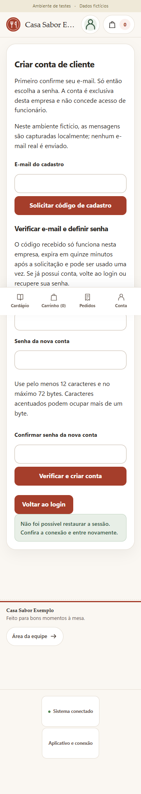 | 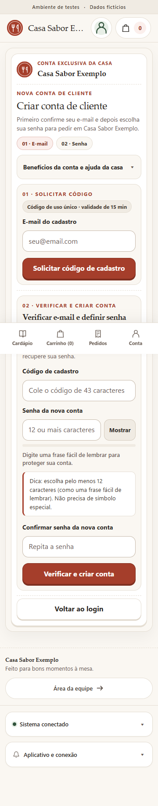 |
| Cadastro (`/cadastro`) · Desktop `1280×900` | 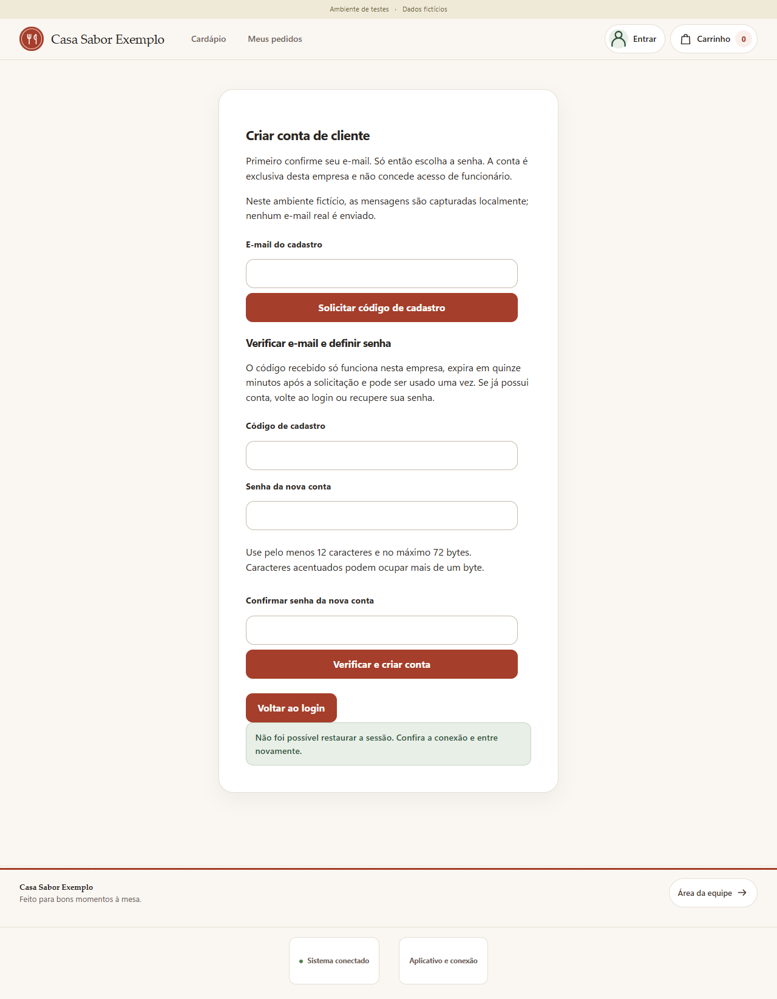 | 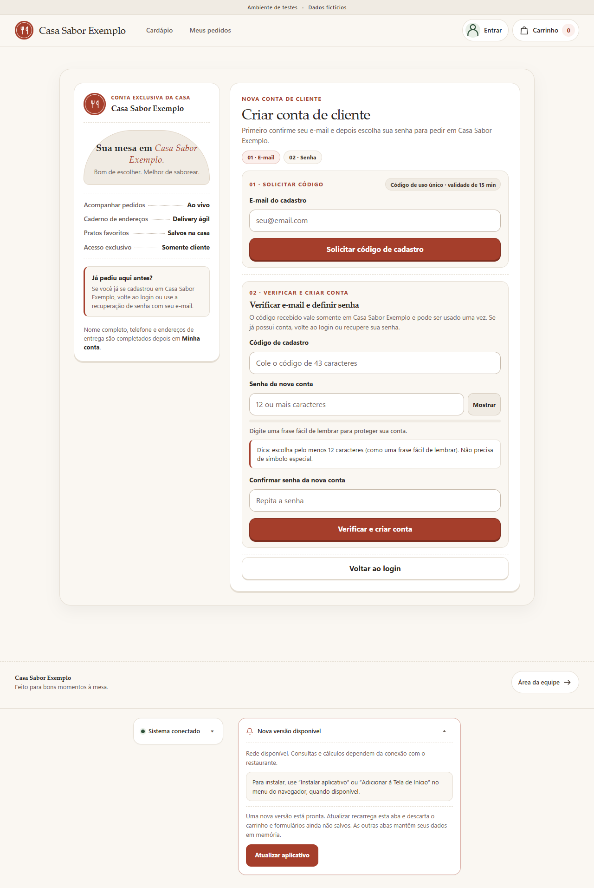 |
| Aceitar convite (`/aceitar-convite`) · Desktop | 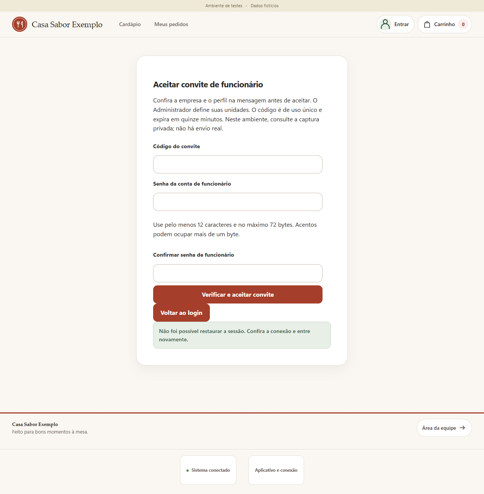 | 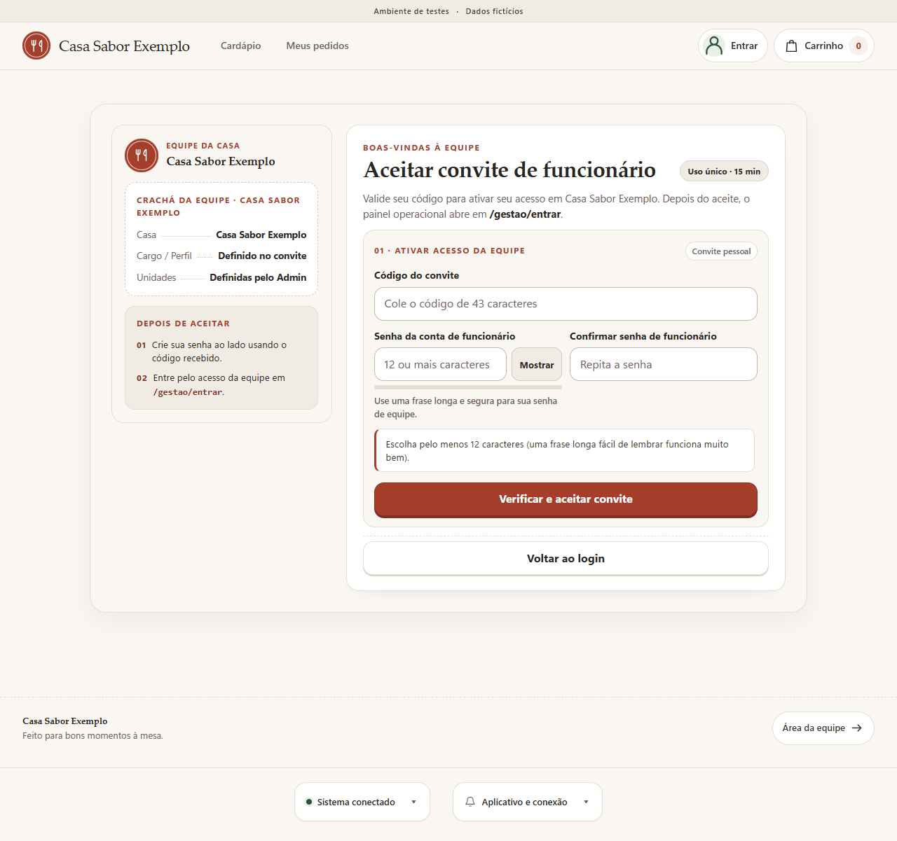 |
| Design System (`/design-system`) · Desktop | 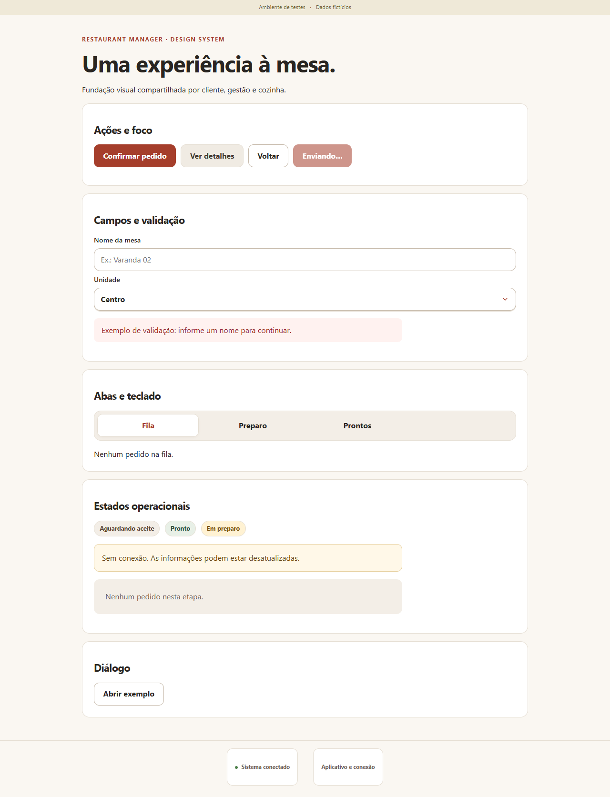 | 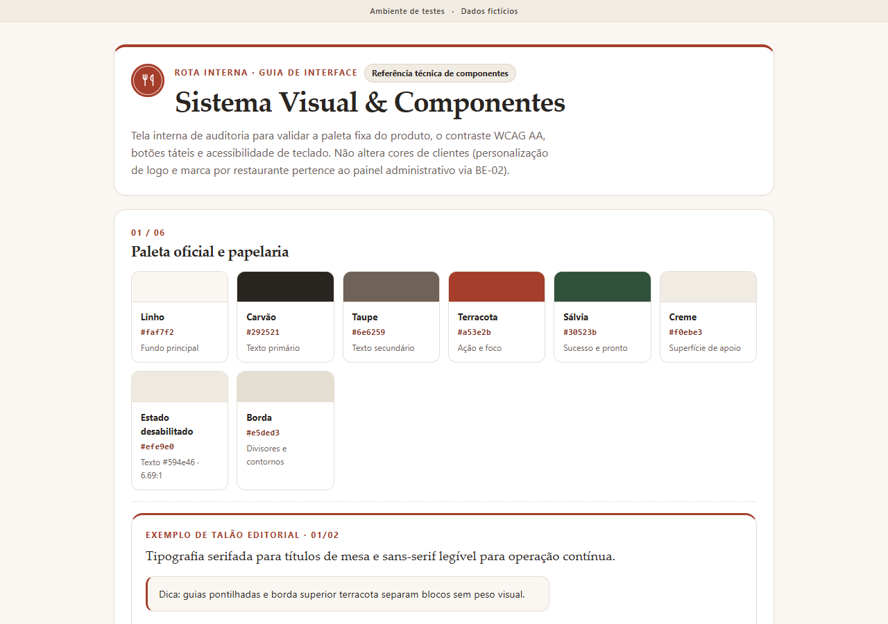 |
| Sem acesso (`/sem-acesso`) · Desktop | 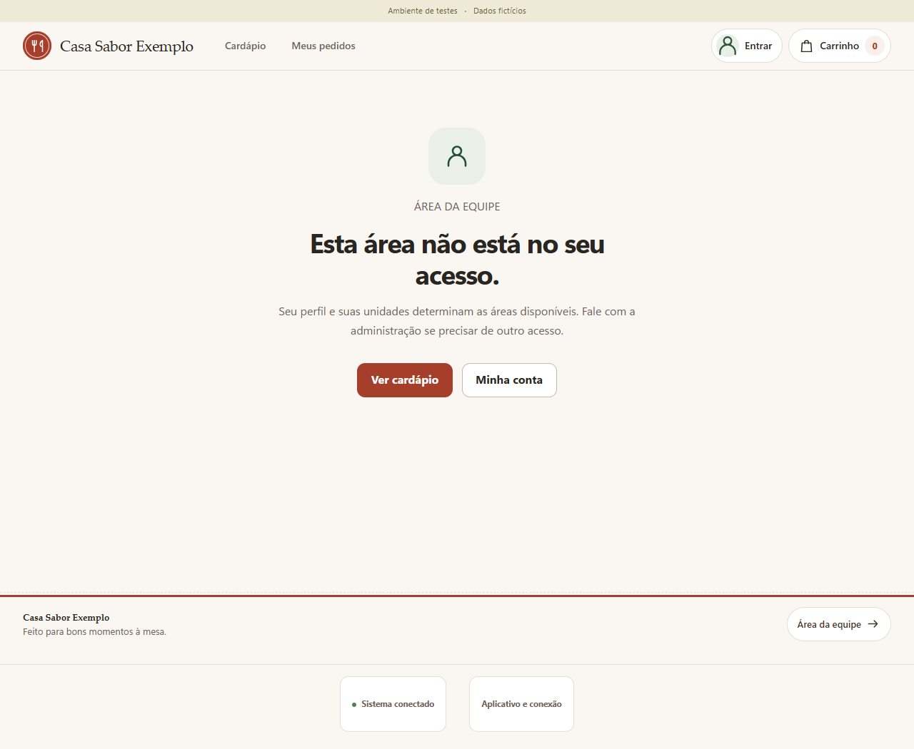 | 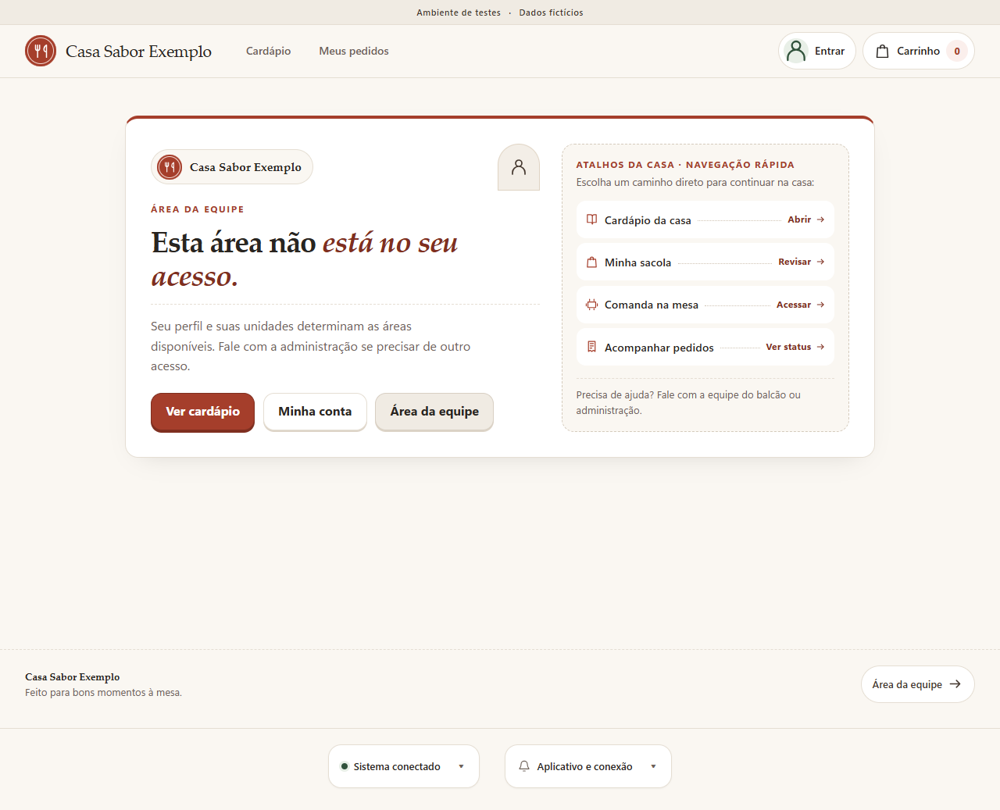 |
| Rodapé e PWA (`<app-pwa>`) · Desktop | 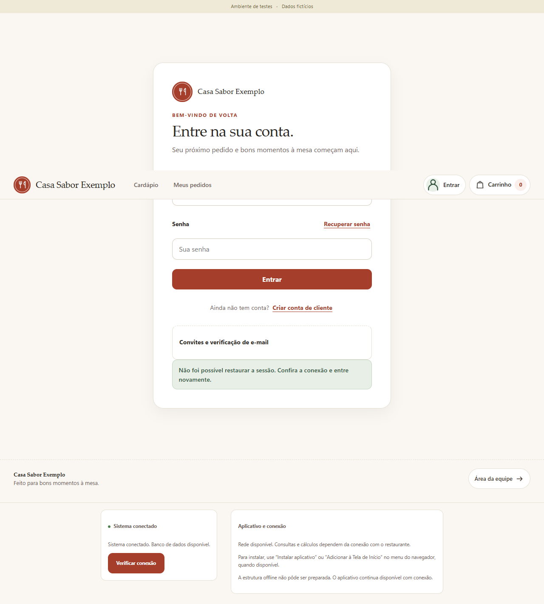 | 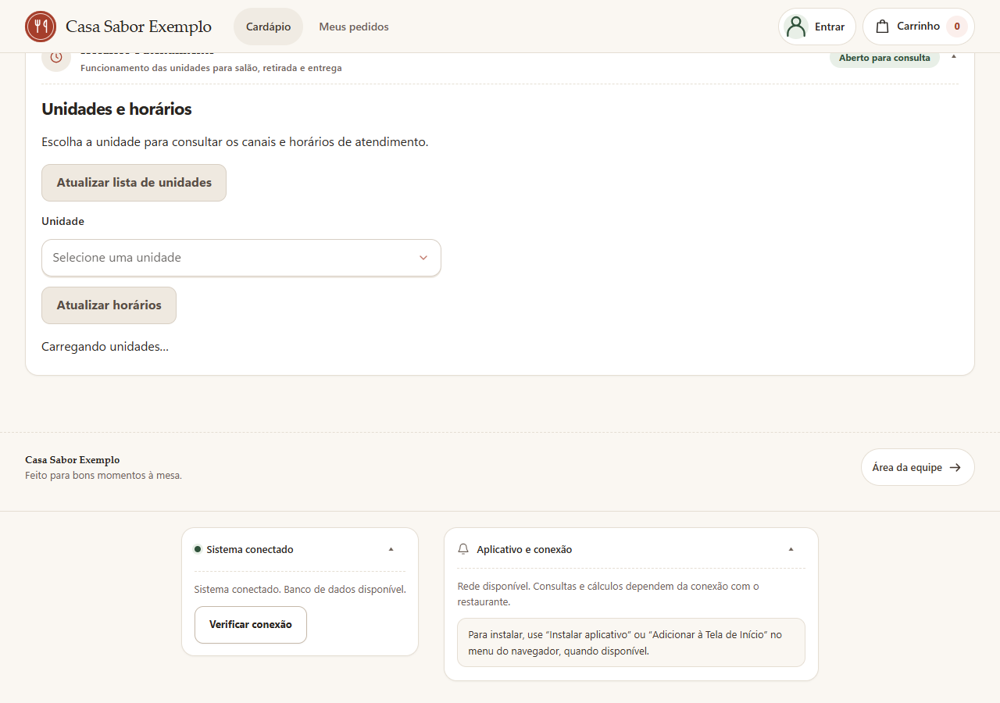 |
| Mesa (`/mesa`) · Desktop | 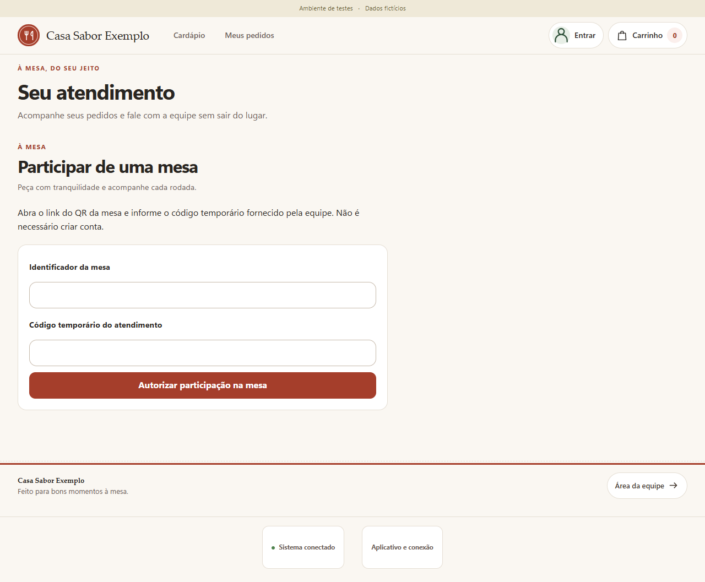 | 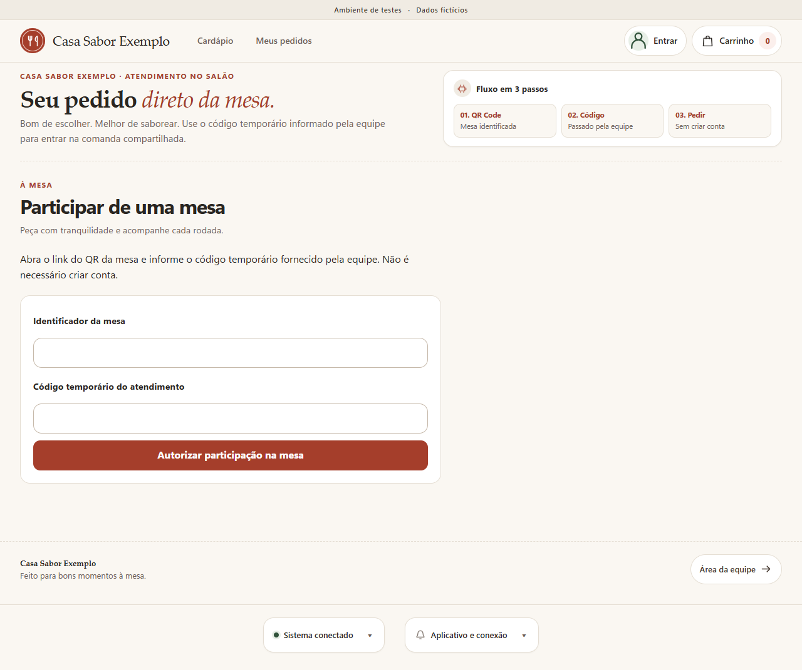 |

---

## 3. O que foi alterado

| Elemento / Bloco | Antes | Depois | Arquivo(s) |
| --- | --- | --- | --- |
| Tokens, estados `:disabled`, placeholder e utilitários editoriais | `opacity: 0.55` em `:disabled`; `summary` com `32px`; `#e8f0e7` na `.badge-verde`; foco ausente na pílula seletora; sem classes `.bistro-*` | `:root` com `--primary-deep`, `--radius-md`, `--radius-lg`, `--shadow-soft` e `--font-serif`; `:disabled` sólido (`#efe9e0`/`#594e46`, contraste `6.69:1`); placeholder com `var(--muted-foreground)` e `opacity: 1`; `summary` `48px`; `.bistro-select-pill:focus-within`; `dialog` protegido acima da navegação móvel abaixo de `680px`; adição das classes `.bistro-card`, `.bistro-talao`, `.bistro-eyebrow`, `.bistro-divider-dotted`, `.bistro-badge`, `.bistro-badge-ok`, `.bistro-badge-warn`, `.bistro-empty`, `.bistro-callout` e `.bistro-details` em CSS plano | [styles.css](../../../frontend/src/styles.css) |
| Shell PWA no rodapé | `
` sem moldura, botão cru, `summary` `44px`, aviso offline `#fff1d7`/`#694d1a` | Card `.pwa-card` em sintonia visual com `.app-utilities details` de `main.ts`, ícone `atualizacoes`, `
` de `48px` com indicador rotativo `▾`, divisória pontilhada `.pwa-body`, `[hlmBtn]` (`variant="outline"` para instalar, primário para atualizar) e aviso offline `#fff8e8`/`#684614`/`#e6cf9e` preservando todos os `role="status"` e textos exigidos | [pwa.component.ts](../../../frontend/src/app/pwa/pwa.component.ts) |
| Páginas informativas (`/sem-acesso` e 404) | Seção aberta com ícone em verde legado (`#eaf0e5`/`#254d36`) e `#6b746c`, sem contexto do estabelecimento | Card `.info-card` centralizado com topo dinâmico `marca.logoUrl()` / fallback `<app-icone nome="marca" />` + `{{ marca.nome() }}`, medalhão em arco terracota/areia, eyebrow `.bistro-eyebrow`, `<h1>` serifado (`clamp(1.85rem, 3.5vw, 2.4rem)`), `.bistro-divider-dotted` e ações `[hlmBtn]` empilhando em `<= 520px` | [pagina-informativa.component.ts](../../../frontend/src/app/rotas/pagina-informativa.component.ts) |
| Vitrine `/design-system` | Showcase curto com `<select>` padrão, disabled lavado e `<dialog>` sem retorno de foco | Seções numeradas (`01 / 06` a `06 / 06`) com grade de tokens da paleta oficial, `.bistro-talao`, botões Spartan em todas as variantes + `:disabled` acessível, pílula seletora `.bistro-select-wrap` sincronizada com `<select id="ui-unidade" class="sr-only">`, abas `RM_TABS`, badges/callout/acordeão `.bistro-details` e `<dialog>` devolvendo foco ao gatilho ao fechar ou cancelar (`Escape`) | [catalogo.component.ts](../../../frontend/src/app/ui/catalogo.component.ts) |
| Cadastro de cliente, recuperação de senha, verificação de e-mail e convite de funcionário | Formulários inline sem cabeçalho da marca, inputs com `#6b7a70`, erro `#9d2424`, botões nativos e sem separação de etapas | Templates e estilos **mantidos inline**, alinhados ao padrão de `/entrar`: cabeçalho `.auth-marca-topo` com `MarcaService` (logo dinâmica ou `<app-icone nome="marca" />` + `{{ marca.nome() }}`), títulos serifados, blocos `.etapa-bloco` (`01`/`02`) com guia pontilhada `.etapa-divisor`, callout de política de senha (`12 a 72 bytes em UTF-8`, sem caractere especial obrigatório), foco `#a53e2b`, erro `#972626`/`#fff2f0` e botões `[hlmBtn]` (`outline` em `Voltar ao login`) com `:disabled` sólido e único `role="status"` (`#resultado`) | [cadastro.component.ts](../../../frontend/src/app/identidade/cadastro.component.ts), [recuperacao.component.ts](../../../frontend/src/app/identidade/recuperacao.component.ts), [verificacao.component.ts](../../../frontend/src/app/identidade/verificacao.component.ts), [aceitar-convite.component.ts](../../../frontend/src/app/identidade/aceitar-convite.component.ts) |
| Shell raiz e página `/mesa` (etapa prévia do coordenador) | Banner de demo chamativo, rodapé sem card estruturado e cabeçalho simples em `/mesa` | `.demo-banner` e `.app-utilities` refinados com ponto de status de conexão em [main.ts](../../../frontend/src/main.ts); `/mesa` com card de entrada multi-tenant e acordeão de horários em [paginas-cliente.ts](../../../frontend/src/app/rotas/paginas-cliente.ts) | [main.ts](../../../frontend/src/main.ts), [paginas-cliente.ts](../../../frontend/src/app/rotas/paginas-cliente.ts) |

---

## 4. Por quê

- **Impacto na experiência do usuário (UX):** elimina quebras abruptas de identidade visual ao sair do `/cardapio` ou `/entrar` para criar conta, recuperar senha, aceitar convite, cair em página inexistente ou consultar o status do aplicativo no rodapé. Todos os controles táteis passam a respeitar altura mínima de `48px` sem overflow em celular (`360px`), tablet (`768px`) e desktop (`1280px`).
- **Conformidade com as normas do projeto:** atende [Interface e PWA](../../09_UI_GUIDELINES.md), [ADR 0003](../../adr/0003-spartan-navegacao-por-area.md) (Spartan UI + CSS plano compatível com a sonda JIT), multi-tenancy estrito via `MarcaService` (zero marca ou inicial fixa) e contraste WCAG 2.2 AA (`>= 4.5:1` inclusive em botões desabilitados e avisos offline).
- **Garantia não-estrutural:** zero alterações em `backend/`, `*.service.ts`, `modelos.ts`, `guardas.ts`, `*.routes.ts`, `main.ts`, `paginas-cliente.ts`, `identidade.component.ts`, `package*.json`, `angular.json`, `service-worker.js` ou testes E2E. Todos os `id`, `for`, `tabindex="-1"`, `aria-describedby`, `aria-invalid`, `role="alert"` e o único `role="status"` (`#resultado`) nos subcomponentes de identidade foram preservados integralmente, mantendo `template:` e `styles:` inline para compilação JIT em `esbuild`.

---

## 5. Pendências e Requisitos para o Backend

Nenhuma pendência estrutural ou de API foi identificada para a Sprint 1. Todos os dados dinâmicos consumidos (`marca.nome()`, `marca.logoUrl()`, ações de autenticação e status offline/PWA) já são fornecidos pelos serviços existentes.

---

## 6. Validações executadas

Todos os checks abaixo foram executados após a integração completa dos 10 arquivos da Sprint 1:

- **Varredura de regressão visual (hex legados e marca fixa) nos 10 arquivos da Sprint 1 (`Select-String`):** `0` ocorrências encontradas.
- **`npm --prefix frontend run format:check` e `npx --prefix frontend prettier --check frontend/src/styles.css`:** passou (`exit 0` — `All matched files use Prettier code style!`).
- **`npm --prefix frontend run typecheck`:** passou (`exit 0`).
- **`node frontend/node_modules/@angular/compiler-cli/bundles/src/bin/ngc.js -p frontend/tsconfig.app.json --noEmit`:** passou (`exit 0`).
- **`npm --prefix frontend run test:logic`:** passou (`exit 0`).
- **`node scripts/check_contrast.cjs --self-test`:** passou (`exit 0` — `14 verificações de matemática, limites, destino e reutilização de sessão aprovadas; nenhuma navegação executada.`).
- **`node scripts/test_pwa.cjs`:** passou (`exit 0` — `PWA: cache somente do shell, query sensível descartada, APIs/credenciais excluídas, atualização explícita e falha atômica; ambiente simulado.`).
- **Build AOT de produção (`ng.js build --configuration production` com shim em memória de `process.versions.node = '26.0.0'` devido ao Node `v24.12.0` do ambiente VS) + `node scripts/build-pwa.cjs`:** passou (`exit 0`).
  - `Initial total`: **317.43 kB** raw (`87.70 kB` estimated transfer) — dentro do orçamento (`<= 450 kB`).
  - `styles-FTRWETZ3.css`: **23.78 kB** raw (`4.89 kB` transfer).
  - `PWA: 34 arquivos públicos; versão 1b50dc2cac16703eb2c5; APIs excluídas.`
- **Sonda JIT `scripts/test_identity_forms.cjs`:**
  - Execução direta (`node scripts/test_identity_forms.cjs`): falhou (`exit 1`) por ausência do binário `chromium_headless_shell-1248` (`chrome-headless-shell.exe`) na máquina Windows.
  - Execução do mesmo script `scripts/test_identity_forms.cjs` redirecionando `chromium.launch` para Microsoft Edge instalado (`msedge.exe`): **passou (`exit 0`)** — `chromium: foco nas quatro jornadas, erros de senha associados, UTF-8, limpeza, resultado incerto e handler de retorno aprovados; transporte fictício/JIT.`
- **Auditoria AOT e capturas em Microsoft Edge (`msedge.exe`, headless):**
  - Captura dos 20 cenários/viewports (`360×800`, `768×1024`, `1280×900`): `errors: []`, `scrollWidth === clientWidth` em todos os cenários.
  - Checagem interativa AOT (`ALL_AOT_SPRINT1_CHECKS_PASSED`): sincronização `.bistro-select-pill` ↔ `<select>` em `/design-system`, contraste em `:disabled` medido no DOM (`6.69:1`), retorno de foco do `<dialog>` ao botão gatilho, headings/alvos `>= 48px` em `/sem-acesso`, `/404`, `/mesa`, `.service-hours` em `/cardapio`, `.app-utilities` e `<app-pwa>` no rodapé e banner offline (`8.02:1`).
- **`python scripts/check-repository.py`:** validado ao concluir a documentação (ver execução final).

---

## 7. Limites e próximos passos

- **Node `v24.12.0` no Windows vs trava de versão do Angular CLI:** a chamada direta `npm --prefix frontend run build` exige Node `>= 24.15.0` no ramo 24; o build AOT completo foi validado via `ngc --noEmit` e `ng.js build --configuration production` com ajuste em memória da string de versão seguida de `build-pwa.cjs`.
- **Chromium do Playwright (`chromium_headless_shell-1248`) não instalado localmente:** `node scripts/test_identity_forms.cjs` e os E2Es contra servidor completo exigem `npx playwright install` (ou homologação com Chromium); nesta estação, todas as asserções de `scripts/test_identity_forms.cjs` e a bateria AOT foram executadas no Microsoft Edge instalado (`msedge.exe`).
