# Polimento visual, imagens de produtos e hierarquia editorial em Carrinho, Meus Pedidos e Acompanhe seu Pedido

- **Data:** 2026-11-15
- **Tela / Rota:** `/cardapio` (comanda lateral sem fotos), `/carrinho` (lista de itens e modal **"Revisar e enviar pedido"**), `/pedidos` (**Meus Pedidos**) e `/pedidos/:id` (**Acompanhe seu pedido**)
- **Área:** Cliente
- **Responsável técnico:** Coordenador (persistência e resolução de `midiaId`, `CatalogoMidiaService`, contratos e testes) + subagente `artesao-ux-bistro` (camada visual em templates/CSS)
- **Arquivos alterados:**
  - **Camada estrutural e testes (coordenador):**
    - [modelos.ts (carrinho)](../../../frontend/src/app/carrinho/modelos.ts) (`midiaId?: string | null` em `ItemCarrinho` sem alterar `LinhaCarrinho`)
    - [carrinho.service.ts](../../../frontend/src/app/carrinho/carrinho.service.ts) (persistência de `midiaId` no carrinho/rascunho)
    - [catalogo-midia.service.ts](../../../frontend/src/app/catalogo/catalogo-midia.service.ts) (cache e pré-carregamento silencioso por `produtoId` sem alterar o backend)
    - [vitrine.component.ts](../../../frontend/src/app/catalogo/vitrine.component.ts) (registro do catálogo e envio de `midiaId` ao guardar)
    - [modelos.ts (pedidos)](../../../frontend/src/app/pedidos/modelos.ts) (`midiaId?: string | null` opcional em `LinhaPedido`)
    - [pedido-detalhe.component.ts](../../../frontend/src/app/pedidos/pedido-detalhe.component.ts) (`midiaLinha`, fallback monograma e tolerância a erro)
    - [meus-pedidos.component.ts](../../../frontend/src/app/pedidos/meus-pedidos.component.ts) (pré-aquecimento de mídias ao listar pedidos)
    - [test_catalog_cart.cjs](../../../scripts/test_catalog_cart.cjs) (garantia de que `midiaId` permanece em `ItemCarrinho` e não vaza no payload de `/api/v1/carrinho/calcular`)
  - **Camada visual e layout:**
    - [carrinho.component.ts](../../../frontend/src/app/carrinho/carrinho.component.ts) (`template:` inline e `@Input() exibirImagens = true`)
    - [carrinho.css](../../../frontend/src/app/carrinho/carrinho.css)
    - [vitrine.component.html](../../../frontend/src/app/catalogo/vitrine.component.html) (`[exibirImagens]="false"` na comanda lateral do `/cardapio`)
    - [operacao.css](../../../frontend/src/app/operacao.css)
    - [pagina-pedido.component.ts](../../../frontend/src/app/rotas/pagina-pedido.component.ts) (`template:` e `styles:` inline)
    - [pedido-detalhe.component.html](../../../frontend/src/app/pedidos/pedido-detalhe.component.html)
    - [pedido-detalhe.component.css](../../../frontend/src/app/pedidos/pedido-detalhe.component.css)

## 1. Como era antes

1. **Carrinho (`/carrinho`) e modal "Revisar e enviar pedido":**
   - Os itens em `.t-items` (`article.item-comanda`) e no resumo de confirmação (`article.item-resumo`) exibiam apenas texto, sem a foto do produto nem monograma editorial de apoio.
   - Na comanda lateral do `/cardapio`, a diretriz do usuário foi manter a lista textual compacta (pois o cliente já vê as fotos do cardápio à frente), reservando as miniaturas exclusivamente para a página `/carrinho` e para o modal **"Revisar e enviar pedido"**.
2. **Meus Pedidos (`/pedidos`):**
   - No rodapé dos cards (`.pedido-resumo-acoes`), `"Ver resumo"` permanecia em uma linha enquanto `"Acompanhar detalhe"` quebrava em duas linhas alinhadas à esquerda, deixando os dois botões com alturas assimétricas.
   - Além disso, as etiquetas de estado `AGUARDANDO_PAGAMENTO` e `CONCLUIDO` não possuíam regras cromáticas dedicadas no conjunto `.etiqueta[data-estado=...]`, destoando da borda superior dos respectivos cards.
3. **Acompanhe seu pedido (`/pedidos/:id`):**
   - `PaginaPedidoComponent` exibia um cabeçalho solto (`← Meus pedidos` + `<h1>` simples) e deixava o botão `"Atualizar pedido"` isolado no rodapé da página.
   - Dentro de `PedidoDetalheComponent` (em `contexto === 'cliente'` e `'mesa'`), as linhas de `.talao-pedido` exibiam somente texto sem foto do item, o bloco **`Pagamento online`** ficava enterrado no fim da tela mesmo quando `aguardandoPagamento()` era verdadeiro, e em monitores (`>= 840px`) os blocos empilhavam em coluna única esticada em vez de separar o talão de itens da coluna de apoio financeiro/histórico/cancelamento.

## 2. Representação visual — Antes × Depois

Capturas sanitizadas geradas no Microsoft Edge sobre o build AOT de produção (`1280×900`, `768×1024` e `360×800`):

| Frente / Tela | Antes | Depois |
| --- | --- | --- |
| Comanda lateral (`/cardapio`) | Sem fotos (padrão mantido conforme orientação do usuário) | 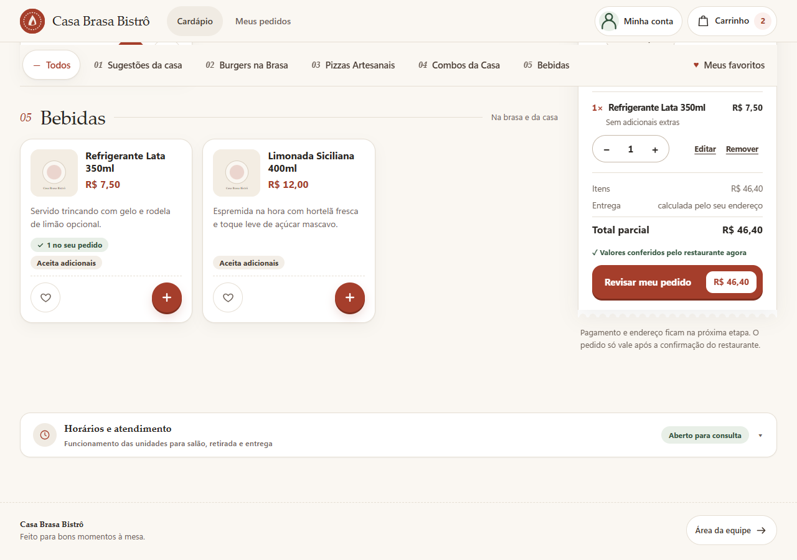 |
| `/carrinho` desktop (`1280×900`) | 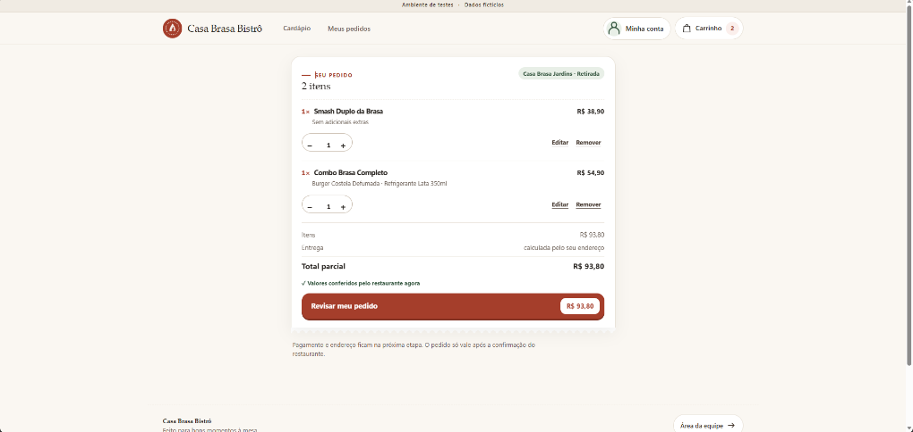 | 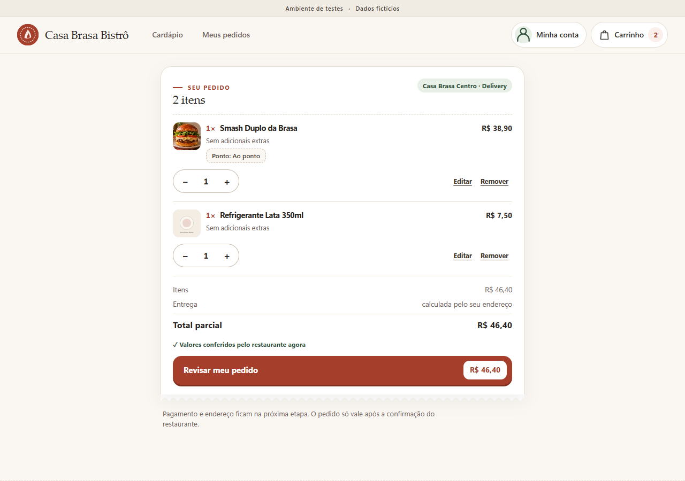 |
| `/carrinho` celular (`360×800`) | Sem imagem de produto na lista | 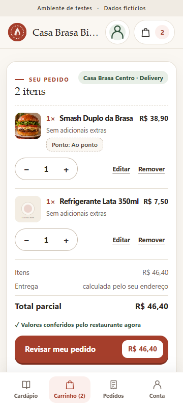 |
| Modal **"Revisar e enviar pedido"** | Itens listados somente em texto, sem miniatura de produto no resumo | 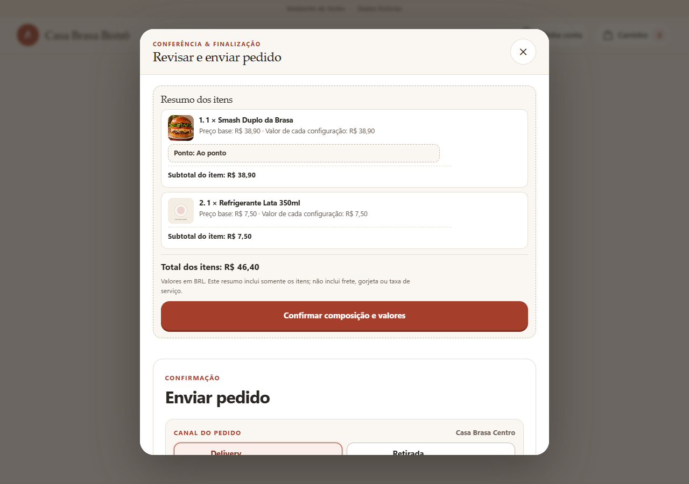 |
| `/pedidos` — **Meus Pedidos** (`1280×900`) | 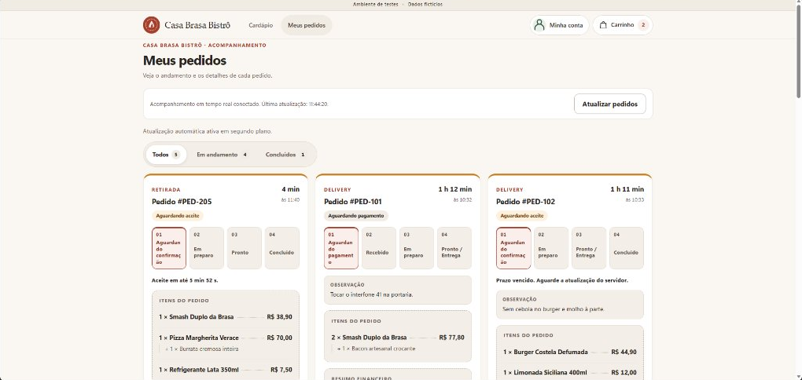 | 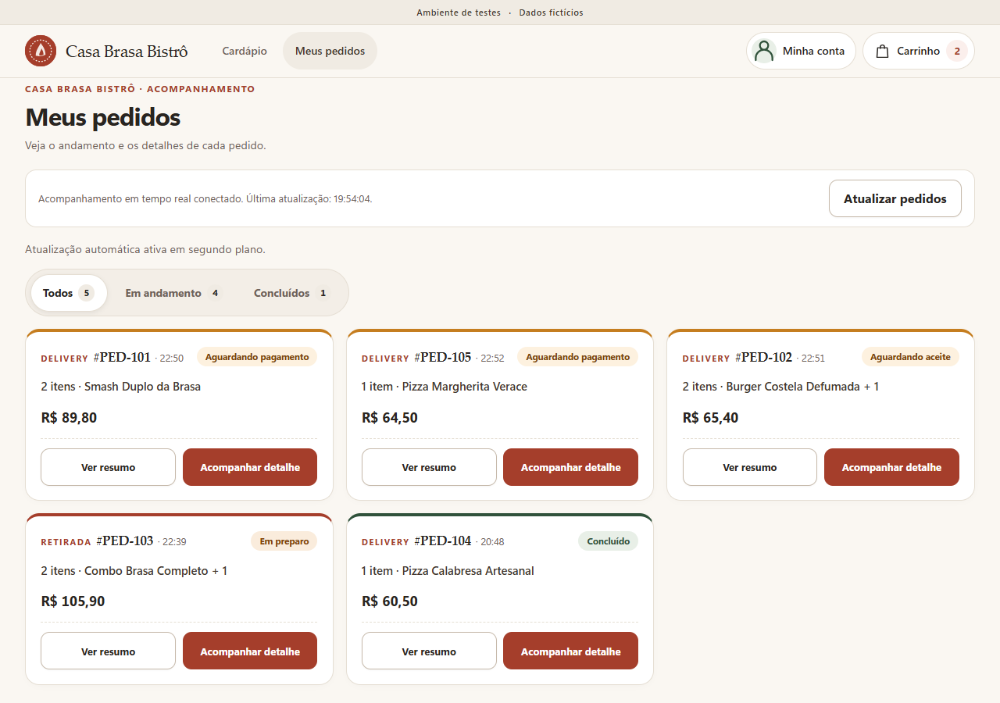 |
| `/pedidos` — **Meus Pedidos** (`360×800`) e resumo expandido | Botões com altura desigual | 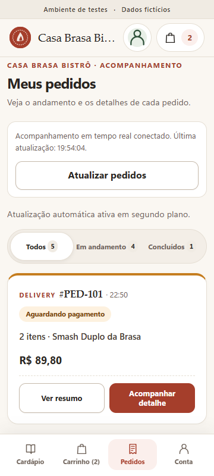 |
| `/pedidos/:id` — Topo e pagamento prioritário | 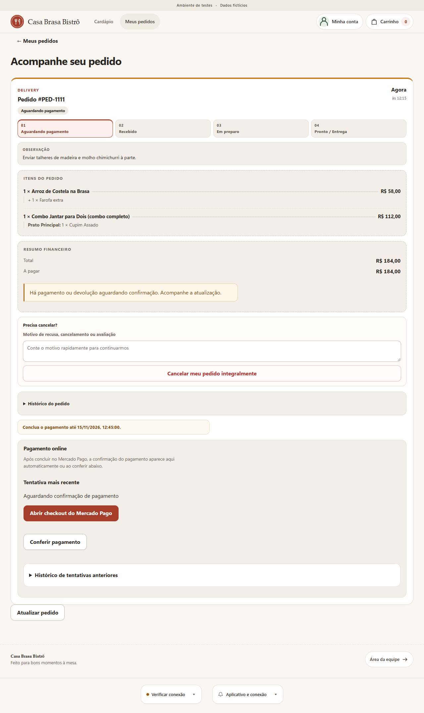 | 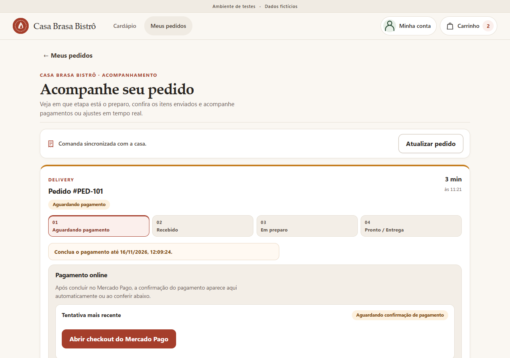 |
| `/pedidos/:id` — Talão com imagem do item e grade 2 colunas | Itens em coluna única sem foto | 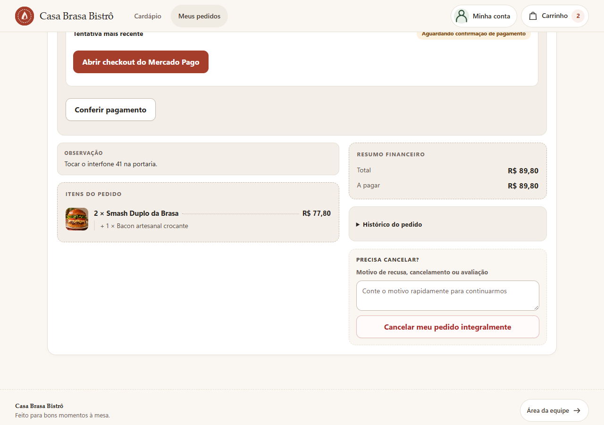 |
| `/pedidos/:id` — Celular (`360×800`) | Cabeçalho solto e botão no rodapé | 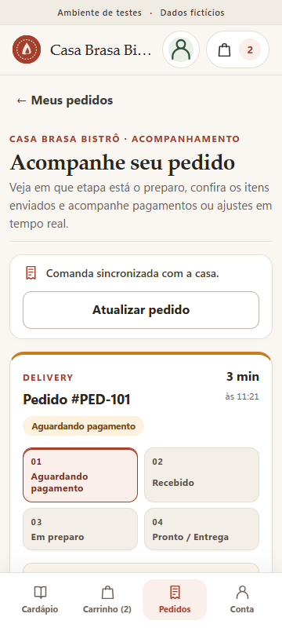 |

## 3. O que foi alterado

| Elemento / Bloco | Antes | Depois | Arquivo(s) |
| --- | --- | --- | --- |
| Itens do carrinho (`/carrinho` vs comanda lateral `/cardapio`) | Apenas texto em ambos os lugares | Adicionado `@Input() exibirImagens = true` no `CarrinhoComponent`; comanda lateral do `/cardapio` passa `[exibirImagens]="false"` (mantendo layout compacto); página `/carrinho` exibe miniatura `52×52` (`/api/v1/midias/:id`, `loading="lazy"`, `decoding="async"`, `object-fit: cover`) ou monograma editorial `.item-thumb--mono` com `inicialProduto(item.nome)` e controles `.t-ctrl` em largura total abaixo | [carrinho.component.ts](../../../frontend/src/app/carrinho/carrinho.component.ts), [carrinho.css](../../../frontend/src/app/carrinho/carrinho.css), [vitrine.component.html](../../../frontend/src/app/catalogo/vitrine.component.html) |
| Resumo no modal **"Revisar e enviar pedido"** | `article.item-resumo` apenas textual | Cabeçalho `.item-resumo-cabecalho` com miniatura `48×48` (`midiaDaLinhaResumo(...)`) ou monograma `.item-thumb--resumo.item-thumb--mono`, com override `.item-thumb img.item-thumb-img` sobre `.item img` de `catalogo.css` | [carrinho.component.ts](../../../frontend/src/app/carrinho/carrinho.component.ts), [carrinho.css](../../../frontend/src/app/carrinho/carrinho.css) |
| Botões e badges em **Meus Pedidos** | `.pedido-resumo-acoes` em `flex-wrap` com quebra assimétrica de `"Acompanhar detalhe"`; badges `AGUARDANDO_PAGAMENTO`/`CONCLUIDO` sem cor dedicada | Grade simétrica `repeat(2, minmax(0, 1fr))` com `align-items: stretch`, filhos com `width: 100%; height: 100%; min-height: 48px; text-align: center; font-size: 0.8125rem; padding: 0.5rem 0.45rem; line-height: 1.2`, limite `max-width: 28rem` quando expandido acima de `640px`, e cores AA para `AGUARDANDO_PAGAMENTO` (`#7a440d` / `#fdf1df`) e `CONCLUIDO` (`#30523b` / `#e8efe7`) | [operacao.css](../../../frontend/src/app/operacao.css) |
| Cabeçalho de `/pedidos/:id` (`PaginaPedidoComponent`) | Link e título soltos; `"Atualizar pedido"` perdido no fim da página | `.pagina-pedido-shell` (`max-width: 1080px`), link `"← Meus pedidos"` com `min-height: 48px`, `.cabecalho-painel` multi-tenant (`{{ marca.nome() }} · Acompanhamento`), título serif editorial, subtítulo claro e `.barra-conexao` no topo com `"Atualizar pedido"` antes de `<app-pedido-detalhe>` (empilhável no mobile `<= 600px`) | [pagina-pedido.component.ts](../../../frontend/src/app/rotas/pagina-pedido.component.ts) |
| Talão, imagens, prioridade de pagamento e grade em **Acompanhe seu pedido** (`pessoal()`) | Linhas sem imagem, pagamento online no fim da página e coluna única no desktop | No modo `pessoal()`: miniatura `48×48` ou monograma `.talao-thumb--mono` em `.linha-pedido-talao`; `.pedido-pagamento-prioritario` exibido antes da grade principal quando `contexto() === 'cliente' && pedido().pagoOnline && aguardandoPagamento()`; grade desktop `>= 840px` (`1.35fr / 0.95fr`) aplicada a `.cartao-pedido--cliente` separando `Observação + Itens + Solicitações` do painel de apoio (`Resumo financeiro + Pagamento pós-confirmação + Histórico + Precisa cancelar?` compacto e diretamente visível); modos `operacao` e `cozinha` 100% preservados | [pedido-detalhe.component.html](../../../frontend/src/app/pedidos/pedido-detalhe.component.html), [pedido-detalhe.component.css](../../../frontend/src/app/pedidos/pedido-detalhe.component.css), [operacao.css](../../../frontend/src/app/operacao.css) |

### Detalhes técnicos de design, responsividade e acessibilidade

- **Multi-tenant sem marca fixa:** o subtítulo editorial superior de `/pedidos/:id` consome `{{ marca.nome() }} · Acompanhamento` via `MarcaService`, e os monogramas de ausência de foto usam a inicial do próprio produto (`inicialProduto(...)`).
- **Paleta oficial e contraste WCAG 2.2 AA:** uso estrito de `--background: #faf7f2`, `--foreground: #292521`, `--card: #ffffff`, `--secondary: #f0ebe3`, `--muted: #f3eee7`, `--muted-foreground: #6e6259`, `--primary: #a53e2b`, `--accent: #e8efe7` / `--accent-foreground: #30523b`, além das etiquetas `#7a440d` sobre `#fdf1df` (`6.80:1`) e `#30523b` sobre `#e8efe7` (`7.30:1`).
- **Contratos E2E e DOM operacional:** mantidos integralmente `#quantidade-<id>`, `.btn-passo`, `Editar`, `Remover`, `Revisar meu pedido`, `.item-resumo`, `[class.confirmacao-oculta]`, `Ver resumo`, `Recolher resumo`, `Acompanhar detalhe`, `"← Meus pedidos"`, `"Atualizar pedido"`, `[id]="'motivo-pedido-' + pedido().id"`, `"Cancelar meu pedido integralmente"`, `"Solicitar avaliação de cancelamento"`, além de todos os IDs e fluxos dos contextos `operacao` e `cozinha`.
- **Prevenção de `overflow-x` e toque (`>= 48px`):** nomes com `min-width: 0; overflow-wrap: anywhere;`, imagens contidas com `object-fit: cover` e `aspect` fixo (`52×52` / `48×48`), `.t-ctrl` em linha própria de largura total e todos os botões/links de ação com `min-height: 48px`.

## 4. Por quê

- **Impacto na experiência do usuário (UX):** reforça o reconhecimento visual dos itens na revisão do carrinho e no acompanhamento do pedido sem poluir a comanda lateral do cardápio; elimina o degrau visual entre os botões dos cards de Meus Pedidos; traz ações urgentes (`Atualizar pedido` e `Pagamento online` pendente) para o topo da leitura; e aproveita a largura do monitor (`1280px`) para organizar itens e resumo lado a lado sem alongar o scroll.
- **Conformidade com as normas do projeto:** segue a linguagem editorial de `/cardapio`, [UI Guidelines](../../09_UI_GUIDELINES.md), [ADR 0003](../../adr/0003-spartan-navegacao-por-area.md) e critérios WCAG 2.2 AA.
- **Isolamento de backend e contratos:** zero alteração em `backend/`, rotas (`*.routes.ts`), guardas (`guardas.ts`) ou payload enviado às APIs (`LinhaCarrinho` em `/api/v1/carrinho/calcular` e `/api/v1/pedidos`). O identificador `midiaId` permanece apenas no estado local e na camada de apresentação via `CatalogoMidiaService`, com asserção contratual em `scripts/test_catalog_cart.cjs`.

## 5. Pendências e Requisitos para o Backend (se aplicável)

Nenhuma pendência adicional de backend foi aberta: `SnapshotLinha` (`backend/src/main/java/br/com/restaurantmanager/pedidos/dtos/SnapshotLinha.java`) já entrega `produtoId` nas linhas dos pedidos, permitindo ao `CatalogoMidiaService` hidratar e armazenar localmente os respectivos `midiaId` sem exigir novos campos ou alterações no servidor Java.

## 6. Validações executadas

Execuções realizadas sobre o estado final dos arquivos (Node do Visual Studio `v24.12.0` nesta estação Windows):

- **Formatação Prettier (`npm --prefix frontend run format:check`):** aprovado (`All matched files use Prettier code style!`, código de saída `0`).
- **Tipagem TypeScript (`npm --prefix frontend run typecheck`):** aprovado (`tsc --noEmit -p tsconfig.app.json && tsc -p tsconfig.e2e.json`, saída `0`).
- **Compilação AOT de templates (`ngc -p frontend/tsconfig.app.json --noEmit`):** aprovado (incluindo `[exibirImagens]="false"` em `vitrine.component.html`, saída `0`).
- **Suite lógica frontend (`node scripts/test-frontend.cjs`):** aprovado (22 probes lógicos integrados, incluindo `test_route_shell.cjs`, `test_catalog_cart.cjs`, `test_catalog_media.cjs`, `test_order_recovery.cjs` e `test_snapshot_queue.cjs`, em transporte/JIT simulados, saída `0`).
- **Contratos e probes específicos:**
  - `node scripts/test_mesa_navigation_templates.cjs` -> aprovado (saída `0`).
  - `node scripts/test_route_shell.cjs` -> aprovado (saída `0`).
  - `node scripts/test_pwa.cjs` -> aprovado (`PWA: cache somente do shell... ambiente simulado`, saída `0`).
  - `node scripts/test_kitchen_templates.cjs` -> aprovado (`chromium: painel/ações parciais... 360/768/1280... aprovados (API fictícia)`, saída `0`).
  - `node scripts/check_contrast.cjs --self-test` -> aprovado (`14 verificações de matemática, limites, destino e reutilização de sessão aprovadas; nenhuma navegação executada`, saída `0`).
  - Probes standalone **bloqueados no host Windows** apenas por ausência de `chrome-headless-shell.exe` no cache do Playwright (`chromium_headless_shell-1248`): `scripts/test_identity_forms.cjs`, `scripts/test_profile_selects.cjs` e `scripts/test_unit_schedule_templates.cjs` (`EXIT=1`).
- **Build AOT de produção e PWA:** artefato gerado e servido em `frontend/dist/restaurant-manager/browser/` com `sw.js` versão `8baf51c2f6ea1f4d7819` (`34` caminhos no shell público, APIs excluídas). Observação de ambiente: na estação Windows (`Node v24.12.0`), o Angular CLI exigiu compatibilização via shim de versão para Node `24.15.0` no momento do build.
- **Verificação visual e E2E no navegador (Microsoft Edge headless sobre servidor de preview local com backend simulado/mock):**
  - `verify-polimento-carrinho-pedidos.cjs` -> aprovado (`VERIFICACAO_POLIMENTO_COMPLETA_OK`, saída `0`): validou ausência de `.item-thumb` na comanda lateral do `/cardapio`, carregamento real das fotos + monograma editorial em `/carrinho` e modal **"Revisar e enviar pedido"**, simetria de largura, altura e alinhamento vertical em `.pedido-resumo-acoes` (`>= 48px`) em `/pedidos`, cabeçalho editorial + `"Atualizar pedido"` no topo, prioridade de pagamento pendente e imagens dos itens em `/pedidos/ped-101`, com zero `overflow-x` em `1280×900`, `768×1024` e `360×800`, e zero erros inesperados de página/console/HTTP (`401` apenas nas sondas anônimas de `/api/v1/mesa` e `/api/v1/clientes/me/pedidos`).
  - `verify-sprint2-1.cjs` -> aprovado (`VERIFICACAO_SPRINT2_1_COMPLETA_OK`, saída `0`): regressão de `/cardapio`, `/carrinho`, `/pedidos`, `/pedidos/ped-101`, `/pedidos/ped-103`, `/mesa/mesa-04`, `/cadastro`, `/conta`, `/design-system` e `/entrar`.
- **Integridade documental e referências (`python scripts/check-repository.py`):** aprovado (`975 arquivos conferidos; links locais e padrões de segredo aprovados. Âncoras exigem revisão adicional.`, saída `0`).

## 7. Limites e próximos passos

- As validações integradas E2E e capturas visuais deste polimento foram executadas contra o servidor local simulado (preview AOT com fixtures e endpoints demo); homologação com backend Java/PostgreSQL real continua recomendada no fechamento da sprint.
- Executar em Linux/CI ou após instalar o binário headless (`npx playwright install`) os 3 probes standalone bloqueados nesta estação Windows (`test_identity_forms.cjs`, `test_profile_selects.cjs`, `test_unit_schedule_templates.cjs`).
