# Sprint 2 · Jornada Completa do Cliente (Checkout, Pagamento, Meus Pedidos & Mesa Participante)

- **Data:** 2026-11-15
- **Telas / Rotas:** `/carrinho` (`<app-confirmar-pedido>`), `/pedidos` (`<app-meus-pedidos>`), `/pedidos/:id` (`<app-pagina-pedido>`), `<app-pedido-detalhe>`, `<app-pagamento-pedido>`, `/mesa` (`<app-participante-mesa>`), `<app-disponibilidade>` (`/cardapio`)
- **Área:** Cliente (Jornada Pós-Carrinho, Acompanhamento, Checkout Pro e Mesa Participante)
- **Responsável técnico:** Coordenador (planejamento visual, métodos/sinais auxiliares sem `computed()` nos componentes validados por JIT, polimento final, documentação multi-tenant/backend e bateria final AOT) + subagente `artesao-ux-bistro` (implementação da camada visual nos templates e estilos)
- **Arquivos alterados:**
  - [styles.css](../../../frontend/src/styles.css) e [operacao.css](../../../frontend/src/app/operacao.css)
  - [confirmar-pedido.component.ts](../../../frontend/src/app/pedidos/confirmar-pedido.component.ts) e [confirmar-pedido.component.html](../../../frontend/src/app/pedidos/confirmar-pedido.component.html)
  - [meus-pedidos.component.ts](../../../frontend/src/app/pedidos/meus-pedidos.component.ts) e [meus-pedidos.component.html](../../../frontend/src/app/pedidos/meus-pedidos.component.html)
  - [pagina-pedido.component.ts](../../../frontend/src/app/rotas/pagina-pedido.component.ts)
  - [pedido-detalhe.component.ts](../../../frontend/src/app/pedidos/pedido-detalhe.component.ts), [pedido-detalhe.component.html](../../../frontend/src/app/pedidos/pedido-detalhe.component.html) e [pedido-detalhe.component.css](../../../frontend/src/app/pedidos/pedido-detalhe.component.css)
  - [pagamento-pedido.component.ts](../../../frontend/src/app/pagamentos/pagamento-pedido.component.ts) e [pagamento-pedido.component.html](../../../frontend/src/app/pagamentos/pagamento-pedido.component.html)
  - [participante-mesa.component.ts](../../../frontend/src/app/mesas/participante-mesa.component.ts) e [participante-mesa.component.html](../../../frontend/src/app/mesas/participante-mesa.component.html)
  - [disponibilidade.component.ts](../../../frontend/src/app/unidades/disponibilidade.component.ts)
  - [test_mesa_navigation_templates.cjs](../../../scripts/test_mesa_navigation_templates.cjs) (compatibilidade multiplataforma Windows `pathToFileURL` + fallback para `msedge.exe` quando o cache Chromium do Playwright estiver ausente, mantendo 100% das asserções originais)
  - [RELATORIO-PENDENCIAS-BACKEND.md](RELATORIO-PENDENCIAS-BACKEND.md) (`BE-21` e `BE-22`)

---

## 1. Como era antes

Antes da Sprint 2, as telas da jornada pós-carrinho compartilhavam folhas herdadas da base operacional com visual genérico e dissonante da vitrine `/cardapio`:

1. **Paleta verde legada fora do Design System:** `operacao.css` e `pedido-detalhe.component.css` aplicavam tons verdes e cinza-esverdeados legados (`#dedfd8`, `#243228`, `#68736b`, `#8c4824`, `#eff1ec`, `#edf7ee`, `#28623e`, `#bfc7c1`, `#b86338`, `#e6f3e9`, `#eef1ec`, `#f0f2ed`) em vez da paleta oficial linho/carvão/terracota/sálvia.
2. **Jargão técnico e excesso de ruído para o cliente:** mensagens ao consumidor citavam `"política"`, `"servidor"`, `"intenção"`, `"nesta aba"`, `"rascunho"`, polling de `"5s"` e identificadores longos no cabeçalho de histórico; o detalhe do pedido expunha unidades internas de produção (`Unidade 1 · Na fila`) e `<dl>` financeiro completo com campos zerados (`Já pago: R$ 0,00`, `A devolver: R$ 0,00`).
3. **Hierarquia plana e pouca ergonomia tátil:** botões nativos sem `hlmBtn`, seletor `#pagamento-pedido` invadindo a borda em `360px`, ausência de linha do tempo visual de preparo para o cliente, falta de filtro rápido local em `/pedidos`, página `/pedidos/:id` sem retorno superior nem skeleton de carregamento, barras de conexão duplicadas em `/mesa`, e disponibilidade pública sem destaque de unidade/horários consistente com `/cardapio`.

---

## 2. Representação visual — Entregas finais (AOT em Microsoft Edge)

Capturas geradas a partir do build AOT de produção (`frontend/dist/restaurant-manager/browser`) em Microsoft Edge headless nos viewports `1280×900` (desktop), `360×800` (celular) e `768×1024` (tablet — imagens `sprint2-*-depois-tablet-768.png` salvas em [imagens/](imagens/)) com rotas `/api/**` simuladas localmente usando marca dinâmica (`Casa Brasa Bistrô`) e ZERO jargão técnico.

### Desktop (`1280×900`)

| Tela / Bloco | Captura AOT final (Desktop `1280×900`) |
| --- | --- |
| `<app-disponibilidade>` (`/cardapio`) | 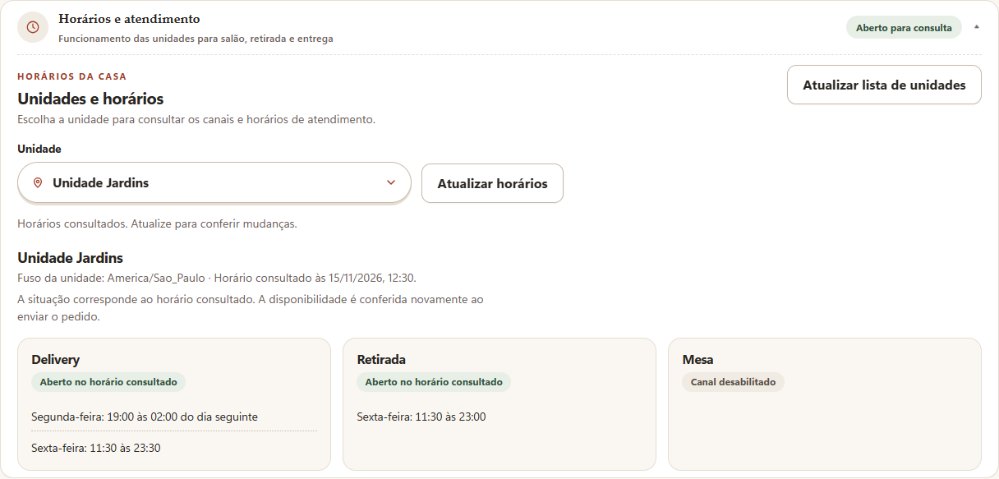 |
| `<app-disponibilidade>` (lista suspensa aberta no padrão `/cardapio`) | 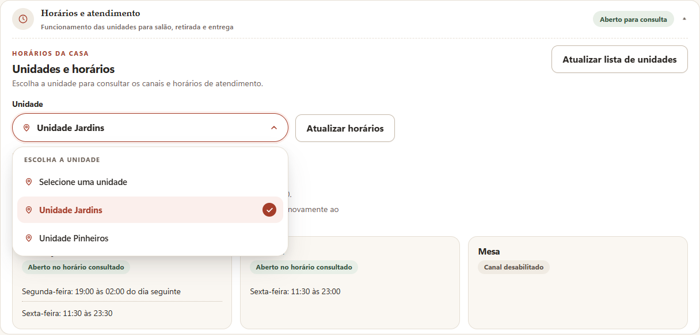 |
| `/carrinho` (`<app-confirmar-pedido>`) | 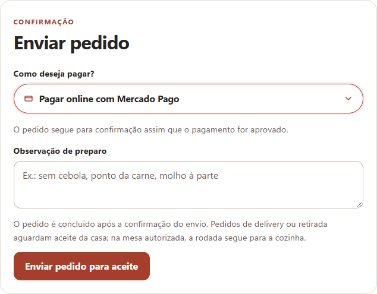 |
| `/carrinho` (`#pagamento-pedido` aberto no padrão `/cardapio`) | 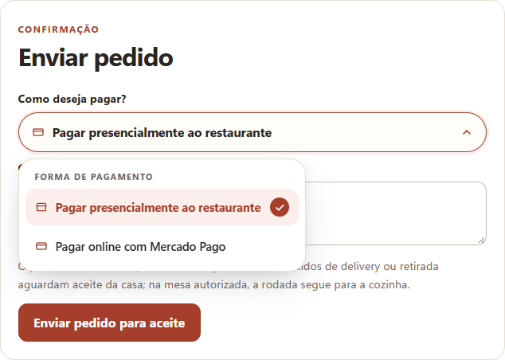 |
| `/carrinho` (`#comanda-pedido-assistido` aberto no padrão `/cardapio`) | 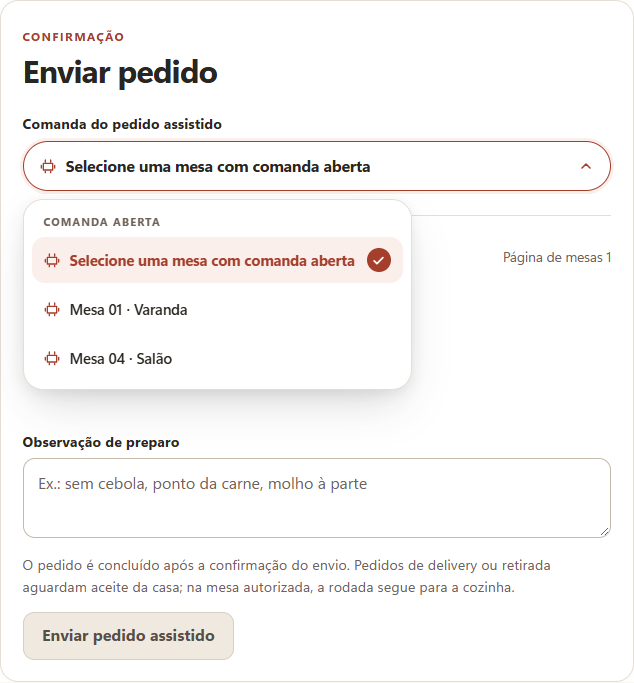 |
| `/pedidos` (`<app-meus-pedidos>`) | 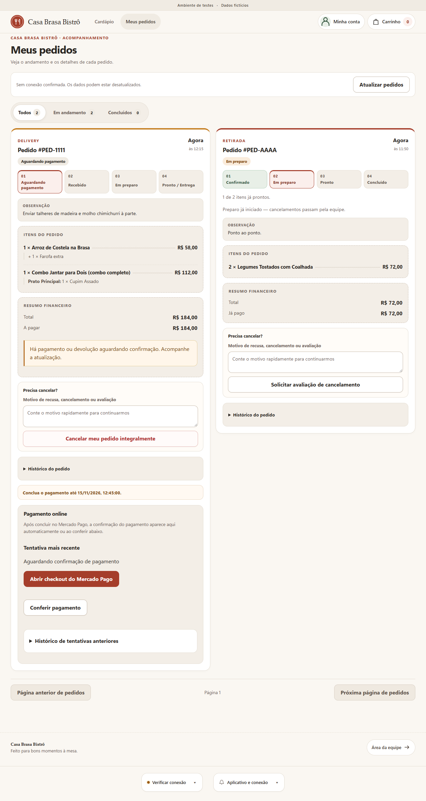 |
| `/pedidos/:id` (Checkout Pro Mercado Pago) | 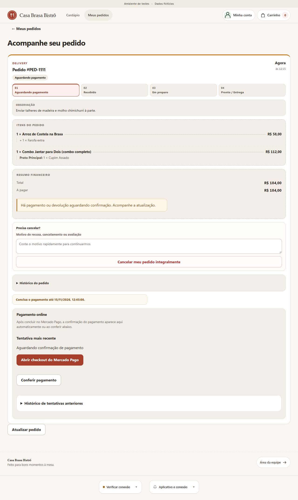 |
| `/mesa` (pré-entrada) | 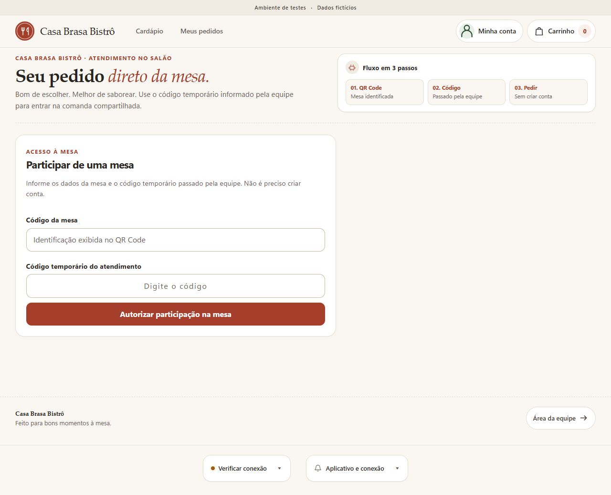 |
| `/mesa` (atendimento ativo + rodadas) | 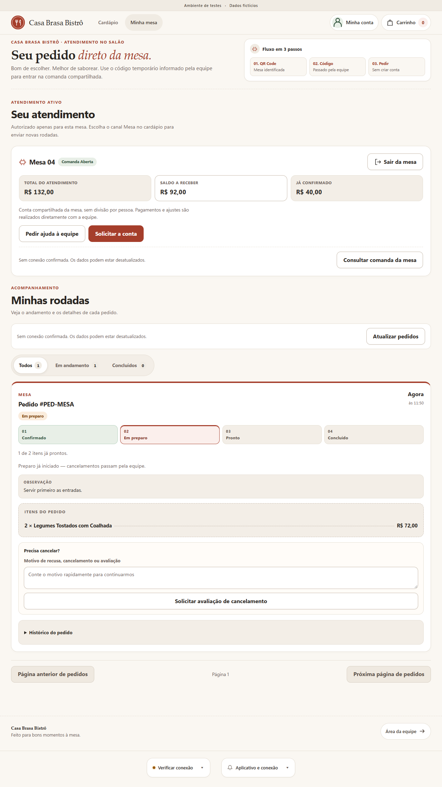 |

### Celular (`360×800`)

| Tela / Bloco | Captura AOT final (Celular `360×800`) |
| --- | --- |
| `<app-disponibilidade>` (`/cardapio`) | 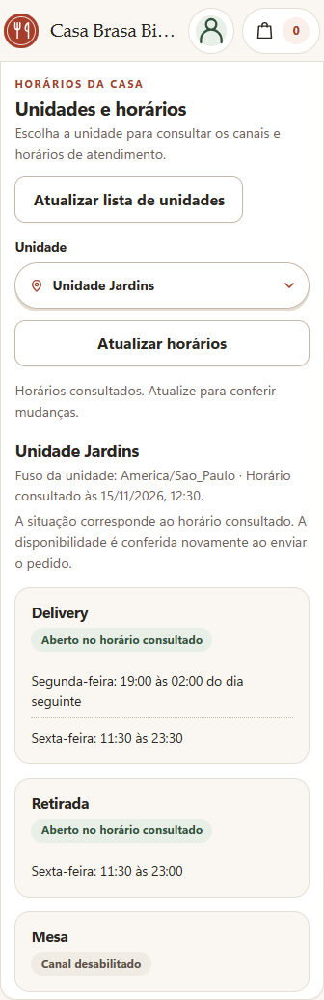 |
| `/carrinho` (`<app-confirmar-pedido>`) | 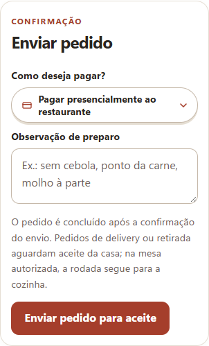 |
| `/pedidos` (`<app-meus-pedidos>`) | 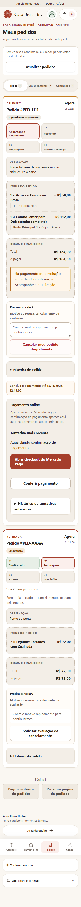 |
| `/pedidos/:id` (Checkout Pro Mercado Pago) | 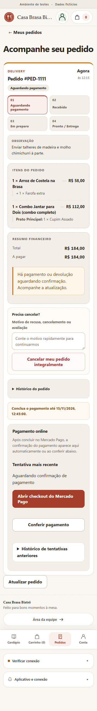 |
| `/mesa` (pré-entrada) | 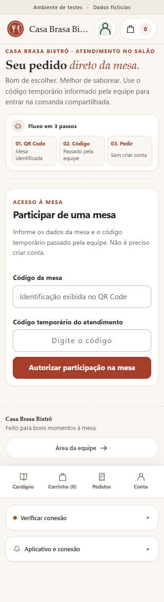 |
| `/mesa` (atendimento ativo + rodadas) | 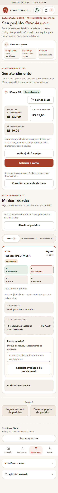 |

---

## 3. O que foi alterado

| Elemento / Bloco | Antes | Depois | Arquivo(s) |
| --- | --- | --- | --- |
| Tokens base, listas suspensas, assinaturas táteis e responsividade `360px` | Listas suspensas fora do padrão de `/cardapio` (sem halo aberto, título interno, badge circular de confirmação ou usando caixa nativa quadrada do sistema operacional); tokens verdes legados (`#dedfd8`, `#243228`, `#68736b`, `#8c4824`, etc.), `label { display: block }` conflitando com `.bistro-select-pill`, filtro em 2 linhas no `360px`, métrica ímpar órfã em `/mesa` e barra duplicada de sincronização | Padrão global `.bistro-select-*` e `.sr-select` alinhados pixel a pixel ao `/cardapio` (pílula com halo `#fbefec` + elevação, ícone líder, seta rotativa, popover `20px` sem caixa nativa do SO, `.bistro-select-popover-title`, `.bistro-select-opt.on` e `.bistro-select-opt-check` circular em terracota); migração integral para tokens oficiais (`#faf7f2`, `#fff`, `#f3eee7`, `#f0ebe3`, `#292521`, `#6e6259`, `#a53e2b`, `#7f2f20`, `#30523b`, `#e8efe7`, `#ad2929`, `#e5ded3`, `#c6b9aa`); regra `label:not(.bistro-select-pill):not(.selecao)`; `.filtros-pedidos` em grade fixa de 3 colunas (`repeat(3, minmax(0, 1fr))`) em `<= 600px`; `.comanda-sync` compacto no rodapé da comanda; `.comanda-metricas > :last-child:nth-child(odd)` ocupando largura total no celular; classes `.talao-pedido`, `.talao-pedido--salvia`, `.talao-linha`/`.talao-guia`, `.timeline-pedido`, `.mp-caixa`, `.btn-sair-mesa` e `.btn-cancelar-outline` preservando compatibilidade operacional das Sprints 3–5 | [styles.css](../../../frontend/src/styles.css), [operacao.css](../../../frontend/src/app/operacao.css) |
| Checkout pós-carrinho (`/carrinho`) | Botões nativos, `<select id="comanda-pedido-assistido">` nativo, `<label class="bistro-select-pill" for="pagamento-pedido">` duplicado sem popover completo de `/cardapio`, ausência de exemplo em `#observacao-pedido`, mensagens com `"política"`, `"servidor"`, `"intenção"`, `"nesta aba"` e `"rascunho"` | Métodos auxiliares preservando `<button hlmBtn (click)="enviar()">` filho direto de `app-confirmar-pedido > section`; `#pagamento-pedido` e `#comanda-pedido-assistido` com `<label for="...">` único, gatilho `
`, `<select class="sr-select">` compatível com `getByLabel(..., { exact: true }).selectOption(...)`, ícones SVG inline e popover no padrão `/cardapio` (`FORMA DE PAGAMENTO` / `COMANDA ABERTA`); exemplo prático em `#observacao-pedido`; textos humanos claros em recuperação e bloqueio; comprovante em `.talao-pedido.talao-pedido--salvia` | [confirmar-pedido.component.ts](../../../frontend/src/app/pedidos/confirmar-pedido.component.ts), [confirmar-pedido.component.html](../../../frontend/src/app/pedidos/confirmar-pedido.component.html) |
| Lista de pedidos do cliente (`/pedidos` e rodadas de `/mesa`) | Cabeçalho genérico sem marca ativa, nota de 5s no texto, estado vazio simples, ausência de filtros rápidos | Sobretítulo dinâmico com `nomeEstabelecimento()`, filtros locais (`Todos`, `Em andamento`, `Concluídos`) em cápsula única sem quebra no `360px`, `.barra-conexao` com `atualizadoEm()` condicional, nota discreta `'Atualização automática ativa em segundo plano.'`, `.vazio` com ícone e CTA `Explorar cardápio`, paginação `hlmBtn` | [meus-pedidos.component.ts](../../../frontend/src/app/pedidos/meus-pedidos.component.ts), [meus-pedidos.component.html](../../../frontend/src/app/pedidos/meus-pedidos.component.html) |
| Página individual (`/pedidos/:id`) | Cabeçalho mínimo sem atalho de volta nem skeleton estruturado | Barra `.pagina-pedido-topo` (`← Meus pedidos` e `Atualizar pedido`), kicker dinâmico com `marca.nome()`, título `Acompanhe seu pedido`, alerta `--danger` e `.pedido-skeleton` responsivo (`4 -> 2` colunas em `<= 520px`, `prefers-reduced-motion: reduce`) | [pagina-pedido.component.ts](../../../frontend/src/app/rotas/pagina-pedido.component.ts) |
| Detalhe do pedido | Unidades internas expostas ao cliente, `<dl>` com zeros, observação limitada a `65ch`, `: 1 × ...` caso `escolha.grupo` esteja ausente, timestamp técnico no preparo pessoal e tokens verdes legados no CSS | Modo `pessoal()`: timeline de 4 estágios (`etapasTimeline()`), `resumoUnidadesCliente()`, observação `.observacao-pedido` em largura total, `<ul class="unidades-producao">` oculta ao cliente, aviso calmo de preparo já iniciado, talão pontilhado com `@if (escolha.grupo)` e `<dl class="talao-resumo-dl">` condicional por `valorPositivo(...)`, faixa `.prazo-pagamento-online` para expiração, `.bloco-cancelamento` compacto e histórico humanizado com `nomeEvento(evento.tipo)`. Modo `!pessoal()` (`operacao`/`cozinha`) intacto e CSS 100% bistrô | [pedido-detalhe.component.ts](../../../frontend/src/app/pedidos/pedido-detalhe.component.ts), [pedido-detalhe.component.html](../../../frontend/src/app/pedidos/pedido-detalhe.component.html), [pedido-detalhe.component.css](../../../frontend/src/app/pedidos/pedido-detalhe.component.css) |
| Pagamento online (Mercado Pago) | Caixa plana sem estado, nota técnica e `
` interrompendo a sequência dos botões principais | `.mp-caixa` reativa a `data-estado` (`CONFIRMADO` sálvia / `RECUSADO` alerta suave), estado legível para `EM_RECONCILIACAO`, `<a hlmBtn variant="default">` para `Abrir checkout do Mercado Pago`, botões agrupados antes do acordeão colapsável `Histórico de tentativas anteriores` | [pagamento-pedido.component.ts](../../../frontend/src/app/pagamentos/pagamento-pedido.component.ts), [pagamento-pedido.component.html](../../../frontend/src/app/pagamentos/pagamento-pedido.component.html) |
| Mesa participante (`/mesa`) | Copy inicial com menção ao servidor, cabeçalho de comanda com botão `Sair da mesa` desalinhado no `360px` e barra `.barra-conexao` duplicada acima de `Minhas rodadas` | Formulário inicial limpo abaixo do `.mesa-hero`; comanda ativa com ícone `<app-icone nome="mesas" />`, botão outline `Sair da mesa` com ícone `sair` alinhado à direita, grade de métricas balanceada (`:last-child:nth-child(odd)` no mobile), `.comanda-sync` embutido no rodapé da comanda e fluxo limpo até `<app-meus-pedidos [mesa]="true" />` | [participante-mesa.component.ts](../../../frontend/src/app/mesas/participante-mesa.component.ts), [participante-mesa.component.html](../../../frontend/src/app/mesas/participante-mesa.component.html) |
| Disponibilidade pública (`/cardapio` e `/horarios`) | `<select id="unidade-publica">` nativo abrindo caixa quadrada do sistema operacional, botão `Atualizar lista de unidades` estilo fantasma e rótulo `"Consulta confirmada:"` | Cabeçalho `.disp-topo` com botão outline `Atualizar lista de unidades`, pílula customizada `#unidade-publica` com pin/seta SVG inline e popover `ESCOLHA A UNIDADE` no padrão `/cardapio` (método puro `nomeSelecionada()`, sem `inject()` ou `computed()`), `<select class="sr-select">` imediatamente seguido em DOM/Tab por `Atualizar horários`, badges com contraste AA e lista pontilhada de horários `.disp-lista` | [disponibilidade.component.ts](../../../frontend/src/app/unidades/disponibilidade.component.ts) |
| Execução multiplataforma da sonda JIT de mesas/confirmar | `import()` ESM com caminho absoluto no Windows (`ERR_UNSUPPORTED_ESM_URL_SCHEME`) e ausência de fallback para `msedge.exe` quando `chrome-headless-shell.exe` não existe no cache local do Playwright | `pathToFileURL(...)` no `import()` de `@angular/compiler-cli` e fallback condicional para `msedge.exe` em `win32` (quando o executável Chromium padrão do Playwright não existir), mantendo o comportamento Linux/CI e todas as asserções intocados | [test_mesa_navigation_templates.cjs](../../../scripts/test_mesa_navigation_templates.cjs) |

---

## 4. Por quê

- **Impacto na experiência do usuário (UX):** estende integralmente a identidade editorial e tátil de `/cardapio` ao checkout, acompanhamento, Checkout Pro e mesa participante; elimina termos de engenharia e zeros supérfluos; evita truncamento e desbalanceamento em `360×800` mantendo todas as ações principais agrupadas e acima de `48px` de altura.
- **Conformidade com as normas do projeto:** atende a [Interface/PWA](../../09_UI_GUIDELINES.md), [ADR 0003](../../adr/0003-spartan-navegacao-por-area.md), [Definition of Done](../../12_DEFINITION_OF_DONE.md), WCAG 2.2 AA (contraste, alvos táteis `>= 48px`, foco visível `#a53e2b`, zero overflow horizontal em `360px`, `768px` e `1280px`), multi-tenant via `MarcaService` (zero marca ou inicial fixa) e vocabulário uniforme (`"Carrinho"`, nunca `"Sacola"`).
- **Integridade de arquitetura e scripts JIT:** `backend/` permaneceu 100% intocado; nenhum `computed()` foi introduzido nos componentes validados por máquina virtual JIT (`meus-pedidos`, `pedido-detalhe`, `disponibilidade`) nem `inject()` em `disponibilidade`; em `<app-confirmar-pedido>`, `<button hlmBtn (click)="enviar()">` seguiu filho direto de `app-confirmar-pedido > section`; a visão `!pessoal()` (`operacao`/`cozinha`) e classes operacionais de `operacao.css` foram preservadas para as Sprints 3 e 4.

---

## 5. Pendências e Requisitos para o Backend

As telas da Sprint 2 operam sobre os contratos vigentes sem bloquear nenhum fluxo. As oportunidades de enriquecimento identificadas durante a inspeção de [`PedidoDetalhe.java`](../../../backend/src/main/java/br/com/restaurantmanager/pedidos/dtos/PedidoDetalhe.java), [`PedidoClienteController.java`](../../../backend/src/main/java/br/com/restaurantmanager/pedidos/controllers/PedidoClienteController.java) e [`CheckoutResumo.java`](../../../backend/src/main/java/br/com/restaurantmanager/pagamentos/dtos/CheckoutResumo.java) foram registradas em [Relatório de Pendências e Evoluções para o Backend](RELATORIO-PENDENCIAS-BACKEND.md):

- [`BE-15`](RELATORIO-PENDENCIAS-BACKEND.md): filtros opcionais por estado em `GET /api/v1/me/pedidos` (complementando o filtro local já entregue em `/pedidos`).
- [`BE-19`](RELATORIO-PENDENCIAS-BACKEND.md): rótulo público sanitizado de mesa por QR Code (`/mesa/:mesaId`).
- [`BE-21`](RELATORIO-PENDENCIAS-BACKEND.md): inclusão de `unidadeNome` e `mesaNome` em `PedidoDetalhe` (além da futura exposição de `endereco`/`entrega` no cliente).
- [`BE-22`](RELATORIO-PENDENCIAS-BACKEND.md): inclusão de `criadoEm` e `valor` em `CheckoutResumo` para o histórico do Mercado Pago.

---

## 6. Validações executadas

Resultados literais após a última edição em código (`frontend/src/styles.css`, `frontend/src/app/unidades/disponibilidade.component.ts`, `frontend/src/app/pedidos/confirmar-pedido.component.ts`, `frontend/src/app/pedidos/confirmar-pedido.component.html` e `scripts/test_mesa_navigation_templates.cjs`):

- **`npm --prefix frontend run format:check`:** aprovado (`exit 0` — `All matched files use Prettier code style!`).
- **`npm --prefix frontend run typecheck`:** aprovado (`exit 0` — `tsc --noEmit -p tsconfig.app.json && tsc -p tsconfig.e2e.json`).
- **`npx --prefix frontend ngc -p frontend/tsconfig.app.json --noEmit`:** aprovado (`exit 0`, com apenas warning pré-existente `NG8113: IconeComponent is not used within the template of PaginaPedidoComponent` em arquivo não editado nesta revisão).
- **`npm --prefix frontend run test:logic` (`scripts/test-frontend.cjs`):** aprovado (`exit 0`).
- **`node scripts/check_contrast.cjs --self-test`:** aprovado (`exit 0` — 14 verificações internas aprovadas).
- **Sondas individuais da Sprint 2 (7 sondas + shell de rotas):**
  - `node scripts/test_order_recovery.cjs` -> aprovado (`exit 0`)
  - `node scripts/test_public_hours.cjs` -> aprovado (`exit 0`)
  - `node scripts/test_mesa_context.cjs` -> aprovado (`exit 0`)
  - `node scripts/test_pending_intentions.cjs` -> aprovado (`exit 0`)
  - `node scripts/test_mesa_pagination.cjs` -> aprovado (`exit 0`)
  - `node scripts/test_snapshot_queue.cjs` -> aprovado (`exit 0`)
  - `node scripts/test_route_shell.cjs` -> aprovado (`exit 0`)
  - `node scripts/test_mesa_navigation_templates.cjs` -> aprovado (`exit 0` — compilação Angular JIT real + Edge headless validando geometria em `360/768/1280`, fontes `16/20`, foco, clique durante SSE, filas, paginação, envio bloqueado, `#comanda-pedido-assistido` e rejeição `409` preservada)
- **Build AOT de produção (`ng build --configuration=production` via Node VS `v24.12.0` com shim em memória `process.versions.node = '26.0.0'`) + PWA (`node scripts/build-pwa.cjs`):** aprovado (`exit 0`, `Initial total: 319.24 kB` / `87.59 kB estimated transfer size`; PWA: `33 arquivos públicos; versão a58d526605522b356b2b; APIs excluídas.`).
- **Auditoria DOM e capturas no Microsoft Edge headless sobre o `dist` AOT (`360×800`, `768×1024`, `1280×900` com mocks `/api/**`):** `overflow: 0`, `smallTargets: []`, `contrastFailed: []` e `forbidden: []` em todas as **22 verificações** (6 cenas principais × 3 viewports + menus suspensos abertos em `<app-disponibilidade>`, `#pagamento-pedido` e `#comanda-pedido-assistido`, mais verificação mobile `360×800` do modo assistido), com `tabOrderOk: true`, `exactLabelsOk: true` e `assistidoComandaSelected: "com-04"`.
- **`python scripts/check-repository.py`:** aprovado (`exit 0` — `936 arquivos conferidos; links locais e padrões de segredo aprovados. Âncoras exigem revisão adicional.`).

---

## 7. Limites de ambiente

- No host Windows deste ambiente, o Angular CLI exige Node `>= 26.0.0` (ou `>= 24.15.0`), razão pela qual o build AOT local utilizou shim em memória `process.versions.node = '26.0.0'` sobre o Node `v24.12.0` do Visual Studio, e a inspeção em navegador (AOT e `scripts/test_mesa_navigation_templates.cjs`) utilizou Microsoft Edge (`msedge.exe`) no lugar de `chrome-headless-shell.exe` com respostas `/api/**` simuladas.
- As sondas da Sprint 2 — incluindo `scripts/test_mesa_navigation_templates.cjs` e `scripts/test_route_shell.cjs` — executam e passam integralmente neste host Windows (`scripts/test_kitchen_templates.cjs` permanece restrito ao escopo da Sprint 3). Já a suíte E2E integrada contra Spring Boot + PostgreSQL (`e2e-pedidos`, `e2e-funcionamento`, `e2e-sprint04`) não pode ser executada localmente por ausência de PostgreSQL, Docker/Podman e WSL instalados nesta máquina; sua execução permanece indicada no pipeline Linux/CI (ou no ambiente de homologação com banco PostgreSQL ativo) ao abrir o Pull Request.
