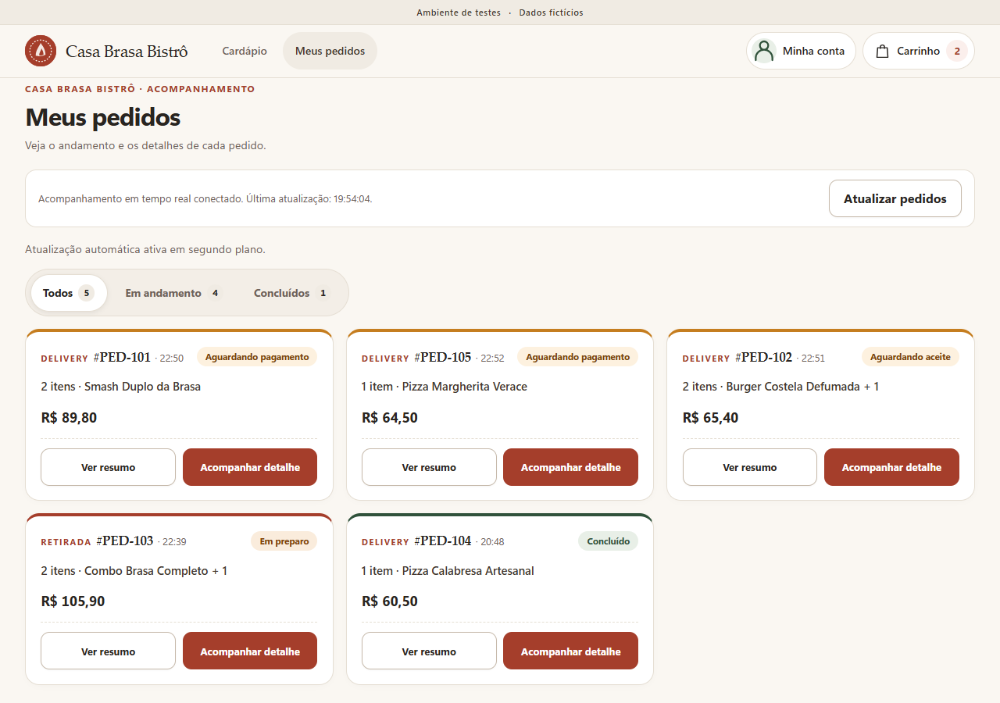
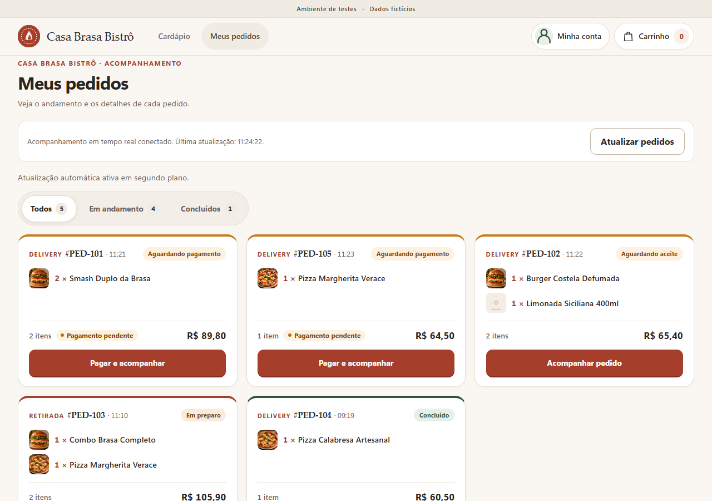
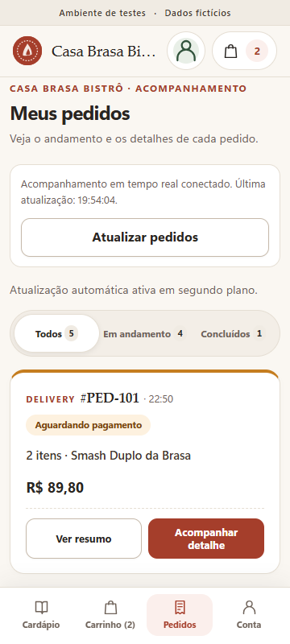
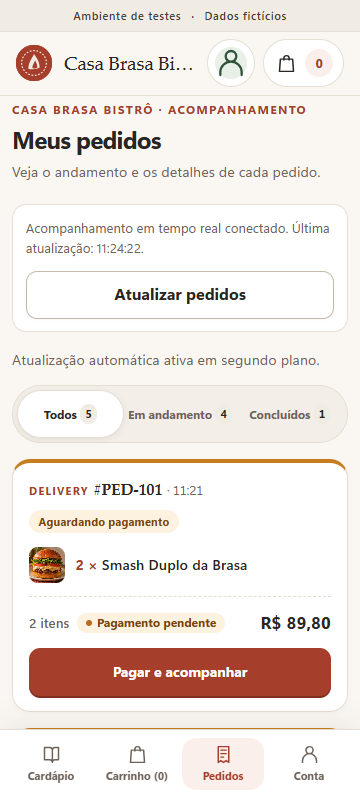
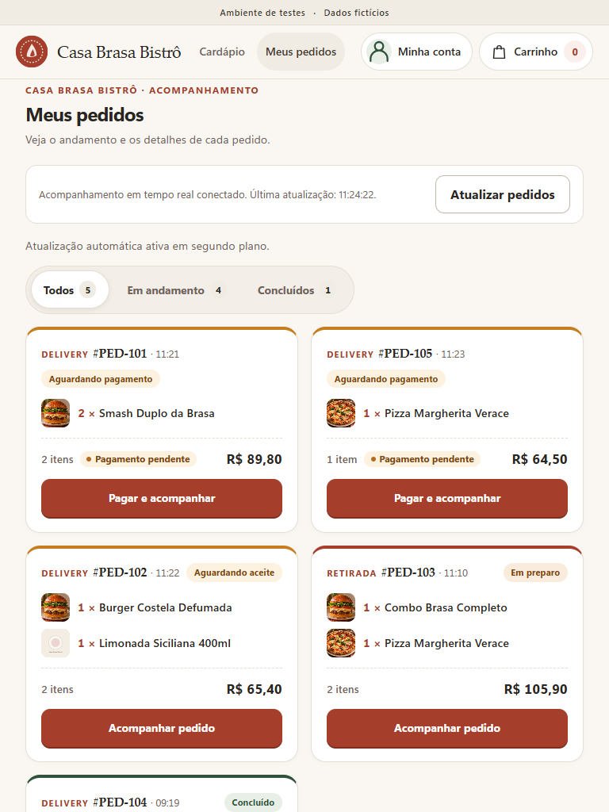

# Fluxo único em Meus Pedidos (`/pedidos`) com resumo visual rico e CTA direto

- **Data:** 2026-11-16
- **Tela / Rota:** `/pedidos` (`<app-meus-pedidos>`) — modo cliente (`!mesa()`), preservando 100% o modo `/mesa` (`mesa() === true`)
- **Área:** Cliente
- **Responsável técnico:** Coordenador (helpers compartilhados em `pedidos/modelos.ts`, limpeza de estado e helpers de resumo em `MeusPedidosComponent`, ajuste em `e2e-pedidos/pedidos.spec.ts`, build AOT/PWA e capturas) + subagente `artesao-ux-bistro` (camada visual em `meus-pedidos.component.html` e `operacao.css`)
- **Arquivos alterados:**
  - **Camada de modelo/componente e E2E (coordenador):**
    - [modelos.ts (pedidos)](../../../frontend/src/app/pedidos/modelos.ts) (`inicialProduto` e `resolverMidiaLinha` compartilhados)
    - [pedido-detalhe.component.ts](../../../frontend/src/app/pedidos/pedido-detalhe.component.ts) (reuso dos helpers de mídia/monograma sem duplicação)
    - [meus-pedidos.component.ts](../../../frontend/src/app/pedidos/meus-pedidos.component.ts) (remoção de `expandidos`/`alternarExpandido` e adição dos helpers do resumo e CTA único)
    - [pedidos.spec.ts](../../../frontend/e2e-pedidos/pedidos.spec.ts) (ajuste do cenário de cancelamento pós-preparo na linha 893–903 para abrir `/pedidos/:id` pelo CTA `"Acompanhar pedido"`)
  - **Camada visual e evidências:**
    - [meus-pedidos.component.html](../../../frontend/src/app/pedidos/meus-pedidos.component.html)
    - [operacao.css](../../../frontend/src/app/operacao.css)
    - [README.md](README.md)

## 1. Como era antes

1. **Redundância e duplicação inline no card de cliente (`@else`):**
   - Cada card em `/pedidos` apresentava dois botões de ação no rodapé (`.pedido-resumo-acoes`): `"Ver resumo"` (outline) e `"Acompanhar detalhe"` (primário).
   - Clicar em `"Ver resumo"` expandia `<app-pedido-detalhe contexto="cliente">` inline dentro da própria lista (`/pedidos`), duplicando toda a jornada de `/pedidos/:id`, causando expansão horizontal (`grid-column: 1 / -1`) e quebrando a previsibilidade da grade de cards.
2. **Resumo textual pobre no card fechado:**
   - Os itens apareciam em uma única linha truncada com `text-overflow: ellipsis` (`.pedido-resumo-itens`, ex.: `2 itens · Smash Duplo da Brasa`), sem miniatura fotográfica nem monograma de produto, dificultando reconhecer rapidamente cada pedido.
3. **Sinais e hierarquia de ação sem diferenciação por situação:**
   - Todos os pedidos (em andamento, aguardando pagamento online ou já concluídos/cancelados) recebiam o mesmo CTA genérico `"Acompanhar detalhe"` com variante primária idêntica, sem destacar pagamento pendente nem sinalizar solicitação de cancelamento em avaliação.
   - No celular (`360×800`), a dupla de botões dividia a largura ao meio e forçava quebra de linha em `"Acompanhar detalhe"`.
   - O elemento raiz do card era um `
`, alternando `role="article"` dinamicamente conforme o estado expandido.

## 2. Representação visual — Antes × Depois

Capturas sanitizadas geradas no Microsoft Edge sobre os builds AOT de produção:

| Viewport / Estado | Antes | Depois |
| --- | --- | --- |
| `/pedidos` — Desktop (`1280×900`) |  |  |
| `/pedidos` — Celular (`360×800`) |  |  |
| `/pedidos` — Tablet (`768×1024`) | Grade 2 colunas anterior sem miniaturas e com botões duplos |  |

## 3. O que foi alterado

| Elemento / Bloco | Antes | Depois | Arquivo(s) |
| --- | --- | --- | --- |
| Elemento raiz e semântica do card (`@else`) | `
` com `[class.pedido-card-resumo--expandido]` e `role="article"` condicional | `<article class="pedido-card-resumo" [attr.data-estado]="pedido.estado" [attr.aria-label]="'Pedido ' + pedido.id">` com `role="article"` implícito permanente e `aria-label` preservado; removidos `Ver resumo`/`Recolher resumo` e `.pedido-resumo-expandido` | [meus-pedidos.component.html](../../../frontend/src/app/pedidos/meus-pedidos.component.html), [operacao.css](../../../frontend/src/app/operacao.css) |
| Topo do card (`.pedido-resumo-topo`) | `@switch` manual de canal/estado e fatiamento bruto de `criadoEm` | Usa `canalRotulo(pedido.canal)`, `#{{ pedido.id.slice(0, 8).toUpperCase() }}`, `horaPedido(pedido.criadoEm)` via fuso local, badge `nomeEstado(pedido.estado)` (`[attr.data-estado]`) e badge condicional `"Cancelamento em avaliação"` (`data-estado="AGUARDANDO_ACEITE"`) quando `cancelamentoPendente(pedido)` | [meus-pedidos.component.html](../../../frontend/src/app/pedidos/meus-pedidos.component.html), [operacao.css](../../../frontend/src/app/operacao.css) |
| Lista rica de itens (`.pedido-resumo-lista-itens`) | Linha única truncada `.pedido-resumo-itens` | Exibe até 2 itens via `linhasVisiveis(pedido)` (`track linha.id`) com miniatura `36×36` (`/api/v1/midias/:id`, `width="36" height="36" loading="lazy" decoding="async"`, `object-fit: cover`, fallback em `(error)="registrarErroMidia(midia)"`) ou monograma `.pedido-resumo-thumb--mono` com `inicialProduto(linha.nome)`, linha `+ N outro(s) item(ns)` quando `linhasRestantes(pedido) > 0` e estado `"Sem itens listados"` quando `pedido.linhas.length === 0` | [meus-pedidos.component.html](../../../frontend/src/app/pedidos/meus-pedidos.component.html), [operacao.css](../../../frontend/src/app/operacao.css) |
| Rodapé financeiro e CTA único (`.pedido-resumo-rodape`) | Valor solto acima de dois botões divididos em `repeat(2, minmax(0, 1fr))` | `.pedido-resumo-rodape` ancorado à base (`margin-top: auto`) com divisória pontilhada de talão; `.pedido-resumo-rodape-info` exibe `totalUnidades(pedido)` (`1 item` / `N itens`), indicador `"Pagamento pendente"` quando `aguardandoPagamentoOnline(pedido)` e `totalPedidoFormatado(pedido)` em `tabular-nums`; `.pedido-resumo-acoes` contém 1 único `<a hlmBtn [variant]="varianteAcaoPedido(pedido)" size="sm" class="pedido-resumo-cta" [routerLink]="['/pedidos', pedido.id]">{{ rotuloAcaoPedido(pedido) }}</a>` (`Pagar e acompanhar`, `Acompanhar pedido` ou `Ver detalhes`) com largura total e `min-height: 48px` | [meus-pedidos.component.html](../../../frontend/src/app/pedidos/meus-pedidos.component.html), [operacao.css](../../../frontend/src/app/operacao.css) |
| Saneamento de regras e estado `EM_ENTREGA` | Regras órfãs `.pedido-card-resumo--expandido`, `.pedido-resumo-expandido` e `.pedido-resumo-itens`; `EM_ENTREGA` sem cor dedicada | Removidas todas as regras órfãs não usadas em outros templates; adicionados estilos AA de borda e etiqueta para `EM_ENTREGA` (`#edf0f8` / `#36457d` e `#5364a8`), ajuste de espaçamento em `<= 400px` e respeito a `prefers-reduced-motion` | [operacao.css](../../../frontend/src/app/operacao.css) |
| Preservação de `/mesa`, filtros e paginação | Cabeçalho, `.barra-conexao`, `.filtros-pedidos`, `@if (mesa()) { <app-pedido-detalhe ... /> }`, `@empty` e `.paginacao` | Preservados 100% sem alterações de estrutura ou comportamento | [meus-pedidos.component.html](../../../frontend/src/app/pedidos/meus-pedidos.component.html) |

### Detalhes técnicos de paleta, contraste WCAG 2.2 AA e responsividade

- **Paleta oficial e contraste AA verificados:**
  - `#292521` sobre `#ffffff` (`15.21:1`), `#a53e2b` sobre `#ffffff` (`6.32:1`), `#ffffff` sobre `#a53e2b` (`6.32:1`), `#a53e2b` sobre `#f0ebe3` (`5.32:1`), `#6e6259` sobre `#ffffff` (`5.91:1`).
  - Etiquetas e alertas: `#7a440d` sobre `#fdf1df` (`7.08:1`), `#36457d` sobre `#edf0f8` (`7.99:1`), `#82410a` sobre `#faecdc` (`6.68:1`), `#30523b` sobre `#e8efe7` (`7.48:1`), `#9c2323` sobre `#fae9e6` (`6.67:1`).
- **Alinhamento em grade de 3 / 2 / 1 colunas (`1280px` / `768px` / `360px`):**
  - Removido `justify-content: space-between` de `.pedido-card-resumo` (mantendo `height: 100%` e `margin-top: auto` no `.pedido-resumo-rodape`) para impedir que cartões com 1 item deixem lacuna vertical entre o topo e a lista de itens, alinhando o rodapé de todos os cartões da mesma linha.
  - Em `1280px`, ajustes sutis em `.pedido-resumo-topo` garantem que `DELIVERY #XXXXXXXX · HH:MM` e uma etiqueta longa como `Aguardando pagamento` permaneçam na mesma linha sem quebra desnecessária.

## 4. Por quê

- **Impacto na experiência do usuário (UX):** elimina o fluxo duplicado entre resumo inline e tela de acompanhamento (`/pedidos/:id`), mostra visualmente o conteúdo de cada pedido já na lista com miniaturas `36×36` e destaca imediatamente ações urgentes (`Pagar e acompanhar`, `"Pagamento pendente"`, `"Cancelamento em avaliação"`), oferecendo um único alvo tátil confortável de `48px` em largura total.
- **Conformidade com as normas do projeto:** alinhado à identidade editorial de `/cardapio` (divisória pontilhada de talão, monograma serifado itálico, relevo tátil de botão), [Interface, acessibilidade e PWA](../../09_UI_GUIDELINES.md), [ADR 0003](../../adr/0003-spartan-navegacao-por-area.md) e critérios WCAG 2.2 AA.
- **Isolamento de backend e contratos:** zero alteração em `backend/`, rotas (`*.routes.ts`), guardas (`guardas.ts`), serviços ou payload das APIs; `mesa() === true` (`/mesa`) preserva 100% do `<app-pedido-detalhe contexto="mesa">`, e cada card em `/pedidos` mantém `role="article"` e `[attr.aria-label]="'Pedido ' + pedido.id"`.

## 5. Pendências e Requisitos para o Backend

Nenhuma pendência de backend: todos os dados (`canal`, `estado`, `criadoEm`, `linhas`, `solicitacoes`, `saldo`, `pagoOnline`) e resolução local de `midiaId` já são entregues e tratados pelos métodos preparados pelo Coordenador em [meus-pedidos.component.ts](../../../frontend/src/app/pedidos/meus-pedidos.component.ts) e [modelos.ts (pedidos)](../../../frontend/src/app/pedidos/modelos.ts).

## 6. Validações executadas

Execuções realizadas sobre a versão final dos arquivos (Node `v24.12.0` do Visual Studio nesta estação Windows):

- **Formatação Prettier (`npm --prefix frontend run format:check`):** aprovado (`All matched files use Prettier code style!`, saída `0`).
- **Tipagem TypeScript (`npm --prefix frontend run typecheck`):** aprovado (`tsc --noEmit -p tsconfig.app.json && tsc -p tsconfig.e2e.json`, saída `0`).
- **Compilação AOT de templates (`ngc -p frontend/tsconfig.app.json --noEmit`):** aprovado (saída `0`).
- **Suite lógica frontend (`node scripts/test-frontend.cjs`):** aprovado (22 probes lógicos integrados em transporte/JIT simulados, saída `0`).
- **Contratos de templates, PWA, KDS e contraste:**
  - `node scripts/test_mesa_navigation_templates.cjs`, `node scripts/test_route_shell.cjs`, `node scripts/test_pwa.cjs` e `node scripts/test_kitchen_templates.cjs` -> aprovados (`exit 0`, ambiente simulado).
  - `node scripts/check_contrast.cjs --self-test` -> aprovado (`14 verificações de matemática, limites, destino e reutilização de sessão aprovadas; nenhuma navegação executada.`, saída `0`).
- **Build AOT de produção e PWA (`ng build --configuration production && node ../scripts/build-pwa.cjs` com shim de versão Node `24.15.0` em `NODE_OPTIONS`):** aprovado (`Initial total: 319.72 kB | Estimated transfer size: 88.14 kB`; PWA: `34` arquivos públicos, versão `28480a18273cf4f10547`, APIs excluídas, saída `0`).
- **Verificação integrada no navegador (Microsoft Edge headless sobre servidor de preview AOT local com backend simulado/demo):**
  - `verify-fluxo-unico-pedidos.cjs` -> aprovado (`VERIFICACAO_FLUXO_UNICO_PEDIDOS_OK`, saída `0`): validou `0` botões `"Ver resumo"`/`"Recolher resumo"`, `0` links `"Acompanhar detalhe"`, `0` `<app-pedido-detalhe>` inline em `/pedidos`, miniaturas `36×36` carregadas + monograma editorial, CTAs contextuais (`Pagar e acompanhar`, `Acompanhar pedido`, `Ver detalhes`) com `height >= 48px`, `0px` overflow horizontal em `1280×900`, `768×1024` e `360×800`, filtros (`Todos`/`Concluídos`), navegação direta até `/pedidos/ped-101` e preservação do modo `[mesa]="true"` em `/mesa/mesa-04`.
  - `verify-polimento-carrinho-pedidos.cjs` -> aprovado (`VERIFICACAO_POLIMENTO_COMPLETA_OK`, saída `0`).
  - `verify-sprint2-1.cjs` -> aprovado (`VERIFICACAO_SPRINT2_1_COMPLETA_OK`, saída `0`).
- **Consistência do repositório (`python scripts/check-repository.py`):** aprovado (`979 arquivos conferidos; links locais e padrões de segredo aprovados. Âncoras exigem revisão adicional.`, saída `0`).

## 7. Limites e próximos passos

- Os testes de navegador aqui executados rodaram contra o build AOT servido no preview local com backend simulado/demo; homologação contra o backend Java/PostgreSQL real permanece no fechamento da etapa integrada.
- Na suíte Playwright integrada completa com backend Spring, revisar se `S04-UI08` em [sprint04.spec.ts](../../../frontend/e2e-sprint04/sprint04.spec.ts#L704-L719) deve clicar em `"Pagar e acompanhar"` na rota `/pedidos` para operar dentro de `/pedidos/:id`.
