# Sprint 3 · Tema Dark Global Bistrô, Shell Operacional da Equipe e Painel KDS (`/cozinha`)

- **Data:** 2026-11-18
- **Telas / Rotas:** Fundação Global + Retrofit Dark das Sprints 1–2.1 (`/cardapio`, `/carrinho`, `/pedidos`, `/pedidos/:id`, `/mesa`, `/conta`, `/entrar`, `/cadastro`, `/recuperar-senha`, `/verificar-email`, `/aceitar-convite`, `/sem-acesso`, `/design-system`), Shell Operacional da Equipe (`/gestao/*` e `/cozinha` via `<app-equipe-layout>`) e Painel KDS (`/cozinha` via `<app-cozinha>` + `<app-cartao-cozinha>`)
- **Área:** Transversal (Cliente, Gestão e Cozinha/KDS)
- **Responsável técnico:** Coordenador (camada estrutural TypeScript: `ui/tema.ts`, inicialização em `main.ts`, ícones `'sol'`/`'lua'` em `IconeComponent`, alternadores de tema em `ClienteLayoutComponent`/`EquipeLayoutComponent` e gestos/sinais de arrasto e divisão de unidades em `CartaoCozinhaComponent`, além do build AOT integrado e capturas finais) + subagente `artesao-ux-bistro` (camada visual completa, tokens Claro/Dark WCAG 2.2 AA, retrofit das Sprints 1–2.1, shell `equipe-layout` e painel KDS `cozinha`/`cartao-cozinha`)
- **Arquivos alterados na camada visual:**
  - **Fundação e Retrofit Claro/Dark (Sprints 1–2.1 + cartões operacionais):**
    - [styles.css](../../../frontend/src/styles.css)
    - [cliente-layout.css](../../../frontend/src/app/rotas/cliente-layout.css)
    - [vitrine.css](../../../frontend/src/app/catalogo/vitrine.css)
    - [catalogo.css](../../../frontend/src/app/catalogo/catalogo.css)
    - [carrinho.css](../../../frontend/src/app/carrinho/carrinho.css)
    - [operacao.css](../../../frontend/src/app/operacao.css)
    - [pedido-detalhe.component.css](../../../frontend/src/app/pedidos/pedido-detalhe.component.css)
    - [mesas.component.css](../../../frontend/src/app/mesas/mesas.component.css)
    - [pagina-pedido.component.ts](../../../frontend/src/app/rotas/pagina-pedido.component.ts) *(bloco `styles:`)*
    - [disponibilidade.component.ts](../../../frontend/src/app/unidades/disponibilidade.component.ts) *(bloco `styles:`)*
    - [pwa.component.ts](../../../frontend/src/app/pwa/pwa.component.ts) *(bloco `styles:`)*
    - [pagina-informativa.component.ts](../../../frontend/src/app/rotas/pagina-informativa.component.ts) *(bloco `styles:`)*
    - [catalogo.component.ts](../../../frontend/src/app/ui/catalogo.component.ts) *(bloco `styles:`)*
    - [enderecos.component.ts](../../../frontend/src/app/delivery/enderecos.component.ts) *(bloco `styles:`)*
    - [identidade.component.ts](../../../frontend/src/app/identidade/identidade.component.ts), [cadastro.component.ts](../../../frontend/src/app/identidade/cadastro.component.ts), [recuperacao.component.ts](../../../frontend/src/app/identidade/recuperacao.component.ts), [verificacao.component.ts](../../../frontend/src/app/identidade/verificacao.component.ts) e [aceitar-convite.component.ts](../../../frontend/src/app/identidade/aceitar-convite.component.ts) *(apenas blocos `styles:` inline preservando compilação JIT)*
  - **Shell Operacional da Equipe:**
    - [equipe-layout.component.html](../../../frontend/src/app/rotas/equipe-layout.component.html)
    - [equipe-layout.css](../../../frontend/src/app/rotas/equipe-layout.css)
  - **Painel KDS da Cozinha:**
    - [cozinha.component.html](../../../frontend/src/app/cozinha/cozinha.component.html)
    - [cozinha.component.css](../../../frontend/src/app/cozinha/cozinha.component.css)
    - [cartao-cozinha.component.html](../../../frontend/src/app/cozinha/cartao-cozinha.component.html)
    - [cartao-cozinha.component.css](../../../frontend/src/app/cozinha/cartao-cozinha.component.css)

---

## 1. Como era antes

1. **Ausência de Tema Dark Bistrô e valores claros fixos nas Sprints 1–2.1:**
   - `:root` definia apenas tokens claros (`color-scheme: light`), sem `:root[data-theme='dark']` nem distinção entre terracota de superfície sólida (`--primary`) e terracota de texto luminoso (`--primary-ink`) sobre fundos escuros.
   - Folhas entregues anteriormente (`cliente-layout.css`, `vitrine.css`, `catalogo.css`, `carrinho.css`, `operacao.css`, `pedido-detalhe.component.css`, `mesas.component.css` e `styles:` de `identidade/`, `enderecos`, `pwa`, `disponibilidade`, `pagina-pedido`, `pagina-informativa`) continham cores fixas (`#faf7f2`, `#ffffff`, `white`, `#fbefec`, `#fff8e8`, `#fff2f0`, `#efe9e0`, `#594e46`, `#7f2f20`) que quebrariam contraste ou ofuscariam o operador em modo escuro; além disso, `.theme-toggle` em `cliente-layout.css` ainda carecia de estilo dedicado de pílula discreta e adaptação compacta em `360px`.
2. **Shell da Equipe (`equipe-layout`) preso à paleta verde legada, texto fixo e ruído:**
   - Topbar da cozinha em verde-floresta (`#173e2c`), sidebar com destaque verde (`#eaf0e5` / `#254d36`), avatar `#edf1e8` / `#34563e` e seletor `.unit-picker` exibindo borda dupla interna (conflito com a regra global de `select`) e truncamento prematuro em `360px`.
   - Breadcrumb exibia `Restaurante` fixo em vez de `{{ marca.nome() }}` (violando a diretriz multi-tenant white-label).
   - Frases decorativas sem função operacional (`"SEU RESTAURANTE, EM SINTONIA"` no cabeçalho e `"Uma boa experiência começa nos detalhes."` no rodapé da sidebar) ocupavam área nobre; em `/cozinha`, `.page-heading` permanecia no DOM e a topbar não oferecia alternância Claro/Escuro.
3. **Painel KDS (`/cozinha` e `<app-cartao-cozinha>`) sem assinatura Bistrô, sem pistas visuais de arrasto e com poluição nos cartões:**
   - Colunas e cartões usavam hexadecimais verdes/azuis/amarelos legados (`#263b30`, `#294b38`, `#316c44`, `#e7ebe5`, `#2558ad`, `#426cba`, `#fff3d7`, `#f3f3ed`).
   - `<app-cartao-cozinha>` não recebia `[etapa]`, não ligava `(pointerdown)="iniciarArrastoCartao($event)"`, nem destacava zonas `[data-drop-etapa]` com `.alvo-arrasto` nas colunas e abas.
   - Cartões com todas as unidades na mesma etapa repetiam linha redundante (`"4 na fila · 0 em preparo · 0 prontas"`, `"0 na fila · 0 em preparo · 1 pronta"`), e `
` exibia frases genéricas de instrução em todo pedido.

---

## 2. Representação visual — Antes × Depois

Capturas sanitizadas do estado **Antes** e **Depois** (build AOT de produção inspecionado em Microsoft Edge nos temas Claro e Dark em `1280×900`, `768×1024` e `360×800`):

| Tela / Viewport | Antes | Depois — Tema Claro | Depois — Tema Dark |
| --- | --- | --- | --- |
| `/cozinha` — Desktop (`1280×900`) | 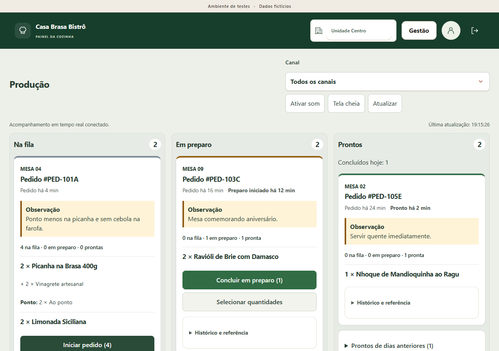 | 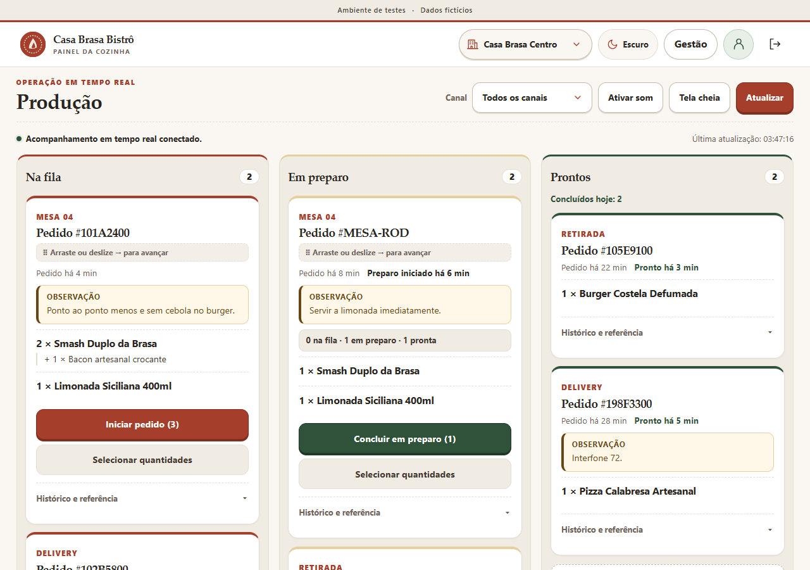 | 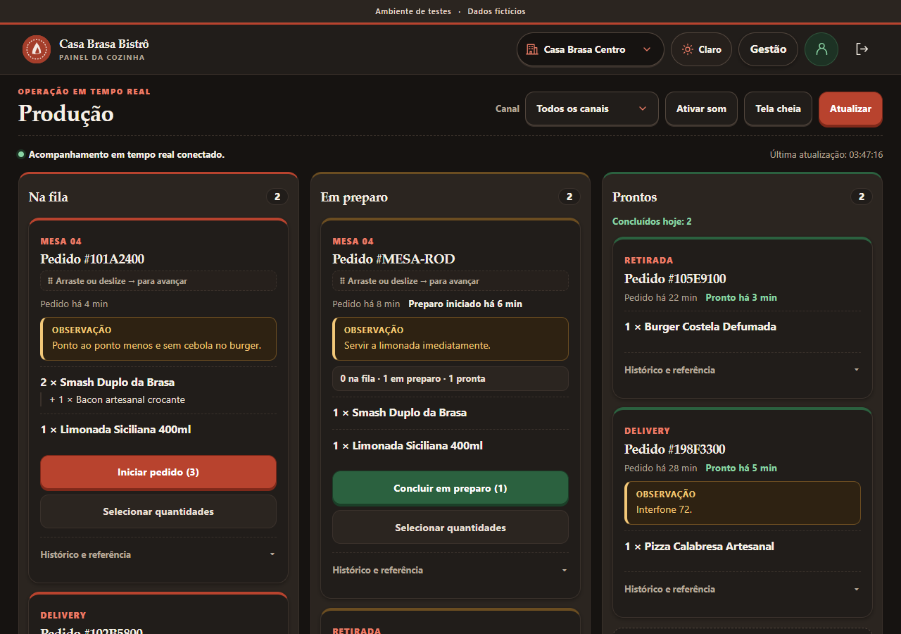 |
| `/cozinha` — Tablet (`768×1024`) | *(Sem captura anterior dedicada; abas verdes legadas)* | *(Mesma estrutura de abas Spartan em tema Claro)* | 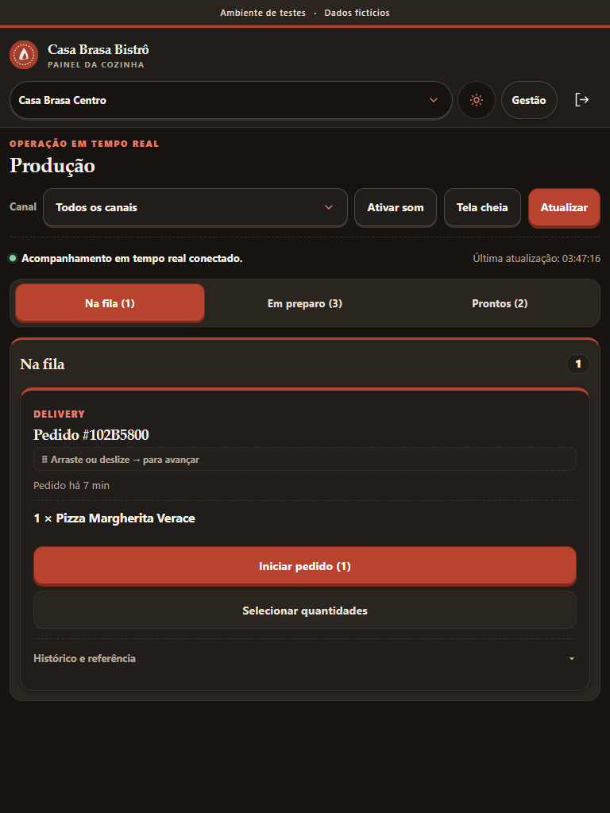 |
| `/cozinha` — Celular (`360×800`) | 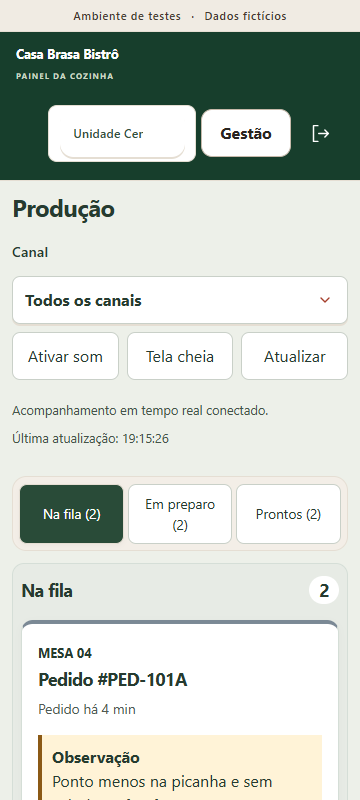 | 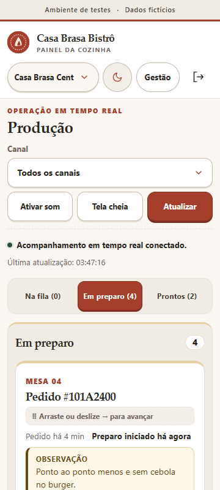 | 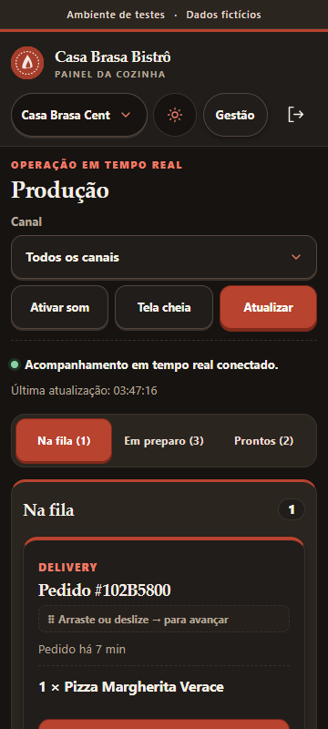 |
| `/gestao/pedidos` — Desktop (`1280×900`) | 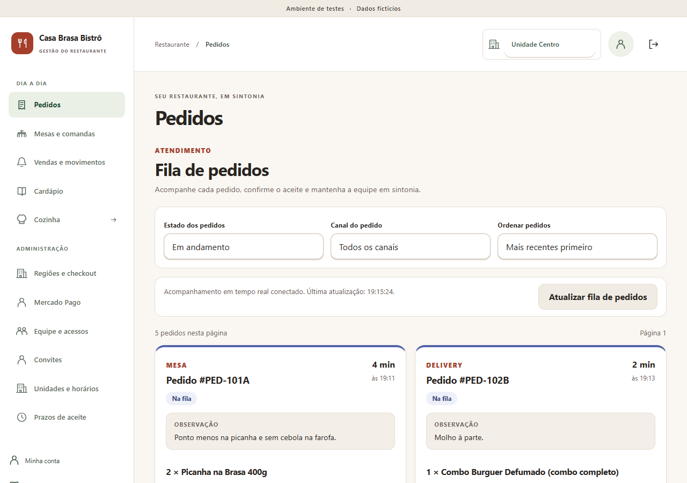 | 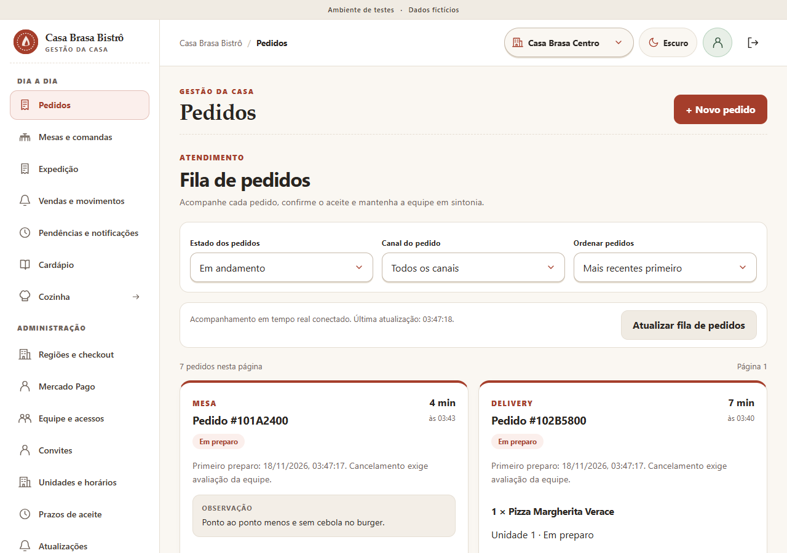 | 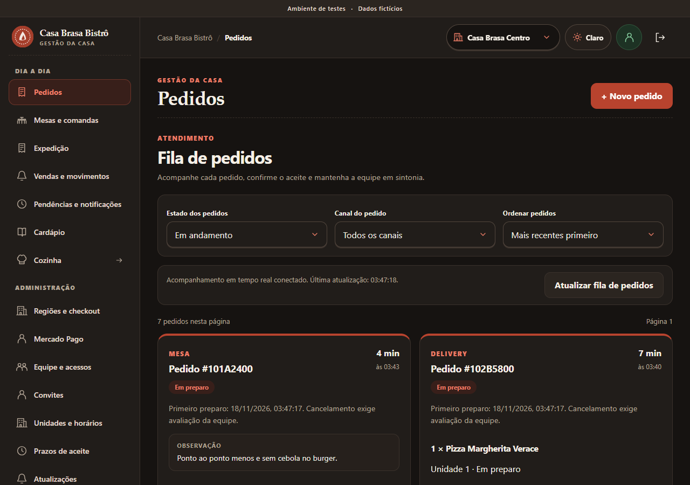 |
| `/gestao/pedidos` — Celular (`360×800`) | 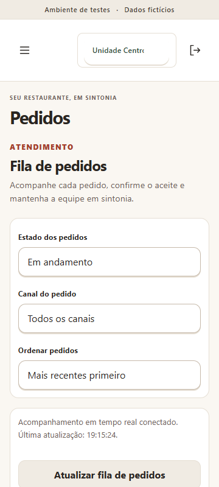 | *(Shell responsivo Bistrô em tema Claro)* | 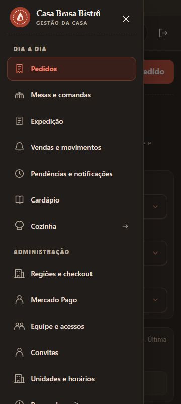 |
| Retrofit Cliente Dark (`/cardapio` e `/pedidos` — `1280×900`) | *(Apenas tema Claro nas Sprints 1–2.1)* | 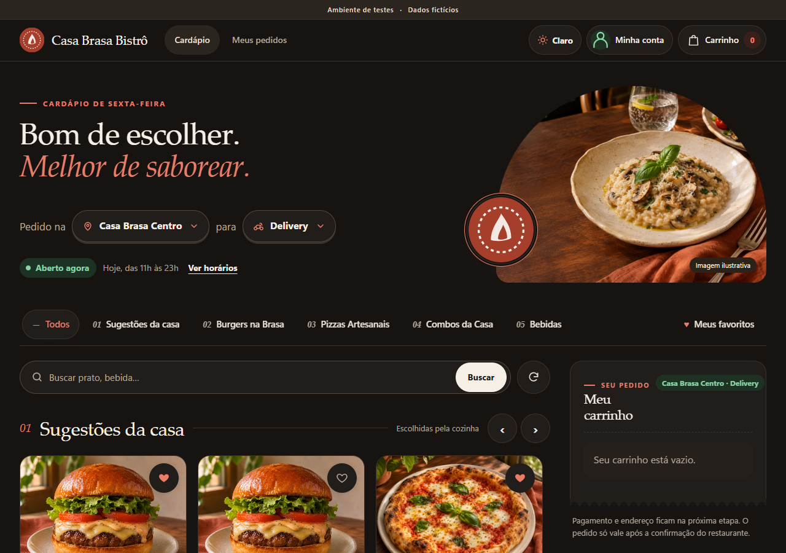 | 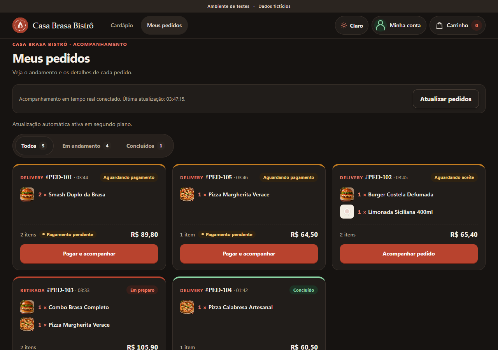 |

---

## 3. O que foi alterado × Por quê

### 3.1. Sistema Global de Tema Claro + Tema Dark Bistrô + Retrofit Sprints 1–2.1

| Elemento / Escopo | Como era antes | O que foi alterado | Por quê (UX, WCAG 2.2 AA e Normas) |
| --- | --- | --- | --- |
| Tokens globais `:root` e `:root[data-theme='dark']` ([styles.css](../../../frontend/src/styles.css)) | Apenas paleta clara; sem tokens semânticos unificados de alerta/erro/desabilitado, sem trava contra repetição de chevron SVG em `<select>` com shorthand local nem separação entre terracota de botão e terracota textual em fundo escuro | Adicionado `:root[data-theme='dark']` (`--background: #161311`, `--card: #211d1a`, `--popover: #241f1c`, `--foreground: #f5efe6`, `--secondary: #2b2520`, `--secondary-foreground: #e8dfd3`, `--muted: #26201c`, `--muted-foreground: #b5a798`, `--primary: #b8432e`, `--primary-hover: #a53a27`, `--primary-deep: #7f291a`, `--primary-ink: #eb7c66`, `--accent: #1d3224`, `--accent-foreground: #8ad4a4`, `--sage-solid: #2b613f`, `--destructive: #c43b3b`, `--border: #3a312b`, `--input: #52463d`, `--ring: #eb7c66`), aliases `--rm-*`, tokens `--amber-*`, `--danger-*`, `--info-*`, `--disabled-*`, controles `color-scheme: dark`, `background-color: var(--card)` + `background-repeat: no-repeat !important; background-position: right 0.9rem center !important` nos `<select>`, `button[hlmBtn]:disabled` (`#2d2722` / `#9c8f82` / `#453b33`) e `.cartao-arrasto-fantasma` global | Garante contraste WCAG 2.2 AA rigoroso tanto em botões sólidos (`#ffffff` sobre `#b8432e` = `5.41:1` e sobre `#2b613f` = `7.39:1`) quanto em textos/preços/eyebrows/links (`#eb7c66` sobre `#161311` = `6.73:1` e sobre `#211d1a` = `6.10:1`), impede repetição em mosaico do chevron SVG nos `<select>` escuros e estiliza o clone de arrasto anexado em `document.body` |
| Cabeçalho do cliente e `.theme-toggle` ([cliente-layout.css](../../../frontend/src/app/rotas/cliente-layout.css)) | `:host`, `.client-header` e `.mobile-nav` com `#faf7f2`/`#ffffff` fixos; `.theme-toggle` herdava estilo cheio de CTA primário | Migrados fundos/textos para `var(--background)`, `var(--card)` e `var(--foreground)`; `.theme-toggle` estilizado como pílula editorial discreta (`min-height: 48px`, ícone em `--primary-ink`) que colapsa `.theme-toggle-label` em `<= 900px`/`680px` virando botão circular `48×48px` | Mantém hierarquia limpa no topo do `/cardapio` (onde o carrinho continua protagonista) e evita aperto ou `overflow-x` em celulares `360px` |
| Vitrine, configurador e carrinho ([vitrine.css](../../../frontend/src/app/catalogo/vitrine.css), [catalogo.css](../../../frontend/src/app/catalogo/catalogo.css), [carrinho.css](../../../frontend/src/app/carrinho/carrinho.css)) | `background: white` nos inputs, `background:` shorthand em `select` de `catalogo.css`, `--primary-deep` fixo em `:host`, botão `.go` com `color: #fff` sobre `--foreground` (ficaria branco sobre creme no dark), `.fav` `#fff` fixo e `.step-n` usando `--accent-foreground` com texto branco | Migrados para `background-color: var(--card)` + `padding-right: 2.5rem` nos `select`, `--primary-ink`, `--primary-soft`, `--popover`, `--sage-solid` (em `.step-n`), `color: var(--background)` em `.go` e cartões `.item` com `var(--card)`/`var(--foreground)` | Preserva 100% da estética editorial da vitrine no tema claro e elimina inversões ilegíveis ou seta repetida em modais, busca, chips de ponto da carne e gestão de catálogo no tema escuro |
| Pedidos, mesa, disponibilidade, PWA, informativas e identidade ([operacao.css](../../../frontend/src/app/operacao.css), [pedido-detalhe.component.css](../../../frontend/src/app/pedidos/pedido-detalhe.component.css), [mesas.component.css](../../../frontend/src/app/mesas/mesas.component.css), blocos `styles:` de `pagina-pedido`, `disponibilidade`, `pwa`, `pagina-informativa`, `ui/catalogo`, `enderecos` e `identidade/*`) | Avisos âmbar/erro, `background:` shorthand em `select:not(.sr-only)` de `operacao.css`, `.timeline-etapa`, `.canal-opcao.ativo`, `.codigo-atendimento` e estados `:disabled` com hexadecimais claros fixos | Substituídos por `background-color: var(--card, #fff)` nos controles, `var(--amber-*)`, `var(--danger-*)`, `var(--info-*)`, `var(--primary-soft)`, `var(--primary-ink)`, `var(--sage-solid)` e `var(--disabled-*)`, além de regras dark globais em `styles.css` para `.navigation-notice`, `.connection-dot.unavailable` e `/mesa` | Assegura leitura confortável, `<select>` limpos com seta única e zero caixas brancas estouradas em `/pedidos`, `/pedidos/:id`, `/mesa`, `/conta`, `/entrar`, `/cadastro`, `/sem-acesso`, `/gestao/pedidos` e `/gestao/mesas`, preservando `template:`/`styles:` inline nos componentes JIT |

### 3.2. Shell Operacional da Equipe (`equipe-layout`)

| Elemento / Bloco | Como era antes | O que foi alterado | Por quê (UX, Multi-Tenant e Contratos) |
| --- | --- | --- | --- |
| Paleta e identidade do shell ([equipe-layout.css](../../../frontend/src/app/rotas/equipe-layout.css)) | Verde legado em `.kitchen-workplace .workspace-header` (`#173e2c`), `.sidebar nav .active` (`#eaf0e5`/`#254d36`), `.brand-mark` (`#285139`) e `.user-avatar` (`#edf1e8`) | Migrado 100% para tokens Bistrô Claro + Dark (`var(--background)`, `var(--card)`, `var(--primary)`, `var(--primary-soft)`, `var(--primary-ink)`, `var(--border)`), selo circular `.brand-mark` idêntico à assinatura da plataforma e filete superior terracota discreto no modo KDS | Unifica Cliente, Gestão e Cozinha na mesma identidade autoral de bistrô ([ADR 0003](../../adr/0003-spartan-navegacao-por-area.md)) com zero resquício da paleta antiga |
| Breadcrumb multi-tenant e limpeza de ruído ([equipe-layout.component.html](../../../frontend/src/app/rotas/equipe-layout.component.html)) | Texto fixo `Restaurante / {{ titulo() }}`; subtítulo longo `GESTÃO DO RESTAURANTE`; frases decorativas `"Uma boa experiência começa nos detalhes."` e `"SEU RESTAURANTE, EM SINTONIA"`; `.page-heading` presente no DOM de `cozinha` | Breadcrumb usa `{{ marca.nome() }}` dinâmico; subtítulo conciso `GESTÃO DA CASA`; frases decorativas removidas; `.page-heading` renderizado apenas quando `@if (!cozinha)` | Cumpre a regra inegociável multi-tenant white-label (`MarcaService`), elimina duplicidade de `<h1>` acima de `Produção` no KDS e prioriza área útil operacional |
| Seletor de unidade, botão Claro/Escuro e contratos E2E ([equipe-layout.component.html](../../../frontend/src/app/rotas/equipe-layout.component.html), [equipe-layout.css](../../../frontend/src/app/rotas/equipe-layout.css)) | `.unit-picker` com borda dupla interna e `id="unidade-area"`; link `Gestão` apontando para `/gestao/pedidos`; sem controle de tema na topbar | `<select id="unidade-operacao" aria-label="Unidade da operação">` limpo sem borda duplicada dentro da pílula `.unit-picker`; adicionado `.theme-toggle` (`aria-pressed`, `aria-label`, ícone `sol`/`lua` e rótulo responsivo `Claro`/`Escuro`); link `Gestão` com `routerLink="/gestao"`; preservados `#abrirMenu` (`Abrir menu de gestão`), `.close-menu` (`Fechar menu`), `<nav aria-label="Gestão do restaurante">` com todos os 15 links, `Sair da conta` e `<h2>Seu acesso foi atualizado</h2>` em `.access-gate` | Elimina o defeito visual de borda dupla da captura anterior, permite alternar Claro/Escuro em 1 toque durante o turno, respeita redirecionamento por perfil em `/gestao` e mantém 100% dos contratos E2E e alvos `>= 48px` sem `overflow-x` em `360px`/`768px`/`1280px` |

### 3.3. Painel KDS da Cozinha (`cozinha` + `cartao-cozinha`, clique + drag/swipe)

| Elemento / Bloco | Como era antes | O que foi alterado | Por quê (Ergonomia KDS e Contratos) |
| --- | --- | --- | --- |
| Colunas, abas e zonas de soltura ([cozinha.component.html](../../../frontend/src/app/cozinha/cozinha.component.html), [cozinha.component.css](../../../frontend/src/app/cozinha/cozinha.component.css)) | Fundo `#e7ebe5`, abas `#294b38`, foco `#2558ad`, sem `[etapa]` nem `[data-drop-etapa]` | 3 colunas simultâneas (`>= 1024px`) e abas Spartan (`< 1024px`) em tokens Bistrô Claro + Dark com filete semântico por etapa (terracota `fila`, âmbar `emPreparo`, sálvia `prontos`), `[attr.data-drop-etapa]="etapa.id"` nas 3 `.coluna` e nos `[brnTabsTrigger]`, `[etapa]="chave"` passado a `<app-cartao-cozinha>` e destaque `.alvo-arrasto` tracejado em terracota; em `<= 640px`, `.filtro` e `#cozinha-canal` ocupam `100%` da largura (`>= 328px` em `360px`) | Oferece leitura imediata à distância, resposta visual instantânea ao arrastar um pedido para a próxima coluna/aba e cumpre integralmente `scripts/test_kitchen_templates.cjs` (`pos[0] < pos[1] < pos[2]` em `1280px` e `combobox 'Canal' width >= 300` em `360px`) |
| Cartão KDS: arrasto/deslize, botões empilhados e limpeza de poluição ([cartao-cozinha.component.html](../../../frontend/src/app/cozinha/cartao-cozinha.component.html), [cartao-cozinha.component.css](../../../frontend/src/app/cozinha/cartao-cozinha.component.css)) | Cartão sem ligação de ponteiro; `.resumo` exibido mesmo sem divisão de unidades; `
` com textos instrutivos repetidos; botões verdes `#294b38`/`#316c44` | `<article class="cartao">` conectado a `(pointerdown)="iniciarArrastoCartao($event)"`, `[class.pode-arrastar]="podeArrastar()"` (`cursor: grab; touch-action: pan-y`) e `[class.arrastando-origem]="arrastando()"`, com indicador `⠿ Arraste ou deslize → para avançar` (`aria-hidden="true"`); `.acoes` em coluna vertical `width: 100%` com botões `min-height: 48px` (terracota para iniciar, `--sage-solid` para concluir e secundário limpo para `Selecionar quantidades`/`Fechar seleção`); `.resumo-unidades` exibido apenas quando `@if (temDivisaoUnidades())`; `
` enxuto apenas com ID e transições | Permite avançar pedidos tanto por clique seguro quanto por arraste (mouse/tablet) ou swipe horizontal (celular), evita botões espremidos lado a lado, elimina ruído em pedidos simples preservando `"1 pronta"` em pedidos parcialmente preparados (`S03-UI01`) e mantém todos os checkboxes/rótulos de seleção parcial e recuperação idempotente |

---

## 4. Garantia Não-Estrutural e Preservação de Contratos

- **Zero alteração estrutural:** nenhum arquivo em `backend/`, `*.service.ts`, `modelos.ts`, `guardas.ts`, `*.routes.ts`, `ui/tema.ts`, `main.ts`, `scripts/`, `package.json`, `angular.json`, `service-worker.js` ou `e2e*/**` foi modificado pelo subagente visual.
- **Preservação JIT:** todos os componentes de `identidade/`, `acessos/`, `unidades/` e `plataforma/` permaneceram com `template:` e `styles:` inline, e nenhum subcomponente externo foi adicionado em `cozinha` ou `cartao-cozinha`.
- **Contratos de acessibilidade e automação preservados:** todos os textos de abas e botões (`Na fila (x)`, `Em preparo (x)`, `Prontos (x)`, `Selecionar quantidades`/`Fechar seleção`, `Iniciar selecionadas (x)`, `Concluir selecionadas (x)`, `Iniciar pedido (x)`, `Concluir em preparo (x)`, `Recuperar resultado da mesma ação`, `Atualizar`, `Ativar som`/`Desativar som` com `aria-pressed`, `Tela cheia`, `Novo`, `Unidade ...`, `Abrir menu de gestão`, `Fechar menu`, `Unidade da operação`, `Gestão`, `Sair da conta` e `Seu acesso foi atualizado`) foram integralmente mantidos.

---

## 5. Pendências e Requisitos para o Backend

Nenhuma nova pendência de backend foi introduzida nesta Sprint: a alternância de tema opera localmente no cliente/navegador via `ui/tema.ts` (`data-theme="light" | "dark"`), e o shell operacional e o KDS consomem integralmente os endpoints e eventos SSE já existentes (`/api/v1/cozinha/painel`, `/api/v1/cozinha/pedidos/{id}/iniciar`, `/api/v1/cozinha/pedidos/{id}/concluir` e `/api/v1/eventos`).

---

## 6. Validações executadas

Comandos e verificações executados após a consolidação das edições:

- **Formatação Prettier (`npm.cmd --prefix frontend run format:check` + `npx.cmd --prefix frontend prettier --check` nos arquivos `.css`/`.html` editados):** aprovado (`All matched files use Prettier code style!`, código de saída `0`).
- **Tipagem TypeScript (`npm.cmd --prefix frontend run typecheck`):** aprovado (`tsc --noEmit -p tsconfig.app.json && tsc -p tsconfig.e2e.json`, código de saída `0`).
- **Compilação AOT estrita de templates (`ngc -p frontend/tsconfig.app.json --noEmit`):** aprovado (código de saída `0`).
- **Build AOT de produção + PWA (`ng build --configuration production` + `scripts/build-pwa.cjs` + `scripts/test_pwa.cjs`):** aprovado (`Initial total: 327.65 kB` bruto / `89.40 kB` transferido — bem abaixo do orçamento de `450 kB` aviso / `600 kB` erro — e `34` arquivos públicos PWA gerados e verificados).
- **Verificação E2E integrada em Microsoft Edge (Claro + Dark):** aprovado nas larguras `1280×900`, `768×1024` e `360×800`, cobrindo alternância de tema Claro/Escuro, drag-and-drop de pedidos entre colunas no desktop, swipe horizontal em celular `360px` e navegação pelos 13 menus de `/gestao/*` sem `overflow-x` nem falhas de API.
- **Sonda Playwright real do KDS (`node scripts/test_kitchen_templates.cjs` via Microsoft Edge headless):** aprovado (`chromium: painel/ações parciais, seleção após atualização, conflito, recuperação idempotente, teclado, 360/768/1280 e aviso de entrada aprovados (API fictícia).`, código de saída `0`).
- **Sonda Playwright de navegação de mesa e confirmação (`node scripts/test_mesa_navigation_templates.cjs`):** aprovado (`chromium: geometria estável em360/768/1280 e fontes16/20; clique único durante SSE, foco, filas, limites, envio bloqueado e rejeição409 preservada após snapshot aprovados.`, código de saída `0`).
- **Autoteste matemático de contraste WCAG (`node scripts/check_contrast.cjs --self-test`):** aprovado (`14 verificações de matemática, limites, destino e reutilização de sessão aprovadas; nenhuma navegação executada.`, código de saída `0`).
- **Suíte lógica integrada do frontend (`npm.cmd --prefix frontend run test:logic`):** aprovado (todos os 22 probes lógicos, incluindo `test_route_shell.cjs`, `test_kitchen_board.cjs`, `test_pwa.cjs`, `test_order_recovery.cjs` e `test_public_hours.cjs`, código de saída `0`).
- **Integridade documental e de links (`python scripts/check-repository.py`):** aprovado (links locais, imagens embutidas e padrões de segredo aprovados, código de saída `0`).

---

## 7. Limites e próximos passos

- A fundação Claro + Dark Bistrô, o shell operacional `<app-equipe-layout>` e o painel KDS (`/cozinha`) estão concluídos, validados em build AOT de produção e navegador real. A **Sprint 4** dará sequência ao redesenho editorial completo em Claro + Dark das telas internas de gestão operacional diária (`/gestao/pedidos`, pedido assistido, `/gestao/mesas`, expedição, financeiro, pendências e vendas).
