# Sprint 4 — Gestão Operacional Diária em Tema Claro + Escuro (`/gestao/*`)

- **Data:** 2026-11-18
- **Telas / Rotas:** `/gestao/pedidos`, `/gestao/pedidos/novo`, `/gestao/mesas`, `/gestao/expedicao`, `/gestao/pendencias`, `/gestao/relatorios` e gaveta/painel `<app-financeiro>`
- **Área:** Gestão Operacional & Caixa (multi-tenant white-label)
- **Responsável técnico:** Coordenador (Fase A TypeScript: restauração do canal `MESA` e `modoPdv()` em `vitrine.component.ts`, texto de confirmação em `carrinho.component.ts`, helpers puros sem `inject()`/`computed()` extras em `operacao-pedidos`, `pedido-detalhe`, `mesas`, `expedicao`, `financeiro`, `pendencias` e `vendas`) + subagente `artesao-ux-bistro` (camada visual completa Claro + Escuro)
- **Arquivos visuais alterados:**
  - [equipe-layout.css](../../../frontend/src/app/rotas/equipe-layout.css)
  - [operacao.css](../../../frontend/src/app/operacao.css)
  - [operacao-pedidos.component.html](../../../frontend/src/app/pedidos/operacao-pedidos.component.html)
  - [pedido-detalhe.component.html](../../../frontend/src/app/pedidos/pedido-detalhe.component.html)
  - [pedido-detalhe.component.css](../../../frontend/src/app/pedidos/pedido-detalhe.component.css)
  - [vitrine.component.html](../../../frontend/src/app/catalogo/vitrine.component.html)
  - [vitrine.css](../../../frontend/src/app/catalogo/vitrine.css)
  - [carrinho.css](../../../frontend/src/app/carrinho/carrinho.css)
  - [mesas.component.html](../../../frontend/src/app/mesas/mesas.component.html)
  - [mesas.component.css](../../../frontend/src/app/mesas/mesas.component.css)
  - [expedicao.component.html](../../../frontend/src/app/delivery/expedicao.component.html)
  - [financeiro.component.html](../../../frontend/src/app/financeiro/financeiro.component.html)
  - [pendencias.component.html](../../../frontend/src/app/pagamentos/pendencias.component.html)
  - [vendas.component.html](../../../frontend/src/app/relatorios/vendas.component.html)

---

## 1. Como era antes

Na inspeção diagnóstica das 7 capturas iniciais (`sprint4-antes-*.png`) sobre o novo shell `<app-equipe-layout>`, foram identificados problemas concretos de ergonomia tátil, hierarquia visual e poluição de rótulos nas telas operacionais diárias:

1. **Cabeçalhos duplicados sob `<app-equipe-layout>`:** `Pedidos`, `Mesas e comandas`, `Expedição` e `Vendas e movimentos` repetiam `<h2>` visíveis imediatamente abaixo do cabeçalho editorial já renderizado pelo shell da equipe, desperdiçando dobra vertical útil em tablets e celulares (`360×800`).
2. **Fila de Pedidos & Cartão Operacional (`/gestao/pedidos`):**
   - Ausência de atalhos rápidos em pílulas para alternar entre estados (`Em andamento`, `Aguardando aceite`, `Na fila`, `Em preparo`, `Prontos`, `Todos`) e ausência de busca textual rápida na página carregada.
   - No cartão operacional (`app-pedido-detalhe`), `Cancelar todas as unidades remanescentes` aparecia antes de `Marcar servido na mesa` e ambos disputavam peso visual; unidades não selecionáveis apareciam como texto solto sem badge; e o histórico exibia enums crus do servidor (`PEDIDO_CRIADO · `) seguidos de ponto solto quando não havia motivo.
3. **Novo Pedido Assistido (`/gestao/pedidos/novo`):** reutilizava integralmente o hero editorial de consumidor (`"Cardápio de sexta-feira / Bom de escolher. Melhor de saborear."`, arco fotográfico de `320px`, link `Ver horários` e corações/`Meus favoritos`), empurrando a busca e os produtos para fora da primeira dobra do operador. Além disso, em `< 1080px` a comanda lateral sumia por CSS, forçando desvio para `/carrinho` (fora do workspace da equipe).
4. **Salão, Mesas & Chamados (`/gestao/mesas`):**
   - Cartões de mesa repetiam o nome completo da mesa em até 5 botões consecutivos (`"Gerar novo código de Mesa 04 · Varanda"`, `"Consultar comanda de Mesa 04 · Varanda"`, `"Mostrar QR de Mesa 04 · Varanda"`, `"Inativar Mesa 04 · Varanda"`), gerando fadiga visual severa.
   - Faltavam diferenciação cromática imediata entre mesa **Livre**, **Comanda Aberta**, **Em fechamento** e **Inativa**, botões de `Copiar código`, `Copiar link` / `Imprimir QR` / `Fechar` no painel QR (com moldura branca segura para leitura em modo escuro), botão `Fechar comanda` e supressão do `<dl>` duplicado quando `<app-financeiro>` já exibia o extrato logo abaixo.
5. **Expedição (`/gestao/expedicao`):** exibia caixa dupla aninhada (`article` externo envolvendo `article.cartao-pedido` com borda e sombra repetidas), endereço em `<address>` cru sem destaque de destinatário/contato e sem atalhos rápidos por etapa de despacho.
6. **Caixa / Financeiro (`<app-financeiro>`):** extrato em `<dl>` linear sem destaque de KPIs, ausência de botão rápido `"Usar saldo restante"` e de calculadora automática de troco em tempo real para `DINHEIRO`, e ruído `"entregue R$ 24,00 · troco R$ 0,00"` impresso até em recebimentos `PIX`/`CARTAO`/`ONLINE`.
7. **Pendências (`/gestao/pendencias`):** listas `<ul><li>` com bullets crus onde os botões primários `Reconciliar a mesma operação` encavalavam verticalmente uns sobre os outros e enums técnicos (`CONFIRMACAO_PEDIDO`) apareciam sem tradução nem filtro de falhas.
8. **Relatório de Vendas (`/gestao/relatorios`):** formulário empilhado ocupando toda a largura com botão gigante `Consultar relatório`, timestamp em ISO UTC cru (`2026-11-18T22:40:15Z`), ausência de atalhos de período (`Hoje`, `Ontem`, `Últimos 7 dias`, `Este mês`), ausência de `Ticket médio bruto` e os 9 indicadores misturados num único `<dl>` plano sem separação visual entre demanda, caixa realizado e posição atual de saldos.

---

## 2. Representação visual — Antes × Depois (Claro + Escuro)

Todas as 36 capturas pós-implementação (`6` fluxos × `2` temas × `3` larguras: `1280×900`, `768×1024` e `360×800`) foram geradas em navegador real sem dados pessoais e validadas com `overflow = 0px`.

### 2.1 Fila de Pedidos & Gaveta Financeira (`/gestao/pedidos`)

| Antes (Claro · `1280px`)                                      | Depois (Claro · `1280px`)                                                   | Depois (Escuro · `1280px`)                                                  |
| ------------------------------------------------------------- | --------------------------------------------------------------------------- | --------------------------------------------------------------------------- |
| 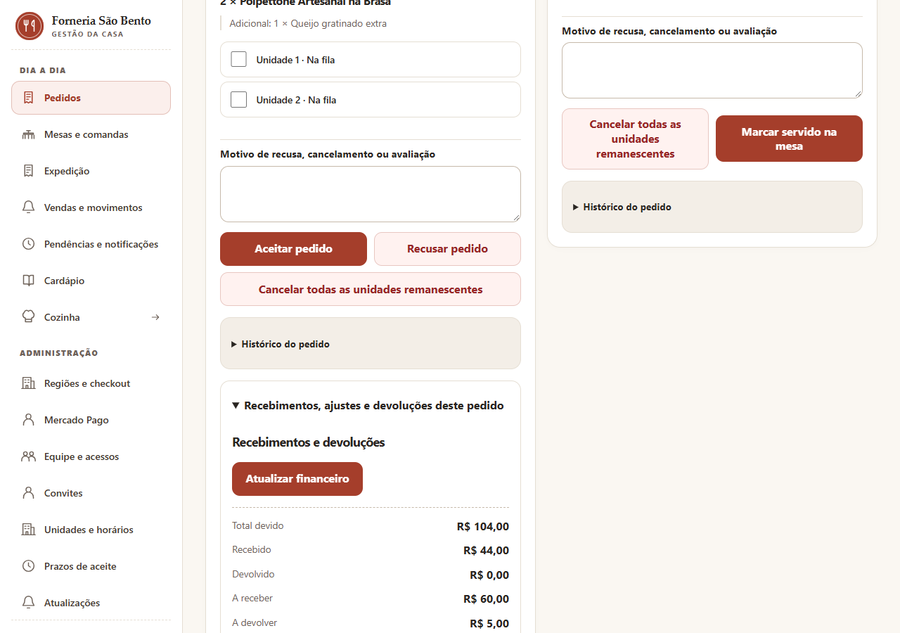 |  |  |

| Antes (Claro · `360px`)                                     | Depois (Claro · `360px`)                                                  | Depois (Escuro · `360px`)                                                 |
| ----------------------------------------------------------- | ------------------------------------------------------------------------- | ------------------------------------------------------------------------- |
| 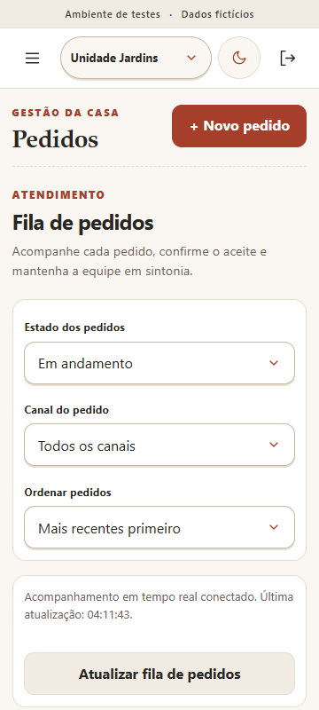 | 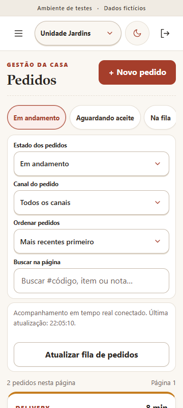 | 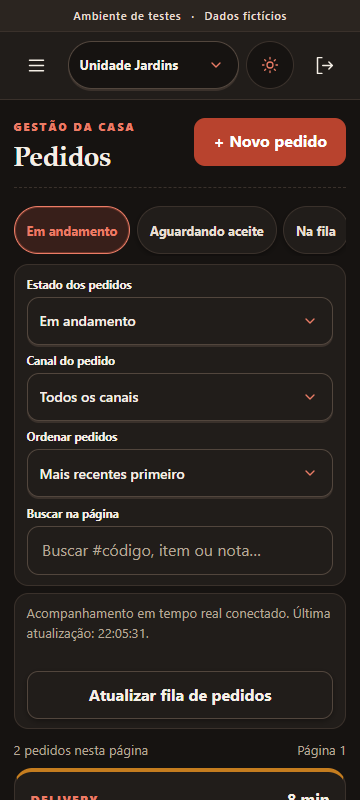 |

### 2.2 Novo Pedido Assistido — Modo PDV (`/gestao/pedidos/novo`)

| Antes (Claro · `1280px`)                              | Depois (Claro · `1280px`)                                           | Depois (Escuro · `1280px`)                                          |
| ----------------------------------------------------- | ------------------------------------------------------------------- | ------------------------------------------------------------------- |
|  | 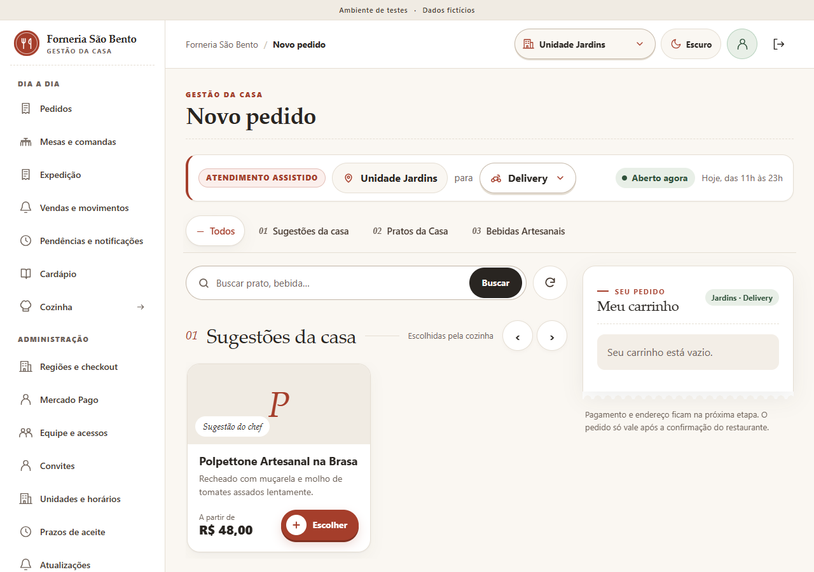 |  |

| Depois (Claro · Tablet `768px`)                                   | Depois (Claro · Celular `360px`)                                  | Depois (Escuro · Celular `360px`)                                 |
| ----------------------------------------------------------------- | ----------------------------------------------------------------- | ----------------------------------------------------------------- |
|  |  |  |

### 2.3 Salão, Mesas & Comandas (`/gestao/mesas`)

| Antes (Claro · `1280px`)                                  | Depois (Claro · `1280px`)                                               | Depois (Escuro · `1280px`)                                              |
| --------------------------------------------------------- | ----------------------------------------------------------------------- | ----------------------------------------------------------------------- |
| 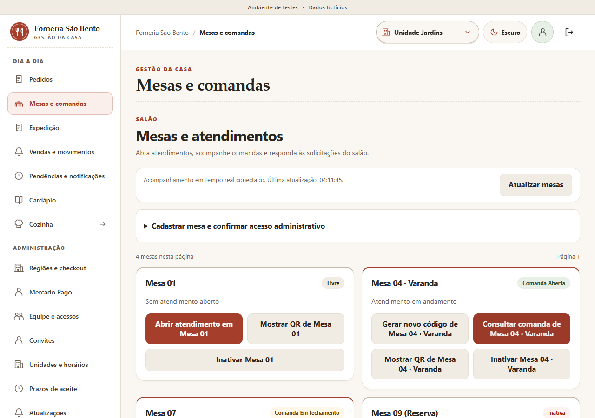 | 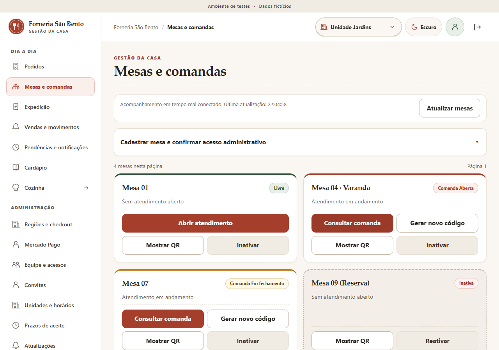 |  |

| Depois (Claro · Tablet `768px`)                                       | Depois (Claro · Celular `360px`)                                      | Depois (Escuro · Celular `360px`)                                     |
| --------------------------------------------------------------------- | --------------------------------------------------------------------- | --------------------------------------------------------------------- |
| 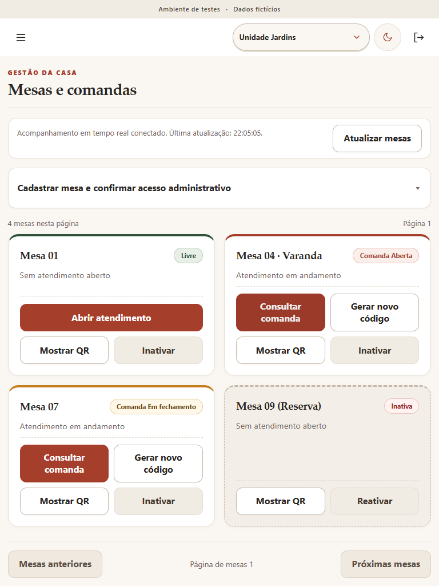 | 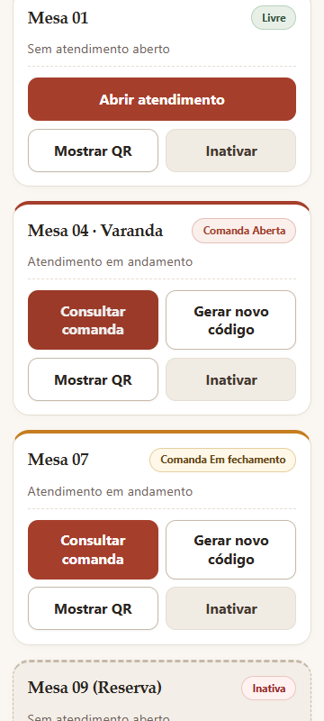 |  |

### 2.4 Expedição & Etiqueta de Despacho (`/gestao/expedicao`)

| Antes (Claro · `1280px`)                                          | Depois (Claro · `1280px`)                                                       | Depois (Escuro · `1280px`)                                                      |
| ----------------------------------------------------------------- | ------------------------------------------------------------------------------- | ------------------------------------------------------------------------------- |
|  | 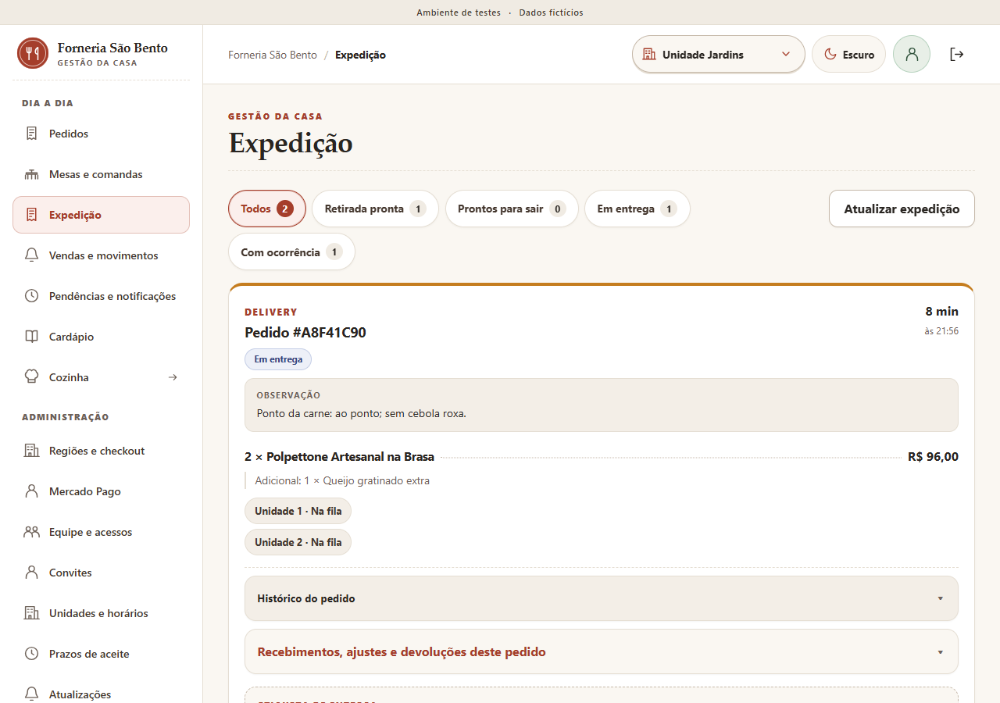 |  |

| Depois (Claro · Celular `360px`)                                              | Depois (Escuro · Celular `360px`)                                             |
| ----------------------------------------------------------------------------- | ----------------------------------------------------------------------------- |
| 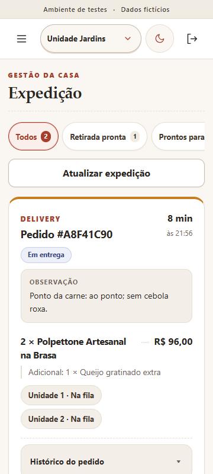 |  |

### 2.5 Pendências Financeiras & Notificações (`/gestao/pendencias`)

| Antes (Claro · `1280px`)                                            | Depois (Claro · `1280px`)                                                         | Depois (Escuro · `1280px`)                                                        |
| ------------------------------------------------------------------- | --------------------------------------------------------------------------------- | --------------------------------------------------------------------------------- |
| 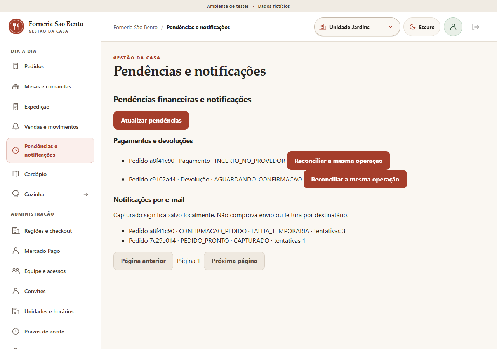 |  | 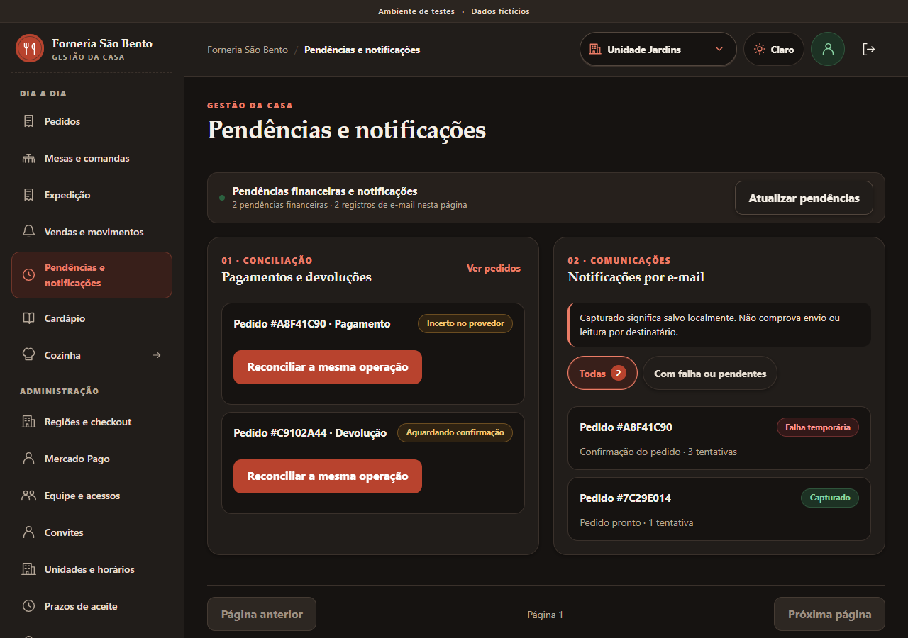 |

| Depois (Claro · Celular `360px`)                                                | Depois (Escuro · Celular `360px`)                                               |
| ------------------------------------------------------------------------------- | ------------------------------------------------------------------------------- |
|  | 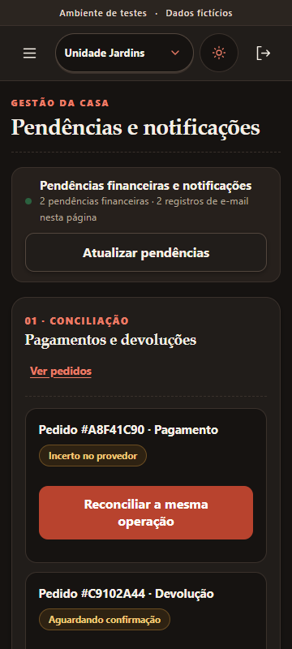 |

### 2.6 Vendas & Movimentos Financeiros (`/gestao/relatorios`)

| Antes (Claro · `1280px`)                                    | Depois (Claro · `1280px`)                                                 | Depois (Escuro · `1280px`)                                                |
| ----------------------------------------------------------- | ------------------------------------------------------------------------- | ------------------------------------------------------------------------- |
|  | 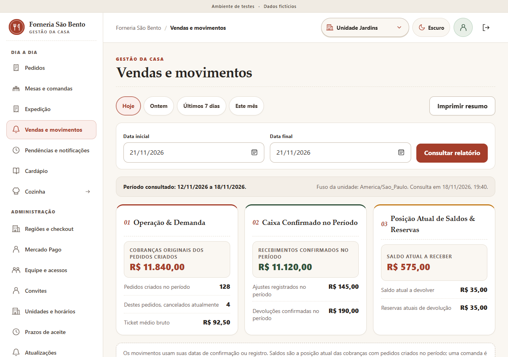 | 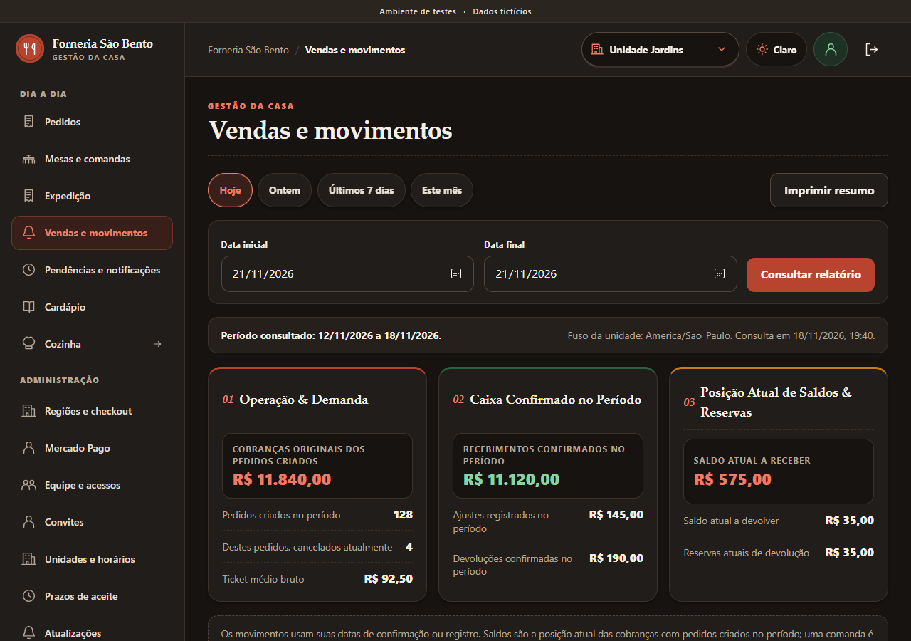 |

| Depois (Claro · Celular `360px`)                                        | Depois (Escuro · Celular `360px`)                                       |
| ----------------------------------------------------------------------- | ----------------------------------------------------------------------- |
| 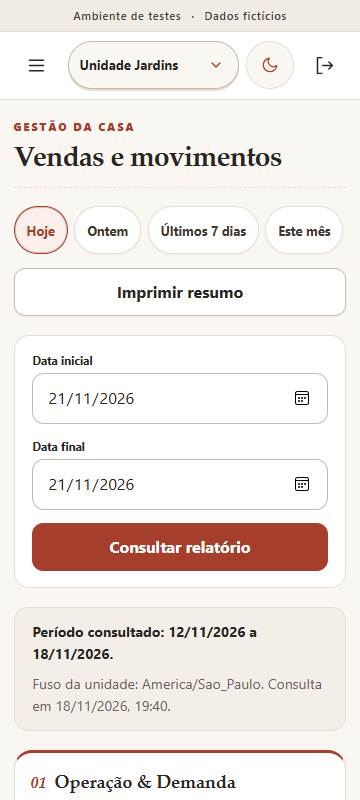 | 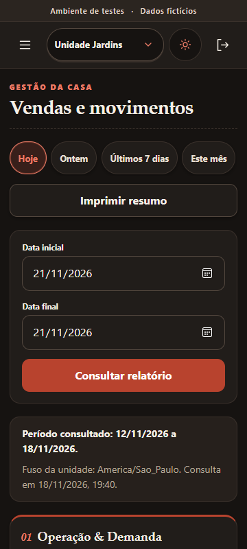 |

---

## 3. O que foi alterado

| Bloco / Tela                           | Antes                                                                                                                                                                           | Depois                                                                                                                                                                                                                                                                                                                                                                                                                                                                                                         | Arquivo(s)                                                                                                                                                                                       |
| -------------------------------------- | ------------------------------------------------------------------------------------------------------------------------------------------------------------------------------- | -------------------------------------------------------------------------------------------------------------------------------------------------------------------------------------------------------------------------------------------------------------------------------------------------------------------------------------------------------------------------------------------------------------------------------------------------------------------------------------------------------------- | ------------------------------------------------------------------------------------------------------------------------------------------------------------------------------------------------ |
| **Fundação Operacional Compartilhada** | `.campo-filtro` em `15rem` sem ajuste de fonte/padding para `select` em `360px`; sem estilos para KPIs de caixa, etiqueta de despacho, grade de pendências ou cartões de vendas | `.campo-filtro` com `flex: 1 1 16.5rem` (`100%` em `<= 600px`) e `select` `0.875rem` / `padding-inline: 0.75rem 2.2rem` (`S03-UI06`); novas classes `.atalhos-operacao`, `.btn-servir-mesa`, `.extrato-financeiro-dl`, `.extrato-kpi`, `.troco-calculadora`, `.expedicao-item`, `.etiqueta-despacho`, `.grade-pendencias`, `.cartao-pendencia`, `.grade-kpis-vendas`, `.cartao-kpi-vendas` e `@media print` em Claro + Escuro                                                                                  | [operacao.css](../../../frontend/src/app/operacao.css)                                                                                                                                           |
| **Fila de Pedidos**                    | `<h2>` duplicado visível; apenas selects; sem busca rápida                                                                                                                      | Cabeçalho duplicado recolhido via `sr-only` quando `!navegacaoInterna()`; 6 pílulas rápidas de estado (`aria-pressed`); campo `#pedidos-busca` (`type="search"`, zero checkboxes extras) com estado vazio dedicado + `Limpar busca`                                                                                                                                                                                                                                                                            | [operacao-pedidos.component.html](../../../frontend/src/app/pedidos/operacao-pedidos.component.html)                                                                                             |
| **Cartão Operacional de Pedido**       | Botões sem hierarquia Spartan consistente; enums crus (`PEDIDO_CRIADO`) no histórico; unidades não selecionáveis em texto cru                                                   | Hierarquia `[hlmBtn]` (`Aceitar pedido` terracota tátil, `Marcar servido na mesa` em sálvia sólida antes do cancelamento, `Recusar pedido` destrutivo, cancelamento em outline destrutivo); guia pontilhada ligando item ao subtotal; `.selecao` tátil `>= 48px` e `.unidade-estatica` em pílula; histórico traduzido por `nomeEvento(evento.tipo)` e gaveta `.gaveta-financeira` editorial                                                                                                                    | [pedido-detalhe.component.html](../../../frontend/src/app/pedidos/pedido-detalhe.component.html), [pedido-detalhe.component.css](../../../frontend/src/app/pedidos/pedido-detalhe.component.css) |
| **Novo Pedido Assistido (Modo PDV)**   | Hero completo de consumidor + foto + `Ver horários` + corações de favoritos; comanda lateral oculta em `< 1080px`                                                               | `[class.vitrine-pdv]="modoPdv()"` transforma `.masthead` em barra horizontal enxuta com selo `ATENDIMENTO ASSISTIDO`, unidade travada sem chevron enganoso e seletor de canal (`Delivery`, `Retirada`, `Mesa`); oculta favoritos; mantém `.carrinho-lateral` empilhado em `grid-template-areas: 'rail' 'menu' 'ticket'` abaixo de `1080px` e barra móvel `Conferir comanda` acionando `abrirRevisaoPdv(...)` sem regressão em `/cardapio`                                                                      | [vitrine.component.html](../../../frontend/src/app/catalogo/vitrine.component.html), [vitrine.css](../../../frontend/src/app/catalogo/vitrine.css)                                               |
| **Salão, Mesas & Chamados**            | Nome da mesa repetido visualmente nos 5 botões; pouca distinção entre estados; resumo duplicado acima de `<app-financeiro>`; QR sem moldura clara no escuro                     | Geometria `< 0.5px` de `.barra-conexao`, `summary` e paginações 100% preservada; cartões diferenciados para Livre (sálvia), Ocupada/Aberta (terracota), Em fechamento (âmbar) e Inativa (tracejada); botões curtos com sufixo `` mantendo nome acessível idêntico; `Copiar código`; painel QR com moldura `#ffffff`, `Copiar link`, `Imprimir QR` e `Fechar`; comanda com `Fechar comanda` e `<dl>` exibido só quando `!exibirFinanceiroComanda()`; chamados com `tempoSolicitacao(...)` | [mesas.component.html](../../../frontend/src/app/mesas/mesas.component.html), [mesas.component.css](../../../frontend/src/app/mesas/mesas.component.css)                                         |
| **Expedição & Entregas**               | Caixa dupla aninhada, `<address>` cru sem botão de cópia, sem filtros rápidos                                                                                                   | Pílulas client-side (`Todos`, `Retirada pronta`, `Prontos p/ sair`, `Em entrega`, `Com ocorrência`) com contadores `tabular-nums`; integração sem borda duplicada (`:host-context(.expedicao-item)`) mantendo `app-expedicao > section > article`; `<address class="etiqueta-despacho">` com `Copiar contato` e bloco de ocorrência/decisão organizado                                                                                                                                                         | [expedicao.component.html](../../../frontend/src/app/delivery/expedicao.component.html)                                                                                                          |
| **Caixa / Financeiro**                 | `<dl>` simples, sem atalho de saldo restante, sem cálculo prévio de troco, `troco R$ 0,00` repetido em Pix/Cartão                                                               | 6 cartões `.extrato-kpi` mantendo `<dt>` irmão imediato de `<dd>`; botão rápido `Usar saldo restante (...)`; card `troco-calculadora` em tempo real para `DINHEIRO`; `entregue ... · troco ...` restrito a `r.metodo === 'DINHEIRO'` + `horarioCurto(r.confirmadoEm)`; `Solicitar devolução` diretamente visível fora de `
`                                                                                                                                                                           | [financeiro.component.html](../../../frontend/src/app/financeiro/financeiro.component.html)                                                                                                      |
| **Pendências & Notificações**          | `<ul><li>` com botões sobrepostos e enums crus                                                                                                                                  | Barra compacta mantendo `<h2>Pendências financeiras e notificações</h2>` visível; 2 painéis lado a lado (`01 · Conciliação` com link `Ver pedidos` e `02 · Comunicações` com filtro `Todas` / `Com falha ou pendentes`, `rotuloTipoNotificacao`, `rotuloEstado` em PT-BR sem enums crus e badges `ok`/`warn`/`danger`)                                                                                                                                                                                         | [pendencias.component.html](../../../frontend/src/app/pagamentos/pendencias.component.html)                                                                                                      |
| **Relatório de Vendas**                | Datas empilhadas, ISO cru em `consultadoEm`, `<dl>` único sem agrupamento                                                                                                       | Pílulas `Hoje`, `Ontem`, `Últimos 7 dias`, `Este mês` + `Imprimir resumo`; datas lado a lado; `horarioConsulta(r)` formatado no fuso da unidade; **3 Cartões de KPIs** (`01 Operação & Demanda` com `Ticket médio bruto`, `02 Caixa Confirmado no Período`, `03 Posição Atual de Saldos & Reservas`) preservando todos os 9 `<dt>` canônicos                                                                                                                                                                   | [vendas.component.html](../../../frontend/src/app/relatorios/vendas.component.html)                                                                                                              |

### 3.1 Polimento Geométrico, Simetria e Ergonomia PDV (`fullPage: true` + `localhost:4200`)

Após auditoria `fullPage: true` em todas as rotas operacionais e inspeção ao vivo em `localhost:4200`, foram aplicadas 8 correções cirúrgicas de alinhamento milimétrico, contraste de decisão e responsividade (`360px` / `768px` / `1280px`, Claro + Escuro):

1. **Continuidade vertical da coluna lateral (`.workplace` em `equipe-layout.css`):** adicionada pista vertical contínua (`linear-gradient` com `var(--card)` até `259px`/`229px`, filete `1px` `var(--border)` em `260px`/`230px` e `var(--background)` no corpo, além de `background: var(--background)` explícito em `.workspace-body` para herança sólida de contraste), eliminando a interrupção visual da sidebar em páginas `> 100dvh` ou overscroll.
2. **Ergonomia e alinhamento do Modo PDV (`/gestao/pedidos/novo`):**
   - `aria-label="Unidade do cardápio"` e `aria-label="Canal do cardápio"` explícitos em `#vitrine-unidade` e `#vitrine-canal` para seleção determinística.
   - Eliminação da colisão entre `.rail` sticky (`z-index: 12`, `background-color: var(--background)`, `margin-inline: -4px; padding: 8px 4px 10px`) e `.finder` (`position: static; z-index: 1`), compactação de `.masthead` em 2 colunas no mobile e `aspect-ratio: 16 / 7.5` em `.vitrine-pdv .f-photo` para caber o 1º produto + botão `+ Escolher` inteiros na dobra inicial de `360×800`.
   - Fim do truncamento prematuro de `.ctx-val` em `768px` (`max-width: 100%; overflow: visible; text-overflow: clip`).
   - Alargamento da comanda lateral `.vitrine-pdv .layout` para `332px` no desktop, `flex-wrap: wrap` em `.t-head` + `white-space: nowrap` em `h2` (`Meu carrinho` nunca esmagado) e ajuste de `.btn-revisar-pedido` para caber em **1 linha limpa**.
   - Carrossel `.vitrine-pdv .features` ajustado para `calc((100% - 18px) / 2)` (`>= 1080px`) e `calc((100% - 36px) / 3)` (`>= 1520px`), exibindo 2 ou 3 cards inteiros sem fatia cortada ao meio, e ocultação do subtítulo genérico `"Na brasa e da casa"` em categorias do PDV (`.vitrine-pdv .sec-categoria .sec-note { display: none }`).
   - Correção do buraco inferior de `76px` de `dialog.revisao-dlg` no mobile do PDV (`:host-context(.vitrine-pdv) dialog.revisao-dlg { margin: 0; max-height: calc(100dvh - 20px) }`), `max-height: min(92dvh, 900px)` no desktop e `:host-context(.revisao-modal-corpo) .cartao-formulario { margin: 0 }`.
3. **Diferenciação crítica `Aceitar pedido` × `Recusar pedido` e proporção de `.grade-pedidos`:**
   - `Aceitar pedido` estilizado em verde sálvia sólido tátil (`.btn-servir-mesa.btn-aceitar-pedido`, contraste `> 7:1` em Claro e Escuro) e `Recusar pedido` em `variant="outline"` + `.btn-cancelar-outline`, eliminando o risco de dois botões vermelhos idênticos lado a lado; `Aprovar solicitação` e `Rejeitar solicitação` com larguras simétricas (`flex: 1 1 9.5rem`).
   - `.grade-pedidos` calibrada para `minmax(min(100%, 24rem), 1fr)` com `align-items: start` (1 coluna folgada em `768px`, 2 colunas amplas em `1280px` e 3 em ultrawide), ritmo interno uniforme `gap: 0.65rem` em `.cartao-pedido` (`.acoes-pedido:not(:has(> *)) { display: none }`, `.acoes > p { flex: 1 1 100%; margin: 0 }`) e compactação vertical do topo mantendo `.campo-filtro` em `16rem` (`S03-UI06`).
4. **Simetria dos 6 KPIs e alertas 100% no Caixa (`app-financeiro`):**
   - `.extrato-financeiro-dl` fixado em `repeat(3, minmax(0, 1fr))` (**2×3 simétricos** no desktop/tablet) e `repeat(2, minmax(0, 1fr))` em `<= 560px` (**3×2 simétricos** no celular, sem card órfão).
   - `.aviso`, `.erro`, `.sucesso` e `.ocorrencia-alerta` com `width: 100%; max-width: none; box-sizing: border-box`; `.financeiro-cabecalho` mantendo `h3` + `Atualizar financeiro` na mesma linha `>= 440px` e `.movimento-item` com `padding: 0.8rem 1rem`.
5. **Simetria dos cartões de mesa, cadastro administrativo e painéis de comanda/QR (`/gestao/mesas`):**
   - `.grade-mesas { align-items: stretch }`, `.cartao-mesa { height: 100% }` e `.cartao-mesa .mesa-acoes` em CSS Grid de 2 colunas simétricas (`repeat(2, minmax(0, 1fr))`), onde o 1º botão em contagem ímpar (`:first-child:nth-last-child(odd)`) ocupa `1 / -1` em linha única e os secundários dividem `50% / 50%` na base com alturas idênticas.
   - `.cadastro-mesa-linha` em `grid-template-columns: minmax(0, 1fr) 15.5rem` (`> 640px`), alinhando ao pixel os dois `<input>`s e os dois botões administrativos.
   - `.comanda-resumo` e `.qr-painel` com `width: 100%; max-width: none`, organizando `.qr-painel-corpo` horizontalmente (`auto minmax(0, 1fr)`) em `>= 640px` e centralizando em coluna única no mobile e `@media print`, preservando 100% da invariante `< 0.5px` sob SSE.
6. **Hierarquia de decisão e barra de despacho na Expedição (`/gestao/expedicao`):**
   - `Autorizar nova tentativa de entrega` em `.btn-servir-mesa` (sálvia sólido) e `Cancelar entrega conforme decisão financeira` em `variant="outline"` + `.btn-cancelar-outline`; `.expedicao-acoes-despacho` destacado logo após `<address>` dentro de `app-expedicao > section > article`; `.expedicao-topo` com `align-items: flex-start` e `.atalhos-operacao .filtro-pilula` com `flex: 0 1 auto` no mobile (sem esticar a 5ª pílula em 100%).
7. **Barra integrada e alinhamento de base em Pendências (`/gestao/pendencias`):**
   - `.pendencias-barra-topo` estilizada como barra enxuta de sincronização com indicador de status + resumo de contagem à esquerda (mantendo `<h2>Pendências financeiras e notificações</h2>` visível para `S04-UI09`) e `Atualizar pendências` à direita; `.grade-pendencias` com `align-items: stretch` e `.coluna-pendencias` com `align-content: start; height: 100%`.
8. **Alinhamento executivo horizontal e mobile de Vendas (`/gestao/relatorios`):**
   - `.cartao-kpi-cabecalho` com `box-sizing: border-box; min-height: 3.7rem; align-items: center` em `>= 1081px` e `.kpi-linha--destaque` em empilhamento vertical (`min-height: 5.75rem` no desktop, `<dt>` uppercase acima e `<dd>` `1.4rem` abaixo mantendo `<dt>` irmão imediato de `<dd>`), travando a linha tracejada e os 3 destaques no exato mesmo pixel Y; linhas normais `.kpi-linha:not(.kpi-linha--destaque)` em `grid-template-columns: minmax(0, 1fr) auto` mantendo `<dd>` sempre alinhado à direita em `360px`.

### 3.2 Polimento Final Mobile e Tablet (`360×800` / `768×1024`)

Com base na inspeção das capturas reais em `360×800`, foram aplicados os 4 ajustes finais de ergonomia e ritmo vertical sem alteração estrutural:

1. **Fila de Pedidos e Paginação (`/gestao/pedidos` — `operacao-pedidos.component.html`, `operacao.css`):**
   - Placeholder de `#pedidos-busca` encurtado para `"Buscar #código, item ou nota…"` evitando corte em `360px`.
   - Em `<= 600px`, `.atalhos-operacao` passou a ser uma faixa horizontal rolável de **1 única linha** (`flex-wrap: nowrap; overflow-x: auto; scrollbar-width: none`) com `.filtro-pilula { flex: 0 0 auto; white-space: nowrap; }`, economizando altura vertical em Pedidos e eliminando a 5ª pílula órfã em Expedição/Vendas.
   - Compactação suave de `.filtros`, `.campo-filtro label`, `.barra-conexao` e `.resumo-listagem` mantendo `.campo-filtro { flex-basis: 100%; }` nos `<select>`s (`S03-UI06`), trazendo o 1º card de pedido para a primeira dobra de `360×800`.
   - `.paginacao` com `align-items: stretch;` e `.paginacao button { height: auto; min-height: 48px; }` garantindo altura e largura 50/50 idênticas entre os botões anterior/próxima.
2. **PDV & Modal `Revisar e enviar pedido` no Celular (`vitrine.css`, `carrinho.css`, `operacao.css`):**
   - Compactação mobile do PDV (`<= 680px`) em `.masthead`, `.rail`, `.finder`, `.sec` e `.f-photo` (`aspect-ratio: 16 / 6.2`) para exibir o card completo de sugestão (foto, título, preço e `+ Escolher`) acima do botão flutuante `Conferir comanda` na dobra inicial de `360×800`, além de `.vitrine-pdv .layout { padding-bottom: 100px; }` em `<= 1079px`.
   - Ampliação da área útil do modal no mobile (`max-height: calc(100dvh - 16px)` no PDV, espaçamentos reduzidos em `.revisao-modal-topo`, `.revisao-modal-corpo`, `.resumo-comanda` e `:host-context(.revisao-modal-corpo)` em `.cartao-formulario`, `.cabecalho-painel` e `.paginacao-assistido`).
3. **Caixa / Financeiro no Celular (`financeiro.component.html`, `operacao.css`):**
   - Ajuste responsivo de `.financeiro-cabecalho` com `flex-wrap: wrap; gap: 0.5rem 0.75rem`, título `h3` (`1.05rem`, `flex: 1 1 12.5rem`) e botão `Atualizar financeiro` (`white-space: nowrap; flex: 0 0 auto`), mantendo cabeçalho lado a lado no desktop/tablet e evitando quebra silábica do título dentro de gavetas estreitas em `360px`.
   - Nivelamento pela base das 3 fileiras de 2 KPIs via `.extrato-kpi { box-sizing: border-box; align-content: space-between; height: 100%; }` e ajuste tipográfico/padding em `<= 560px`.
   - `.movimento-item` sem botão fixado em `flex-wrap: nowrap` (`:has(> button)` volta para `wrap`), `.movimento-hora { flex: 0 0 auto; margin-left: auto; }` e remoção dos `·` literais avulsos em Recebimentos confirmados e Devoluções usando `.movimento-detalhe` (preservando `troco {{ moeda(r.troco) }}` para o contrato `S04-UI03`).
4. **Expedição no Celular e Tablet (`expedicao.component.html`, `operacao.css`):**
   - Placeholder de `#motivo-ocorrencia-*` encurtado para `"Descreva o motivo…"` e rótulo `"Prontos p/ sair"` ajustado para `"Prontos para sair"`.
   - `.expedicao-acoes-despacho` simplificado como rodapé limpo separado por `border-top: 1px dashed var(--border, #e5ded3)` (sem borda esquerda espessa), com botão `width: 100%` em `<= 600px`.

---

## 4. Por quê

- **Impacto na experiência do usuário (UX):** atendentes, caixas, expedidores e gestores batem o olho na tela e distinguem imediatamente o que exige ação (aceite pendente, mesa solicitando conta, entrega com ocorrência, saldo a receber/devolver ou falha de e-mail) tanto em **Tema Claro** (ambientes diurnos) quanto em **Tema Escuro** (salão à meia-luz e operação noturna), com zero ruído textual e alvos táteis `>= 48px` em `360px`, `768px` e `1280px`.
- **Conformidade com as normas do projeto:** atende integralmente [Interface, acessibilidade e PWA](../../09_UI_GUIDELINES.md), [Padrões de código](../../10_CODING_STANDARDS.md), [Definition of Done](../../12_DEFINITION_OF_DONE.md), [ADR 0003 — Spartan UI e navegação por área](../../adr/0003-spartan-navegacao-por-area.md) e **WCAG 2.2 AA** (`tabular-nums` em valores/relógios, contraste opaco verificado em Claro e Escuro, suporte a `prefers-reduced-motion` e zero nome/monograma fixo de restaurante).
- **Garantia não-estrutural e preservação de contratos:** nenhum arquivo em `backend/`, `*.service.ts`, `modelos.ts`, `guardas.ts`, `*.routes.ts`, `paginas-*.ts`, `scripts/`, `package.json`, `angular.json`, `service-worker.js` ou `e2e*/**` foi alterado, e nenhum `inject(...)` ou `computed(...)` adicional foi introduzido nos `.ts`. Todos os contratos de automação (`S03-UI01`, `S03-UI02`, `S03-UI04`, `S03-UI06`, `S03-UI09`, `S03-UI12`, `S03-UI13`, `S04-UI03` a `S04-UI06`, `S04-UI08` a `S04-UI10` e estabilidade geométrica `< 0.5px` sob SSE em `test_mesa_navigation_templates.cjs`) foram integralmente preservados.

---

## 5. Pendências e Requisitos para o Backend

Nenhuma tela desta Sprint está bloqueada. As evoluções opcionais de API já catalogadas em [RELATORIO-PENDENCIAS-BACKEND.md](RELATORIO-PENDENCIAS-BACKEND.md) que enriquecerão ainda mais estas visões em ciclos futuros de backend são:

- **`BE-12` _(P1 · `/gestao/pendencias`)_:** incluir `criadaEm`, `atualizadaEm` e `detalheCurto` sanitizado em `NotificacaoOperacional`, além de endpoint idempotente para reconhecer/reenviar notificações tratadas.
- **`BE-13` _(P1 · `/gestao/relatorios`)_:** quebra analítica por canal (`MESA`, `RETIRADA`, `DELIVERY`) e meio de pagamento (`ONLINE`, `PRESENCIAL`) + exportação CSV auditada em `/api/v1/relatorios/vendas`.
- **`BE-14` _(P2 · `<app-equipe-layout>` / operação)_:** endpoint leve `GET /api/v1/operacao/resumo?unidadeId={uuid}` para contadores globais em tempo real nos badges da barra lateral.
- **`BE-15` _(P2 · `/gestao/pedidos` e `/gestao/mesas`)_:** filtros server-side opcionais (`busca` textual em `/api/v1/operacao/pedidos` para buscar além da página corrente e filtro de ocupação/atividade em `/api/v1/operacao/mesas`).
- **`BE-21` _(P1/P2 · `PedidoDetalhe`)_:** incluir `unidadeNome` e `mesaNome` diretamente no DTO `PedidoDetalhe` para exibição nominal imediata da mesa nos cartões da fila de pedidos.

---

## 6. Validações executadas

Gates reexecutados sobre a versão final (após os polimentos `3.2` e ajuste final de `.financeiro-cabecalho`):

- **Prettier (`prettier.cjs --config .prettierrc.json --check ...`):** aprovado (`All matched files use Prettier code style!`, código `0`, incluindo `vitrine.css`, `carrinho.css`, `equipe-layout.css` e este relatório).
- **`typecheck` (`tsc --noEmit -p tsconfig.app.json && tsc -p tsconfig.e2e.json`):** aprovado (`0` erros).
- **`ngc -p frontend/tsconfig.app.json --noEmit`:** aprovado (`0` erros de template/AOT estrito).
- **`test-frontend.cjs` (`test:logic`):** aprovado em Node `v24.21.0` (`0` falhas).
- **`ng build` + `build-pwa.cjs` (Node `v24.21.0`):** aprovado (`7.013s`; bundle inicial `325.08 kB` / `89.11 kB` transferência; `PWA: 34 arquivos públicos; versão f32e89369392dc408829`).
- **`node scripts/test_pwa.cjs`:** aprovado (`cache somente do shell, query sensível descartada, APIs/credenciais excluídas...`).
- **`node scripts/test_mesa_navigation_templates.cjs`:** aprovado (`chromium: geometria estável em360/768/1280 e fontes16/20; clique único durante SSE...`).
- **`node scripts/test_kitchen_templates.cjs` e `node scripts/test_route_shell.cjs`:** aprovados.
- **`node scripts/check_contrast.cjs --self-test`:** aprovado (`14 verificações de matemática, limites, destino e reutilização de sessão aprovadas`).
- **Auditoria visual e capturas (`capture_sprint4.cjs --mode=depois` + `audit_fullpage_sprint4.cjs`):** todas as 36 capturas em `docs/evidencias/frontend/imagens/sprint4-depois-*.png` regeneradas com `overflow=0px`, `/cardapio` preservado (`hero=true, overflow=0px`) e revisão visual em `360px`/`768px`/`1280px` (Claro + Escuro).
- **`python scripts/check-repository.py`:** aprovado (links locais, imagens referenciadas e padrões de segredo íntegros).

---

## 7. Limites e próximos passos

- Todas as entregas visuais, auditorias `360×800` / `768×1024` / `1280×900` (Claro + Escuro) e builds locais desta Sprint estão concluídos e consolidados em commit na branch `feat/frontend-bistro-sprints`.
- A homologação integrada ponta a ponta com PostgreSQL real permanece no escopo do pipeline Linux/CI conforme [Estratégia de validação](../../26_TEST_STRATEGY.md).
- Próxima etapa planejada no roadmap visual: **Sprint 5 — Gestão Comercial e Configurações em Light + Dark** (Catálogo administrativo, Mídia, Regiões/Delivery, Prazos de aceite e Integração Mercado Pago).
