# Sprint 4 — Gestão Operacional Diária em Tema Claro + Escuro (`/gestao/*`)

- **Data:** 2026-11-18
- **Telas / Rotas:** `/gestao/pedidos`, `/gestao/pedidos/novo`, `/gestao/mesas`, `/gestao/expedicao`, `/gestao/pendencias`, `/gestao/relatorios` e gaveta/painel `<app-financeiro>`
- **Área:** Gestão Operacional & Caixa (multi-tenant white-label)
- **Responsável técnico:** Coordenador (Fase A TypeScript: restauração do canal `MESA` e `modoPdv()` em `vitrine.component.ts`, texto de confirmação em `carrinho.component.ts`, helpers puros sem `inject()`/`computed()` extras em `operacao-pedidos`, `pedido-detalhe`, `mesas`, `expedicao`, `financeiro`, `pendencias` e `vendas`) + subagente `artesao-ux-bistro` (camada visual completa Claro + Escuro)
- **Arquivos visuais alterados:**
  - [operacao.css](../../../frontend/src/app/operacao.css)
  - [operacao-pedidos.component.html](../../../frontend/src/app/pedidos/operacao-pedidos.component.html)
  - [pedido-detalhe.component.html](../../../frontend/src/app/pedidos/pedido-detalhe.component.html)
  - [pedido-detalhe.component.css](../../../frontend/src/app/pedidos/pedido-detalhe.component.css)
  - [vitrine.component.html](../../../frontend/src/app/catalogo/vitrine.component.html)
  - [vitrine.css](../../../frontend/src/app/catalogo/vitrine.css)
  - [mesas.component.html](../../../frontend/src/app/mesas/mesas.component.html)
  - [mesas.component.css](../../../frontend/src/app/mesas/mesas.component.css)
  - [expedicao.component.html](../../../frontend/src/app/delivery/expedicao.component.html)
  - [financeiro.component.html](../../../frontend/src/app/financeiro/financeiro.component.html)
  - [pendencias.component.html](../../../frontend/src/app/pagamentos/pendencias.component.html)
  - [vendas.component.html](../../../frontend/src/app/relatorios/vendas.component.html)

---

## 1. Como era antes

Na inspeção diagnóstica das 7 capturas iniciais (`sprint4-antes-*.png`) sobre o novo shell `<app-equipe-layout>`, foram identificados problemas concretos de ergonomia tátil, hierarquia visual e poluição de rótulos nas telas operacionais diárias:

1. **Cabeçalhos duplicados sob `<app-equipe-layout>`:** `Pedidos`, `Mesas e comandas`, `Expedição` e `Vendas e movimentos` repetiam `<h2>` visíveis imediatamente abaixo do cabeçalho editorial já renderizado pelo shell da equipe, desperdiçando dobra vertical útil em tablets e celulares (`360×800`).
2. **Fila de Pedidos & Cartão Operacional (`/gestao/pedidos`):**
   - Ausência de atalhos rápidos em pílulas para alternar entre estados (`Em andamento`, `Aguardando aceite`, `Na fila`, `Em preparo`, `Prontos`, `Todos`) e ausência de busca textual rápida na página carregada.
   - No cartão operacional (`app-pedido-detalhe`), `Cancelar todas as unidades remanescentes` aparecia antes de `Marcar servido na mesa` e ambos disputavam peso visual; unidades não selecionáveis apareciam como texto solto sem badge; e o histórico exibia enums crus do servidor (`PEDIDO_CRIADO · `) seguidos de ponto solto quando não havia motivo.
3. **Novo Pedido Assistido (`/gestao/pedidos/novo`):** reutilizava integralmente o hero editorial de consumidor (`"Cardápio de sexta-feira / Bom de escolher. Melhor de saborear."`, arco fotográfico de `320px`, link `Ver horários` e corações/`Meus favoritos`), empurrando a busca e os produtos para fora da primeira dobra do operador. Além disso, em `< 1080px` a comanda lateral sumia por CSS, forçando desvio para `/carrinho` (fora do workspace da equipe).
4. **Salão, Mesas & Chamados (`/gestao/mesas`):**
   - Cartões de mesa repetiam o nome completo da mesa em até 5 botões consecutivos (`"Gerar novo código de Mesa 04 · Varanda"`, `"Consultar comanda de Mesa 04 · Varanda"`, `"Mostrar QR de Mesa 04 · Varanda"`, `"Inativar Mesa 04 · Varanda"`), gerando fadiga visual severa.
   - Faltavam diferenciação cromática imediata entre mesa **Livre**, **Comanda Aberta**, **Em fechamento** e **Inativa**, botões de `Copiar código`, `Copiar link` / `Imprimir QR` / `Fechar` no painel QR (com moldura branca segura para leitura em modo escuro), botão `Fechar comanda` e supressão do `<dl>` duplicado quando `<app-financeiro>` já exibia o extrato logo abaixo.
5. **Expedição (`/gestao/expedicao`):** exibia caixa dupla aninhada (`article` externo envolvendo `article.cartao-pedido` com borda e sombra repetidas), endereço em `<address>` cru sem destaque de destinatário/contato e sem atalhos rápidos por etapa de despacho.
6. **Caixa / Financeiro (`<app-financeiro>`):** extrato em `<dl>` linear sem destaque de KPIs, ausência de botão rápido `"Usar saldo restante"` e de calculadora automática de troco em tempo real para `DINHEIRO`, e ruído `"entregue R$ 24,00 · troco R$ 0,00"` impresso até em recebimentos `PIX`/`CARTAO`/`ONLINE`.
7. **Pendências (`/gestao/pendencias`):** listas `<ul><li>` com bullets crus onde os botões primários `Reconciliar a mesma operação` encavalavam verticalmente uns sobre os outros e enums técnicos (`CONFIRMACAO_PEDIDO`) apareciam sem tradução nem filtro de falhas.
8. **Relatório de Vendas (`/gestao/relatorios`):** formulário empilhado ocupando toda a largura com botão gigante `Consultar relatório`, timestamp em ISO UTC cru (`2026-11-18T22:40:15Z`), ausência de atalhos de período (`Hoje`, `Ontem`, `Últimos 7 dias`, `Este mês`), ausência de `Ticket médio bruto` e os 9 indicadores misturados num único `<dl>` plano sem separação visual entre demanda, caixa realizado e posição atual de saldos.

---

## 2. Representação visual — Antes × Depois (Claro + Escuro)

Todas as 36 capturas pós-implementação (`6` fluxos × `2` temas × `3` larguras: `1280×900`, `768×1024` e `360×800`) foram geradas em navegador real sem dados pessoais e validadas com `overflow = 0px`.

### 2.1 Fila de Pedidos & Gaveta Financeira (`/gestao/pedidos`)

| Antes (Claro · `1280px`) | Depois (Claro · `1280px`) | Depois (Escuro · `1280px`) |
| --- | --- | --- |
|  | 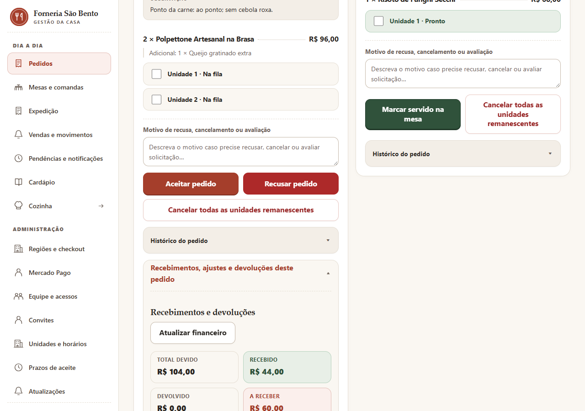 | 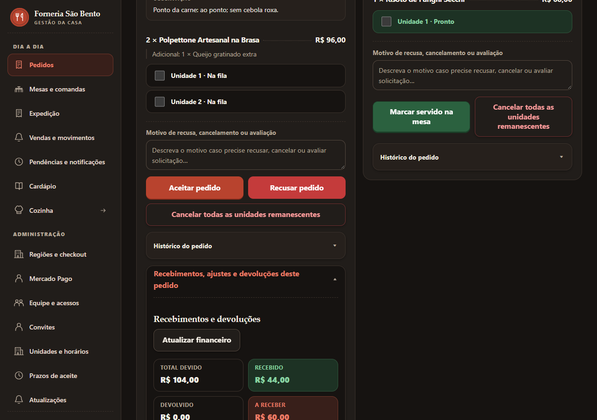 |

| Antes (Claro · `360px`) | Depois (Claro · `360px`) | Depois (Escuro · `360px`) |
| --- | --- | --- |
|  |  |  |

### 2.2 Novo Pedido Assistido — Modo PDV (`/gestao/pedidos/novo`)

| Antes (Claro · `1280px`) | Depois (Claro · `1280px`) | Depois (Escuro · `1280px`) |
| --- | --- | --- |
| 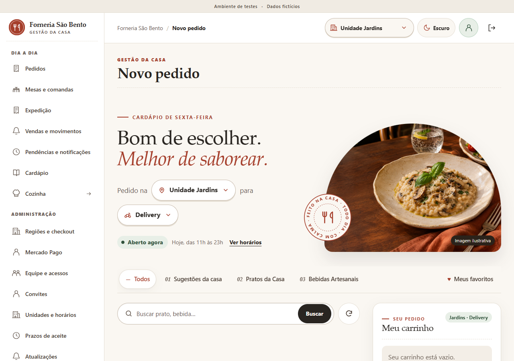 |  | 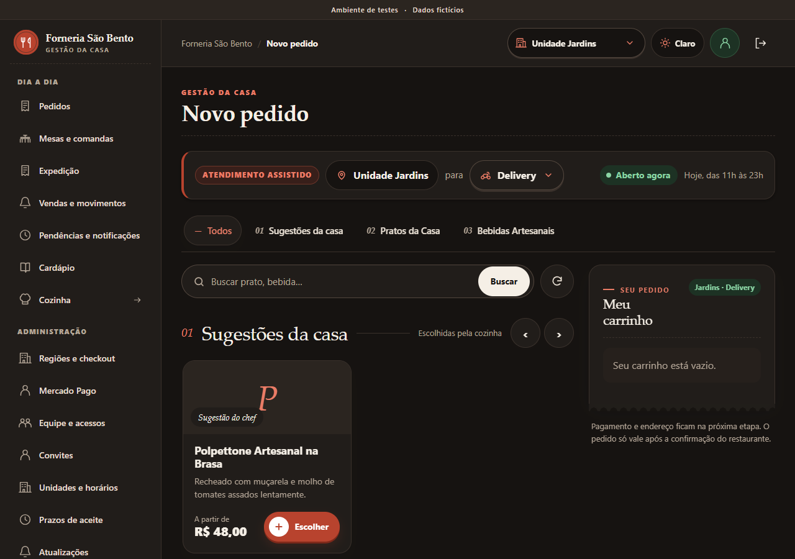 |

| Depois (Claro · Tablet `768px`) | Depois (Claro · Celular `360px`) | Depois (Escuro · Celular `360px`) |
| --- | --- | --- |
| 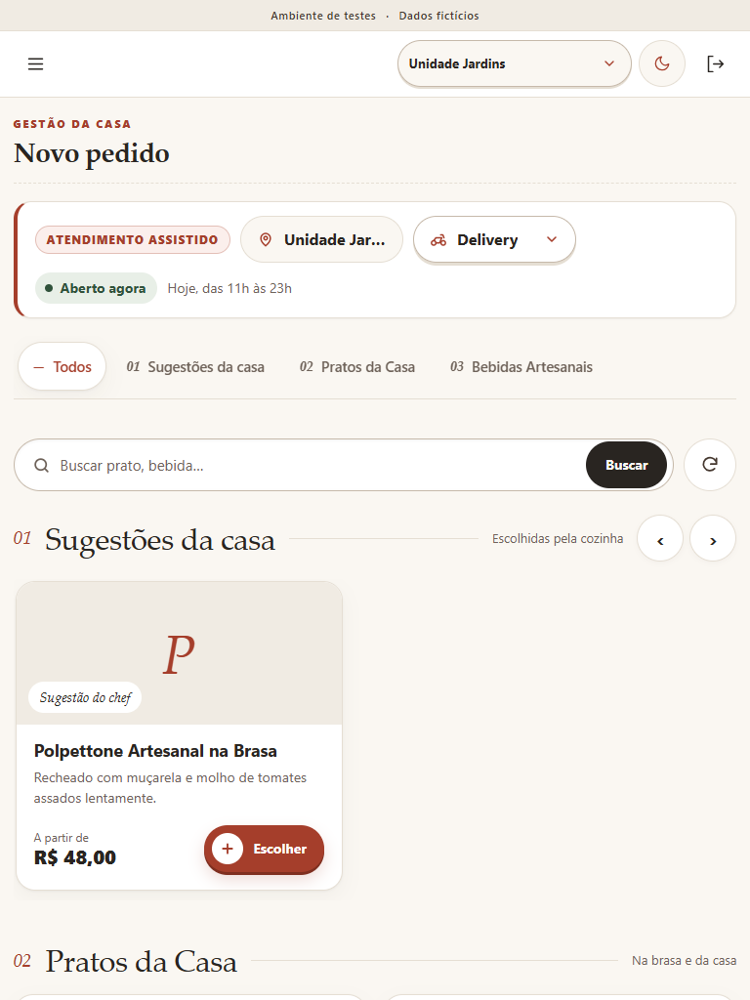 | 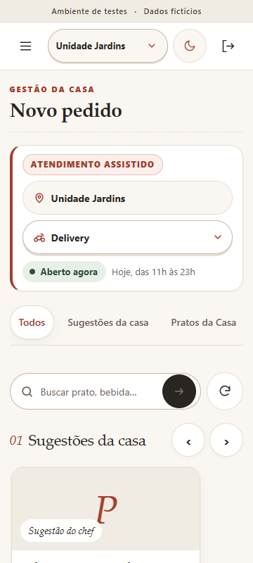 | 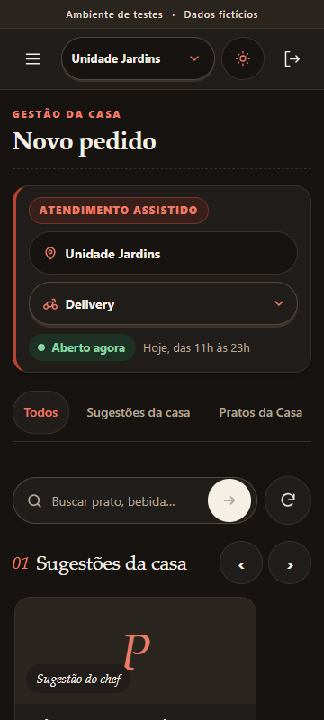 |

### 2.3 Salão, Mesas & Comandas (`/gestao/mesas`)

| Antes (Claro · `1280px`) | Depois (Claro · `1280px`) | Depois (Escuro · `1280px`) |
| --- | --- | --- |
|  |  | 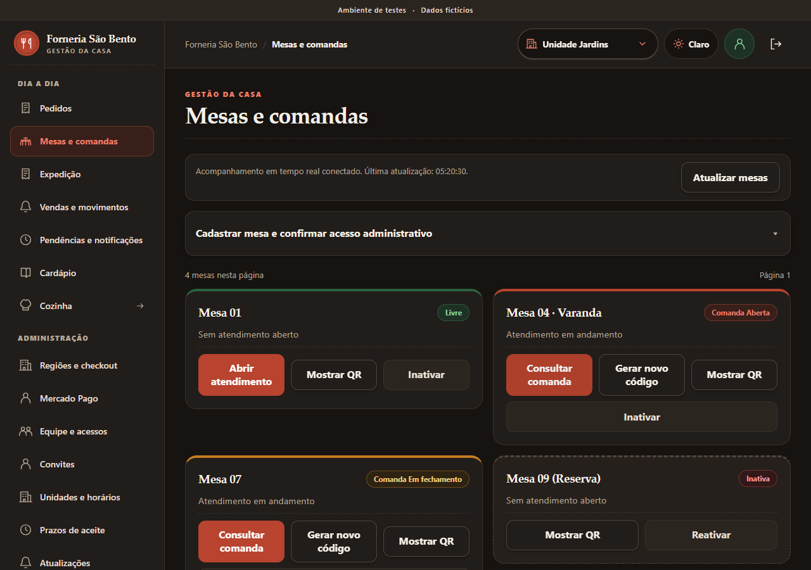 |

| Depois (Claro · Tablet `768px`) | Depois (Claro · Celular `360px`) | Depois (Escuro · Celular `360px`) |
| --- | --- | --- |
|  |  | 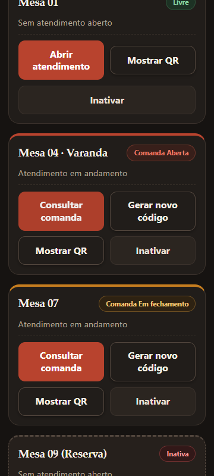 |

### 2.4 Expedição & Etiqueta de Despacho (`/gestao/expedicao`)

| Antes (Claro · `1280px`) | Depois (Claro · `1280px`) | Depois (Escuro · `1280px`) |
| --- | --- | --- |
| 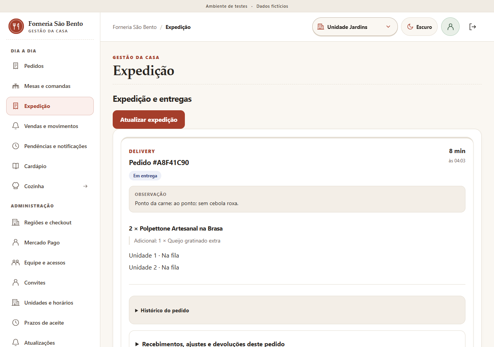 |  | 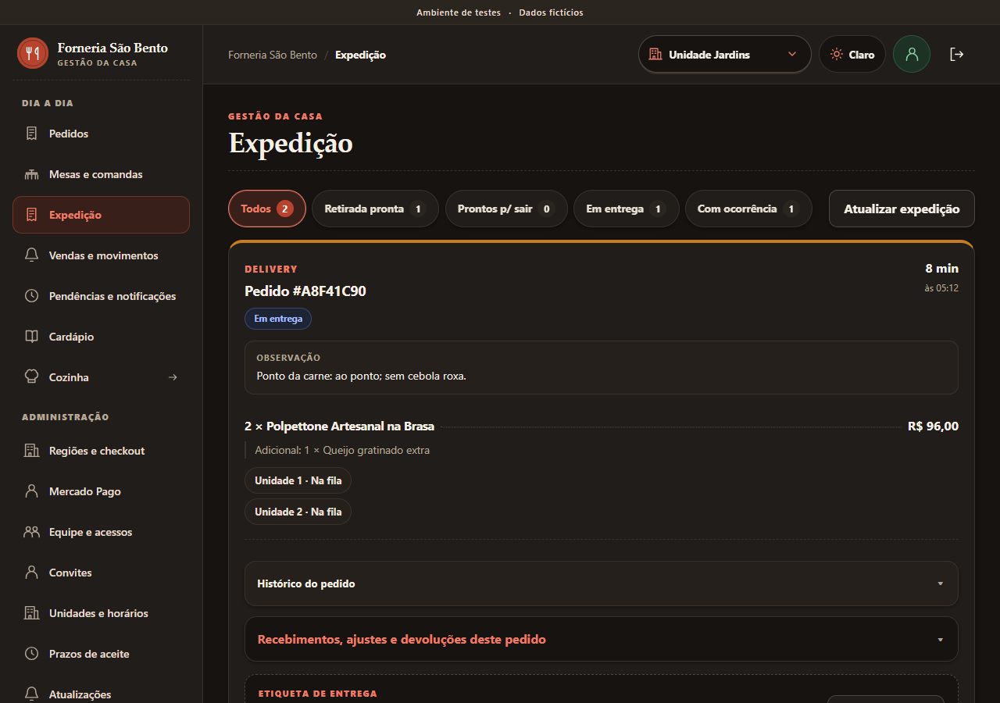 |

| Depois (Claro · Celular `360px`) | Depois (Escuro · Celular `360px`) |
| --- | --- |
|  | 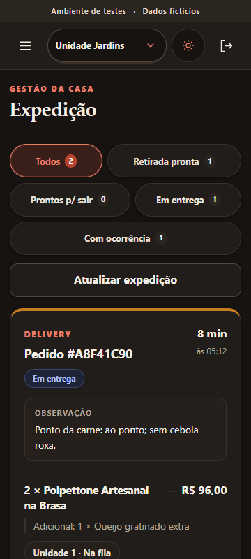 |

### 2.5 Pendências Financeiras & Notificações (`/gestao/pendencias`)

| Antes (Claro · `1280px`) | Depois (Claro · `1280px`) | Depois (Escuro · `1280px`) |
| --- | --- | --- |
|  | 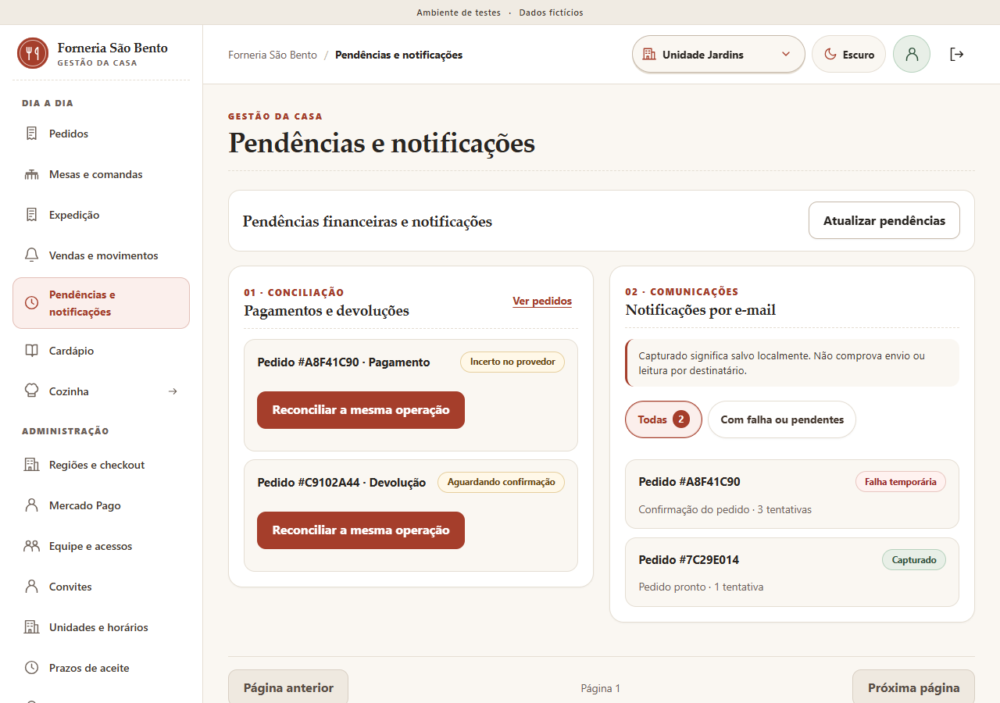 |  |

| Depois (Claro · Celular `360px`) | Depois (Escuro · Celular `360px`) |
| --- | --- |
| 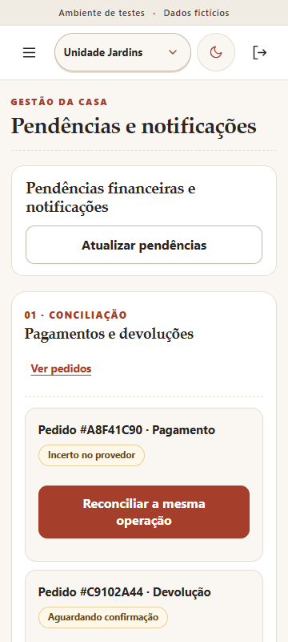 |  |

### 2.6 Vendas & Movimentos Financeiros (`/gestao/relatorios`)

| Antes (Claro · `1280px`) | Depois (Claro · `1280px`) | Depois (Escuro · `1280px`) |
| --- | --- | --- |
| 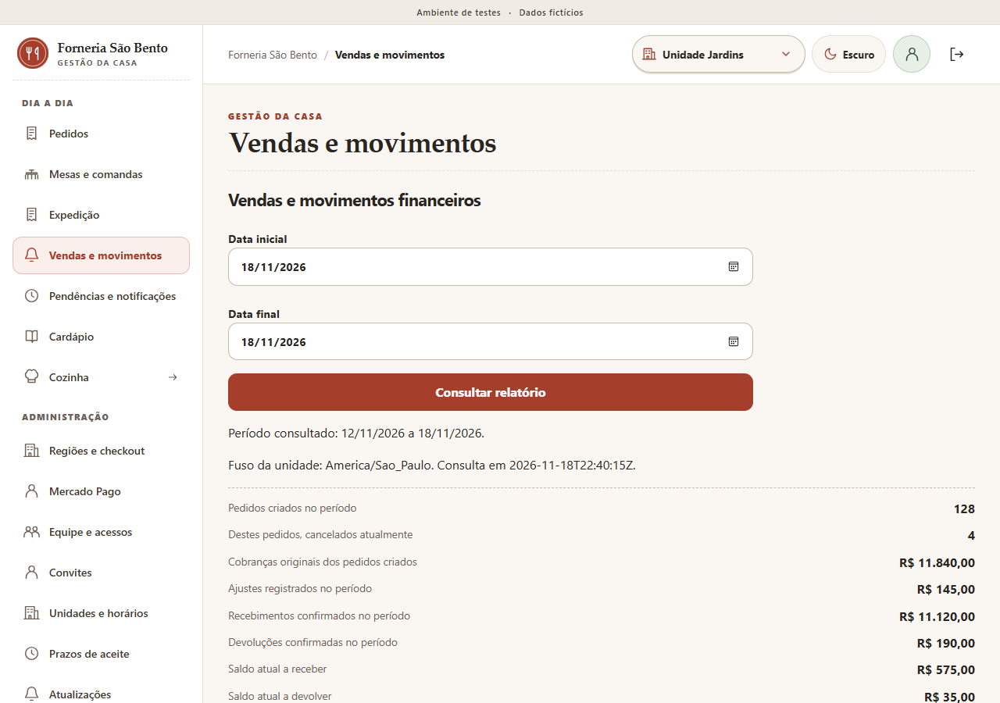 |  |  |

| Depois (Claro · Celular `360px`) | Depois (Escuro · Celular `360px`) |
| --- | --- |
|  |  |

---

## 3. O que foi alterado

| Bloco / Tela | Antes | Depois | Arquivo(s) |
| --- | --- | --- | --- |
| **Fundação Operacional Compartilhada** | `.campo-filtro` em `15rem` sem ajuste de fonte/padding para `select` em `360px`; sem estilos para KPIs de caixa, etiqueta de despacho, grade de pendências ou cartões de vendas | `.campo-filtro` com `flex: 1 1 16.5rem` (`100%` em `<= 600px`) e `select` `0.875rem` / `padding-inline: 0.75rem 2.2rem` (`S03-UI06`); novas classes `.atalhos-operacao`, `.btn-servir-mesa`, `.extrato-financeiro-dl`, `.extrato-kpi`, `.troco-calculadora`, `.expedicao-item`, `.etiqueta-despacho`, `.grade-pendencias`, `.cartao-pendencia`, `.grade-kpis-vendas`, `.cartao-kpi-vendas` e `@media print` em Claro + Escuro | [operacao.css](../../../frontend/src/app/operacao.css) |
| **Fila de Pedidos** | `<h2>` duplicado visível; apenas selects; sem busca rápida | Cabeçalho duplicado recolhido via `sr-only` quando `!navegacaoInterna()`; 6 pílulas rápidas de estado (`aria-pressed`); campo `#pedidos-busca` (`type="search"`, zero checkboxes extras) com estado vazio dedicado + `Limpar busca` | [operacao-pedidos.component.html](../../../frontend/src/app/pedidos/operacao-pedidos.component.html) |
| **Cartão Operacional de Pedido** | Botões sem hierarquia Spartan consistente; enums crus (`PEDIDO_CRIADO`) no histórico; unidades não selecionáveis em texto cru | Hierarquia `[hlmBtn]` (`Aceitar pedido` terracota tátil, `Marcar servido na mesa` em sálvia sólida antes do cancelamento, `Recusar pedido` destrutivo, cancelamento em outline destrutivo); guia pontilhada ligando item ao subtotal; `.selecao` tátil `>= 48px` e `.unidade-estatica` em pílula; histórico traduzido por `nomeEvento(evento.tipo)` e gaveta `.gaveta-financeira` editorial | [pedido-detalhe.component.html](../../../frontend/src/app/pedidos/pedido-detalhe.component.html), [pedido-detalhe.component.css](../../../frontend/src/app/pedidos/pedido-detalhe.component.css) |
| **Novo Pedido Assistido (Modo PDV)** | Hero completo de consumidor + foto + `Ver horários` + corações de favoritos; comanda lateral oculta em `< 1080px` | `[class.vitrine-pdv]="modoPdv()"` transforma `.masthead` em barra horizontal enxuta com selo `ATENDIMENTO ASSISTIDO`, unidade travada sem chevron enganoso e seletor de canal (`Delivery`, `Retirada`, `Mesa`); oculta favoritos; mantém `.carrinho-lateral` empilhado em `grid-template-areas: 'rail' 'menu' 'ticket'` abaixo de `1080px` e barra móvel `Conferir comanda` acionando `abrirRevisaoPdv(...)` sem regressão em `/cardapio` | [vitrine.component.html](../../../frontend/src/app/catalogo/vitrine.component.html), [vitrine.css](../../../frontend/src/app/catalogo/vitrine.css) |
| **Salão, Mesas & Chamados** | Nome da mesa repetido visualmente nos 5 botões; pouca distinção entre estados; resumo duplicado acima de `<app-financeiro>`; QR sem moldura clara no escuro | Geometria `< 0.5px` de `.barra-conexao`, `summary` e paginações 100% preservada; cartões diferenciados para Livre (sálvia), Ocupada/Aberta (terracota), Em fechamento (âmbar) e Inativa (tracejada); botões curtos com sufixo `` mantendo nome acessível idêntico; `Copiar código`; painel QR com moldura `#ffffff`, `Copiar link`, `Imprimir QR` e `Fechar`; comanda com `Fechar comanda` e `<dl>` exibido só quando `!exibirFinanceiroComanda()`; chamados com `tempoSolicitacao(...)` | [mesas.component.html](../../../frontend/src/app/mesas/mesas.component.html), [mesas.component.css](../../../frontend/src/app/mesas/mesas.component.css) |
| **Expedição & Entregas** | Caixa dupla aninhada, `<address>` cru sem botão de cópia, sem filtros rápidos | Pílulas client-side (`Todos`, `Retirada pronta`, `Prontos p/ sair`, `Em entrega`, `Com ocorrência`) com contadores `tabular-nums`; integração sem borda duplicada (`:host-context(.expedicao-item)`) mantendo `app-expedicao > section > article`; `<address class="etiqueta-despacho">` com `Copiar contato` e bloco de ocorrência/decisão organizado | [expedicao.component.html](../../../frontend/src/app/delivery/expedicao.component.html) |
| **Caixa / Financeiro** | `<dl>` simples, sem atalho de saldo restante, sem cálculo prévio de troco, `troco R$ 0,00` repetido em Pix/Cartão | 6 cartões `.extrato-kpi` mantendo `<dt>` irmão imediato de `<dd>`; botão rápido `Usar saldo restante (...)`; card `troco-calculadora` em tempo real para `DINHEIRO`; `entregue ... · troco ...` restrito a `r.metodo === 'DINHEIRO'` + `horarioCurto(r.confirmadoEm)`; `Solicitar devolução` diretamente visível fora de `
` | [financeiro.component.html](../../../frontend/src/app/financeiro/financeiro.component.html) |
| **Pendências & Notificações** | `<ul><li>` com botões sobrepostos e enums crus | Barra compacta mantendo `<h2>Pendências financeiras e notificações</h2>` visível; 2 painéis lado a lado (`01 · Conciliação` com link `Ver pedidos` e `02 · Comunicações` com filtro `Todas` / `Com falha ou pendentes`, `rotuloTipoNotificacao`, `rotuloEstado` em PT-BR sem enums crus e badges `ok`/`warn`/`danger`) | [pendencias.component.html](../../../frontend/src/app/pagamentos/pendencias.component.html) |
| **Relatório de Vendas** | Datas empilhadas, ISO cru em `consultadoEm`, `<dl>` único sem agrupamento | Pílulas `Hoje`, `Ontem`, `Últimos 7 dias`, `Este mês` + `Imprimir resumo`; datas lado a lado; `horarioConsulta(r)` formatado no fuso da unidade; **3 Cartões de KPIs** (`01 Operação & Demanda` com `Ticket médio bruto`, `02 Caixa Confirmado no Período`, `03 Posição Atual de Saldos & Reservas`) preservando todos os 9 `<dt>` canônicos | [vendas.component.html](../../../frontend/src/app/relatorios/vendas.component.html) |

---

## 4. Por quê

- **Impacto na experiência do usuário (UX):** atendentes, caixas, expedidores e gestores batem o olho na tela e distinguem imediatamente o que exige ação (aceite pendente, mesa solicitando conta, entrega com ocorrência, saldo a receber/devolver ou falha de e-mail) tanto em **Tema Claro** (ambientes diurnos) quanto em **Tema Escuro** (salão à meia-luz e operação noturna), com zero ruído textual e alvos táteis `>= 48px` em `360px`, `768px` e `1280px`.
- **Conformidade com as normas do projeto:** atende integralmente [Interface, acessibilidade e PWA](../../09_UI_GUIDELINES.md), [Padrões de código](../../10_CODING_STANDARDS.md), [Definition of Done](../../12_DEFINITION_OF_DONE.md), [ADR 0003 — Spartan UI e navegação por área](../../adr/0003-spartan-navegacao-por-area.md) e **WCAG 2.2 AA** (`tabular-nums` em valores/relógios, contraste opaco verificado em Claro e Escuro, suporte a `prefers-reduced-motion` e zero nome/monograma fixo de restaurante).
- **Garantia não-estrutural e preservação de contratos:** nenhum arquivo em `backend/`, `*.service.ts`, `modelos.ts`, `guardas.ts`, `*.routes.ts`, `paginas-*.ts`, `scripts/`, `package.json`, `angular.json`, `service-worker.js` ou `e2e*/**` foi alterado, e nenhum `inject(...)` ou `computed(...)` adicional foi introduzido nos `.ts`. Todos os contratos de automação (`S03-UI01`, `S03-UI02`, `S03-UI04`, `S03-UI06`, `S03-UI09`, `S03-UI12`, `S03-UI13`, `S04-UI03` a `S04-UI06`, `S04-UI08` a `S04-UI10` e estabilidade geométrica `< 0.5px` sob SSE em `test_mesa_navigation_templates.cjs`) foram integralmente preservados.

---

## 5. Pendências e Requisitos para o Backend

Nenhuma tela desta Sprint está bloqueada. As evoluções opcionais de API já catalogadas em [RELATORIO-PENDENCIAS-BACKEND.md](RELATORIO-PENDENCIAS-BACKEND.md) que enriquecerão ainda mais estas visões em ciclos futuros de backend são:

- **`BE-12` *(P1 · `/gestao/pendencias`)*:** incluir `criadaEm`, `atualizadaEm` e `detalheCurto` sanitizado em `NotificacaoOperacional`, além de endpoint idempotente para reconhecer/reenviar notificações tratadas.
- **`BE-13` *(P1 · `/gestao/relatorios`)*:** quebra analítica por canal (`MESA`, `RETIRADA`, `DELIVERY`) e meio de pagamento (`ONLINE`, `PRESENCIAL`) + exportação CSV auditada em `/api/v1/relatorios/vendas`.
- **`BE-14` *(P2 · `<app-equipe-layout>` / operação)*:** endpoint leve `GET /api/v1/operacao/resumo?unidadeId={uuid}` para contadores globais em tempo real nos badges da barra lateral.
- **`BE-15` *(P2 · `/gestao/pedidos` e `/gestao/mesas`)*:** filtros server-side opcionais (`busca` textual em `/api/v1/operacao/pedidos` para buscar além da página corrente e filtro de ocupação/atividade em `/api/v1/operacao/mesas`).
- **`BE-21` *(P1/P2 · `PedidoDetalhe`)*:** incluir `unidadeNome` e `mesaNome` diretamente no DTO `PedidoDetalhe` para exibição nominal imediata da mesa nos cartões da fila de pedidos.

---

## 6. Validações executadas

Todos os gates abaixo foram executados após a última edição de código, com saída real aprovada:

- **`npm.cmd --prefix frontend run format:check` (+ `prettier --check` em `catalogo/vitrine.{component.html,css}`):** aprovado (`All matched files use Prettier code style!`, código `0`).
- **`npm.cmd --prefix frontend run typecheck`:** aprovado (`tsc --noEmit -p tsconfig.app.json && tsc -p tsconfig.e2e.json`, `0` erros).
- **`npx.cmd --prefix frontend ngc -p frontend/tsconfig.app.json --noEmit`:** aprovado (`0` erros de template/AOT estrito).
- **`npm.cmd --prefix frontend run test:logic`:** aprovado (todos os cenários unitários e de concorrência/recuperação aprovados, código `0`).
- **`node scripts/test_mesa_navigation_templates.cjs`:** aprovado (`chromium: geometria estável em360/768/1280 e fontes16/20; clique único durante SSE, foco, filas, limites, envio bloqueado e rejeição409 preservada após snapshot aprovados. Transporte fictício/JIT.`).
- **`node scripts/test_kitchen_templates.cjs`:** aprovado (`chromium: painel/ações parciais, seleção após atualização, conflito, recuperação idempotente, teclado, 360/768/1280 e aviso de entrada aprovados (API fictícia).`).
- **`node scripts/check_contrast.cjs --self-test`:** aprovado (`14 verificações de matemática, limites, destino e reutilização de sessão aprovadas`).
- **`npm.cmd --prefix frontend run build` + `node scripts/test_pwa.cjs`:** aprovado (`Initial total: 325.08 kB` bruto / `89.13 kB` transferido — abaixo do limite de `450 kB` aviso / `600 kB` erro; `PWA: 34 arquivos públicos` verificados).
- **Auditoria visual Playwright/Edge em `1280×900`, `768×1024` e `360×800` (Claro + Escuro):** 36 capturas geradas em `docs/evidencias/frontend/imagens/sprint4-depois-*.png` com `overflow = 0px` em 100% dos cenários e inspeção visual direta confirmando ausência de sobreposições ou cortes.
- **`python scripts/check-repository.py`:** aprovado (links locais, imagens referenciadas e higiene de repositório íntegros).

---

## 7. Limites e próximos passos

- As capturas de tela e sondas Playwright desta entrega foram executadas localmente em Microsoft Edge headless sobre o bundle AOT real de produção (`frontend/dist/restaurant-manager/browser`) com transporte HTTP local controlado; a homologação integrada ponta a ponta com PostgreSQL real permanece no escopo do pipeline Linux/CI conforme [Estratégia de validação](../../26_TEST_STRATEGY.md).
- Próxima etapa planejada no roadmap visual: **Sprint 5 — Gestão Comercial e Configurações em Light + Dark** (Catálogo administrativo, Mídia, Regiões/Delivery, Prazos de aceite e Integração Mercado Pago).
