# Sprint 6 · Gestão Corporativa & Segurança (Light + Dark): Equipe/Acessos, Convites, Unidades, Funcionamento e Eventos

- **Data:** 2026-11-22
- **Telas / Rotas:** `/gestao/equipe` (`<app-acessos>`), `/gestao/equipe/convites` (`<app-convites>`), `/gestao/unidades` (`<app-unidades>` + `<app-funcionamento-unidade>`) e `/gestao/atualizacoes` (`<app-eventos-unidade>`)
- **Área:** Gestão Corporativa & Segurança
- **Responsável técnico:** Coordenador (helpers visuais, preparação `[hlmBtn]` da Fase A, compatibilidade `[variant='outline']` em `styles.css` + sondas/capturas em Edge real) + subagente `artesao-ux-bistro` (implementação visual inline Light + Dark nos 5 componentes, preservação dos contratos JIT/E2E e auditoria técnica)
- **Arquivos alterados na camada visual:**
  - [styles.css](../../../frontend/src/styles.css) *(adição dos seletores `[variant='secondary'|'outline'|'ghost'|'destructive']` para paridade AOT/JIT)*
  - [acessos.component.ts](../../../frontend/src/app/acessos/acessos.component.ts)
  - [convites.component.ts](../../../frontend/src/app/acessos/convites.component.ts)
  - [unidades.component.ts](../../../frontend/src/app/unidades/unidades.component.ts)
  - [funcionamento.component.ts](../../../frontend/src/app/unidades/funcionamento.component.ts)
  - [eventos-unidade.component.ts](../../../frontend/src/app/unidades/eventos-unidade.component.ts)

---

## 1. Como era antes

1. **Estética legada fora da paleta e ausência de suporte a Tema Dark:**
   - Os cinco componentes corporativos utilizavam bordas e divisórias herdadas (`#6b7a70`, `#d9e2dc`) e vermelho fixo (`#9d2424`) em `styles:` inline, sem tokens semânticos (`--card`, `--background`, `--foreground`, `--border`, `--primary`, `--accent`, `--amber-*`, `--danger-*`) compatíveis com `:root[data-theme='dark']`.
   - Botões primários, secundários e de remoção eram `<button>` HTML crus sem `[hlmBtn]`, sem `variant="outline"`, sem `.btn-cancelar-outline` e sem relevo tátil `--primary-deep`.
2. **Dropdowns nativos crus e falta de hierarquia editorial:**
   - Todos os 6 seletores (`#perfil-acesso`, `#perfil-{{f.id}}`, `#perfil-convite`, canal e dia em `funcionamento`, e `#unidade-eventos`) renderizavam `<select>` HTML padrão sem o padrão `.bistro-select-wrap` > `.bistro-select-pill` + `.bistro-select-popover`.
3. **Ruído técnico e layout pouco escaneável em Desktop, Tablet e Celular (`360px`):**
   - `acessos.component.ts` empilhava matriz de permissões e lista de funcionários em coluna única longa sem busca rápida de funcionário, sem contador de permissões ativas e sem link direto para `/gestao/equipe/convites`.
   - `convites.component.ts` exibia aviso fixo `"Ambiente fictício: captura privada, sem envio real de e-mail."`, UUID de 36 caracteres e timestamp ISO cru em destaque no corpo do cartão, e não oferecia filtros rápidos por estado nem botão de cópia de ID.
   - `unidades.component.ts` e `funcionamento.component.ts` empilhavam reautenticação e criação de unidade em coluna única sem atalhos rápidos de fuso IANA e sem resumo visual da semana de funcionamento.
   - `eventos-unidade.component.ts` apresentava lista ordenada plana sem cartões de auditoria nem destaque de status da conexão.

---

## 2. Representação visual — Depois (Claro + Escuro · `1280px` / `768px` / `360px`)

A representação visual interativa do Gate 0 (`sprint6-representacao-visual.html`) foi aprovada pelo usuário antes da edição de código. Após a implementação, todos os 5 componentes reais foram compilados via `esbuild` JIT em Microsoft Edge (`Playwright`) nos temas **Claro e Escuro** em `1280×900`, `768×1024` e `360×800` (24 combinações com `overflow = 0px`, `0` botões verdes, `0` selects nativos visíveis e `0` botões principais `< 48px`):

| Área / Tela | Desktop (`1280×900`) | Tablet (`768×1024`) | Celular (`360×800`) |
| --- | --- | --- | --- |
| **Equipe e acessos** (`/gestao/equipe`) | 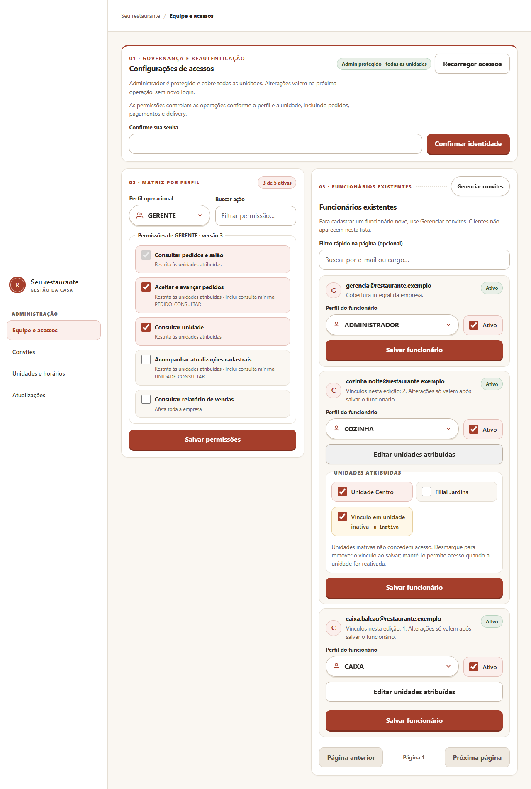 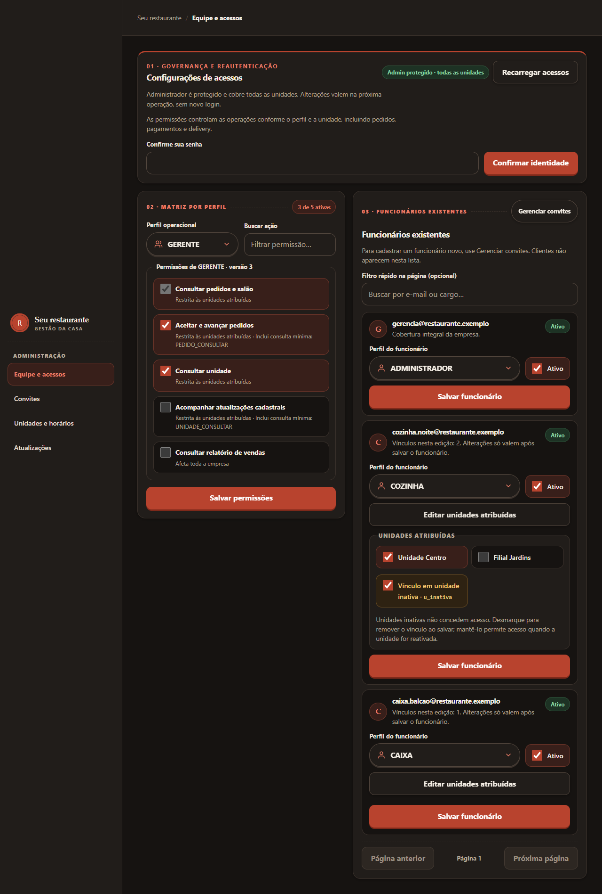 | 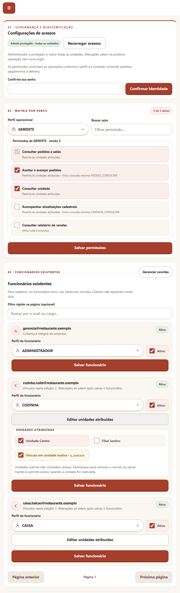 | 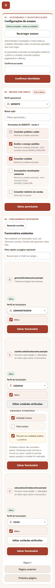 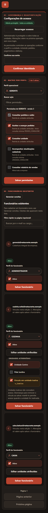 |
| **Convites** (`/gestao/equipe/convites`) | 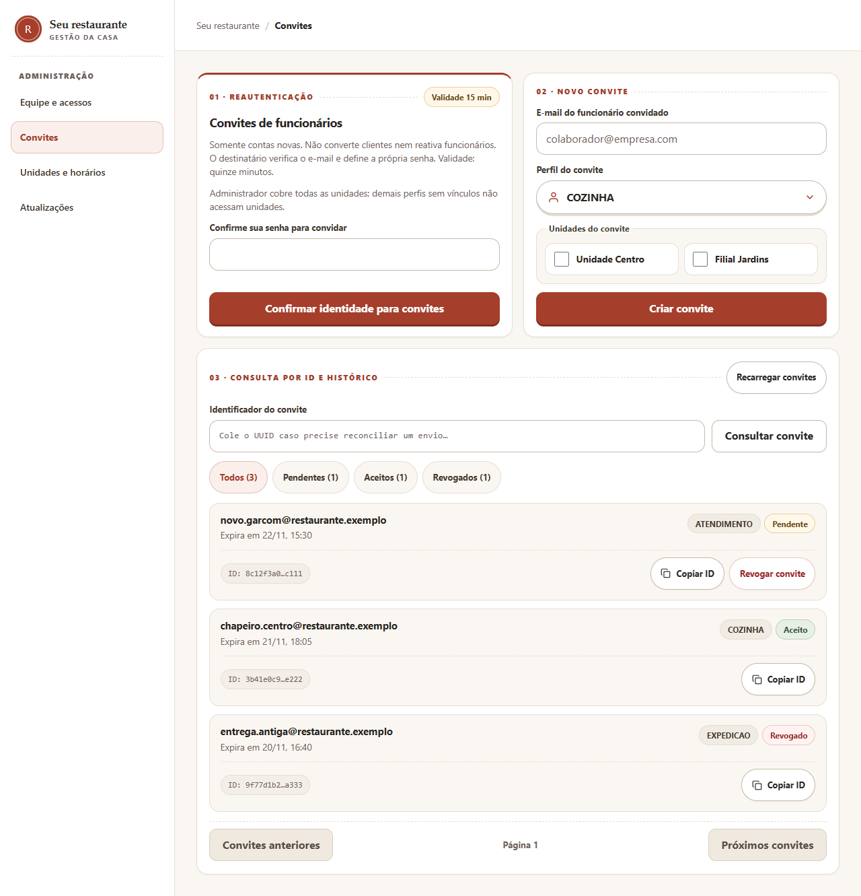 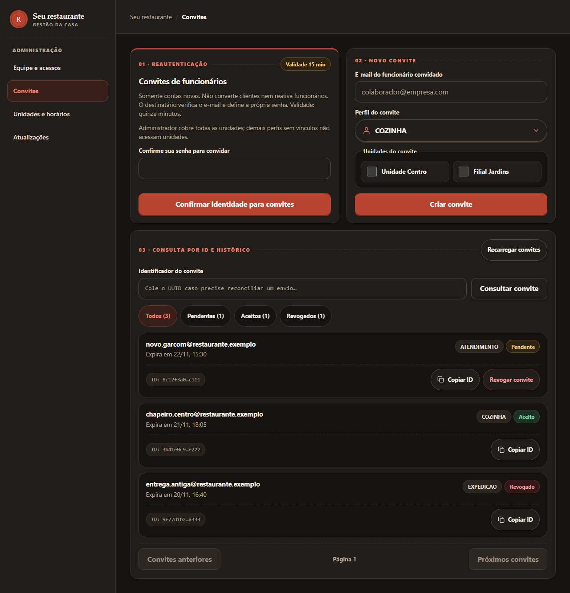 | 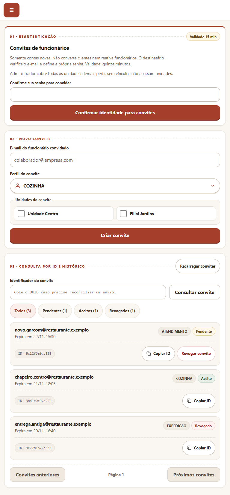 | 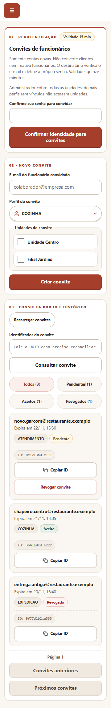 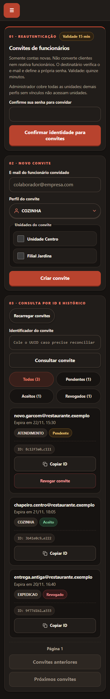 |
| **Unidades e horários** (`/gestao/unidades`) | 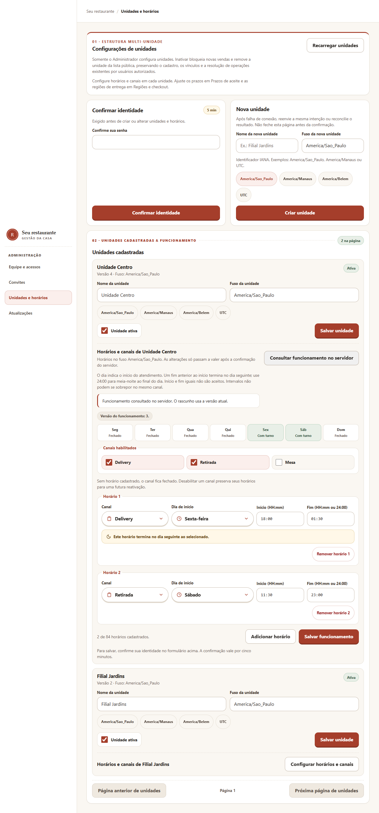 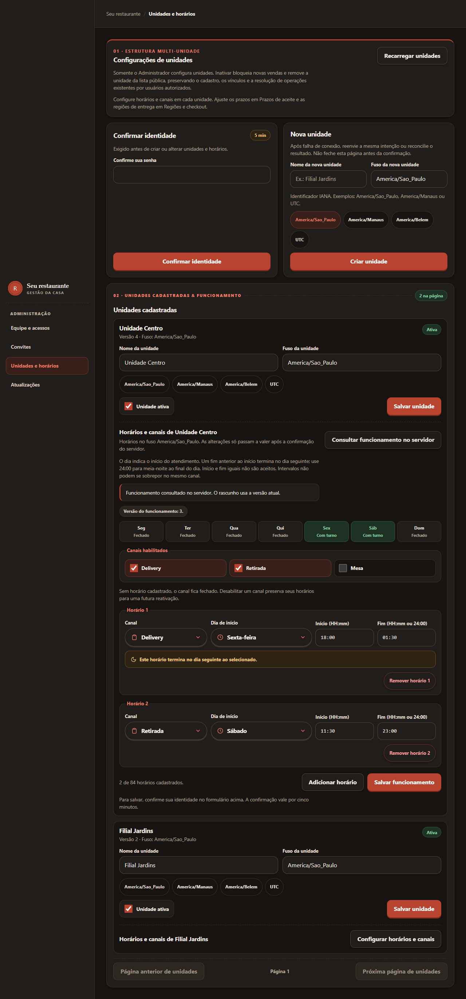 | 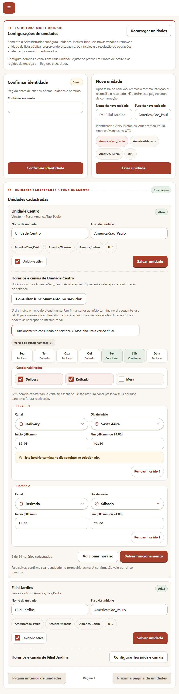 | 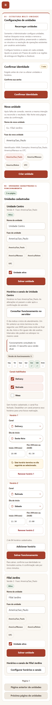 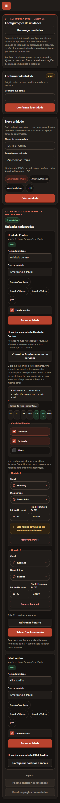 |
| **Atualizações** (`/gestao/atualizacoes`) | 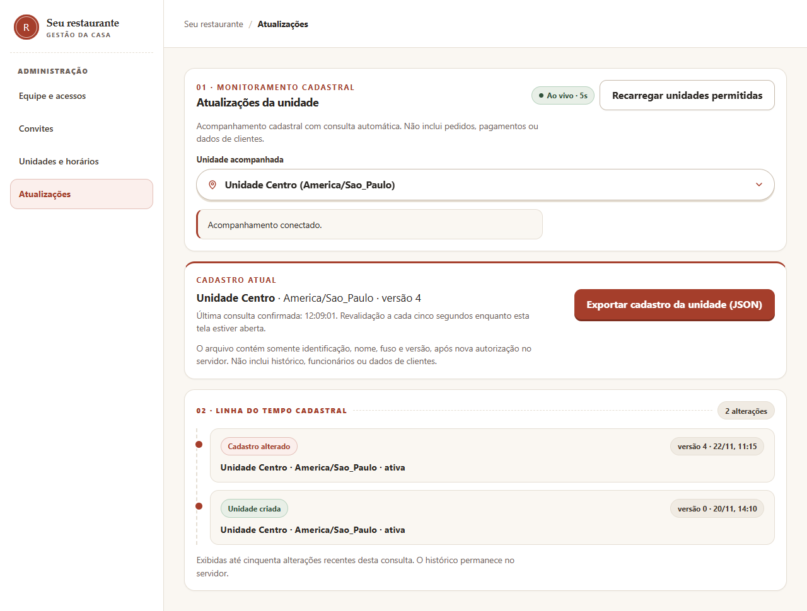 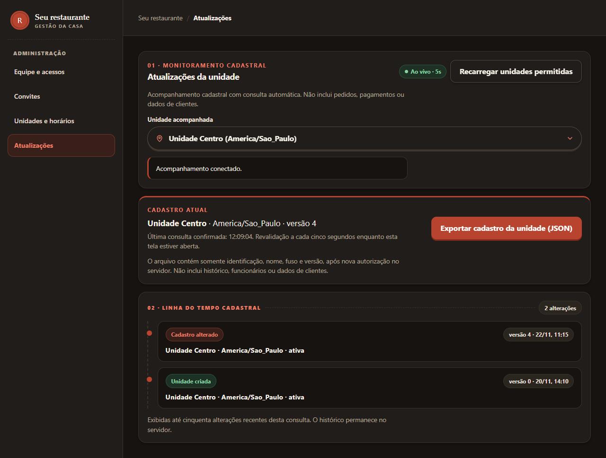 | 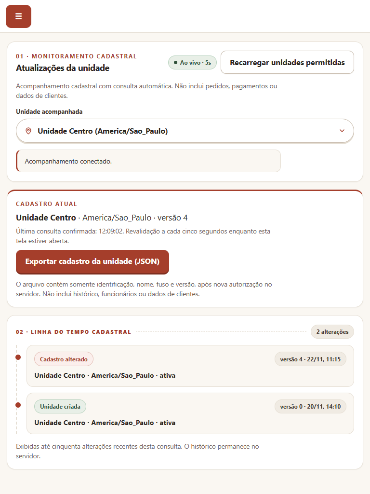 | 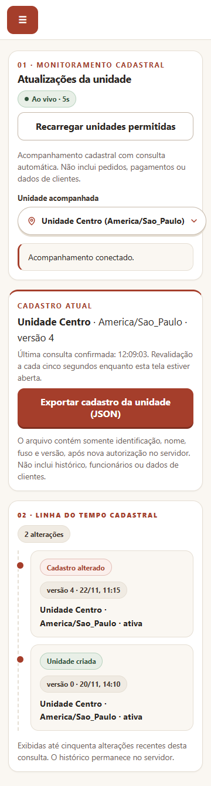 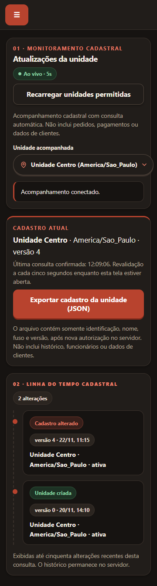 |

---

## 3. O que foi alterado

| Elemento / Bloco | Antes | Depois | Arquivo(s) |
| --- | --- | --- | --- |
| **Identidade, tokens e botões** | Cores fixas `#6b7a70`/`#d9e2dc`/`#9d2424`; botões HTML crus | Tokens Claro + Dark (`--card`, `--background`, `--primary`, `--primary-deep`, `--accent`, `--amber-*`, `--danger-*`); CTAs primários com `[hlmBtn]` Terracota, secundários com `variant="outline"` e remoções/revogação com `.btn-cancelar-outline` inline (zero botão verde em formulários e zero dependência de `operacao.css`) | Todos os 5 componentes |
| **Seletores `.bistro-select-wrap`** | 6 `<select>` nativos crus | Padrão completo `.bistro-select-wrap` > `.bistro-select-pill` + `select.bistro-select-native` + `.bistro-select-popover` controlado por `signal` (`menuPerfilAberto`, `menuFuncionarioAberto`, `menuAberto`, `menuUnidadeAberto`), sem `<input type="checkbox" hidden>` nos cards de funcionário e com contenção mobile `<= 640px` | `acessos`, `convites`, `funcionamento`, `eventos-unidade` |
| **Acessos e Equipe (`/gestao/equipe`)** | Bloco único linear com `<fieldset>` e `<article>` simples | Talão superior `01 · GOVERNANÇA E REAUTENTICAÇÃO`, grade desktop `0.94fr / 1.06fr` (`02 · MATRIZ POR PERFIL` × `03 · FUNCIONÁRIOS EXISTENTES`), contador de permissões ativas, link `<a hlmBtn variant="outline" href="/gestao/equipe/convites">Gerenciar convites</a>`, filtro `#buscar-emp`, quebra segura de e-mail (`word-break: break-word`), ordem vertical preservada (`Editar unidades atribuídas` acima de `Salvar funcionário`) e 1 checkbox por `<article>` fechado | [acessos.component.ts](../../../frontend/src/app/acessos/acessos.component.ts) |
| **Convites (`/gestao/equipe/convites`)** | Aviso fictício, UUID completo e ISO cru no destaque | Grade 2 colunas (`01 · REAUTENTICAÇÃO` como `form.first()` × `02 · NOVO CONVITE` / recuperação idempotente), remoção do texto fictício, filtros `2×2` em `<= 600px`, expiração formatada em PT-BR (`formatarExpiracao`), chip discreto `idCurto` + `Copiar ID`, preservação de `c.perfil`, `c.estado` (via `.sr-only`) e `Revogar convite de <email>` | [convites.component.ts](../../../frontend/src/app/acessos/convites.component.ts) |
| **Unidades e Horários (`/gestao/unidades`)** | Formulários empilhados em coluna única e horários sem resumo visual | `<section>` em CSS Grid 2 colunas mantendo os dois `<form>` (`Confirmar identidade` e `data-rascunho="nova-unidade"`) como filhos diretos de `app-unidades > section`; atalhos de fuso IANA (`fusosComuns`) na criação e edição; faixa semanal `Seg`–`Dom` sempre em 7 colunas (`repeat(7, minmax(0, 1fr))`), alerta de virada de madrugada, `Remover horário N` em `.btn-cancelar-outline` e rodapé responsivo preservando todos os textos literais | [unidades.component.ts](../../../frontend/src/app/unidades/unidades.component.ts), [funcionamento.component.ts](../../../frontend/src/app/unidades/funcionamento.component.ts) |
| **Atualizações (`/gestao/atualizacoes`)** | Parágrafos planos e `<ol>` sem estilo | Card superior com indicador de estado (`Ao vivo · 5s` / `Reconectando…`), seletor `.bistro-select-wrap`, talão `CADASTRO ATUAL` com `data-testid="unidade-atual"` e botão Terracota de exportação JSON, e linha do tempo pontilhada `.s6-timeline-ol` com badges e timestamps formatados | [eventos-unidade.component.ts](../../../frontend/src/app/unidades/eventos-unidade.component.ts) |

---

## 4. Por quê

- **Impacto na experiência do usuário (UX):** unifica toda a área de Governança & Segurança ao padrão editorial tátil de `/cardapio` nos modos Claro e Escuro, reduz ruído técnico (UUID completo e ISO cru saem do protagonismo), agiliza o preenchimento de fuso IANA e leitura de disponibilidade semanal em celular `360px`, e diferencia claramente ações primárias (Terracota) de ações destrutivas (`.btn-cancelar-outline`).
- **Conformidade com as normas do projeto:** atende às diretrizes de [Interface/PWA](../../09_UI_GUIDELINES.md), [ADR 0003](../../adr/0003-spartan-navegacao-por-area.md), WCAG 2.2 AA (alvos `>= 48px`, contraste semântico Claro/Dark, `prefers-reduced-motion: reduce`) e às regras de compilação JIT `esbuild` e anti-regressão da [Seção Sprint 6 e Regra 7 do plano](PLANO-SPRINTS-FRONTEND.md).
- **Garantia não-estrutural:** nenhuma alteração foi realizada em `backend/`, serviços (`*.service.ts`), rotas (`*.routes.ts`), `modelos.ts`, `guardas.ts`, `operacao.css` ou scripts de teste; todos os `template:`/`styles:` permaneceram inline e todos os IDs, labels, `role`s e seletores de E2E/probes foram preservados. Em `styles.css`, foi adicionada apenas a paridade `[variant='...']` ao lado de `[data-variant='...']` para que botões `outline` mantenham contraste neutro tanto em AOT quanto em compilação JIT `esbuild`.

---

## 5. Pendências e Requisitos para o Backend

Nenhuma nova dependência de backend introduzida nesta entrega visual. Permanece apenas a evolução opcional já mapeada anteriormente: **`BE-10`** (nome do funcionário em `/api/v1/equipe`) em [RELATORIO-PENDENCIAS-BACKEND.md](RELATORIO-PENDENCIAS-BACKEND.md).

---

## 6. Validações executadas

Resultados literais após a última edição (com Node `v24.12.0` do Visual Studio no `PATH`):

- `npx --prefix frontend prettier --check` nos 5 arquivos e `npm --prefix frontend run format:check` -> **Aprovado** (`All matched files use Prettier code style!`).
- `npm --prefix frontend run typecheck` (`tsc --noEmit -p tsconfig.app.json && tsc -p tsconfig.e2e.json`) -> **Aprovado** (exit code `0`).
- `npx --prefix frontend ngc -p frontend/tsconfig.app.json --noEmit` -> **Aprovado** (exit code `0`).
- `npm --prefix frontend run test:logic` (`node ../scripts/test-frontend.cjs`) -> **Aprovado** (todos os cenários da suíte lógica passaram, exit code `0`).
- `node scripts/test_inactive_memberships.cjs` -> **Aprovado** (`Vínculo inativo visível e removível sem conceder unidade nova: aprovado (lógica unitária).`).
- `node scripts/test_unit_schedule.cjs` -> **Aprovado** (`9/9` funções de lógica aprovadas).
- `node scripts/test_unit_export.cjs` -> **Aprovado** (`6/6` funções de lógica aprovadas).
- `node scripts/test_unit_events.cjs` -> **Aprovado** (`4/4` funções de lógica aprovadas).
- `node scripts/check_contrast.cjs --self-test` -> **Aprovado** (`14 verificações de matemática, limites, destino e reutilização de sessão aprovadas; nenhuma navegação executada.`).
- Empacotamento JIT `esbuild` dos 5 componentes editados -> **Aprovado** (`JIT esbuild OK, bytes: 2389783`).
- Varredura estática de hex legado / strings proibidas nos 5 arquivos -> **Aprovado** (0 ocorrências de `#285139`, `#254d36`, `#263b30`, `#173e2c`, `#6b7a70`, `#d9e2dc`, `#f7f8f4`, `#eaf0e5`, `#9d2424`, `templateUrl`, `styleUrl`, `operacao.css`, `Montibeller` ou `Ambiente fictício`).
- `node scripts/test_profile_selects.cjs` (via Microsoft Edge em `Playwright` com `esbuild` JIT) -> **Aprovado** (`Perfis, recarga, payloads, convite com e-mail longo no mobile, revogação por teclado, leitura posterior, reautenticação de unidades e intenção após destruir a tela coerentes. API fictícia: não é E2E.`).
- `node scripts/test_unit_schedule_templates.cjs` (via Microsoft Edge em `Playwright` com `esbuild` JIT) -> **Aprovado** (`chromium: horários, bindings, bloqueio do pai, conflito, reautenticação, logout e layout aprovados; transporte fictício.`).
- Auditoria Playwright em Microsoft Edge nas 24 combinações (`4 telas × 2 temas Claro/Escuro × 1280/768/360`) -> **Aprovado** (`0` overflow horizontal, `0` botões verdes, `0` selects nativos visíveis, `0` botões `< 48px`, `0` erros de runtime).
- `python scripts/check-repository.py` -> **Aprovado** após a última edição.
- `npm --prefix frontend run build` -> **Bloqueado neste ambiente pela checagem de versão do Angular CLI** (`Node.js version v24.12.0 detected. The Angular CLI requires a minimum Node.js version of v22.22.3 or v24.15.0 or v26.0.0.`).

---

## 7. Limites e próximos passos

- Executar `npm --prefix frontend run build` no ambiente com Node compatível (`>= 24.15.0` ou `22.22.3+`) para confirmar orçamento de bundle (`<= 450 kB`) e PWA, e executar as suítes E2E completas contra o backend/PostgreSQL no CI.
- Próxima e última etapa planejada no roadmap visual: **Sprint 7 — Console da Plataforma SaaS (`/plataforma`) & Auditoria Final Global (Light + Dark WCAG AA, Zero Legado e PWA)**.
