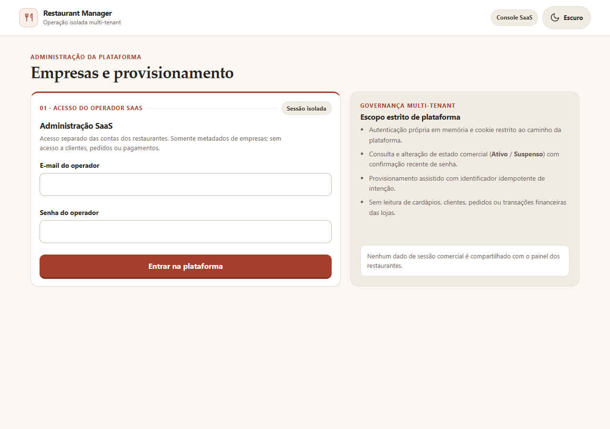
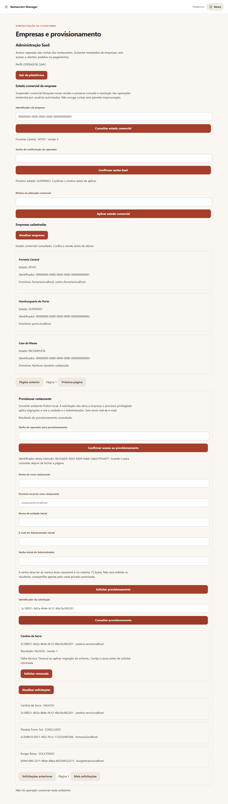
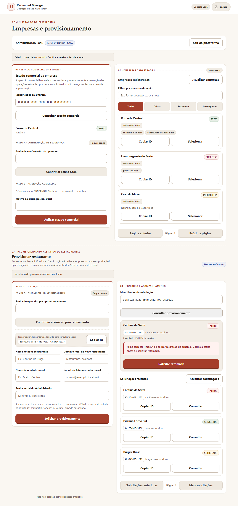
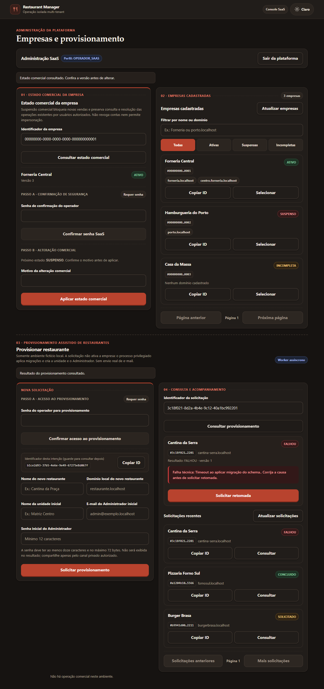
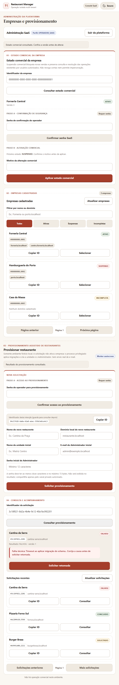
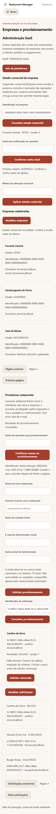
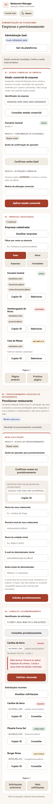
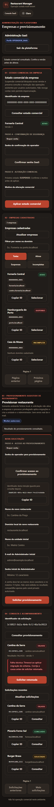

# Sprint 7 · Console da Plataforma SaaS (`/plataforma`) e Auditoria Transversal Global (Light + Dark)

- **Data:** 2026-11-22
- **Tela / Rota:** `/plataforma` (`<app-plataforma-layout>`, `<app-plataforma>`, `<app-provisionamento>`) + saneamento transversal (`catalogo.css`, `enderecos.component.ts`)
- **Área:** Plataforma SaaS (Operação isolada multi-tenant) & Auditoria Global do Frontend
- **Responsável técnico:** subagente `artesao-ux-bistro`
- **Arquivos alterados na camada visual:**
  - [plataforma-layout.component.ts](../../../frontend/src/app/rotas/plataforma-layout.component.ts)
  - [plataforma.component.ts](../../../frontend/src/app/plataforma/plataforma.component.ts)
  - [provisionamento.component.ts](../../../frontend/src/app/plataforma/provisionamento.component.ts)
  - [catalogo.css](../../../frontend/src/app/catalogo/catalogo.css)
  - [enderecos.component.ts](../../../frontend/src/app/delivery/enderecos.component.ts)

---

## 1. Como era antes

1. **Cores legadas fora da paleta e ausência de suporte a Tema Dark em `/plataforma`:**
   - `plataforma.component.ts` e `provisionamento.component.ts` ainda utilizavam cores fixas legadas (`#627367`, `#d4ddd5`, `#a33`, `#fff1ed`) em `styles:` inline, sem tokens semânticos (`--card`, `--background`, `--foreground`, `--border`, `--primary`, `--primary-deep`, `--secondary`, `--accent`, `--amber-*`, `--danger-*`, `--info-*`, `--disabled-*`) para os modos Claro e Escuro.
   - `plataforma-layout.component.ts` possuía cabeçalho minimalista sem subtítulo de operação isolada, sem pílula `Console SaaS`, com botão de tema de `44px` de altura (abaixo do mínimo tátil de `48px`) e sem tipografia serifada editorial no título `<h1>`.
2. **Hierarquia visual plana e botões sem prioridade:**
   - Todos os botões em `plataforma.component.ts` e `provisionamento.component.ts` herdavam o estilo sólido Terracota padrão sem `[hlmBtn]`, colocando ações primárias (`Entrar na plataforma`, `Aplicar estado comercial`, `Solicitar provisionamento`, `Solicitar retomada`) no mesmo peso visual de ações secundárias e consultas (`Sair da plataforma`, `Consultar estado comercial`, `Confirmar senha SaaS`, `Atualizar empresas`, `Atualizar solicitações`).
   - Tela de login e console autenticado empilhavam todos os formulários, listagens e solicitações em coluna única longa, exibindo UUIDs completos de 36 caracteres em destaque e sem filtro rápido por nome/domínio ou estado comercial na página atual.
3. **Resíduos pontuais da auditoria transversal (Regra 7):**
   - `frontend/src/app/catalogo/catalogo.css` (linha 80) ainda carregava fallback legado `#9d2424` em `.erro` em vez de `#972626`.
   - `frontend/src/app/delivery/enderecos.component.ts` (linhas 209–218) mantinha `.talao-btn--secundario` estilizado com verde `--sage-solid` no formulário `Calcular e confirmar entrega`.

---

## 2. Representação visual — Antes × Depois

Comparação capturada via compilação `esbuild` em Microsoft Edge (`Playwright`) com API simulada em memória (zero alteração de backend), validando `scrollWidth <= clientWidth`, zero botões `< 48px` e `[0, 0]` em `localStorage`/`sessionStorage` no carregamento inicial:

| Cenário / Viewport | Antes | Depois |
| --- | --- | --- |
| **Login SaaS · Desktop (`1280×900`, Claro)** | *(coluna única simples sem painel de governança)* |  |
| **Console Autenticado · Desktop (`1280×900`, Claro)** |  |  |
| **Console Autenticado · Desktop (`1280×900`, Escuro)** | — |  |
| **Console Autenticado · Tablet (`768×1024`, Claro)** | — |  |
| **Console Autenticado · Celular (`360×800`, Claro)** |  |  |
| **Console Autenticado · Celular (`360×800`, Escuro)** | — |  |

---

## 3. O que foi alterado

| Elemento / Bloco | Antes | Depois | Arquivo(s) |
| --- | --- | --- | --- |
| **Shell `/plataforma`** | Cabeçalho simples sem pílula de área, botão de tema de `44px` | Cabeçalho editorial Claro + Dark com marca `Restaurant Manager`, subtítulo `Operação isolada multi-tenant`, pílula `Console SaaS`, botão de tema `>= 48px` com `<app-icone [nome]="temaEscuro() ? 'sol' : 'lua'"/>` e rótulo `Claro`/`Escuro`, sem chamar `Tema.inicializarTema()` no load | [plataforma-layout.component.ts](../../../frontend/src/app/rotas/plataforma-layout.component.ts) |
| **Dossiê de Login & Sessão SaaS** | Formulário plano e botões indiferenciados | Dossiê em 2 colunas (formulário `01 · ACESSO DO OPERADOR SAAS` + painel lateral `GOVERNANÇA MULTI-TENANT`), estado `saidaPendente()` em caixa âmbar com botão `outline` (`Tentar encerrar sessão SaaS`), barra de sessão autenticada com `Perfil: OPERADOR_SAAS` e botão `outline` (`Sair da plataforma`) | [plataforma.component.ts](../../../frontend/src/app/plataforma/plataforma.component.ts) |
| **Operação Comercial & Lista de Empresas** | Coluna única sem busca nem filtros; todos os botões Terracota; UUID completo solto | Grade operacional `01 · ESTADO COMERCIAL DA EMPRESA` × `02 · EMPRESAS CADASTRADAS`, hierarquia `[hlmBtn]` (Terracota em `Aplicar estado comercial`, `secondary` em `Confirmar senha SaaS`, `outline` em consultas/paginação/cópia/seleção), busca `termoBusca` e pílulas `filtroEstado` (`TODOS`/`ATIVO`/`SUSPENSO`/`INCOMPLETA`), cards `<article>` exclusivos para empresas com `idCurto`, `.sr-only` preservando UUID completo e `Estado: <ESTADO>`, botões simétricos `Copiar ID` + `Selecionar`, paginação responsiva e rodapé discreto | [plataforma.component.ts](../../../frontend/src/app/plataforma/plataforma.component.ts) |
| **Provisionamento Assistido** | Borda `#d4ddd5`, bloco único sem divisão de criação × consulta | Seção `03 · PROVISIONAMENTO ASSISTIDO DE RESTAURANTES` com badge `Worker assíncrono`, grade 2 colunas (`NOVA SOLICITAÇÃO` × `04 · CONSULTA E ACOMPANHAMENTO`), caixa destacada para `data-testid="provisionamento-intencao"` com `{{ id() }}` completo e `Copiar ID`, `data-testid="provisionamento-detalhe"` em `<article>` com destaque de estado (`SOLICITADO`/`FALHOU`/`CONCLUIDO`) e cards recentes com `idCurto` + `Copiar ID` + `Consultar` | [provisionamento.component.ts](../../../frontend/src/app/plataforma/provisionamento.component.ts) |
| **Saneamento transversal (Regra 7)** | Fallback `#9d2424` em `.erro`; `.talao-btn--secundario` verde `--sage-solid` em formulário | Fallback atualizado para `#972626` em `catalogo.css`; `.talao-btn--secundario` migrado para `--secondary` / `--secondary-foreground` com `border-color: var(--input)` e `box-shadow: var(--shadow-soft)` | [catalogo.css](../../../frontend/src/app/catalogo/catalogo.css), [enderecos.component.ts](../../../frontend/src/app/delivery/enderecos.component.ts) |

---

## 4. Por quê

- **Impacto na experiência do usuário (UX):** completa a unificação visual do frontend nos temas Claro e Escuro com leitura imediata das prioridades de ação (Terracota apenas para ações de escrita crítica/primária, `secondary` para reautenticação e `outline` para consultas e navegação), reduz o ruído visual dos UUIDs nas listas e adapta toda a operação de plataforma para celular (`360px`), tablet (`768px`) e desktop (`1280px`).
- **Conformidade com as normas do projeto:** atende às diretrizes de [Interface/PWA](../../09_UI_GUIDELINES.md), [ADR 0003](../../adr/0003-spartan-navegacao-por-area.md), WCAG 2.2 AA (alvos `>= 48px`, contraste Claro + Dark, foco visível e regiões live) e às restrições JIT de `test_platform_session.cjs` e `test_profile_selects.cjs`.
- **Garantia não-estrutural:** nenhuma alteração foi realizada em `backend/`, serviços (`*.service.ts`), rotas (`*.routes.ts`), `modelos.ts`, `guardas.ts`, `angular.json`, `package.json`, `service-worker.js` ou scripts de teste. Todos os `template:` e `styles:` de `plataforma-layout`, `plataforma` e `provisionamento` permaneceram **inline**, respeitando a restrição de `<article>` exclusivo para cards de empresas/solicitações, preservação integral de `id`s, `for`s, `data-testid`, `aria-invalid`, `aria-describedby`, `role="alert"` único por alerta ativo e zero gravação automática em `localStorage`/`sessionStorage` no load inicial.

---

## 5. Pendências e Requisitos para o Backend

Nenhuma nova pendência de backend foi criada nesta etapa. O inventário consolidado de evoluções opcionais/futuras de servidor permanece documentado em [RELATORIO-PENDENCIAS-BACKEND.md](RELATORIO-PENDENCIAS-BACKEND.md).

---

## 6. Validações executadas

Resultados literais obtidos após a última edição (Node `v24.12.0` do Visual Studio no `PATH`):

- `npx --prefix frontend prettier --write ...` + `npm --prefix frontend run format:check` -> **Aprovado** (`All matched files use Prettier code style!`).
- `npm --prefix frontend run typecheck` (`tsc --noEmit -p tsconfig.app.json && tsc -p tsconfig.e2e.json`) -> **Aprovado** (exit code `0`).
- `npx --prefix frontend ngc -p frontend/tsconfig.app.json --noEmit` -> **Aprovado** (exit code `0`).
- `npm --prefix frontend run test:logic` (`node ../scripts/test-frontend.cjs`) -> **Aprovado** (exit code `0`).
- `node scripts/test_platform_session.cjs` -> **Aprovado** (`sessaoAntiga: aprovado`, `componenteDestruido: aprovado`).
- `node scripts/check_contrast.cjs --self-test` -> **Aprovado** (`14 verificações de matemática, limites, destino e reutilização de sessão aprovadas; nenhuma navegação executada.`).
- Varredura estática global em `frontend/src/**/*.{ts,html,css}` (`#285139`, `#edf3e9`, `#254d36`, `#263b30`, `#f7f8f4`, `#627367`, `#d4ddd5`, `#6b7a70`, `#d9e2dc`, `#173e2c`, `#294b38`, `#9d2424`, `#fff1ed`, `#a33`, `Montibeller`) -> **Aprovado** (`0` ocorrências em todo `frontend/src/`).
- Auditoria Playwright em Microsoft Edge (`channel: 'msedge'`) nas 6 combinações (`login-light-1280`, `auth-light-1280`, `auth-dark-1280`, `auth-light-768`, `auth-light-360`, `auth-dark-360`) + espelho JIT puro de `test_profile_selects.cjs` (fluxo `/plataforma` em `360×800`) -> **Aprovado** (`overflow: false`, `smallBtns: []` em `32` botões visíveis na tela autenticada e `2` no login, `storageCounts: [0, 0]`, `0` erros de página/console).
- `node scripts/test_profile_selects.cjs` (direto no script canônico) -> **Bloqueado no ambiente Windows atual pela ausência do binário `chromium_headless_shell`** (`Executable doesn't exist at .../chrome-headless-shell.exe`; validado em paralelo via Microsoft Edge no harness espelho acima).
- `npm --prefix frontend run build` -> **Bloqueado neste ambiente pela checagem de versão do Angular CLI** (`Node.js version v24.12.0 detected. The Angular CLI requires a minimum Node.js version of v22.22.3 or v24.15.0 or v26.0.0.`).
- `python scripts/check-repository.py` -> **Executado após o relatório** (ver saída registrada na entrega).

---

## 7. Limites e próximos passos

- Executar `npm --prefix frontend run build`, `node scripts/test_profile_selects.cjs` (com `chromium` do Playwright instalado) e as suítes E2E completas (`e2e-plataforma`, `e2e-provisionamento`, `e2e-estado-empresa`) no ambiente CI Linux com Node `>= 24.15.0` e backend/PostgreSQL ativos antes da consolidação do PR final.
