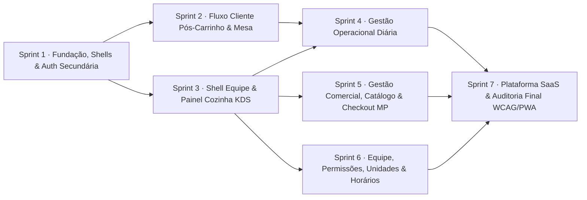

# Plano Master de Sprints — Frontend (`SAAS Restaurante MB`)

Este plano organiza a evolução visual, ergonômica e multi-tenant de **todo o `frontend/`** em **7 Sprints independentes**, pensadas para execução sequencial com **um novo chat por Sprint**, evitando esgotamento de contexto e garantindo **zero alterações em `backend/`**.

Qualquer necessidade nova de endpoint, campo de DTO ou regra de servidor identificada antes ou durante as sprints fica consolidada em [Relatório de Pendências e Evoluções para o Backend](RELATORIO-PENDENCIAS-BACKEND.md).

---

## 1. Diagnóstico do Estado Atual (`frontend/src/app`)

### 1.1 O que já está concluído no padrão Editorial Bistrô v3 + Multi-Tenant

As entregas abaixo já seguem a paleta oficial (`#faf7f2` linho, `#292521` carvão, `#a53e2b` terracota, `#30523b` sálvia), uso dinâmico de `MarcaService` (zero marca fixa ou inicial `'M'` hardcoded), assinatura editorial tátil e alvos >= `48px`:

- **Tokens globais & UI base:** [`styles.css`](../../../frontend/src/styles.css), [`ui/button.ts`](../../../frontend/src/app/ui/button.ts), [`ui/tabs.ts`](../../../frontend/src/app/ui/tabs.ts) e [`rotas/marca.service.ts`](../../../frontend/src/app/rotas/marca.service.ts).
- **Área do Cliente (Vitrine & Comanda):** [`cliente-layout.component.ts`](../../../frontend/src/app/rotas/cliente-layout.component.ts), [`cliente-layout.css`](../../../frontend/src/app/rotas/cliente-layout.css), [`vitrine.component.html`](../../../frontend/src/app/catalogo/vitrine.component.html), [`vitrine.css`](../../../frontend/src/app/catalogo/vitrine.css), [`configurador-produto.component.ts`](../../../frontend/src/app/catalogo/configurador-produto.component.ts) e [`carrinho.component.ts`](../../../frontend/src/app/carrinho/carrinho.component.ts) / [`carrinho.css`](../../../frontend/src/app/carrinho/carrinho.css) — ver [relatório de `/cardapio`](2026-11-14-cardapio-vitrine-e-comanda.md).
- **Identidade Principal & Endereços:** [`identidade.component.ts`](../../../frontend/src/app/identidade/identidade.component.ts) (`/entrar`, `/gestao/entrar`, `/conta`) e [`enderecos.component.html`](../../../frontend/src/app/delivery/enderecos.component.html) / [`enderecos.component.ts`](../../../frontend/src/app/delivery/enderecos.component.ts) — ver [relatório de `/conta` e `/entrar`](2026-11-14-conta-dossie-multi-tenant-e-seguranca.md).

### 1.2 Diagnóstico das pendências restantes (varredura estática verificada)

Uma auditoria direta em `frontend/src/` detectou **resíduos da paleta verde legada** (`#285139`, `#254d36`, `#263b30`, `#173e2c`, `#f7f8f4`, `#eaf0e5`, `#e2e7df`, `#6b7a70`, `#68736b`, `#dedfd8`, etc.), cabeçalhos sem identidade dinâmica multi-tenant, `<fieldset>`/`<ul>`/`<dl>` sem acabamento editorial e botões/inputs sem `hlmBtn` ou estilos consistentes nos seguintes arquivos:

| Grupo / Área | Arquivos afetados com lacunas visuais ou legado | Principais problemas encontrados |
| --- | --- | --- |
| **Shells globais & utilitários** | `main.ts`, `pwa.component.ts`, `pagina-informativa.component.ts`, `paginas-cliente.ts`, `ui/catalogo.component.ts` | Banner raiz/PWA e `/sem-acesso` em verde legado; cabeçalho de `/mesa` com `#285139`/`#69786c`; `/design-system` desatualizado frente ao `/cardapio` |
| **Auth secundária** | `cadastro.component.ts`, `recuperacao.component.ts`, `verificacao.component.ts`, `aceitar-convite.component.ts` | Estilos inline simples com borda `#6b7a70`, botões crus sem `hlmBtn`, sem hierarquia visual de etapas alinhada ao `/entrar` |
| **Checkout, Pedidos & Mesa Cliente** | `operacao.css`, `confirmar-pedido.*`, `meus-pedidos.*`, `pagina-pedido.component.ts`, `pedido-detalhe.*`, `pagamento-pedido.*`, `participante-mesa.*`, `disponibilidade.component.ts` | `operacao.css` e `pedido-detalhe.component.css` com tons esverdeados (`#dedfd8`, `#243228`, `#68736b`, `#8c4824`); `<dl>` técnicos e `<ul>` crus; ausência de linha do tempo visual clara de preparo |
| **Shell Equipe & Cozinha (KDS)** | `equipe-layout.*`, `cozinha.component.*`, `cartao-cozinha.component.*` | **100% em verde legado** (`equipe-layout.css` com 17 ocorrências, `cozinha.component.css` + `cartao-cozinha.component.css` com foco azul `#2558ad` e verde `#263b30`); breadcrumb com texto fixo `"Restaurante /"` |
| **Gestão Operacional** | `operacao-pedidos.*`, `paginas-gestao.ts`, `mesas.*`, `expedicao.*`, `financeiro.*`, `pendencias.*`, `vendas.component.*` | `mesas.component.css` com `#dedfd8`/`#68736b`; expedição, financeiro, pendências e relatórios usando `<ul>`/`<dl>` HTML padrão sem cartões, KPIs visuais ou `[hlmBtn]` |
| **Gestão Comercial & Config** | `gestao-catalogo.*`, `catalogo.css` (seção admin), `categoria-editor`, `produto-editor`, `adicionais-editor`, `grupos-editor`, `midia-editor`, `oferta-unidade`, `config-delivery.*`, `prazos-aceite.*`, `integracao.*` | Editores administrativos com `<fieldset>` crus e visual de formulário prototípico; falta seção administrativa preparada para identidade visual da marca (multi-tenant) condicionada a `BE-02` |
| **Gestão Corporativa (JIT)** | `acessos.component.ts`, `convites.component.ts`, `unidades.component.ts`, `funcionamento.component.ts`, `eventos-unidade.component.ts` | Estilos inline legados com `#6b7a70`, `#d9e2dc`; grade horária semanal difícil de ler em celular (`360px`); matriz de permissões extensa sem agrupamento visual claro |
| **Console Plataforma SaaS** | `plataforma-layout.component.ts`, `plataforma.component.ts`, `provisionamento.component.ts` | Layout `#f7f8f4`/`#285139` e estilos inline `#627367`/`#d4ddd5`; formulários crus sem `[hlmBtn]` ou tokens bistrô |

---

## 2. Arquitetura de Sprints e Dependências



| Sprint | Foco principal | Arquivos / Blocos | Probes e E2Es críticos |
| --- | --- | --- | --- |
| **Sprint 1** | Fundação global, `styles.css`, shells utilitários e subtelas de auth | 10 arquivos (`styles.css`, `main.ts`, `pwa`, `pagina-informativa`, `paginas-cliente`, `ui/catalogo`, 4 subcomponentes de `identidade/`) | `test_identity_forms.cjs`, `test_pwa.cjs`, `e2e-cadastro`, `e2e-recuperacao`, `e2e-verificacao`, `e2e-convites` |
| **Sprint 2** | Checkout, Checkout Pro, Meus Pedidos, Mesa Participante e Horários Públicos | 8 blocos (`operacao.css` base, `confirmar-pedido`, `meus-pedidos`, `pagina-pedido`, `pedido-detalhe` visão pessoal, `pagamento-pedido`, `participante-mesa`, `disponibilidade`) | `test_mesa_navigation_templates.cjs`, `test_order_recovery.cjs`, `test_pending_intentions.cjs`, `test_public_hours.cjs`, `test_mesa_context.cjs`, `e2e-pedidos`, `e2e-sprint04` |
| **Sprint 3** | Shell da Equipe (`equipe-layout`) e Painel KDS da Cozinha (`/cozinha`) | 3 grupos / 9 arquivos (`equipe-layout.*`, `cozinha.component.*`, `cartao-cozinha.component.*`) | `test_route_shell.cjs`, `test_kitchen_templates.cjs`, `test_kitchen_board.cjs` |
| **Sprint 4** | Gestão Operacional Diária: Pedidos, Salão/Mesas, Expedição, Financeiro, Pendências e Vendas | 7 componentes + `paginas-gestao.ts` (`operacao-pedidos`, `pedido-detalhe` operação, `mesas`, `expedicao`, `financeiro`, `pendencias`, `vendas`) | `test_mesa_navigation_templates.cjs`, `test_mesa_pagination.cjs`, `test_order_recovery.cjs`, `test_delivery_reports.cjs`, `test_snapshot_queue.cjs` |
| **Sprint 5** | Gestão Comercial: Catálogo Admin, Mídia, Delivery Config, Prazos e Mercado Pago | 11 arquivos (`gestao-catalogo.*`, `catalogo.css` admin, 6 editores inline, `config-delivery`, `prazos-aceite`, `integracao`) | `test_catalog_media.cjs`, `test_catalog_recovery.cjs`, `test_catalog_cart.cjs`, `e2e-catalogo` |
| **Sprint 6** | Gestão Corporativa (JIT estrito): Equipe/Permissões, Convites, Unidades, Funcionamento e Eventos | 5 componentes (`acessos`, `convites`, `unidades`, `funcionamento`, `eventos-unidade`) | `test_profile_selects.cjs`, `test_inactive_memberships.cjs`, `test_unit_schedule_templates.cjs`, `test_unit_schedule.cjs`, `test_unit_export.cjs`, `test_unit_events.cjs` |
| **Sprint 7** | Console da Plataforma SaaS (`/plataforma`) e Auditoria Final Global (WCAG AA, 0 legado, PWA) | 3 arquivos (`plataforma-layout`, `plataforma`, `provisionamento`) + varredura transversal completa | `test_platform_session.cjs`, `test_profile_selects.cjs`, `check_contrast.cjs`, `check-repository.py`, `build-pwa.cjs` |

---

## 3. Regras Obrigatórias para Todos os Chats de Sprint

0. **Gate Obrigatório de Abertura de Sprint — Planejamento + Representação Visual Pré-Código:**
   - Ao iniciar **qualquer Sprint**, **ANTES de modificar qualquer arquivo do sistema (`frontend/` ou código)**, o coordenador/agente deve:
     1. Inspecionar as telas reais atuais (se aplicável, gerar ou consultar as capturas `"Antes"`);
     2. Apresentar ao usuário o **planejamento detalhado da Sprint acompanhado de uma representação visual clara** do resultado proposto (protótipo visual HTML interativo, mockup/esquema visual comparativo ou wireframe fiel aos tokens `#faf7f2`/`#292521`/`#a53e2b`/`#30523b` para Desktop `1280px`, Tablet `768px` e Celular `360px`);
     3. **Parar e aguardar a aprovação explícita do usuário** sobre a representação visual. **Somente após aprovada**, seguir para as alterações de código no repositório.
   - **Fluxo Git e PR:** os avanços aprovados de cada Sprint são salvos por meio de **commits locais** na branch `feat/frontend-bistro-sprints`; **o Pull Request será aberto uma única vez apenas após a conclusão de todas as sprints** (sem PRs intermediários por sprint).
1. **Proibido alterar `backend/`:** Toda alteração deste roadmap ocorre somente em `frontend/` e `docs/`. Se surgir necessidade de novo campo, filtro ou endpoint, registrar/referenciar em [RELATORIO-PENDENCIAS-BACKEND.md](RELATORIO-PENDENCIAS-BACKEND.md) e implementar fallback visual resiliente no frontend.
2. **Divisão estrita Coordenador × `artesao-ux-bistro`:**
   - O subagente especialista `artesao-ux-bistro` possui bloqueio determinístico por hook (`guardiao_frontend.cjs`) contra edições em `backend/`, `*.service.ts`, `modelos.ts`, `guardas.ts`, `*.routes.ts`, `scripts/`, `package.json`, `angular.json` e `service-worker.js`.
   - **Coordenador (chat principal da Sprint)** executa primeiro eventuais ajustes leves de camada lógica/estrutura permitida no frontend (ex.: adicionar um computed puramente visual em componente se estritamente necessário, preparar chamada opcional tolerante a `404`/`405`/`501` em `.service.ts` apenas quando aplicável) **ou** conduz a integração e validação final.
   - **`artesao-ux-bistro`** executa todo o trabalho visual (`.html`, `.css`, `template:`/`styles:` inline, `MarcaService`/`HlmButton` visuais), realiza auditoria em `360px × 800`, `768px × 1024` e `1280px × 900` e entrega o relatório obrigatório em `docs/evidencias/frontend/YYYY-MM-DD-<tela>-<melhoria>.md`.
3. **Contrato crítico de compilação JIT (`esbuild`) — NÃO extrair templates para `.html` nos 11 componentes abaixo:**
   Os scripts `scripts/test_profile_selects.cjs`, `scripts/test_identity_forms.cjs` e `scripts/test_unit_schedule_templates.cjs` compilam componentes via `esbuild` **sem** resolver `templateUrl`/`styleUrl`. Mantenha **`template:` e `styles:` inline** em:
   - `frontend/src/app/identidade/identidade.component.ts`
   - `frontend/src/app/identidade/cadastro.component.ts`
   - `frontend/src/app/identidade/recuperacao.component.ts`
   - `frontend/src/app/identidade/aceitar-convite.component.ts`
   - `frontend/src/app/identidade/verificacao.component.ts`
   - `frontend/src/app/acessos/acessos.component.ts`
   - `frontend/src/app/acessos/convites.component.ts`
   - `frontend/src/app/unidades/unidades.component.ts`
   - `frontend/src/app/unidades/funcionamento.component.ts`
   - `frontend/src/app/plataforma/plataforma.component.ts`
   - `frontend/src/app/plataforma/provisionamento.component.ts`
   *(Além disso, `test_kitchen_templates.cjs` e `test_mesa_navigation_templates.cjs` resolvem `templateUrl` via regex apenas para `(?:cozinha|cartao-cozinha)\.component\.ts$` e `(?:mesas|confirmar-pedido)\.component\.ts$` — portanto não importe novos subcomponentes com `.html` externo nesses arquivos.)*
4. **Regra Multi-Tenant (White-Label):** Zero nomes fixos de demonstração (ex.: `"Bistrô Montibeller"`) e zero monogramas estáticos `'M'`. Usar sempre `MarcaService` (`marca.nome()`, `marca.iniciais()`, `marca.logoUrl()`) ou ícones/rótulos neutros aplicáveis a restaurantes, pizzarias e hamburguerias.
5. **Orçamento PWA, Prettier e Node local:**
   - Orçamento em [`frontend/angular.json`](../../../frontend/angular.json): `maximumWarning: 450kB`, `maximumError: 600kB` para chunk inicial. Prefira classes utilitárias enxutas e tokens CSS herdados de `styles.css` a duplicação pesada de CSS por componente.
   - Escopo real do `npm --prefix frontend run format:check` (em [`frontend/package.json`](../../../frontend/package.json)): cobre `src/**/*.ts`, `{pedidos,mesas,cozinha,financeiro,delivery,pagamentos,relatorios}/**/*.{html,css}`, `unidades/prazos-aceite.component.{html,css}`, `operacao.css`, `e2e*/**/*.ts`, `playwright*.config.ts` e `../scripts/test*.cjs`. Para arquivos HTML/CSS fora desse glob (ex.: `rotas/`, `catalogo/`), rodar Prettier explicitamente neles também.
   - Em ambiente Windows local com Node `v24.12.0` (onde `@angular/cli` pede `>= 26.0.0`), validar sempre: `typecheck`, `ngc.js -p frontend/tsconfig.app.json --noEmit`, `test:logic`, sondas JIT e build AOT via `ng.js build` + `build-pwa.cjs` com shim em memória ou runtime Node compatível, deixando explícita qualquer limitação de ambiente no relatório.

---

## 4. Detalhamento por Sprint (com Prompt para Novo Chat)

---

### Sprint 1 — Fundação Global, Shells Utilitários & Autenticação Secundária

**Objetivo:** Eliminar todo vestígio visual do tema verde legado nas camadas globais da aplicação e uniformizar as 4 jornadas públicas secundárias de conta (`/cadastro`, `/recuperar-senha`, `/aceitar-convite`, `/verificar-email`) com o mesmo padrão editorial já entregue em `/entrar` e `/conta`.

#### Escopo de Arquivos
| Arquivo | Intervenção planejada | Restrição |
| --- | --- | --- |
| [`frontend/src/styles.css`](../../../frontend/src/styles.css) | Consolidar classes reutilizáveis leves (`.bistro-card`, `.bistro-talao`, `.bistro-eyebrow`, `.bistro-divider-dotted`, `.bistro-badge-*`, `.bistro-empty`, `.bistro-callout`) em cima das variáveis já existentes, mantendo chunk inicial controlado | Cuidar peso do bundle global (`< 450 kB`) |
| [`frontend/src/main.ts`](../../../frontend/src/main.ts) | Remover `--rm-bg:#f8f8f3`, `#e2e7df`, `#6b746c`, `#50834e` de `.app-utilities`, `.demo-banner` e `.navigation-notice`; estilizar com `--card`, `--border`, `--primary`, `--accent` | Manter bootstrap e banner de aviso intactos |
| [`frontend/src/app/pwa/pwa.component.ts`](../../../frontend/src/app/pwa/pwa.component.ts) | Estilizar banner de atualização PWA e indicador offline com tokens bistrô e alvo clicável `>= 48px` | Não alterar `service-worker.js` |
| [`frontend/src/app/rotas/pagina-informativa.component.ts`](../../../frontend/src/app/rotas/pagina-informativa.component.ts) | Substituir `#eaf0e5`, `#254d36`, `#69786c` em `/sem-acesso` e `404` por cartela editorial centrada com ícone/marca dinâmica e ação `[hlmBtn]` de retorno | Preservar `data.semAcesso` e títulos |
| [`frontend/src/app/rotas/paginas-cliente.ts`](../../../frontend/src/app/rotas/paginas-cliente.ts) | Remover `--rm-primary:#285139` / `--rm-muted:#69786c` de `PaginaMesaComponent` (migrar para `--primary`/`--muted-foreground` e serif editorial); aprimorar accordion `.service-hours` em `PaginaCardapioComponent` | Não alterar `VitrineComponent` nem lógica de rota |
| [`frontend/src/app/ui/catalogo.component.ts`](../../../frontend/src/app/ui/catalogo.component.ts) | Sincronizar `/design-system` com paleta atual (`#faf7f2`, `#292521`, `#a53e2b`, `#30523b`), exibir padrão `.bistro-select-pill`, talão, badges e foco visível | Somente leitura/referência visual |
| [`frontend/src/app/identidade/cadastro.component.ts`](../../../frontend/src/app/identidade/cadastro.component.ts) | Converter estética `#6b7a70` / botões crus para cartela em etapas (`01 · SOLICITAR CÓDIGO`, `02 · CONFIRMAR`), selo da regra `12–72 bytes`, inputs `48px`, `[hlmBtn]`, foco `#a53e2b` | **Obrigatório manter `template:` e `styles:` inline** (`test_identity_forms.cjs`) |
| [`frontend/src/app/identidade/recuperacao.component.ts`](../../../frontend/src/app/identidade/recuperacao.component.ts) | Mesmo tratamento editorial em 2 passos; preservar IDs `#codigo-recuperacao`, `#nova-senha`, `#confirmar-senha`, `#regra-senha`, texto exato `'Alterar senha'` | **Obrigatório manter `template:` e `styles:` inline** |
| [`frontend/src/app/identidade/verificacao.component.ts`](../../../frontend/src/app/identidade/verificacao.component.ts) | Mesmo tratamento editorial de envio/confirmação de código por e-mail; alinhar a `/entrar` | **Obrigatório manter `template:` e `styles:` inline** |
| [`frontend/src/app/identidade/aceitar-convite.component.ts`](../../../frontend/src/app/identidade/aceitar-convite.component.ts) | Mesmo tratamento editorial com destaque para boas-vindas de novo membro da equipe de `{{ marca.nome() }}` | **Obrigatório manter `template:` e `styles:` inline** |

#### Divisão Coordenador × `artesao-ux-bistro`
- **Coordenador:** Checar antes do dispatch se há alguma classe CSS ou importação necessária em `main.ts` / `paginas-cliente.ts`; coordenar execução do `artesao-ux-bistro` e rodar validações técnicas/JIT pós-edição.
- **`artesao-ux-bistro`:** Toda a refatoração visual dos 10 arquivos, inspeção em `360px`/`768px`/`1280px` e geração de relatório nominal `docs/evidencias/frontend/2026-MM-DD-fundacao-e-auth-secundaria.md`.

#### Dependências de Backend
Nenhuma (`cadastros`, `recuperação`, `verificação` pública e `convites/aceitar` já existem no backend).

#### Critérios de Aceite & Gates de Validação
- Zero ocorrências de hex verde legado em `main.ts`, `pagina-informativa.component.ts`, `paginas-cliente.ts` e nos 4 subcomponentes de `identidade/`.
- Executar com sucesso: `npm --prefix frontend run format:check`, `npm --prefix frontend run typecheck`, `ngc --noEmit`, `npm --prefix frontend run test:logic`, `node scripts/test_identity_forms.cjs`, `node scripts/test_pwa.cjs`, build AOT (`< 450 kB`), `node scripts/check_contrast.cjs --self-test`, auditoria Playwright `360/768/1280` sem overflow (`scrollWidth <= clientWidth`), e `python scripts/check-repository.py`.

#### Prompt Pronto para Novo Chat — Sprint 1
```markdown
Você está executando a **Sprint 1 — Fundação Global, Shells Utilitários & Autenticação Secundária** do frontend de `SAAS Restaurante MB`.

Leia antes de editar:
1. `AGENTS.md` e as skills `bistro-design-system-e-responsividade` e `bistro-auditoria-visual-e-relatorio`.
2. `docs/evidencias/frontend/PLANO-SPRINTS-FRONTEND.md` (seção Sprint 1).
3. `docs/evidencias/frontend/2026-11-14-conta-dossie-multi-tenant-e-seguranca.md` (referência visual do padrão v3 em `/entrar` e `/conta`).
4. `scripts/test_identity_forms.cjs` e `scripts/test_pwa.cjs` para conhecer todos os seletores, IDs e labels obrigatórios.

Regras invioláveis:
- Não altere nada em `backend/`.
- Preserve `template:` e `styles:` **inline** em `cadastro.component.ts`, `recuperacao.component.ts`, `verificacao.component.ts` e `aceitar-convite.component.ts` (exigido pelo `esbuild` JIT de `test_identity_forms.cjs`).
- Mantenha 100% dos IDs (`#codigo-recuperacao`, `#nova-senha`, `#confirmar-senha`, `#regra-senha`, `#codigo-cadastro`, `#senha-cadastro`, `#confirmacao-cadastro`, etc.), rótulos e fluxos funcionais existentes.
- Use o subagente `artesao-ux-bistro` para executar a camada visual no escopo exato da Sprint 1 (`frontend/src/styles.css`, `frontend/src/main.ts`, `pwa.component.ts`, `pagina-informativa.component.ts`, `paginas-cliente.ts`, `ui/catalogo.component.ts`, `cadastro/recuperacao/verificacao/aceitar-convite.component.ts`), com inspeção responsiva em `360px`, `768px` e `1280px` e relatório obrigatório em `docs/evidencias/frontend/`.

Ao finalizar, valide `format:check`, `typecheck`, `ngc --noEmit`, `test:logic`, `test_identity_forms.cjs`, `test_pwa.cjs`, build AOT (`< 450 kB`), `check_contrast.cjs --self-test` e `python scripts/check-repository.py`, atualize o índice em `docs/evidencias/frontend/README.md` e reporte literalmente cada resultado.
```

---

### Sprint 2 — Jornada Completa do Cliente: Checkout, Pagamento, Meus Pedidos & Mesa Participante

**Objetivo:** Fechar toda a jornada do consumidor após o carrinho (`confirmar-pedido`, `/pedidos`, `/pedidos/:id`, Checkout Pro Mercado Pago, `/mesa`, `/mesa/:mesaId` e `<app-disponibilidade>`) com a mesma clareza editorial tátil de `/cardapio`, removendo jargões técnicos (`versao`, `<dl>` rígido) e cores esverdeadas herdadas de `operacao.css` e `pedido-detalhe.component.css`.

#### Escopo de Arquivos
| Arquivo | Intervenção planejada | Restrição |
| --- | --- | --- |
| [`frontend/src/app/operacao.css`](../../../frontend/src/app/operacao.css) | Migrar tokens legados (`#dedfd8`, `#243228`, `#68736b`, `#8c4824`, `#eff1ec`, `#edf7ee`, `#28623e`) para variáveis oficiais (`--border`, `--foreground`, `--muted-foreground`, `--primary`, `--accent`) e adicionar estilos limpos de timeline e talão de pedido | Verificar que classes usadas em `operacao-pedidos` e `mesas` (Sprints 3–4) continuam legíveis |
| [`frontend/src/app/pedidos/confirmar-pedido.component.html`](../../../frontend/src/app/pedidos/confirmar-pedido.component.html) & [`.ts`](../../../frontend/src/app/pedidos/confirmar-pedido.component.ts) | Aplicar `[hlmBtn]` nos botões primários/secundários, transformar banner de intenção incerta em card de recuperação acolhedor, destacar seleção de forma de pagamento e mesa assistida em cartões | Não extrair novos subcomponentes externos (regex JIT de `test_mesa_navigation_templates.cjs`); preservar `nav[aria-label]` |
| [`frontend/src/app/pedidos/meus-pedidos.component.html`](../../../frontend/src/app/pedidos/meus-pedidos.component.html) & [`.ts`](../../../frontend/src/app/pedidos/meus-pedidos.component.ts) | Criar lista em formato de cartelas de pedido (número curto `#REF`, canal badge, estado semântico, timestamp amigável, botão `[hlmBtn]` para abrir detalhe), estado vazio ilustrado convidando ao `/cardapio` | Manter paginação e tratamento de erro/loading |
| [`frontend/src/app/rotas/pagina-pedido.component.ts`](../../../frontend/src/app/rotas/pagina-pedido.component.ts) | Alinhar cabeçalho e navegação de volta de `/pedidos/:id` ao topo editorial das páginas do cliente | — |
| [`frontend/src/app/pedidos/pedido-detalhe.component.html`](../../../frontend/src/app/pedidos/pedido-detalhe.component.html), [`.css`](../../../frontend/src/app/pedidos/pedido-detalhe.component.css) & [`.ts`](../../../frontend/src/app/pedidos/pedido-detalhe.component.ts) | Eliminar hex legados do CSS; criar **linha do tempo visual** para o contexto `cliente`/`mesa` (`Aguardando aceite → Na fila → Em preparo → Pronto / Em entrega → Concluído`), transformar itens e totais em **talão fiscal pontilhado**, destacar painel de pagamento/cancelamento e preservar integralmente os controles usados no modo `operacao` | Preservar seletores e fluxos de `test_order_recovery.cjs` e contexto `operacao` para a Sprint 4 |
| [`frontend/src/app/pagamentos/pagamento-pedido.component.html`](../../../frontend/src/app/pagamentos/pagamento-pedido.component.html) & [`.ts`](../../../frontend/src/app/pagamentos/pagamento-pedido.component.ts) | Transformar `<p>`/`<ul>` crus em cartão seguro de **Checkout Pro (Mercado Pago)** com contagem de expiração clara, badge de status, histórico limpo de tentativas e botão `[hlmBtn]` para iniciar tentativa | Zero alteração de regras de idempotência |
| [`frontend/src/app/mesas/participante-mesa.component.html`](../../../frontend/src/app/mesas/participante-mesa.component.html) & [`.ts`](../../../frontend/src/app/mesas/participante-mesa.component.ts) | Transformar entrada por código da mesa em card acolhedor com `marca.nome()`, destaque para comanda aberta da mesa, botões rápidos `[hlmBtn]` (`Chamar atendente`, `Pedir conta`) com confirmação clara e lista de pedidos da sessão usando o novo `app-pedido-detalhe` | Preservar contratos de `test_mesa_context.cjs`, `SessaoMesaService` e fluxo QR (`/mesa/:mesaId`) |
| [`frontend/src/app/unidades/disponibilidade.component.ts`](../../../frontend/src/app/unidades/disponibilidade.component.ts) | Estilizar seletor de unidade e quadro de horários públicos (exibido dentro de `/cardapio` em `.service-hours`) com tokens linho/terracota/sálvia e badges `Aberto agora` / `Fechado` | Preservar contratos de `test_public_hours.cjs` (texto exato esperado nas asserções de horário) |

#### Divisão Coordenador × `artesao-ux-bistro`
- **Coordenador:** Importar `HlmButton` / `MarcaService` ou adicionar computed puramente visual de etapas da timeline em `pedido-detalhe.component.ts` / `participante-mesa.component.ts` se necessário, além de conduzir probes após a etapa visual.
- **`artesao-ux-bistro`:** Redesign dos HTML/CSS e templates visuais + captura e relatório em `docs/evidencias/frontend/`.

#### Dependências de Backend
- **Opcional / Evolutiva (`BE-15`):** Filtros server-side por estado em `GET /api/v1/me/pedidos` são recomendados para clientes recorrentes (ver relatório backend), mas a Sprint 2 funciona 100% com o endpoint paginado atual.

#### Critérios de Aceite & Gates de Validação
- Executar: `format:check`, `typecheck`, `ngc --noEmit`, `test:logic`, `node scripts/test_mesa_navigation_templates.cjs`, `node scripts/test_order_recovery.cjs`, `node scripts/test_pending_intentions.cjs`, `node scripts/test_public_hours.cjs`, `node scripts/test_mesa_context.cjs`, build AOT (`< 450 kB`), inspeção `360/768/1280` e `check-repository.py`.

#### Prompt Pronto para Novo Chat — Sprint 2
```markdown
Você está executando a **Sprint 2 — Jornada Completa do Cliente (Checkout, Pagamento, Meus Pedidos & Mesa Participante)** do frontend de `SAAS Restaurante MB`.

Leia antes de editar:
1. `AGENTS.md`, `bistro-design-system-e-responsividade`, `bistro-auditoria-visual-e-relatorio`.
2. `docs/evidencias/frontend/PLANO-SPRINTS-FRONTEND.md` (seção Sprint 2) e `docs/evidencias/frontend/2026-11-14-cardapio-vitrine-e-comanda.md`.
3. Leia os scripts de teste antes de tocar os templates: `scripts/test_mesa_navigation_templates.cjs`, `scripts/test_order_recovery.cjs`, `scripts/test_pending_intentions.cjs`, `scripts/test_public_hours.cjs`, `scripts/test_mesa_context.cjs`.

Regras invioláveis:
- Zero alterações em `backend/`. Se faltar algo de servidor, registre em `docs/evidencias/frontend/RELATORIO-PENDENCIAS-BACKEND.md`.
- Atenção ao `operacao.css`: ele também estiliza telas de gestão (`operacao-pedidos`, `mesas`). Ao migrar os tokens para `#faf7f2`/`#292521`/`#a53e2b`/`#30523b`, preserve contraste e compatibilidade estrutural das classes operacionais.
- Em `confirmar-pedido.component.ts`, não importe novos subcomponentes externos (por causa do filtro JIT de `test_mesa_navigation_templates.cjs`) e preserve todas as tags `<nav aria-label="...">` e botões verificados pelos testes.
- Delegue a camada visual ao subagente `artesao-ux-bistro` para o escopo da Sprint 2, garantindo relatório completo em `docs/evidencias/frontend/` com evidências em `360px`, `768px` e `1280px`.

Finalize validando `format:check`, `typecheck`, `ngc --noEmit`, `test:logic`, todos os `test_*.cjs` da Sprint 2, build AOT (`< 450 kB`), atualização de `docs/evidencias/frontend/README.md` e `python scripts/check-repository.py`.
```

---

### Sprint 3 — Shell da Equipe (`equipe-layout`) & Painel KDS da Cozinha (`/cozinha`)

**Objetivo:** Migrar completamente o portal autenticado da equipe (`/gestao/*` e `/cozinha`) e o Painel KDS da Cozinha do esquema verde legado (`#173e2c`, `#285139`, `#263b30`, `#294b38`, `#f7f8f4`, foco azul `#2558ad`) para a identidade profissional bistrô em carvão, linho, terracota e sálvia (`#292521`, `#faf7f2`, `#a53e2b`, `#30523b`), removendo o texto fixo `"Restaurante /"` do breadcrumb.

#### Escopo de Arquivos
| Arquivo | Intervenção planejada | Restrição |
| --- | --- | --- |
| [`frontend/src/app/rotas/equipe-layout.component.html`](../../../frontend/src/app/rotas/equipe-layout.component.html), [`.ts`](../../../frontend/src/app/rotas/equipe-layout.component.ts) & [`.css`](../../../frontend/src/app/rotas/equipe-layout.css) | Substituir **todas as 17 ocorrências** de hex verde por barra/gaveta em carvão (`#292521`), ativo em terracota/creme, área principal em linho (`#faf7f2`); trocar `"Restaurante /"` por referência multi-tenant via `marca.nome()`; melhorar seletor de unidade, badge SSE ao vivo e gaveta mobile `>= 48px` | Preservar 100% da lógica de ativação/roteamento verificada por `test_route_shell.cjs` e `ContextoOperacaoService` |
| [`frontend/src/app/cozinha/cozinha.component.html`](../../../frontend/src/app/cozinha/cozinha.component.html), [`.css`](../../../frontend/src/app/cozinha/cozinha.component.css) & [`.ts`](../../../frontend/src/app/cozinha/cozinha.component.ts) | Converter topo, filtros, colunas `.coluna` e abas `@spartan-ng/brain/tabs` de `#263b30`/`#294b38`/`#e7ebe5` para linho/carvão de alto contraste; aprimorar barra compacta de áudio/atualização/SSE em `360px` | Preservar nomes exatos das abas `'Na fila (N)'`, `'Em preparo (N)'`, `'Prontos (N)'`, classe `.coluna`, combobox `'Canal'`, botões `'Atualizar'`, `'Ativar som'`/`'Desativar som'` e não adicionar subcomponentes externos |
| [`frontend/src/app/cozinha/cartao-cozinha.component.html`](../../../frontend/src/app/cozinha/cartao-cozinha.component.html), [`.css`](../../../frontend/src/app/cozinha/cartao-cozinha.component.css) & [`.ts`](../../../frontend/src/app/cozinha/cartao-cozinha.component.ts) | Cartão estilo ficha de passe de cozinha (linho/papel branco, borda lateral de canal `MESA`/`RETIRADA`/`DELIVERY`, foco visível `--ring` `#a53e2b` em vez de `#2558ad`, observações destacadas em tarja quente, badge `'Novo'` de alta visibilidade, botões `>= 48px`) | Preservar rótulos exatos de `test_kitchen_templates.cjs`: `'Selecionar quantidades'`, `'Iniciar selecionadas (N)'`, `'Concluir em preparo (N)'`, `'Iniciar pedido (N)'`, `'Recuperar resultado da mesma ação'` e texto `'Unidade ... Na fila'` |

#### Divisão Coordenador × `artesao-ux-bistro`
- **Coordenador:** Validar se `EquipeLayoutComponent` ou `CozinhaComponent` exige ajuste em `.ts` para `HlmButton` / classes ou breadcrumb dinâmico mantendo `test_route_shell.cjs` verde; rodar bateria completa de cozinha.
- **`artesao-ux-bistro`:** Migração integral de `equipe-layout.*` e `cozinha/*` + relatório em `docs/evidencias/frontend/`.

#### Dependências de Backend
- **Opcional (`BE-14`):** Contadores por unidade no menu lateral podem enriquecer futuramente a barra do `equipe-layout`, sem impedir a conclusão integral desta Sprint.

#### Critérios de Aceite & Gates de Validação
- Zero ocorrências de hex verdes/azuis legados (`#173e2c`, `#285139`, `#263b30`, `#294b38`, `#2558ad`, `#f7f8f4`) em `equipe-layout.css`, `cozinha.component.css` e `cartao-cozinha.component.css`.
- Passar obrigatoriamente: `format:check` (incluindo prettier nos arquivos `rotas/equipe-layout.*`), `typecheck`, `ngc --noEmit`, `test:logic`, `node scripts/test_route_shell.cjs`, `node scripts/test_kitchen_templates.cjs`, `node scripts/test_kitchen_board.cjs`, build AOT (`< 450 kB`), inspeção `360/768/1280` e `check-repository.py`.

#### Prompt Pronto para Novo Chat — Sprint 3
```markdown
Você está executando a **Sprint 3 — Shell da Equipe (`equipe-layout`) & Painel KDS da Cozinha (`/cozinha`)** do frontend de `SAAS Restaurante MB`.

ETAPA 0 OBRIGATÓRIA (ANTES DE EDITAR QUALQUER CÓDIGO):
- Leia os arquivos abaixo, inspecione o estado atual (incluindo `sprint3-antes-*` se disponíveis) e apresente ao usuário o planejamento da Sprint 3 com uma **representação visual** (mockup/protótipo visual ou esquema comparativo em `1280px`/`768px`/`360px`) das telas propostas.
- **PARE e aguarde a aprovação explícita da representação visual pelo usuário** antes de editar qualquer arquivo de sistema em `frontend/`.

Leia antes de planejar/editar:
1. `AGENTS.md`, `bistro-design-system-e-responsividade`, `bistro-auditoria-visual-e-relatorio`.
2. `docs/evidencias/frontend/PLANO-SPRINTS-FRONTEND.md` (seção Sprint 3) e `docs/evidencias/painel-cozinha-2026-11-10.md`.
3. `scripts/test_route_shell.cjs`, `scripts/test_kitchen_templates.cjs` e `scripts/test_kitchen_board.cjs` (ATENÇÃO máxima aos rótulos exatos e seletores dos testes!).

Regras invioláveis:
- Zero alterações em `backend/` ou serviços/rotas (`equipe-layout` preserva intacto `ContextoOperacaoService` e `ActivatedRoute`).
- Remova `"Restaurante /"` hardcoded em `equipe-layout.component.html`, usando `marca.nome()` (ou contexto do tenant).
- Em `cozinha/` (`cozinha.component.*` e `cartao-cozinha.component.*`): substitua toda a paleta verde/azul (`#263b30`, `#294b38`, `#173e2c`, `#2558ad`) pela paleta oficial (`#faf7f2`, `#292521`, `#a53e2b`, `#30523b`), mantendo **exatamente** os nomes das abas (`Na fila (N)`, `Em preparo (N)`, `Prontos (N)`), botões (`Selecionar quantidades`, `Iniciar selecionadas (N)`, `Concluir em preparo (N)`, `Iniciar pedido (N)`, `Recuperar resultado da mesma ação`, `Ativar som`, `Desativar som`, `Atualizar`), classe `.coluna` e estrutura compatível com o filtro JIT de `test_kitchen_templates.cjs` (não introduzir novos subcomponentes com `.html` externo).
- Delegue a execução visual ao subagente `artesao-ux-bistro` e gere o relatório nominal com prints `360/768/1280` em `docs/evidencias/frontend/`.

Valide ao final `format:check`, `typecheck`, `ngc --noEmit`, `test:logic`, `test_route_shell.cjs`, `test_kitchen_templates.cjs`, `test_kitchen_board.cjs`, build AOT (`< 450 kB`), `docs/evidencias/frontend/README.md` e `python scripts/check-repository.py`.
```

---

### Sprint 4 — Gestão Operacional Diária: Pedidos, Salão/Mesas, Expedição, Financeiro, Pendências & Vendas

**Objetivo:** Dotar as telas operacionais do salão, caixa e expedição de alta velocidade de leitura e segurança operacional contra cliques acidentais, substituindo tabelas/listas `<ul>`/`<dl>` cruas por cartões táticos padronizados, QR/código físico de mesa, extrato financeiro legível e painel visual de KPIs de vendas.

#### Escopo de Arquivos
| Arquivo | Intervenção planejada | Restrição |
| --- | --- | --- |
| [`frontend/src/app/pedidos/operacao-pedidos.component.html`](../../../frontend/src/app/pedidos/operacao-pedidos.component.html) & [`.ts`](../../../frontend/src/app/pedidos/operacao-pedidos.component.ts) | Filtros de estado, canal e ordenação em barra compacta responsiva; sub-abas da operação integradas ao estilo bistrô; `[hlmBtn]` nos comandos de lista/paginação; polimento final da visão `operacao` em `pedido-detalhe` (alertas de atraso/expiração, ações de aceitar/recusar/preparar/entregar/cancelar bem hierarquizadas) | Preservar `test_order_recovery.cjs`, `test_snapshot_queue.cjs` |
| [`frontend/src/app/rotas/paginas-gestao.ts`](../../../frontend/src/app/rotas/paginas-gestao.ts) | Ajustar apresentação de `PaginaPedidoAssistidoComponent` (`/gestao/pedidos/novo`) e cabeçalhos auxiliares em cartões limpos | Zero mudança em `gestao.routes.ts` ou guards |
| [`frontend/src/app/mesas/mesas.component.html`](../../../frontend/src/app/mesas/mesas.component.html), [`.css`](../../../frontend/src/app/mesas/mesas.component.css) & [`.ts`](../../../frontend/src/app/mesas/mesas.component.ts) | Remover hex legados de `mesas.component.css`; cards de mesa com faixa superior terracota (ocupada) vs sálvia/neutro (livre); cartão destacado para **código de atendimento e QR Code** (sem exibir `ATENDIMENTO_ID` técnico cru sem utilidade, ou mantendo acesso claro); **talão de comanda aberta** e fila clara de solicitações do salão (`AJUDA`, `CONTA`) | **CRÍTICO (`test_mesa_navigation_templates.cjs`):** manter `<details><summary>` no cadastro de mesa, `<nav aria-label="Páginas de mesas">`, `<nav aria-label="Solicitações de atendimento">`, botão `'Atualizar mesas'` e zero novos subcomponentes externos |
| [`frontend/src/app/delivery/expedicao.component.html`](../../../frontend/src/app/delivery/expedicao.component.html) & [`.ts`](../../../frontend/src/app/delivery/expedicao.component.ts) | Cards de saída para entrega destacando destinatário, endereço completo, taxa/contato, ocorrências em badge âmbar/vermelho e botões `[hlmBtn]` distintos para registrar entrega vs ocorrência/cancelamento | Preservar `test_delivery_reports.cjs` |
| [`frontend/src/app/financeiro/financeiro.component.html`](../../../frontend/src/app/financeiro/financeiro.component.html) & [`.ts`](../../../frontend/src/app/financeiro/financeiro.component.ts) | Converter `<dl>`/`<ul>` em cartela financeira tipo extrato (resumo em 3 blocos: Recebido / A receber / Devolver ou Reservas), formulários compactos de lançamento/ajuste/devolução e separação visual entre criação de devolução vs confirmação | Atenção para manter peso e leitura dentro de `pedido-detalhe` e `mesas` |
| [`frontend/src/app/pagamentos/pendencias.component.html`](../../../frontend/src/app/pagamentos/pendencias.component.html) & [`.ts`](../../../frontend/src/app/pagamentos/pendencias.component.ts) | Dois painéis claros: *Pendências Mercado Pago* (com CTA `[hlmBtn]` de reconciliação idempotente) e *Fila de notificações operacionais* (com contador de tentativas e status); informar limitação atual caso `BE-12` (marcar reconhecida / timestamp) ainda não exista | Preparado para evoluir com `BE-12` |
| [`frontend/src/app/relatorios/vendas.component.html`](../../../frontend/src/app/relatorios/vendas.component.html) & [`.ts`](../../../frontend/src/app/relatorios/vendas.component.ts) | Barra de período + KPI grid editorial de 2–4 colunas (Pedidos criados / Cancelados, Faturamento cobrado & ajustado, Caixa confirmado & devolvido, Saldos pendentes/reservas) substituindo `<dl>` sem estilo | Preservar `test_delivery_reports.cjs` (`dados.set(null)` antes de nova consulta) |

#### Divisão Coordenador × `artesao-ux-bistro`
- **Coordenador:** Se optar por preparar suporte opcional a `BE-12` (reconhecer notificação) ou apenas renderizar os dados já disponíveis sem tocar serviços, manter 100% compatível com backend atual; coordenar remoção de últimos hex legados de `mesas.component.css` e `operacao.css`.
- **`artesao-ux-bistro`:** Redesign visual dos 7 componentes + capturas e relatório nominal em `docs/evidencias/frontend/`.

#### Dependências de Backend
- Sprint funciona integralmente sobre as APIs já existentes. Melhorias futuras mapeadas para esta Sprint: **`BE-12`** (timestamp + reconhecer notificação), **`BE-13`** (quebra por canal/pagamento e CSV em `/relatorios/vendas`), **`BE-15`** (busca por código curto em `/operacao/pedidos` e filtro de status em `/operacao/mesas`).

#### Critérios de Aceite & Gates de Validação
- Executar: `format:check`, `typecheck`, `ngc --noEmit`, `test:logic`, `node scripts/test_mesa_navigation_templates.cjs`, `node scripts/test_mesa_pagination.cjs`, `node scripts/test_order_recovery.cjs`, `node scripts/test_delivery_reports.cjs`, `node scripts/test_snapshot_queue.cjs`, build AOT (`< 450 kB`), inspeção `360/768/1280` e `check-repository.py`.

#### Prompt Pronto para Novo Chat — Sprint 4
```markdown
Você está executando a **Sprint 4 — Gestão Operacional Diária (Pedidos, Mesas/Salão, Expedição, Financeiro, Pendências & Relatórios de Vendas)** do frontend de `SAAS Restaurante MB`.

ETAPA 0 OBRIGATÓRIA (ANTES DE EDITAR QUALQUER CÓDIGO):
- Leia os arquivos abaixo, inspecione o estado atual das telas e apresente ao usuário o planejamento da Sprint 4 com uma **representação visual** (mockup/protótipo visual ou esquema comparativo em `1280px`/`768px`/`360px`) antes de alterar o sistema.
- **PARE e aguarde a aprovação explícita da representação visual pelo usuário** antes de editar qualquer arquivo em `frontend/`.

Leia antes de planejar/editar:
1. `AGENTS.md`, `bistro-design-system-e-responsividade`, `bistro-auditoria-visual-e-relatorio`.
2. `docs/evidencias/frontend/PLANO-SPRINTS-FRONTEND.md` (seção Sprint 4).
3. Leia obrigatoriamente `scripts/test_mesa_navigation_templates.cjs`, `scripts/test_mesa_pagination.cjs`, `scripts/test_order_recovery.cjs`, `scripts/test_delivery_reports.cjs` e `scripts/test_snapshot_queue.cjs`.

Regras invioláveis:
- Zero alterações em `backend/`.
- Em `mesas.component.html`: preserve `<details><summary>` no cadastro de mesa, `<nav aria-label="Páginas de mesas">`, `<nav aria-label="Solicitações de atendimento">`, o botão `'Atualizar mesas'` e não adicione novos subcomponentes externos em `mesas.component.ts`.
- Em `vendas.component.ts`: não altere a regra que limpa `dados` antes da nova consulta (`test_delivery_reports.cjs`).
- Substitua todos os `<dl>` e `<ul>` crus de `expedicao`, `financeiro`, `pendencias`, `vendas` e `mesas` por cartelas, badges, talões e botões `[hlmBtn]` alinhados à paleta oficial (`#faf7f2`, `#292521`, `#a53e2b`, `#30523b`), zerando hex legados de `mesas.component.css`.
- Delegue a etapa visual ao `artesao-ux-bistro` e gere o relatório nominal em `docs/evidencias/frontend/` com prints em `360px`, `768px` e `1280px`.

Valide `format:check`, `typecheck`, `ngc --noEmit`, `test:logic`, todos os probes `test_*.cjs` desta Sprint, build AOT (`< 450 kB`), atualização de `docs/evidencias/frontend/README.md` e `python scripts/check-repository.py`.
```

---

### Sprint 5 — Gestão Comercial & Operação de Loja: Catálogo Admin, Mídia, Delivery Config, Prazos & Mercado Pago

**Objetivo:** Padronizar toda a gestão comercial do estabelecimento (cadastro de categorias, produtos, adicionais, grupos de combos, upload/prévia de mídia, oferta e disponibilidade por unidade, regiões de CEP/delivery, prazos de aceite automático e integração OAuth Mercado Pago), tornando formulários complexos claros em telas de tablet e celular (`360px`/`768px`).

#### Escopo de Arquivos
| Arquivo | Intervenção planejada | Restrição |
| --- | --- | --- |
| [`frontend/src/app/catalogo/gestao-catalogo.component.html`](../../../frontend/src/app/catalogo/gestao-catalogo.component.html), [`.ts`](../../../frontend/src/app/catalogo/gestao-catalogo.component.ts) & [`catalogo.css`](../../../frontend/src/app/catalogo/catalogo.css) *(seção admin)* | Dividir claramente em painel de **Categorias** + **Catálogo de Produtos** + **Editor lateral/ficha ativa**, com aviso destacado de rascunho/recuperação pendente, busca e paginação limpas sem quebrar estilização da vitrine pública `/cardapio` | **Cuidado crítico:** `catalogo.css` também é importado por `vitrine.component.ts`! Não quebre `/cardapio` nem remova regras usadas pela vitrine |
| [`categoria-editor.component.ts`](../../../frontend/src/app/catalogo/categoria-editor.component.ts), [`produto-editor.component.ts`](../../../frontend/src/app/catalogo/produto-editor.component.ts), [`adicionais-editor.component.ts`](../../../frontend/src/app/catalogo/adicionais-editor.component.ts), [`grupos-editor.component.ts`](../../../frontend/src/app/catalogo/grupos-editor.component.ts), [`midia-editor.component.ts`](../../../frontend/src/app/catalogo/midia-editor.component.ts) & [`oferta-unidade.component.ts`](../../../frontend/src/app/catalogo/oferta-unidade.component.ts) | Estilizar todos os `<fieldset class="campos">` em painéis hierárquicos com grid 2 colunas em desktop / 1 coluna em `<600px`, `[hlmBtn]` (ou classes `.btn-*` leves), `midia-editor` com dropzone/prévia em moldura e estado de upload pendente claro, `grupos-editor` com recuo visual limpo entre Grupo e Opções | Preservar `test_catalog_media.cjs`, `test_catalog_recovery.cjs`, `test_catalog_cart.cjs` |
| [`frontend/src/app/delivery/config-delivery.component.html`](../../../frontend/src/app/delivery/config-delivery.component.html) & [`.ts`](../../../frontend/src/app/delivery/config-delivery.component.ts) | Transformar configuração de checkout online + lista de faixas de CEP em cards compactos com máscara/indicação clara de CEP inicial/final, taxa e pedido mínimo | — |
| [`frontend/src/app/unidades/prazos-aceite.component.html`](../../../frontend/src/app/unidades/prazos-aceite.component.html), [`.css`](../../../frontend/src/app/unidades/prazos-aceite.component.css) & [`.ts`](../../../frontend/src/app/unidades/prazos-aceite.component.ts) | Cartelas separadas para *Padrão da empresa* vs *Exceção da unidade*, controles de minutos limpos e `[hlmBtn]` | `prazos-aceite` entra no `format:check` do `package.json` |
| [`frontend/src/app/pagamentos/integracao.component.html`](../../../frontend/src/app/pagamentos/integracao.component.html) & [`.ts`](../../../frontend/src/app/pagamentos/integracao.component.ts) | Card de conexão Mercado Pago mostrando status (`Conectada`/`Desconectada`/`Reautorizar`), identificador do vendedor, expiração e formulário seguro de reautenticação; nota clara sobre desconexão se `BE-11` ainda pendente | Zero fluxo OAuth quebrado |

#### Divisão Coordenador × `artesao-ux-bistro`
- **Coordenador:** Se `BE-02` (identidade visual da marca por tenant) ou `BE-11` (desconectar Mercado Pago) já tiverem sido entregues no backend até esta Sprint, integrar aqui; caso contrário, manter escopo 100% compatível com endpoints existentes.
- **`artesao-ux-bistro`:** Redesign visual de todos os editores de catálogo, delivery config, prazos e Mercado Pago + relatório em `docs/evidencias/frontend/`. *(Lembrar de validar também `/cardapio` após tocar `catalogo.css`!)*

#### Dependências de Backend
- **`BE-02` (Marca multi-tenant admin)** e **`BE-11` (Desconectar Mercado Pago)**: documentados em [RELATORIO-PENDENCIAS-BACKEND.md](RELATORIO-PENDENCIAS-BACKEND.md); opcionalmente acopláveis caso já implementados antes desta Sprint, ou tratados como futura microentrega pós-backend.

#### Critérios de Aceite & Gates de Validação
- Executar: `format:check` (e prettier nos arquivos de `catalogo/`), `typecheck`, `ngc --noEmit`, `test:logic`, `node scripts/test_catalog_media.cjs`, `node scripts/test_catalog_recovery.cjs`, `node scripts/test_catalog_cart.cjs`, build AOT (`< 450 kB`), inspeção `360/768/1280` (incluindo regressão zero em `/cardapio`), e `check-repository.py`.

#### Prompt Pronto para Novo Chat — Sprint 5
```markdown
Você está executando a **Sprint 5 — Gestão Comercial & Configuração de Loja (Catálogo Admin, Mídia, Delivery, Prazos e Mercado Pago)** do frontend de `SAAS Restaurante MB`.

ETAPA 0 OBRIGATÓRIA (ANTES DE EDITAR QUALQUER CÓDIGO):
- Leia os arquivos abaixo, inspecione o estado atual das telas e apresente ao usuário o planejamento da Sprint 5 com uma **representação visual** (mockup/protótipo visual ou esquema comparativo em `1280px`/`768px`/`360px`) antes de alterar o sistema.
- **PARE e aguarde a aprovação explícita da representação visual pelo usuário** antes de editar qualquer arquivo em `frontend/`.

Leia antes de planejar/editar:
1. `AGENTS.md`, `bistro-design-system-e-responsividade`, `bistro-auditoria-visual-e-relatorio`.
2. `docs/evidencias/frontend/PLANO-SPRINTS-FRONTEND.md` (seção Sprint 5) e `docs/evidencias/frontend/RELATORIO-PENDENCIAS-BACKEND.md` (`BE-02`, `BE-11`).
3. Leia `scripts/test_catalog_media.cjs`, `scripts/test_catalog_recovery.cjs` e `scripts/test_catalog_cart.cjs`.

Regras invioláveis:
- Zero alterações em `backend/`. Verifique apenas se `BE-02`/`BE-11` já existem antes de propor UI conectada; se não existirem, entregue toda a Sprint sobre os contratos reais já existentes.
- Atenção ao `frontend/src/app/catalogo/catalogo.css`: ele é compartilhado com `/cardapio` (`vitrine.component`). Após editar, valide também `/cardapio` em `360px`/`1280px` para garantir zero regressão visual.
- Delegue a camada visual ao `artesao-ux-bistro` para `gestao-catalogo.*`, os 6 editores inline de `catalogo/`, `config-delivery.*`, `prazos-aceite.*` e `integracao.*`, gerando o relatório em `docs/evidencias/frontend/` com prints em `360px`, `768px` e `1280px`.

Valide `format:check` + prettier em `catalogo/`, `typecheck`, `ngc --noEmit`, `test:logic`, `test_catalog_media.cjs`, `test_catalog_recovery.cjs`, `test_catalog_cart.cjs`, build AOT (`< 450 kB`), atualização de `docs/evidencias/frontend/README.md` e `python scripts/check-repository.py`.
```

---

### Sprint 6 — Gestão Corporativa & Segurança: Equipe/Acessos, Convites, Unidades, Horários & Auditoria

**Objetivo:** Modernizar as telas administrativas de governança (`/gestao/equipe`, `/gestao/equipe/convites`, `/gestao/unidades`, `/gestao/atualizacoes`) com clareza visual de alta densidade sem comprometer **nenhum contrato do compilador JIT `esbuild`** — pois quatro destes componentes são validados diretamente pelas sondas mais sensíveis do repositório.

#### Escopo de Arquivos
| Arquivo | Intervenção planejada | Restrição |
| --- | --- | --- |
| [`frontend/src/app/acessos/acessos.component.ts`](../../../frontend/src/app/acessos/acessos.component.ts) | Substituir `#6b7a70`/`#fff` e inputs/selects crus por cartela de reautenticação destacada, barra de seleção de perfil + busca, matriz de permissões em grid legível com badges de escopo (`EMPRESA` vs `UNIDADE`) e cards de funcionários (`article`) organizados | **OBRIGATÓRIO manter `template:`/`styles:` inline!** Preservar `test_profile_selects.cjs` e `test_inactive_memberships.cjs` (`article`, `fieldset` só aberto quando editando unidades, labels exatos `'Perfil do funcionário'`, `'Editar unidades atribuídas'`, `'Salvar funcionário'`, `'Perfil operacional'`, `'Salvar permissões'`, `'Confirmar identidade'`, `'Recarregar acessos'`) |
| [`frontend/src/app/acessos/convites.component.ts`](../../../frontend/src/app/acessos/convites.component.ts) | Cartela limpa de emissão de convite, banner de intenção pendente e lista `article` com badge de estado (`PENDENTE`/`ACEITO`/`REVOGADO`) | **OBRIGATÓRIO manter `template:`/`styles:` inline!** Preservar labels de `test_profile_selects.cjs` (`'Perfil do convite'`, `'E-mail do funcionário convidado'`, `'Criar convite'`, `'Recarregar convites'`, `'Reenviar mesma intenção'`, heading com o e-mail) |
| [`frontend/src/app/unidades/unidades.component.ts`](../../../frontend/src/app/unidades/unidades.component.ts) | Substituir `#6b7a70`/layout plano por cabeçalho corporativo de filiais, formulário de criação/edição e integração harmônica com `<app-funcionamento-unidade>` | **OBRIGATÓRIO manter `template:`/`styles:` inline!** Preservar `test_unit_schedule_templates.cjs` e `test_profile_selects.cjs` (`'Recarregar unidades'`) |
| [`frontend/src/app/unidades/funcionamento.component.ts`](../../../frontend/src/app/unidades/funcionamento.component.ts) | Transformar checkboxes de canais e `Horário N` (`fieldset`) em grade semanal/turno organizada que não estoura em `360px`, com alerta claro para horários de madrugada (`termina no dia seguinte`) e banner de conflito `409` | **OBRIGATÓRIO manter `template:`/`styles:` inline!** Preservar labels exatos de `test_unit_schedule_templates.cjs` e `test_unit_schedule.cjs` (`'Configurar horários e canais'`, `'Consultar funcionamento no servidor'`, `#fuso-...`, `group` `'Horário N'`, `'Dia de início'`, `'Canal'`, `'Início (HH:mm)'`, `'Fim (HH:mm ou 24:00)'`, `'Salvar funcionamento'`, `'Versão do funcionamento: N.'`) |
| [`frontend/src/app/unidades/eventos-unidade.component.ts`](../../../frontend/src/app/unidades/eventos-unidade.component.ts) | `/gestao/atualizacoes`: transformar trilha de auditoria e exportação em timeline limpa com filtros legíveis e cartão de exportação | Preservar `test_unit_export.cjs` e `test_unit_events.cjs` |

#### Divisão Coordenador × `artesao-ux-bistro`
- **Coordenador:** Garantir compatibilidade 100% JIT após edições (especialmente não adicionar imports externos com templates `.html` nos 4 componentes JIT nem alterar textos literais testados via `exact: true`); rodar toda a suíte `test_profile_selects.cjs` e `test_unit_schedule_templates.cjs`.
- **`artesao-ux-bistro`:** Redesign visual inline em `acessos`, `convites`, `unidades`, `funcionamento` e `eventos-unidade` + relatório em `docs/evidencias/frontend/`.

#### Dependências de Backend
- **`BE-10` (Nome do funcionário em `/api/v1/equipe`):** melhoria recomendada para exibir `nome + email` nos cards de equipe; enquanto não implementada, exibir apenas `email` com card limpo e fallback neutro.

#### Critérios de Aceite & Gates de Validação
- Executar com sucesso **sem falhar nenhum seletor**: `format:check`, `typecheck`, `ngc --noEmit`, `test:logic`, `node scripts/test_profile_selects.cjs`, `node scripts/test_inactive_memberships.cjs`, `node scripts/test_unit_schedule_templates.cjs`, `node scripts/test_unit_schedule.cjs`, `node scripts/test_unit_export.cjs`, `node scripts/test_unit_events.cjs`, build AOT (`< 450 kB`), inspeção `360/768/1280` e `check-repository.py`.

#### Prompt Pronto para Novo Chat — Sprint 6
```markdown
Você está executando a **Sprint 6 — Gestão Corporativa & Segurança (Equipe/Acessos, Convites, Unidades, Funcionamento e Eventos)** do frontend de `SAAS Restaurante MB`.

ETAPA 0 OBRIGATÓRIA (ANTES DE EDITAR QUALQUER CÓDIGO):
- Leia os arquivos abaixo, inspecione o estado atual das telas e apresente ao usuário o planejamento da Sprint 6 com uma **representação visual** (mockup/protótipo visual ou esquema comparativo em `1280px`/`768px`/`360px`) antes de alterar o sistema.
- **PARE e aguarde a aprovação explícita da representação visual pelo usuário** antes de editar qualquer arquivo em `frontend/`.

Leia antes de planejar/editar:
1. `AGENTS.md`, `bistro-design-system-e-responsividade`, `bistro-auditoria-visual-e-relatorio`.
2. `docs/evidencias/frontend/PLANO-SPRINTS-FRONTEND.md` (seção Sprint 6).
3. Leia obrigatoriamente `scripts/test_profile_selects.cjs`, `scripts/test_inactive_memberships.cjs`, `scripts/test_unit_schedule_templates.cjs`, `scripts/test_unit_schedule.cjs`, `scripts/test_unit_export.cjs` e `scripts/test_unit_events.cjs`.

Regras invioláveis (CRÍTICO — compilação JIT `esbuild`):
- Zero alterações em `backend/`.
- **MANTENHA `template:` e `styles:` INLINE** em `acessos.component.ts`, `convites.component.ts`, `unidades.component.ts` e `funcionamento.component.ts` (não crie `.html` nem `.css` externos para eles!).
- Preserve **literalmente** todos os labels, `role`s, `fieldset`/`article`/`heading` e textos verificados por `exact: true` nas sondas `test_profile_selects.cjs` e `test_unit_schedule_templates.cjs`. Em `acessos.component.ts`, mantenha o `<fieldset>` de unidades montado apenas quando o card do funcionário estiver aberto para edição (`haveCount(0)` / `haveCount(1)`).
- Remova todo legado `#6b7a70` / `#d9e2dc`, aplicando tokens oficiais, alvos `>= 48px` e grade responsiva `360/768/1280` via subagente `artesao-ux-bistro`, com relatório nominal em `docs/evidencias/frontend/`.

Valide `format:check`, `typecheck`, `ngc --noEmit`, `test:logic`, todas as 6 sondas `test_*.cjs` da Sprint 6, build AOT (`< 450 kB`), atualização de `docs/evidencias/frontend/README.md` e `python scripts/check-repository.py`.
```

---

### Sprint 7 — Console da Plataforma SaaS (`/plataforma`) & Auditoria Final Global (WCAG AA, Zero Legado e PWA)

**Objetivo:** Unificar a última área restante do sistema — o **Console do Operador SaaS** (`/plataforma`) — à linguagem visual coesa da plataforma e conduzir a **auditoria final ponta a ponta de todo o frontend**: varredura global de hex legados (meta `0`), conferência multi-tenant, matriz de contraste WCAG 2.2 AA, orçamento de bundle PWA e consistência documental.

#### Escopo de Arquivos
| Arquivo | Intervenção planejada | Restrição |
| --- | --- | --- |
| [`frontend/src/app/rotas/plataforma-layout.component.ts`](../../../frontend/src/app/rotas/plataforma-layout.component.ts) | Substituir `--rm-bg:#f7f8f4`, `--rm-border:#e2e7df`, `--rm-primary:#285139`, `--rm-muted:#6b746c` por cabeçalho editorial sobrio em carvão/linho (`#292521` / `#faf7f2`), identificando explicitamente `Console SaaS · Operação da Plataforma` (sem confundir com tenant único) | — |
| [`frontend/src/app/plataforma/plataforma.component.ts`](../../../frontend/src/app/plataforma/plataforma.component.ts) | Eliminar `#627367`, `#d4ddd5`, estilizar login do operador SaaS, reautenticação para bloqueio/ativação comercial e cards de empresas com badges comerciais legíveis | **OBRIGATÓRIO manter `template:`/`styles:` inline!** Preservar `test_platform_session.cjs` e `test_profile_selects.cjs` (`'Identificador da empresa'`, `'Consultar estado comercial'`) |
| [`frontend/src/app/plataforma/provisionamento.component.ts`](../../../frontend/src/app/plataforma/provisionamento.component.ts) | Eliminar `#627367`, `#d4ddd5`, estilizar criação de novo restaurante (provisionamento multi-tenant), status da fila/worker e botão de retomada em cards limpos | **OBRIGATÓRIO manter `template:`/`styles:` inline!** Preservar contratos com `SolicitacaoProvisionamentoController` e `e2e-provisionamento` |

#### Auditoria Transversal Obrigatória da Sprint 7 (Fechamento do Frontend Completo)
1. **Varredura estática global (`0` resíduos verdes legados):** confirmar que nenhum `.ts`, `.html` ou `.css` em `frontend/src/` ainda contém cores do tema antigo (`#285139`, `#254d36`, `#263b30`, `#173e2c`, `#f7f8f4`, `#f8f8f3`, `#eaf0e5`, `#edf0e9`, `#edf1e8`, `#edf3e9`, `#d5ded7`, `#d4ddd5`, `#d9e2dc`, `#e2e7df`, `#dedfd8`, `#e7ebe5`, `#6b7a70`, `#6b746c`, `#69786c`, `#627367`, `#68736b`, `#233527`, `#243228`, `#2558ad`).
2. **Varredura White-Label Multi-Tenant:** confirmar zero strings hardcoded de estabelecimentos demonstrativos ou iniciais fixas `'M'` em templates/SVGs.
3. **Suite completa de sondas e qualidade:**
   - `format:check` + prettier em todas as pastas `.html`/`.css`
   - `typecheck` & `ngc --noEmit`
   - `test:logic` (`node scripts/test-frontend.cjs`)
   - Todas as sondas de template (`test_profile_selects`, `test_identity_forms`, `test_unit_schedule_templates`, `test_mesa_navigation_templates`, `test_kitchen_templates`, `test_route_shell`, `test_platform_session`)
   - Build AOT + `scripts/build-pwa.cjs` dentro do orçamento (`< 450 kB` chunk inicial)
   - `node scripts/check_contrast.cjs --self-test` (e `--config` se ambiente de contraste local estiver disponível)
   - Revisão responsiva `360px`, `768px`, `1280px` (`scrollWidth <= clientWidth`) nas áreas Cliente, Equipe/Gestão, Cozinha e Plataforma
   - `python scripts/check-repository.py`
4. **Handoff para o Backend:** Atualizar o status final de fronteira em [RELATORIO-PENDENCIAS-BACKEND.md](RELATORIO-PENDENCIAS-BACKEND.md) deixando claro exatamente o que o backend precisa implementar para liberar os fluxos preparados no frontend.

#### Prompt Pronto para Novo Chat — Sprint 7
```markdown
Você está executando a **Sprint 7 (Final) — Console da Plataforma SaaS (`/plataforma`) & Auditoria Global do Frontend** de `SAAS Restaurante MB`.

ETAPA 0 OBRIGATÓRIA (ANTES DE EDITAR QUALQUER CÓDIGO):
- Leia os arquivos abaixo, inspecione o estado atual das telas e apresente ao usuário o planejamento da Sprint 7 com uma **representação visual** (mockup/protótipo visual ou esquema comparativo em `1280px`/`768px`/`360px`) antes de alterar o sistema.
- **PARE e aguarde a aprovação explícita da representação visual pelo usuário** antes de editar qualquer arquivo em `frontend/`.

Leia antes de planejar/editar:
1. `AGENTS.md`, `bistro-design-system-e-responsividade`, `bistro-auditoria-visual-e-relatorio`.
2. `docs/evidencias/frontend/PLANO-SPRINTS-FRONTEND.md` (seção Sprint 7) e `docs/evidencias/frontend/RELATORIO-PENDENCIAS-BACKEND.md`.
3. Leia `scripts/test_platform_session.cjs`, `scripts/test_profile_selects.cjs` e `scripts/check_contrast.cjs`.

Regras invioláveis:
- Zero alterações em `backend/`.
- **MANTENHA `template:` e `styles:` INLINE** em `plataforma.component.ts` e `provisionamento.component.ts`. Preserve `'Identificador da empresa'` e `'Consultar estado comercial'` (`exact: true` em `test_profile_selects.cjs`).
- Delegue ao `artesao-ux-bistro` a migração visual de `plataforma-layout.component.ts`, `plataforma.component.ts` e `provisionamento.component.ts` + relatório nominal final em `docs/evidencias/frontend/`.

Após a etapa visual de `/plataforma`, conduza a auditoria transversal final em todo `frontend/src/`:
1. Confirme `0` ocorrências restantes da paleta verde legada e `0` marcas hardcoded.
2. Rode todas as validações (`format:check`, `typecheck`, `ngc --noEmit`, `test:logic`, todas as sondas `test_*.cjs`, build AOT + PWA dentro do orçamento `< 450 kB`, `check_contrast.cjs --self-test`, inspeção `360/768/1280` e `python scripts/check-repository.py`).
3. Atualize `docs/evidencias/frontend/README.md` e sinalize que o frontend completo está pronto para a etapa de execução no backend conforme `RELATORIO-PENDENCIAS-BACKEND.md`.
```
