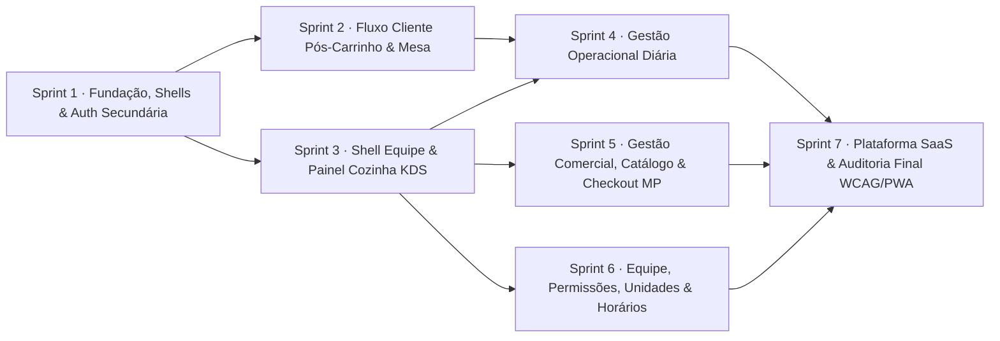

# Plano Master de Sprints — Frontend (`SAAS Restaurante MB`)

Este plano organiza a evolução visual, ergonômica e multi-tenant de **todo o `frontend/`** em **7 Sprints independentes**, pensadas para execução sequencial com **um novo chat por Sprint**, evitando esgotamento de contexto e garantindo **zero alterações em `backend/`**.

Qualquer necessidade nova de endpoint, campo de DTO ou regra de servidor identificada antes ou durante as sprints fica consolidada em [Relatório de Pendências e Evoluções para o Backend](RELATORIO-PENDENCIAS-BACKEND.md).

---

## 1. Diagnóstico do Estado Atual (`frontend/src/app`)

### 1.1 O que já está concluído no padrão Editorial Bistrô v3 + Multi-Tenant

As entregas abaixo já seguem a paleta oficial (`#faf7f2` linho, `#292521` carvão, `#a53e2b` terracota, `#30523b` sálvia), uso dinâmico de `MarcaService` (zero marca fixa ou inicial `'M'` hardcoded), assinatura editorial tátil e alvos >= `48px`:

- **Tokens globais & UI base:** [`styles.css`](../../../frontend/src/styles.css), [`ui/button.ts`](../../../frontend/src/app/ui/button.ts), [`ui/tabs.ts`](../../../frontend/src/app/ui/tabs.ts) e [`rotas/marca.service.ts`](../../../frontend/src/app/rotas/marca.service.ts).
- **Área do Cliente (Vitrine & Comanda):** [`cliente-layout.component.ts`](../../../frontend/src/app/rotas/cliente-layout.component.ts), [`cliente-layout.css`](../../../frontend/src/app/rotas/cliente-layout.css), [`vitrine.component.html`](../../../frontend/src/app/catalogo/vitrine.component.html), [`vitrine.css`](../../../frontend/src/app/catalogo/vitrine.css), [`configurador-produto.component.ts`](../../../frontend/src/app/catalogo/configurador-produto.component.ts) e [`carrinho.component.ts`](../../../frontend/src/app/carrinho/carrinho.component.ts) / [`carrinho.css`](../../../frontend/src/app/carrinho/carrinho.css) — ver [relatório de `/cardapio`](2026-11-14-cardapio-vitrine-e-comanda.md).
- **Identidade Principal & Endereços:** [`identidade.component.ts`](../../../frontend/src/app/identidade/identidade.component.ts) (`/entrar`, `/gestao/entrar`, `/conta`) e [`enderecos.component.html`](../../../frontend/src/app/delivery/enderecos.component.html) / [`enderecos.component.ts`](../../../frontend/src/app/delivery/enderecos.component.ts) — ver [relatório de `/conta` e `/entrar`](2026-11-14-conta-dossie-multi-tenant-e-seguranca.md).
- **Tema Dark Global, Shell da Equipe & Painel KDS (Sprint 3 concluída):** [`ui/tema.ts`](../../../frontend/src/app/ui/tema.ts), [`equipe-layout.component.html`](../../../frontend/src/app/rotas/equipe-layout.component.html) / [`equipe-layout.css`](../../../frontend/src/app/rotas/equipe-layout.css), [`cozinha.component.html`](../../../frontend/src/app/cozinha/cozinha.component.html) / [`cozinha.component.css`](../../../frontend/src/app/cozinha/cozinha.component.css) e [`cartao-cozinha.component.ts`](../../../frontend/src/app/cozinha/cartao-cozinha.component.ts) / [`.html`](../../../frontend/src/app/cozinha/cartao-cozinha.component.html) / [`.css`](../../../frontend/src/app/cozinha/cartao-cozinha.component.css) — ver [relatório da Sprint 3](2026-11-18-sprint3-equipe-kds-e-tema-dark.md).

### 1.2 Diagnóstico das pendências restantes (varredura estática verificada)

Uma auditoria direta em `frontend/src/` detectou **resíduos da paleta verde legada** (`#285139`, `#254d36`, `#263b30`, `#173e2c`, `#f7f8f4`, `#eaf0e5`, `#e2e7df`, `#6b7a70`, `#68736b`, `#dedfd8`, etc.), cabeçalhos sem identidade dinâmica multi-tenant, `<fieldset>`/`<ul>`/`<dl>` sem acabamento editorial e botões/inputs sem `hlmBtn` ou estilos consistentes nos seguintes arquivos:

| Grupo / Área | Arquivos afetados com lacunas visuais ou legado | Principais problemas encontrados |
| --- | --- | --- |
| **Shells globais & utilitários** | `main.ts`, `pwa.component.ts`, `pagina-informativa.component.ts`, `paginas-cliente.ts`, `ui/catalogo.component.ts` | Banner raiz/PWA e `/sem-acesso` em verde legado; cabeçalho de `/mesa` com `#285139`/`#69786c`; `/design-system` desatualizado frente ao `/cardapio` |
| **Auth secundária** | `cadastro.component.ts`, `recuperacao.component.ts`, `verificacao.component.ts`, `aceitar-convite.component.ts` | Estilos inline simples com borda `#6b7a70`, botões crus sem `hlmBtn`, sem hierarquia visual de etapas alinhada ao `/entrar` |
| **Checkout, Pedidos & Mesa Cliente** | `operacao.css`, `confirmar-pedido.*`, `meus-pedidos.*`, `pagina-pedido.component.ts`, `pedido-detalhe.*`, `pagamento-pedido.*`, `participante-mesa.*`, `disponibilidade.component.ts` | `operacao.css` e `pedido-detalhe.component.css` com tons esverdeados (`#dedfd8`, `#243228`, `#68736b`, `#8c4824`); `<dl>` técnicos e `<ul>` crus; ausência de linha do tempo visual clara de preparo |
| **Shell Equipe & Cozinha (KDS)** | `equipe-layout.*`, `cozinha.component.*`, `cartao-cozinha.component.*` | **100% em verde legado** (`equipe-layout.css` com 17 ocorrências, `cozinha.component.css` + `cartao-cozinha.component.css` com foco azul `#2558ad` e verde `#263b30`); breadcrumb com texto fixo `"Restaurante /"` |
| **Gestão Operacional** | `operacao-pedidos.*`, `paginas-gestao.ts`, `mesas.*`, `expedicao.*`, `financeiro.*`, `pendencias.*`, `vendas.component.*` | `mesas.component.css` com `#dedfd8`/`#68736b`; expedição, financeiro, pendências e relatórios usando `<ul>`/`<dl>` HTML padrão sem cartões, KPIs visuais ou `[hlmBtn]` |
| **Gestão Comercial & Config** | `gestao-catalogo.*`, `catalogo.css` (seção admin), `categoria-editor`, `produto-editor`, `adicionais-editor`, `grupos-editor`, `midia-editor`, `oferta-unidade`, `config-delivery.*`, `prazos-aceite.*`, `integracao.*` | Editores administrativos com `<fieldset>` crus e visual de formulário prototípico; falta seção administrativa preparada para identidade visual da marca (multi-tenant) condicionada a `BE-02` |
| **Gestão Corporativa (JIT)** | `acessos.component.ts`, `convites.component.ts`, `unidades.component.ts`, `funcionamento.component.ts`, `eventos-unidade.component.ts` | Estilos inline legados com `#6b7a70`, `#d9e2dc`; grade horária semanal difícil de ler em celular (`360px`); matriz de permissões extensa sem agrupamento visual claro |
| **Console Plataforma SaaS** | `plataforma-layout.component.ts`, `plataforma.component.ts`, `provisionamento.component.ts` | Layout `#f7f8f4`/`#285139` e estilos inline `#627367`/`#d4ddd5`; formulários crus sem `[hlmBtn]` ou tokens bistrô |

---

## 2. Arquitetura de Sprints e Dependências



| Sprint | Foco principal | Arquivos / Blocos | Probes e E2Es críticos |
| --- | --- | --- | --- |
| **Sprint 1** | Fundação global, `styles.css`, shells utilitários e subtelas de auth | 10 arquivos (`styles.css`, `main.ts`, `pwa`, `pagina-informativa`, `paginas-cliente`, `ui/catalogo`, 4 subcomponentes de `identidade/`) | `test_identity_forms.cjs`, `test_pwa.cjs`, `e2e-cadastro`, `e2e-recuperacao`, `e2e-verificacao`, `e2e-convites` |
| **Sprint 2** | Checkout, Checkout Pro, Meus Pedidos, Mesa Participante e Horários Públicos | 8 blocos (`operacao.css` base, `confirmar-pedido`, `meus-pedidos`, `pagina-pedido`, `pedido-detalhe` visão pessoal, `pagamento-pedido`, `participante-mesa`, `disponibilidade`) | `test_mesa_navigation_templates.cjs`, `test_order_recovery.cjs`, `test_pending_intentions.cjs`, `test_public_hours.cjs`, `test_mesa_context.cjs`, `e2e-pedidos`, `e2e-sprint04` |
| **Sprint 3** | **Tema Dark Global (Sprints 1–3)** + Shell da Equipe (`equipe-layout`) + Painel KDS (`/cozinha` por clique e arraste mouse/touch) | `styles.css`, `ui/tema.ts`, retrofit dark das Sprints 1–2.1 + `equipe-layout.*`, `cozinha.component.*`, `cartao-cozinha.component.*` | `test_route_shell.cjs`, `test_kitchen_templates.cjs`, `test_kitchen_board.cjs`, `check_contrast.cjs` |
| **Sprint 4** | Gestão Operacional Diária (Light + Dark): Pedidos, Pedido Assistido, Salão/Mesas, Expedição, Financeiro, Pendências e Vendas | 7 componentes + `paginas-gestao.ts` (`operacao-pedidos`, `pedido-detalhe` operação, `mesas`, `expedicao`, `financeiro`, `pendencias`, `vendas`) | `test_mesa_navigation_templates.cjs`, `test_mesa_pagination.cjs`, `test_order_recovery.cjs`, `test_delivery_reports.cjs`, `test_snapshot_queue.cjs` |
| **Sprint 5** | Gestão Comercial (Light + Dark): Catálogo Admin com fotos, Mídia, Delivery Config, Prazos SLA e Mercado Pago | 11 arquivos (`gestao-catalogo.*`, `catalogo.css` admin, 6 editores inline, `config-delivery`, `prazos-aceite`, `integracao`) | `test_catalog_media.cjs`, `test_catalog_recovery.cjs`, `test_catalog_cart.cjs`, `e2e-catalogo` |
| **Sprint 6** | Gestão Corporativa JIT (Light + Dark): Equipe/Permissões, Convites, Unidades, Funcionamento e Eventos | 5 componentes (`acessos`, `convites`, `unidades`, `funcionamento`, `eventos-unidade`) | `test_profile_selects.cjs`, `test_inactive_memberships.cjs`, `test_unit_schedule_templates.cjs`, `test_unit_schedule.cjs`, `test_unit_export.cjs`, `test_unit_events.cjs` |
| **Sprint 7** | Console da Plataforma SaaS (`/plataforma`) e Auditoria Final Global (Light + Dark WCAG AA, 0 legado, PWA) | 3 arquivos (`plataforma-layout`, `plataforma`, `provisionamento`) + varredura transversal completa | `test_platform_session.cjs`, `test_profile_selects.cjs`, `check_contrast.cjs`, `check-repository.py`, `build-pwa.cjs` |

---

## 3. Regras Obrigatórias para Todos os Chats de Sprint

0. **Gate Obrigatório de Abertura de Sprint — Planejamento + Representação Visual Pré-Código:**
   - Ao iniciar **qualquer Sprint**, **ANTES de modificar qualquer arquivo do sistema (`frontend/` ou código)**, o coordenador/agente deve:
     1. Inspecionar as telas reais atuais (se aplicável, gerar ou consultar as capturas `"Antes"`);
     2. Apresentar ao usuário o **planejamento detalhado da Sprint acompanhado de uma representação visual clara e interativa** do resultado proposto (com todos os menus/ações daquele escopo clicáveis, zero elementos cortados/espremidos e alternância **Tema Claro × Tema Dark** em Desktop `1280px`, Tablet `768px` e Celular `360px`);
     3. **Parar e aguardar a aprovação explícita do usuário** sobre a representação visual. **Somente após aprovada**, seguir para as alterações de código no repositório.
   - **Fluxo Git e PR:** os avanços aprovados de cada Sprint são salvos por meio de **commits locais** na branch `feat/frontend-bistro-sprints`; **o Pull Request será aberto uma única vez apenas após a conclusão de todas as sprints** (sem PRs intermediários por sprint).
1. **Proibido alterar `backend/`:** Toda alteração deste roadmap ocorre somente em `frontend/` e `docs/`. Se surgir necessidade de novo campo, filtro ou endpoint, registrar/referenciar em [RELATORIO-PENDENCIAS-BACKEND.md](RELATORIO-PENDENCIAS-BACKEND.md) e implementar fallback visual resiliente no frontend.
2. **Divisão estrita Coordenador × `artesao-ux-bistro`:**
   - O subagente especialista `artesao-ux-bistro` possui bloqueio determinístico por hook (`guardiao_frontend.cjs`) contra edições em `backend/`, `*.service.ts`, `modelos.ts`, `guardas.ts`, `*.routes.ts`, `scripts/`, `package.json`, `angular.json` e `service-worker.js`.
   - **Coordenador (chat principal da Sprint)** executa primeiro eventuais ajustes leves de camada lógica/estrutura permitida no frontend (ex.: utilitário `ui/tema.ts` sem DI, handlers de drag/touch idempotentes no KDS, computed visual em componente) **ou** conduz a integração e validação final.
   - **`artesao-ux-bistro`** executa todo o trabalho visual (`.html`, `.css`, `template:`/`styles:` inline, `MarcaService`/`HlmButton` visuais), realiza auditoria em `360px × 800`, `768px × 1024` e `1280px × 900` nos temas **Claro e Dark** e entrega o relatório obrigatório em `docs/evidencias/frontend/YYYY-MM-DD-<tela>-<melhoria>.md`.
3. **Contrato crítico de compilação JIT (`esbuild`) e probes `vm.runInNewContext`:**
   - Os scripts `scripts/test_profile_selects.cjs`, `scripts/test_identity_forms.cjs` e `scripts/test_unit_schedule_templates.cjs` compilam componentes via `esbuild` **sem** resolver `templateUrl`/`styleUrl`. Mantenha **`template:` e `styles:` inline** em:
     - `frontend/src/app/identidade/{identidade,cadastro,recuperacao,aceitar-convite,verificacao}.component.ts`
     - `frontend/src/app/acessos/{acessos,convites}.component.ts`
     - `frontend/src/app/unidades/{unidades,funcionamento}.component.ts`
     - `frontend/src/app/plataforma/{plataforma,provisionamento}.component.ts`
   - `test_kitchen_templates.cjs` e `test_mesa_navigation_templates.cjs` resolvem `templateUrl` via regex apenas para `(?:cozinha|cartao-cozinha)\.component\.ts$` e `(?:mesas|confirmar-pedido)\.component\.ts$` — não importe novos subcomponentes com `.html` externo nesses arquivos.
   - `test_route_shell.cjs` valida `inject()` com lista fechada de tokens em `equipe-layout.component.ts` — portanto o controle de tema (`Claro / Dark`) deve usar módulo utilitário reativo puro sem `inject()` (ex.: `frontend/src/app/ui/tema.ts`).
4. **Regra Multi-Tenant (White-Label) & Limpeza de Poluição Visual:** Zero nomes fixos de demonstração e zero monogramas estáticos `'M'`. Remover de todas as telas: títulos `<h1>`/`<h2>` duplicados em cascata, frases decorativas sem função operacional, UUIDs de 36 caracteres em evidência principal, timestamps ISO crus (`2026-11-18T...Z`), enums internos em caixa alta (`PEDIDO_CRIADO`) e resumos redundantes.
5. **Tema Claro & Tema Dark Bistrô Oficial (Todo o Frontend — Passado e Futuro):**
   - **Claro (`:root`):** `--background: #faf7f2`, `--card: #ffffff`, `--secondary: #f0ebe3`, `--muted: #f3eee7`, `--foreground: #292521`, `--muted-foreground: #6e6259`, `--primary: #a53e2b`, `--accent: #e8efe7` / `--accent-foreground: #30523b`, `--border: #e5ded3`.
   - **Dark (`:root[data-theme='dark']`):** `--background: #161311` (espresso profundo), `--card: #201c19` (carvão quente elevado), `--secondary: #2a2420`, `--muted: #26201d`, `--foreground: #f5efe6` (linho claro AA), `--muted-foreground: #b5a798` (taupe claro AA), `--primary: #d4563f` (botões primários `#b8432e` com texto `#ffffff` AA), `--accent: #1e3325` / `--accent-foreground: #86cfa0`, `--border: #362e29`, `--input: #4a3f38`.
   - Persistência em `localStorage('rm-tema')` com fallback em `prefers-color-scheme` e botão acessível de alternância (`Claro / Escuro`) em Cliente, Gestão, Cozinha e Plataforma.
6. **Orçamento PWA, Prettier e Node local:**
   - Orçamento em [`frontend/angular.json`](../../../frontend/angular.json): `maximumWarning: 450kB`, `maximumError: 600kB` para chunk inicial.
   - Escopo real do `npm --prefix frontend run format:check` (em [`frontend/package.json`](../../../frontend/package.json)): rodar Prettier explicitamente também nos arquivos `.html`/`.css` fora do glob padrão (ex.: `rotas/`, `catalogo/`).
   - Em ambiente Windows local com Node `v24.12.0`, validar sempre `typecheck`, `ngc -p frontend/tsconfig.app.json --noEmit`, `test:logic`, sondas JIT e build AOT + `build-pwa.cjs`.

---

## 4. Detalhamento por Sprint (com Prompt para Novo Chat)

---

### Sprint 1 — Fundação Global, Shells Utilitários & Autenticação Secundária

**Objetivo:** Eliminar todo vestígio visual do tema verde legado nas camadas globais da aplicação e uniformizar as 4 jornadas públicas secundárias de conta (`/cadastro`, `/recuperar-senha`, `/aceitar-convite`, `/verificar-email`) com o mesmo padrão editorial já entregue em `/entrar` e `/conta`.

#### Escopo de Arquivos
| Arquivo | Intervenção planejada | Restrição |
| --- | --- | --- |
| [`frontend/src/styles.css`](../../../frontend/src/styles.css) | Consolidar classes reutilizáveis leves (`.bistro-card`, `.bistro-talao`, `.bistro-eyebrow`, `.bistro-divider-dotted`, `.bistro-badge-*`, `.bistro-empty`, `.bistro-callout`) em cima das variáveis já existentes, mantendo chunk inicial controlado | Cuidar peso do bundle global (`< 450 kB`) |
| [`frontend/src/main.ts`](../../../frontend/src/main.ts) | Remover `--rm-bg:#f8f8f3`, `#e2e7df`, `#6b746c`, `#50834e` de `.app-utilities`, `.demo-banner` e `.navigation-notice`; estilizar com `--card`, `--border`, `--primary`, `--accent` | Manter bootstrap e banner de aviso intactos |
| [`frontend/src/app/pwa/pwa.component.ts`](../../../frontend/src/app/pwa/pwa.component.ts) | Estilizar banner de atualização PWA e indicador offline com tokens bistrô e alvo clicável `>= 48px` | Não alterar `service-worker.js` |
| [`frontend/src/app/rotas/pagina-informativa.component.ts`](../../../frontend/src/app/rotas/pagina-informativa.component.ts) | Substituir `#eaf0e5`, `#254d36`, `#69786c` em `/sem-acesso` e `404` por cartela editorial centrada com ícone/marca dinâmica e ação `[hlmBtn]` de retorno | Preservar `data.semAcesso` e títulos |
| [`frontend/src/app/rotas/paginas-cliente.ts`](../../../frontend/src/app/rotas/paginas-cliente.ts) | Remover `--rm-primary:#285139` / `--rm-muted:#69786c` de `PaginaMesaComponent` (migrar para `--primary`/`--muted-foreground` e serif editorial); aprimorar accordion `.service-hours` em `PaginaCardapioComponent` | Não alterar `VitrineComponent` nem lógica de rota |
| [`frontend/src/app/ui/catalogo.component.ts`](../../../frontend/src/app/ui/catalogo.component.ts) | Sincronizar `/design-system` com paleta atual (`#faf7f2`, `#292521`, `#a53e2b`, `#30523b`), exibir padrão `.bistro-select-pill`, talão, badges e foco visível | Somente leitura/referência visual |
| [`frontend/src/app/identidade/cadastro.component.ts`](../../../frontend/src/app/identidade/cadastro.component.ts) | Converter estética `#6b7a70` / botões crus para cartela em etapas (`01 · SOLICITAR CÓDIGO`, `02 · CONFIRMAR`), selo da regra `12–72 bytes`, inputs `48px`, `[hlmBtn]`, foco `#a53e2b` | **Obrigatório manter `template:` e `styles:` inline** (`test_identity_forms.cjs`) |
| [`frontend/src/app/identidade/recuperacao.component.ts`](../../../frontend/src/app/identidade/recuperacao.component.ts) | Mesmo tratamento editorial em 2 passos; preservar IDs `#codigo-recuperacao`, `#nova-senha`, `#confirmar-senha`, `#regra-senha`, texto exato `'Alterar senha'` | **Obrigatório manter `template:` e `styles:` inline** |
| [`frontend/src/app/identidade/verificacao.component.ts`](../../../frontend/src/app/identidade/verificacao.component.ts) | Mesmo tratamento editorial de envio/confirmação de código por e-mail; alinhar a `/entrar` | **Obrigatório manter `template:` e `styles:` inline** |
| [`frontend/src/app/identidade/aceitar-convite.component.ts`](../../../frontend/src/app/identidade/aceitar-convite.component.ts) | Mesmo tratamento editorial com destaque para boas-vindas de novo membro da equipe de `{{ marca.nome() }}` | **Obrigatório manter `template:` e `styles:` inline** |

#### Divisão Coordenador × `artesao-ux-bistro`
- **Coordenador:** Checar antes do dispatch se há alguma classe CSS ou importação necessária em `main.ts` / `paginas-cliente.ts`; coordenar execução do `artesao-ux-bistro` e rodar validações técnicas/JIT pós-edição.
- **`artesao-ux-bistro`:** Toda a refatoração visual dos 10 arquivos, inspeção em `360px`/`768px`/`1280px` e geração de relatório nominal `docs/evidencias/frontend/2026-MM-DD-fundacao-e-auth-secundaria.md`.

#### Dependências de Backend
Nenhuma (`cadastros`, `recuperação`, `verificação` pública e `convites/aceitar` já existem no backend).

#### Critérios de Aceite & Gates de Validação
- Zero ocorrências de hex verde legado em `main.ts`, `pagina-informativa.component.ts`, `paginas-cliente.ts` e nos 4 subcomponentes de `identidade/`.
- Executar com sucesso: `npm --prefix frontend run format:check`, `npm --prefix frontend run typecheck`, `ngc --noEmit`, `npm --prefix frontend run test:logic`, `node scripts/test_identity_forms.cjs`, `node scripts/test_pwa.cjs`, build AOT (`< 450 kB`), `node scripts/check_contrast.cjs --self-test`, auditoria Playwright `360/768/1280` sem overflow (`scrollWidth <= clientWidth`), e `python scripts/check-repository.py`.

#### Prompt Pronto para Novo Chat — Sprint 1
```markdown
Você está executando a **Sprint 1 — Fundação Global, Shells Utilitários & Autenticação Secundária** do frontend de `SAAS Restaurante MB`.

Leia antes de editar:
1. `AGENTS.md` e as skills `bistro-design-system-e-responsividade` e `bistro-auditoria-visual-e-relatorio`.
2. `docs/evidencias/frontend/PLANO-SPRINTS-FRONTEND.md` (seção Sprint 1).
3. `docs/evidencias/frontend/2026-11-14-conta-dossie-multi-tenant-e-seguranca.md` (referência visual do padrão v3 em `/entrar` e `/conta`).
4. `scripts/test_identity_forms.cjs` e `scripts/test_pwa.cjs` para conhecer todos os seletores, IDs e labels obrigatórios.

Regras invioláveis:
- Não altere nada em `backend/`.
- Preserve `template:` e `styles:` **inline** em `cadastro.component.ts`, `recuperacao.component.ts`, `verificacao.component.ts` e `aceitar-convite.component.ts` (exigido pelo `esbuild` JIT de `test_identity_forms.cjs`).
- Mantenha 100% dos IDs (`#codigo-recuperacao`, `#nova-senha`, `#confirmar-senha`, `#regra-senha`, `#codigo-cadastro`, `#senha-cadastro`, `#confirmacao-cadastro`, etc.), rótulos e fluxos funcionais existentes.
- Use o subagente `artesao-ux-bistro` para executar a camada visual no escopo exato da Sprint 1 (`frontend/src/styles.css`, `frontend/src/main.ts`, `pwa.component.ts`, `pagina-informativa.component.ts`, `paginas-cliente.ts`, `ui/catalogo.component.ts`, `cadastro/recuperacao/verificacao/aceitar-convite.component.ts`), com inspeção responsiva em `360px`, `768px` e `1280px` e relatório obrigatório em `docs/evidencias/frontend/`.

Ao finalizar, valide `format:check`, `typecheck`, `ngc --noEmit`, `test:logic`, `test_identity_forms.cjs`, `test_pwa.cjs`, build AOT (`< 450 kB`), `check_contrast.cjs --self-test` e `python scripts/check-repository.py`, atualize o índice em `docs/evidencias/frontend/README.md` e reporte literalmente cada resultado.
```

---

### Sprint 2 — Jornada Completa do Cliente: Checkout, Pagamento, Meus Pedidos & Mesa Participante

**Objetivo:** Fechar toda a jornada do consumidor após o carrinho (`confirmar-pedido`, `/pedidos`, `/pedidos/:id`, Checkout Pro Mercado Pago, `/mesa`, `/mesa/:mesaId` e `<app-disponibilidade>`) com a mesma clareza editorial tátil de `/cardapio`, removendo jargões técnicos (`versao`, `<dl>` rígido) e cores esverdeadas herdadas de `operacao.css` e `pedido-detalhe.component.css`.

#### Escopo de Arquivos
| Arquivo | Intervenção planejada | Restrição |
| --- | --- | --- |
| [`frontend/src/app/operacao.css`](../../../frontend/src/app/operacao.css) | Migrar tokens legados (`#dedfd8`, `#243228`, `#68736b`, `#8c4824`, `#eff1ec`, `#edf7ee`, `#28623e`) para variáveis oficiais (`--border`, `--foreground`, `--muted-foreground`, `--primary`, `--accent`) e adicionar estilos limpos de timeline e talão de pedido | Verificar que classes usadas em `operacao-pedidos` e `mesas` (Sprints 3–4) continuam legíveis |
| [`frontend/src/app/pedidos/confirmar-pedido.component.html`](../../../frontend/src/app/pedidos/confirmar-pedido.component.html) & [`.ts`](../../../frontend/src/app/pedidos/confirmar-pedido.component.ts) | Aplicar `[hlmBtn]` nos botões primários/secundários, transformar banner de intenção incerta em card de recuperação acolhedor, destacar seleção de forma de pagamento e mesa assistida em cartões | Não extrair novos subcomponentes externos (regex JIT de `test_mesa_navigation_templates.cjs`); preservar `nav[aria-label]` |
| [`frontend/src/app/pedidos/meus-pedidos.component.html`](../../../frontend/src/app/pedidos/meus-pedidos.component.html) & [`.ts`](../../../frontend/src/app/pedidos/meus-pedidos.component.ts) | Criar lista em formato de cartelas de pedido (número curto `#REF`, canal badge, estado semântico, timestamp amigável, botão `[hlmBtn]` para abrir detalhe), estado vazio ilustrado convidando ao `/cardapio` | Manter paginação e tratamento de erro/loading |
| [`frontend/src/app/rotas/pagina-pedido.component.ts`](../../../frontend/src/app/rotas/pagina-pedido.component.ts) | Alinhar cabeçalho e navegação de volta de `/pedidos/:id` ao topo editorial das páginas do cliente | — |
| [`frontend/src/app/pedidos/pedido-detalhe.component.html`](../../../frontend/src/app/pedidos/pedido-detalhe.component.html), [`.css`](../../../frontend/src/app/pedidos/pedido-detalhe.component.css) & [`.ts`](../../../frontend/src/app/pedidos/pedido-detalhe.component.ts) | Eliminar hex legados do CSS; criar **linha do tempo visual** para o contexto `cliente`/`mesa` (`Aguardando aceite → Na fila → Em preparo → Pronto / Em entrega → Concluído`), transformar itens e totais em **talão fiscal pontilhado**, destacar painel de pagamento/cancelamento e preservar integralmente os controles usados no modo `operacao` | Preservar seletores e fluxos de `test_order_recovery.cjs` e contexto `operacao` para a Sprint 4 |
| [`frontend/src/app/pagamentos/pagamento-pedido.component.html`](../../../frontend/src/app/pagamentos/pagamento-pedido.component.html) & [`.ts`](../../../frontend/src/app/pagamentos/pagamento-pedido.component.ts) | Transformar `<p>`/`<ul>` crus em cartão seguro de **Checkout Pro (Mercado Pago)** com contagem de expiração clara, badge de status, histórico limpo de tentativas e botão `[hlmBtn]` para iniciar tentativa | Zero alteração de regras de idempotência |
| [`frontend/src/app/mesas/participante-mesa.component.html`](../../../frontend/src/app/mesas/participante-mesa.component.html) & [`.ts`](../../../frontend/src/app/mesas/participante-mesa.component.ts) | Transformar entrada por código da mesa em card acolhedor com `marca.nome()`, destaque para comanda aberta da mesa, botões rápidos `[hlmBtn]` (`Chamar atendente`, `Pedir conta`) com confirmação clara e lista de pedidos da sessão usando o novo `app-pedido-detalhe` | Preservar contratos de `test_mesa_context.cjs`, `SessaoMesaService` e fluxo QR (`/mesa/:mesaId`) |
| [`frontend/src/app/unidades/disponibilidade.component.ts`](../../../frontend/src/app/unidades/disponibilidade.component.ts) | Estilizar seletor de unidade e quadro de horários públicos (exibido dentro de `/cardapio` em `.service-hours`) com tokens linho/terracota/sálvia e badges `Aberto agora` / `Fechado` | Preservar contratos de `test_public_hours.cjs` (texto exato esperado nas asserções de horário) |

#### Divisão Coordenador × `artesao-ux-bistro`
- **Coordenador:** Importar `HlmButton` / `MarcaService` ou adicionar computed puramente visual de etapas da timeline em `pedido-detalhe.component.ts` / `participante-mesa.component.ts` se necessário, além de conduzir probes após a etapa visual.
- **`artesao-ux-bistro`:** Redesign dos HTML/CSS e templates visuais + captura e relatório em `docs/evidencias/frontend/`.

#### Dependências de Backend
- **Opcional / Evolutiva (`BE-15`):** Filtros server-side por estado em `GET /api/v1/me/pedidos` são recomendados para clientes recorrentes (ver relatório backend), mas a Sprint 2 funciona 100% com o endpoint paginado atual.

#### Critérios de Aceite & Gates de Validação
- Executar: `format:check`, `typecheck`, `ngc --noEmit`, `test:logic`, `node scripts/test_mesa_navigation_templates.cjs`, `node scripts/test_order_recovery.cjs`, `node scripts/test_pending_intentions.cjs`, `node scripts/test_public_hours.cjs`, `node scripts/test_mesa_context.cjs`, build AOT (`< 450 kB`), inspeção `360/768/1280` e `check-repository.py`.

#### Prompt Pronto para Novo Chat — Sprint 2
```markdown
Você está executando a **Sprint 2 — Jornada Completa do Cliente (Checkout, Pagamento, Meus Pedidos & Mesa Participante)** do frontend de `SAAS Restaurante MB`.

Leia antes de editar:
1. `AGENTS.md`, `bistro-design-system-e-responsividade`, `bistro-auditoria-visual-e-relatorio`.
2. `docs/evidencias/frontend/PLANO-SPRINTS-FRONTEND.md` (seção Sprint 2) e `docs/evidencias/frontend/2026-11-14-cardapio-vitrine-e-comanda.md`.
3. Leia os scripts de teste antes de tocar os templates: `scripts/test_mesa_navigation_templates.cjs`, `scripts/test_order_recovery.cjs`, `scripts/test_pending_intentions.cjs`, `scripts/test_public_hours.cjs`, `scripts/test_mesa_context.cjs`.

Regras invioláveis:
- Zero alterações em `backend/`. Se faltar algo de servidor, registre em `docs/evidencias/frontend/RELATORIO-PENDENCIAS-BACKEND.md`.
- Atenção ao `operacao.css`: ele também estiliza telas de gestão (`operacao-pedidos`, `mesas`). Ao migrar os tokens para `#faf7f2`/`#292521`/`#a53e2b`/`#30523b`, preserve contraste e compatibilidade estrutural das classes operacionais.
- Em `confirmar-pedido.component.ts`, não importe novos subcomponentes externos (por causa do filtro JIT de `test_mesa_navigation_templates.cjs`) e preserve todas as tags `<nav aria-label="...">` e botões verificados pelos testes.
- Delegue a camada visual ao subagente `artesao-ux-bistro` para o escopo da Sprint 2, garantindo relatório completo em `docs/evidencias/frontend/` com evidências em `360px`, `768px` e `1280px`.

Finalize validando `format:check`, `typecheck`, `ngc --noEmit`, `test:logic`, todos os `test_*.cjs` da Sprint 2, build AOT (`< 450 kB`), atualização de `docs/evidencias/frontend/README.md` e `python scripts/check-repository.py`.
```

---

### Sprint 3 — Tema Dark Global (Sprints 1–3), Shell da Equipe (`equipe-layout`) & Painel KDS (`/cozinha`) *(Concluída — [relatório](2026-11-18-sprint3-equipe-kds-e-tema-dark.md))*

**Objetivo:** (1) Instituir o **Tema Dark Bistrô Editorial (`:root[data-theme='dark']`)** em todo o frontend já entregue (Sprints 1, 2 e 2.1) e nas novas áreas; (2) migrar o Shell da Equipe (`/gestao/*` e `/cozinha`) do verde legado para os tokens oficiais Claro + Dark, eliminando frases/títulos redundantes e mantendo os 13 menus organizados e claros; e (3) modernizar o **Painel KDS da Cozinha (`/cozinha`)** com botões empilhados de largura total (`100%`, zero corte/esmagamento em qualquer largura) e **avanço de status tanto por CLIQUE quanto ARRASTANDO o cartão com mouse (desktop) ou gesto touch/swipe (tablet e celular)**.

#### Escopo de Arquivos
| Arquivo | Intervenção planejada | Restrição |
| --- | --- | --- |
| [`frontend/src/styles.css`](../../../frontend/src/styles.css), `frontend/src/app/ui/tema.ts` & retrofit dark (`vitrine.css`, `carrinho.css`, `operacao.css`, `pedido-detalhe.component.css`, `cliente-layout.*`, `identidade/*`) | Adicionar tokens `:root[data-theme='dark']`, utilitário reativo sem DI (`ui/tema.ts`, persistido em `localStorage('rm-tema')`), botão `Claro / Escuro` no header de Cliente e Equipe/Cozinha, e substituir fundos/textos claros hardcoded nas telas das Sprints 1–2.1 por variáveis semânticas | Módulo `tema.ts` **não deve usar `inject()`** em `equipe-layout` para preservar `test_route_shell.cjs` |
| [`frontend/src/app/rotas/equipe-layout.component.html`](../../../frontend/src/app/rotas/equipe-layout.component.html), [`.ts`](../../../frontend/src/app/rotas/equipe-layout.component.ts) & [`.css`](../../../frontend/src/app/rotas/equipe-layout.css) | Substituir todas as ocorrências verdes por Claro/Dark Bistrô; trocar `"Restaurante /"` por `marca.nome()`; **suprimir `.page-heading` duplicado quando `cozinha === true`** (evitando empilhar `<h1>Cozinha</h1>` sobre `<h1>Produção</h1>`); remover frases decorativas (`"SEU RESTAURANTE, EM SINTONIA"`, `"Uma boa experiência começa nos detalhes."`); organizar todos os menus (`Dia a dia` e `Administração`) com ícones distintos e gaveta mobile `>= 48px` | Preservar 100% `test_route_shell.cjs`, `Abrir menu de gestão`, `.close-menu`, `Gestão do restaurante`, `Unidade da operação` e `Sair da conta` |
| [`frontend/src/app/cozinha/cozinha.component.html`](../../../frontend/src/app/cozinha/cozinha.component.html), [`.css`](../../../frontend/src/app/cozinha/cozinha.component.css) & [`.ts`](../../../frontend/src/app/cozinha/cozinha.component.ts) | Barra enxuta de `Produção` + status SSE compacto `"Ao vivo"` + `Canal` + `Ativar/Desativar som` + `Tela cheia` + `Atualizar` + toggle `Claro/Dark`; zonas de **drop (`dragover`/`drop`) nas colunas `.coluna` (desktop) e nas abas/swipe (tablet e celular)** conectadas de forma idempotente ao avanço de etapa (`Na fila` → `Em preparo` → `Prontos`) | Preservar abas `'Na fila (N)'`, `'Em preparo (N)'`, `'Prontos (N)'`, `.coluna`, combobox `'Canal'` (`>= 300px` em `360px`), `'Atualizar'`, `'Ativar som'`/`'Desativar som'` e zero novos subcomponentes externos |
| [`frontend/src/app/cozinha/cartao-cozinha.component.html`](../../../frontend/src/app/cozinha/cartao-cozinha.component.html), [`.css`](../../../frontend/src/app/cozinha/cartao-cozinha.component.css) & [`.ts`](../../../frontend/src/app/cozinha/cartao-cozinha.component.ts) | Ficha de passe KDS Claro/Dark; **botões empilhados em `width: 100%`** (primário `Iniciar pedido (N)` / `Concluir em preparo (N)` em destaque total na linha superior + secundário `Selecionar quantidades` abaixo, **nunca lado a lado espremidos**); suporte a `draggable` (mouse) + gesto horizontal touch com feedback visual (`Solte para avançar`); ocultar resumo redundante `"X na fila · 0 em preparo · 0 prontas"` quando 100% homogêneo (exibindo apenas em preparo parcial misto) e limpar textos burocráticos fixos dentro de `Histórico` | Preservar rótulos exatos de `test_kitchen_templates.cjs`: `'Selecionar quantidades'`, `'Iniciar selecionadas (N)'`, `'Concluir em preparo (N)'`, `'Iniciar pedido (N)'`, `'Concluir selecionadas (N)'`, `'Recuperar resultado da mesma ação'` e `'Unidade ... Na fila'` |

#### Divisão Coordenador × `artesao-ux-bistro`
- **Coordenador:** Criar `frontend/src/app/ui/tema.ts` (zero DI), expor helpers de tema em `ClienteLayoutComponent` e `EquipeLayoutComponent`, implementar handlers seguros/idempotentes de drag-and-drop mouse + swipe/touch entre etapas em `CozinhaComponent`/`CartaoCozinhaComponent` (respeitando `bloqueado()`, `tem('iniciar'|'concluir')` e `parcial()`), e conduzir a bateria completa de testes.
- **`artesao-ux-bistro`:** Camada visual Light + Dark em `styles.css`, retrofit dark das Sprints 1–2.1, `equipe-layout.*` e `cozinha/*` + relatório nominal Antes × Depois em `docs/evidencias/frontend/`.

#### Dependências de Backend
- **Opcional (`BE-14`):** Contadores por unidade no menu lateral podem enriquecer futuramente a barra do `equipe-layout`, sem impedir a conclusão integral desta Sprint.

#### Critérios de Aceite & Gates de Validação
- Zero ocorrências de hex verdes/azuis legados (`#173e2c`, `#285139`, `#263b30`, `#294b38`, `#2558ad`, `#f7f8f4`) em `equipe-layout.css`, `cozinha.component.css` e `cartao-cozinha.component.css`.
- Nenhum botão truncado ou espremido em `360px`, `768px`, `820px` (split-screen) ou `1280px`; avanço funcional por clique e por arraste (mouse e touch); contraste WCAG AA aprovado nos temas **Claro e Dark** (incluindo `/cardapio`, `/carrinho`, `/pedidos`, `/mesa`, `/gestao/*` e `/cozinha`).
- Passar obrigatoriamente: `format:check`, `typecheck`, `ngc --noEmit`, `test:logic`, `node scripts/test_route_shell.cjs`, `node scripts/test_kitchen_templates.cjs`, `node scripts/test_kitchen_board.cjs`, build AOT (`< 450 kB`), inspeção `360/768/1280` (Light + Dark) e `check-repository.py`.

#### Prompt Pronto para Novo Chat — Sprint 3
```markdown
Você está executando a **Sprint 3 — Tema Dark Global (Sprints 1–3), Shell da Equipe (`equipe-layout`) & Painel KDS da Cozinha (`/cozinha`)** do frontend de `SAAS Restaurante MB`.

ETAPA 0 OBRIGATÓRIA (ANTES DE EDITAR QUALQUER CÓDIGO):
- Leia os arquivos abaixo, inspecione o estado atual e apresente ao usuário o planejamento da Sprint 3 com uma **representação visual interativa** (cobrindo Tema Claro + Tema Dark, KDS com avanço por clique e arraste mouse/touch sem botões espremidos, e navegação funcional pelos menus do Shell em `1280px`/`768px`/`360px`).
- **PARE e aguarde a aprovação explícita da representação visual pelo usuário** antes de editar qualquer arquivo de sistema em `frontend/`.

Leia antes de planejar/editar:
1. `AGENTS.md`, `.agents/rules/atelier-bistro-frontend.md`, `bistro-design-system-e-responsividade`, `bistro-auditoria-visual-e-relatorio`.
2. `docs/evidencias/frontend/PLANO-SPRINTS-FRONTEND.md` (seção Sprint 3) e `docs/evidencias/painel-cozinha-2026-11-10.md`.
3. `scripts/test_route_shell.cjs`, `scripts/test_kitchen_templates.cjs` e `scripts/test_kitchen_board.cjs`.

Regras invioláveis:
- Zero alterações em `backend/` ou rotas/guardas (`equipe-layout` preserva `test_route_shell.cjs` sem novos `inject()`).
- Entregue Tema Claro + Tema Dark (`styles.css` + `ui/tema.ts` + retrofit Sprints 1–2.1 + `equipe-layout` + `cozinha`).
- Em `cozinha/`: botões empilhados em `width: 100%` (zero corte lateral), avanço por clique + drag mouse + swipe/drag touch, limpeza de resumos/textos redundantes e preservação estrita dos seletores e rótulos de `test_kitchen_templates.cjs`.
- Delegue a camada visual ao `artesao-ux-bistro` e gere o relatório nominal com prints Light + Dark em `360/768/1280` em `docs/evidencias/frontend/`.

Valide ao final `format:check`, `typecheck`, `ngc --noEmit`, `test:logic`, `test_route_shell.cjs`, `test_kitchen_templates.cjs`, `test_kitchen_board.cjs`, build AOT (`< 450 kB`), `docs/evidencias/frontend/README.md` e `python scripts/check-repository.py`.
```

---

### Sprint 4 — Gestão Operacional Diária (Light + Dark): Pedidos, Pedido Assistido, Salão/Mesas, Expedição, Financeiro, Pendências & Vendas

**Objetivo:** Dotar as telas operacionais do salão, caixa e expedição de alta velocidade de leitura e limpeza visual (nos temas **Claro e Dark**), corrigindo a emissão assistida para mesas, eliminando duplicações/UUIDs/textos ruidosos e entregando cartões táticos, etiqueta de despacho, calculadora de troco e painel de KPIs de vendas.

#### Escopo de Arquivos, Melhorias & Limpeza de Excessos
| Arquivo | O que manter + Melhorias + O que retirar de poluição | Restrição |
| --- | --- | --- |
| [`operacao-pedidos.*`](../../../frontend/src/app/pedidos/operacao-pedidos.component.html) & [`pedido-detalhe.*`](../../../frontend/src/app/pedidos/pedido-detalhe.component.html) (`operacao`) | **Melhorar:** pílulas rápidas (`Aguardando aceite`, `Em andamento`, `Prontos`, `Concluídos`), busca rápida na página, hierarquia `[hlmBtn]` (Aceitar/Servir primário vs Recusar/Cancelar destrutivo) e `nomeEvento()` legível no histórico. **Retirar:** título `<h2>` duplicado, UUID completo em destaque e enums crus (`PEDIDO_CRIADO`) com ponto solto no histórico | Preservar `test_order_recovery.cjs`, `test_snapshot_queue.cjs`, largura das `<option>` (`S03-UI06`) e manter checkboxes/motivo visíveis no DOM quando `podeCancelarOperacional()`/`pedeMotivo()` (`S03-UI04`) |
| [`paginas-gestao.ts`](../../../frontend/src/app/rotas/paginas-gestao.ts), [`vitrine.component.*`](../../../frontend/src/app/catalogo/vitrine.component.ts) & [`carrinho.component.ts`](../../../frontend/src/app/carrinho/carrinho.component.ts) (`/gestao/pedidos/novo`) | **Corrigir & Melhorar:** restaurar canal `'MESA'` em `VitrineComponent.canaisDisponiveis()` quando `!!unidadeExterna()` (pedido assistido de salão), restaurar texto literal `'Resumo confirmado. O envio do pedido exige confirmação separada.'` e modo PDV compacto. **Retirar:** hero B2C (`"Cardápio de sexta-feira..."`), corações de favoritos inúteis para equipe e saída acidental para `/carrinho` no mobile | Preservar `test_mesa_navigation_templates.cjs`, `test_mesa_pagination.cjs`, `S03-UI09` e `S03-UI12` |
| [`mesas.component.*`](../../../frontend/src/app/mesas/mesas.component.html) | **Melhorar:** cards Claro/Dark por status (Livre, Ocupada, Em fechamento), botões `Fechar` e `Copiar código` / `Imprimir QR` nos painéis de QR e comanda, destaque para chamados `AJUDA`/`CONTA` pendentes com tempo de espera via `solicitacao.criadaEm`. **Retirar:** repetição do nome da mesa em 5 botões seguidos (usar rótulo curto + `<span class="sr-only">`), título duplicado e **saldos financeiros duplicados** acima de `<app-financeiro>` | **ARMADILHA `< 0.5px` (`test_mesa_navigation_templates.cjs`):** nunca alterar `x/y/width/height` de `summary`, `.barra-conexao > button` e dos 2 `<nav>` de paginação durante transições SSE! |
| [`expedicao.component.*`](../../../frontend/src/app/delivery/expedicao.component.html) | **Melhorar:** pílulas client-side (`Todos`, `Retirada`, `Prontos p/ sair`, `Em rota`, `Com ocorrência`), `<address>` estilizado como **Etiqueta de Despacho** (destinatário, telefone clicável/copiável, endereço claro) e alerta visual de ocorrência. **Retirar:** título duplicado e borda/sombra duplicada de `<article>` envolvendo `<article>` | **Manter obrigatoriamente** `app-expedicao > section > article` contendo `<app-pedido-detalhe>` e `<address>`, e texto `/Ocorrência:.*PENDENTE/` (`S04-UI05`/`S04-UI10`) |
| [`financeiro.component.*`](../../../frontend/src/app/financeiro/financeiro.component.html) | **Melhorar:** cartela tipo extrato (Light + Dark), botão rápido `"Usar saldo restante"`, **calculadora visual automática de troco** em Dinheiro e datas formatadas (`confirmadoEm`/`criadaEm`). **Retirar:** impressão inútil de `"entregue R$ X · troco R$ 0,00"` em pagamentos `PIX`, `CARTAO` e `ONLINE` | Manter `<dl><dt><dd>` adjacentes (`xpath=following-sibling::dd[1]`) e **não ocultar `Solicitar devolução` em `<details>` fechado** (`S04-UI03`/`S04-UI08`) |
| [`pendencias.component.*`](../../../frontend/src/app/pagamentos/pendencias.component.html) | **Melhorar:** 2 painéis claros (*Reconciliação Mercado Pago* × *Fila de E-mails*), badges traduzidos, filtro rápido de falhas e link para `/gestao/pedidos`. **Retirar:** `<ul>` cru com bullets e códigos em caixa alta soltos | Manter heading `'Pendências financeiras e notificações'`, `/Capturado significa salvo localmente/` e `'Reconciliar a mesma operação'` (`S04-UI09`) |
| [`vendas.component.*`](../../../frontend/src/app/relatorios/vendas.component.html) | **Melhorar:** atalhos rápidos (`Hoje`, `Ontem`, `7 dias`, `Este mês`), 3 blocos de **KPI Cards** (Operação + Ticket Médio; Caixa Confirmado; Saldos/Reservas) e botão `Imprimir`. **Retirar:** título duplicado, `<dl>` plano único de 9 linhas e timestamp `consultadoEm` em ISO cru | Preservar `test_delivery_reports.cjs` (`dados.set(null)` imediato) e textos de `S04-UI06` |

#### Divisão Coordenador × `artesao-ux-bistro`
- **Coordenador:** Corrigir `canaisDisponiveis()` para pedido assistido e texto de resumo no carrinho, preparar helpers de filtro rápido/troco/formatação sem adicionar novos `inject()` nos componentes testados em `vm`, e validar geometria `< 0.5px` em `test_mesa_navigation_templates.cjs`.
- **`artesao-ux-bistro`:** Redesign visual Light + Dark dos 7 blocos + capturas e relatório nominal em `docs/evidencias/frontend/`.

#### Dependências de Backend
- Sprint funciona integralmente sobre as APIs já existentes. Evoluções mapeadas: **`BE-12`** (timestamps/reconhecer notificação), **`BE-13`** (quebra por canal/pagamento e CSV em `/relatorios/vendas`), **`BE-14`** (badges na sidebar), **`BE-15`** (busca/filtro server-side) e **`BE-21`** (`mesaNome` em `PedidoOperacional`).

#### Critérios de Aceite & Gates de Validação
- Executar: `format:check`, `typecheck`, `ngc --noEmit`, `test:logic`, `node scripts/test_mesa_navigation_templates.cjs`, `node scripts/test_mesa_pagination.cjs`, `node scripts/test_order_recovery.cjs`, `node scripts/test_delivery_reports.cjs`, `node scripts/test_snapshot_queue.cjs`, build AOT (`< 450 kB`), inspeção `360/768/1280` (Light + Dark) e `check-repository.py`.

#### Prompt Pronto para Novo Chat — Sprint 4
```markdown
Você está executando a **Sprint 4 — Gestão Operacional Diária (Pedidos, Pedido Assistido, Mesas/Salão, Expedição, Financeiro, Pendências & Relatórios de Vendas)** do frontend de `SAAS Restaurante MB` (Light + Dark).

ETAPA 0 OBRIGATÓRIA (ANTES DE EDITAR QUALQUER CÓDIGO):
- Leia os arquivos abaixo, inspecione o estado atual das telas e apresente ao usuário o planejamento da Sprint 4 com uma **representação visual interativa** (Light + Dark em `1280px`/`768px`/`360px`) antes de alterar o sistema.
- **PARE e aguarde a aprovação explícita da representação visual pelo usuário** antes de editar qualquer arquivo em `frontend/`.

Leia antes de planejar/editar:
1. `AGENTS.md`, `.agents/rules/atelier-bistro-frontend.md`, `bistro-design-system-e-responsividade`, `bistro-auditoria-visual-e-relatorio`.
2. `docs/evidencias/frontend/PLANO-SPRINTS-FRONTEND.md` (seção Sprint 4).
3. Leia obrigatoriamente `scripts/test_mesa_navigation_templates.cjs`, `scripts/test_mesa_pagination.cjs`, `scripts/test_order_recovery.cjs`, `scripts/test_delivery_reports.cjs` e `scripts/test_snapshot_queue.cjs`.

Regras invioláveis:
- Zero alterações em `backend/`. Entregue todas as telas funcionando em **Tema Claro e Tema Dark**.
- Corrija o canal `'MESA'` em `/gestao/pedidos/novo` (`unidadeExterna()`) e preserve estritamente a geometria `< 0.5px` de `test_mesa_navigation_templates.cjs`, a estrutura `app-expedicao > section > article` e os `<dt>/<dd>` adjacentes de `financeiro`.
- Elimine títulos duplicados, UUIDs/ISOs crus, botões verbosos repetindo nome da mesa (use `.sr-only`) e saldos duplicados.
- Delegue a etapa visual ao `artesao-ux-bistro` e gere o relatório nominal em `docs/evidencias/frontend/` com prints Light + Dark em `360px`, `768px` e `1280px`.

Valide `format:check`, `typecheck`, `ngc --noEmit`, `test:logic`, todos os probes `test_*.cjs` desta Sprint, build AOT (`< 450 kB`), atualização de `docs/evidencias/frontend/README.md` e `python scripts/check-repository.py`.
```

---

### Sprint 5 — Gestão Comercial & Operação de Loja (Light + Dark): Catálogo Admin, Mídia, Delivery Config, Prazos & Mercado Pago

**Objetivo:** Padronizar toda a gestão comercial (Light + Dark), enriquecendo a listagem administrativa de produtos com fotos/preços/status, eliminando `<fieldset>` triplamente aninhados e inputs empilhados desnecessários, traduzindo segundos em minutos nos prazos de aceite e destacando a saúde da conexão Mercado Pago.

#### Escopo de Arquivos, Melhorias & Limpeza de Excessos
| Arquivo | O que manter + Melhorias + O que retirar de poluição | Restrição |
| --- | --- | --- |
| [`gestao-catalogo.*`](../../../frontend/src/app/catalogo/gestao-catalogo.component.html) & [`catalogo.css`](../../../frontend/src/app/catalogo/catalogo.css) *(admin)* | **Melhorar:** cards de produto com **miniatura `48×48`** (`/api/v1/midias/:id` ou monograma), categoria, badges (`Ativo`/`Inativo`, `Sugestão`, preço e disponibilidade na filial) e filtro rápido por nome/categoria/status. **Retirar:** título duplicado e repetição do nome do prato nos botões (usar `.sr-only`) | **Cuidado crítico:** `catalogo.css` é compartilhado com `/cardapio` — validar zero regressão na vitrine do cliente (Light + Dark)! |
| [`categoria-editor`](../../../frontend/src/app/catalogo/categoria-editor.component.ts), [`produto-editor`](../../../frontend/src/app/catalogo/produto-editor.component.ts), [`adicionais-editor`](../../../frontend/src/app/catalogo/adicionais-editor.component.ts), [`grupos-editor`](../../../frontend/src/app/catalogo/grupos-editor.component.ts), [`midia-editor`](../../../frontend/src/app/catalogo/midia-editor.component.ts) & [`oferta-unidade`](../../../frontend/src/app/catalogo/oferta-unidade.component.ts) | **Melhorar:** painéis com pares de campos curtos lado a lado em desktop (Preço + Máximo, Mínimo + Máximo, Acréscimo + Limite) e moldura limpa de upload. **Retirar:** 3 níveis de `<fieldset>` encaixotados pesados e texto técnico excessivo de pixels/MiB em destaque | Preservar `test_catalog_media.cjs`, `test_catalog_recovery.cjs`, `test_catalog_cart.cjs` e todos os labels/mensagens de `e2e-catalogo` |
| [`config-delivery.*`](../../../frontend/src/app/delivery/config-delivery.component.html) | **Melhorar:** resumo superior (regiões ativas + faixa de taxas + expiração online), cards horizontais compactos (`CEP inicial` + `CEP final`; `Taxa` + `Mínimo`) e aviso visual não-bloqueante de CEP sobreposto. **Retirar:** 5 inputs empilhados em coluna única por região e título duplicado | **Não desabilitar submit** em sobreposição de CEP (`S04-UI02` testa erro do servidor) |
| [`prazos-aceite.*`](../../../frontend/src/app/unidades/prazos-aceite.component.html) | **Melhorar:** conversão visual automática ao lado do input (`300 s · 5 min`), pílulas de presets rápidos (`Ágil 2m/5m`, `Padrão 3m/8m`, `Pico 5m/15m`) e linha visual de SLA. **Retirar:** título `<h3>` duplicado e campos soltos sem agrupamento | Manter inputs aceitando segundos arbitrários (`'1'`, `'4'`) para `S03-UI05` |
| [`integracao.*`](../../../frontend/src/app/pagamentos/integracao.component.html) | **Melhorar:** card OAuth com selo de estado, `vendedor`, validade formatada (`expiraEm` já retornado pela API!) e feedback para `?conexao=concluida`. **Retirar:** layout cru sem hierarquia | Manter heading `'Mercado Pago do restaurante'` e textos de `S04-UI07` |

#### Divisão Coordenador × `artesao-ux-bistro`
- **Coordenador:** Preparar helpers visuais leves (busca client-side no catálogo, formatação de minutos em prazos e data de expiração OAuth) e validar sondas de catálogo.
- **`artesao-ux-bistro`:** Redesign visual Light + Dark de todos os editores de catálogo, delivery config, prazos e Mercado Pago + relatório em `docs/evidencias/frontend/`.

#### Dependências de Backend
- **`BE-02` (Marca multi-tenant admin)**, **`BE-11` (Desconectar Mercado Pago)** e **`BE-24` (`exigePontoCarne`/`aceitaObservacao` no cadastro de produto)**: documentados em [RELATORIO-PENDENCIAS-BACKEND.md](RELATORIO-PENDENCIAS-BACKEND.md).

#### Critérios de Aceite & Gates de Validação
- Executar: `format:check` (e prettier em `catalogo/`), `typecheck`, `ngc --noEmit`, `test:logic`, `node scripts/test_catalog_media.cjs`, `node scripts/test_catalog_recovery.cjs`, `node scripts/test_catalog_cart.cjs`, build AOT (`< 450 kB`), inspeção `360/768/1280` Light + Dark (incluindo `/cardapio`) e `check-repository.py`.

#### Prompt Pronto para Novo Chat — Sprint 5
```markdown
Você está executando a **Sprint 5 — Gestão Comercial & Configuração de Loja (Catálogo Admin, Mídia, Delivery, Prazos e Mercado Pago)** do frontend de `SAAS Restaurante MB` (Light + Dark).

ETAPA 0 OBRIGATÓRIA (ANTES DE EDITAR QUALQUER CÓDIGO):
- Leia os arquivos abaixo, inspecione o estado atual das telas e apresente ao usuário o planejamento da Sprint 5 com uma **representação visual interativa** (Light + Dark em `1280px`/`768px`/`360px`) antes de alterar o sistema.
- **PARE e aguarde a aprovação explícita da representação visual pelo usuário** antes de editar qualquer arquivo em `frontend/`.

Leia antes de planejar/editar:
1. `AGENTS.md`, `.agents/rules/atelier-bistro-frontend.md`, `bistro-design-system-e-responsividade`, `bistro-auditoria-visual-e-relatorio`.
2. `docs/evidencias/frontend/PLANO-SPRINTS-FRONTEND.md` (seção Sprint 5) e `docs/evidencias/frontend/RELATORIO-PENDENCIAS-BACKEND.md` (`BE-02`, `BE-11`, `BE-24`).
3. Leia `scripts/test_catalog_media.cjs`, `scripts/test_catalog_recovery.cjs` e `scripts/test_catalog_cart.cjs`.

Regras invioláveis:
- Zero alterações em `backend/`. Suporte completo a **Tema Claro e Tema Dark**.
- Atenção ao `frontend/src/app/catalogo/catalogo.css`: valide `/cardapio` (Light + Dark) em `360px`/`1280px` após editar.
- Enriquecer cards de produtos com miniatura/preço/status, compactar faixas de CEP em grid horizontal, traduzir segundos em minutos nos prazos e exibir `expiraEm` no Mercado Pago, preservando todos os contratos de `e2e-catalogo` e `S04-UI02`/`S04-UI07`.

Valide `format:check` + prettier em `catalogo/`, `typecheck`, `ngc --noEmit`, `test:logic`, `test_catalog_media.cjs`, `test_catalog_recovery.cjs`, `test_catalog_cart.cjs`, build AOT (`< 450 kB`), atualização de `docs/evidencias/frontend/README.md` e `python scripts/check-repository.py`.
```

---

### Sprint 6 — Gestão Corporativa & Segurança (Light + Dark): Equipe/Acessos, Convites, Unidades, Horários & Auditoria

**Objetivo:** Modernizar as telas administrativas de governança (`/gestao/equipe`, `/gestao/equipe/convites`, `/gestao/unidades`, `/gestao/atualizacoes`) nos temas **Claro e Dark**, removendo UUIDs/ISOs crus do destaque visual e organizando a matriz de permissões e a grade horária sem quebrar nenhum contrato JIT `esbuild`.

#### Escopo de Arquivos, Melhorias & Limpeza de Excessos
| Arquivo | O que manter + Melhorias + O que retirar de poluição | Restrição |
| --- | --- | --- |
| [`acessos.component.ts`](../../../frontend/src/app/acessos/acessos.component.ts) | **Melhorar:** layout em 2 colunas no desktop (Matriz de Permissões × Equipe Cadastrada), busca rápida de funcionário, contador de permissões ativas e link clicável para `/gestao/equipe/convites`. **Retirar:** bordas legadas `#6b7a70` e códigos técnicos soltos | **INLINE obrigatório!** Preservar `test_profile_selects.cjs` (apenas funcionários usam `<article>`, 1 checkbox/select por card fechado, `Salvar funcionário` abaixo de `Editar unidades atribuídas`) e `test_inactive_memberships.cjs` |
| [`convites.component.ts`](../../../frontend/src/app/acessos/convites.component.ts) | **Melhorar:** cards Claro/Dark com e-mail, cargo, validade formatada em PT-BR, filtro rápido (`Pendentes` / `Todos`) e botão discreto `Copiar ID`. **Retirar:** **UUID de 36 caracteres** e timestamp ISO do destaque principal, aviso fixo de ambiente fictício e protagonismo excessivo da busca técnica por UUID | **INLINE obrigatório!** Preservar `test_profile_selects.cjs`, `test_pending_intentions.cjs` e `e2e-convites` (`form.first()` sendo reautenticação e form `Identificador do convite` acessível no DOM) |
| [`unidades.component.ts`](../../../frontend/src/app/unidades/unidades.component.ts) & [`funcionamento.component.ts`](../../../frontend/src/app/unidades/funcionamento.component.ts) | **Melhorar:** cartela compacta de reautenticação/nova filial, presets/seleção rápida de fuso IANA e grade semanal de turnos legível em `360px` com destaque claro para virada de madrugada. **Retirar:** blocos extensos de texto repetitivo | **INLINE obrigatório!** Preservar `test_unit_schedule_templates.cjs`, `test_unit_schedule.cjs` e `test_profile_selects.cjs` |
| [`eventos-unidade.component.ts`](../../../frontend/src/app/unidades/eventos-unidade.component.ts) | **Melhorar:** timeline visual limpa de auditoria cadastral (Light + Dark) com timestamps formatados em PT-BR e card de exportação JSON. **Retirar:** textos redundantes soltos | Preservar `test_unit_export.cjs`, `test_unit_events.cjs` e `data-testid="unidade-atual"` |

#### Divisão Coordenador × `artesao-ux-bistro`
- **Coordenador:** Garantir compatibilidade 100% JIT após edições e rodar `test_profile_selects.cjs`, `test_unit_schedule_templates.cjs`, `test_inactive_memberships.cjs`, `test_unit_schedule.cjs`, `test_unit_export.cjs` e `test_unit_events.cjs`.
- **`artesao-ux-bistro`:** Redesign visual inline Light + Dark nos 5 componentes + relatório em `docs/evidencias/frontend/`.

#### Dependências de Backend
- **`BE-10` (Nome do funcionário em `/api/v1/equipe`):** melhoria futura para exibir `nome + email`.

#### Critérios de Aceite & Gates de Validação
- Executar: `format:check`, `typecheck`, `ngc --noEmit`, `test:logic`, todas as sondas `test_*.cjs` da Sprint 6, build AOT (`< 450 kB`), inspeção `360/768/1280` (Light + Dark) e `check-repository.py`.

#### Prompt Pronto para Novo Chat — Sprint 6
```markdown
Você está executando a **Sprint 6 — Gestão Corporativa & Segurança (Equipe/Acessos, Convites, Unidades, Funcionamento e Eventos)** do frontend de `SAAS Restaurante MB` (Light + Dark).

ETAPA 0 OBRIGATÓRIA (ANTES DE EDITAR QUALQUER CÓDIGO):
- Leia os arquivos abaixo, inspecione o estado atual das telas e apresente ao usuário o planejamento da Sprint 6 com uma **representação visual interativa** (Light + Dark em `1280px`/`768px`/`360px`) antes de alterar o sistema.
- **PARE e aguarde a aprovação explícita da representação visual pelo usuário** antes de editar qualquer arquivo em `frontend/`.

Leia antes de planejar/editar:
1. `AGENTS.md`, `.agents/rules/atelier-bistro-frontend.md`, `bistro-design-system-e-responsividade`, `bistro-auditoria-visual-e-relatorio`.
2. `docs/evidencias/frontend/PLANO-SPRINTS-FRONTEND.md` (seção Sprint 6).
3. Leia obrigatoriamente `scripts/test_profile_selects.cjs`, `scripts/test_inactive_memberships.cjs`, `scripts/test_unit_schedule_templates.cjs`, `scripts/test_unit_schedule.cjs`, `scripts/test_unit_export.cjs` e `scripts/test_unit_events.cjs`.

Regras invioláveis (CRÍTICO — compilação JIT `esbuild`):
- Zero alterações em `backend/`. Suporte completo a **Tema Claro e Tema Dark**.
- **MANTENHA `template:` e `styles:` INLINE** em `acessos.component.ts`, `convites.component.ts`, `unidades.component.ts` e `funcionamento.component.ts`.
- Preserve literalmente todos os seletores, contagens de `<article>`/`<fieldset>` e posições relativas exigidas por `test_profile_selects.cjs` e `test_unit_schedule_templates.cjs`, retirando UUIDs/ISOs crus do destaque visual.

Valide `format:check`, `typecheck`, `ngc --noEmit`, `test:logic`, todas as sondas `test_*.cjs` da Sprint 6, build AOT (`< 450 kB`), atualização de `docs/evidencias/frontend/README.md` e `python scripts/check-repository.py`.
```

---

### Sprint 7 — Console da Plataforma SaaS (`/plataforma`) & Auditoria Final Global (Light + Dark WCAG AA, Zero Legado e PWA)

**Objetivo:** Unificar o **Console do Operador SaaS** (`/plataforma`) aos temas **Claro e Dark** da plataforma, limpando excessos visuais nos cards de tenants e provisionamento, e conduzir a **auditoria final ponta a ponta de todo o frontend** nos dois temas.

#### Escopo de Arquivos
| Arquivo | Intervenção planejada | Restrição |
| --- | --- | --- |
| [`frontend/src/app/rotas/plataforma-layout.component.ts`](../../../frontend/src/app/rotas/plataforma-layout.component.ts) | Substituir tokens verdes legados por cabeçalho editorial Claro + Dark com seletor de tema e identificação `Console SaaS · Operação da Plataforma` | — |
| [`frontend/src/app/plataforma/plataforma.component.ts`](../../../frontend/src/app/plataforma/plataforma.component.ts) | Eliminar `#627367`/`#d4ddd5`, estilizar login, reautenticação e cards de empresas (Light + Dark) com badges comerciais limpos e metadados secundários discretos | **INLINE obrigatório!** Preservar `test_platform_session.cjs` e `test_profile_selects.cjs` (`'Identificador da empresa'`, `'Consultar estado comercial'`) |
| [`frontend/src/app/plataforma/provisionamento.component.ts`](../../../frontend/src/app/plataforma/provisionamento.component.ts) | Eliminar `#627367`/`#d4ddd5`, organizar formulário multi-tenant e status do worker em cards claros (Light + Dark) | **INLINE obrigatório!** Preservar contratos de `e2e-provisionamento` |

#### Auditoria Transversal Obrigatória da Sprint 7 (Fechamento do Frontend Completo)
1. **Varredura estática global (`0` resíduos verdes legados)** em todo `frontend/src/`.
2. **Varredura White-Label Multi-Tenant** (`0` marcas/iniciais fixas).
3. **Validação completa Light + Dark WCAG 2.2 AA e Responsividade (`360px`, `768px`, `1280px`)** em todas as rotas de Cliente, Gestão, Cozinha e Plataforma, com bundle AOT + PWA `< 450 kB` e `python scripts/check-repository.py`.
4. **Handoff para o Backend:** Atualizar o status final em [RELATORIO-PENDENCIAS-BACKEND.md](RELATORIO-PENDENCIAS-BACKEND.md) para execução posterior das pendências de servidor e abertura do Pull Request único final.

#### Prompt Pronto para Novo Chat — Sprint 7
```markdown
Você está executando a **Sprint 7 (Final) — Console da Plataforma SaaS (`/plataforma`) & Auditoria Global do Frontend (Light + Dark)** de `SAAS Restaurante MB`.

ETAPA 0 OBRIGATÓRIA (ANTES DE EDITAR QUALQUER CÓDIGO):
- Leia os arquivos abaixo, inspecione o estado atual das telas e apresente ao usuário o planejamento da Sprint 7 com uma **representação visual interativa** (Light + Dark em `1280px`/`768px`/`360px`) antes de alterar o sistema.
- **PARE e aguarde a aprovação explícita da representação visual pelo usuário** antes de editar qualquer arquivo em `frontend/`.

Leia antes de planejar/editar:
1. `AGENTS.md`, `.agents/rules/atelier-bistro-frontend.md`, `bistro-design-system-e-responsividade`, `bistro-auditoria-visual-e-relatorio`.
2. `docs/evidencias/frontend/PLANO-SPRINTS-FRONTEND.md` (seção Sprint 7) e `docs/evidencias/frontend/RELATORIO-PENDENCIAS-BACKEND.md`.
3. Leia `scripts/test_platform_session.cjs`, `scripts/test_profile_selects.cjs` e `scripts/check_contrast.cjs`.

Regras invioláveis:
- Zero alterações em `backend/`. Suporte completo a **Tema Claro e Tema Dark**.
- **MANTENHA `template:` e `styles:` INLINE** em `plataforma.component.ts` e `provisionamento.component.ts`. Preserve `'Identificador da empresa'` e `'Consultar estado comercial'`.
- Após concluir `/plataforma`, execute a auditoria transversal completa (0 legado verde, 0 marcas fixas, todas as sondas `test_*.cjs`, contraste Light + Dark, responsividade `360/768/1280`, build AOT + PWA `< 450 kB` e `python scripts/check-repository.py`).
```
